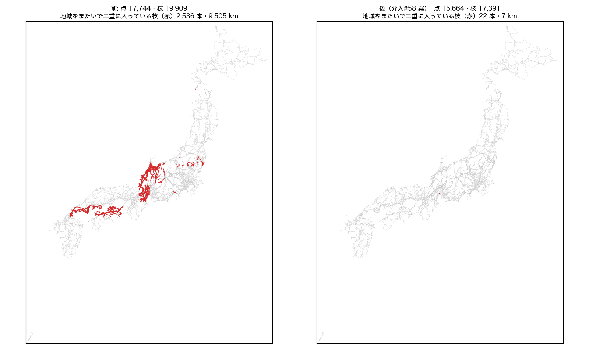
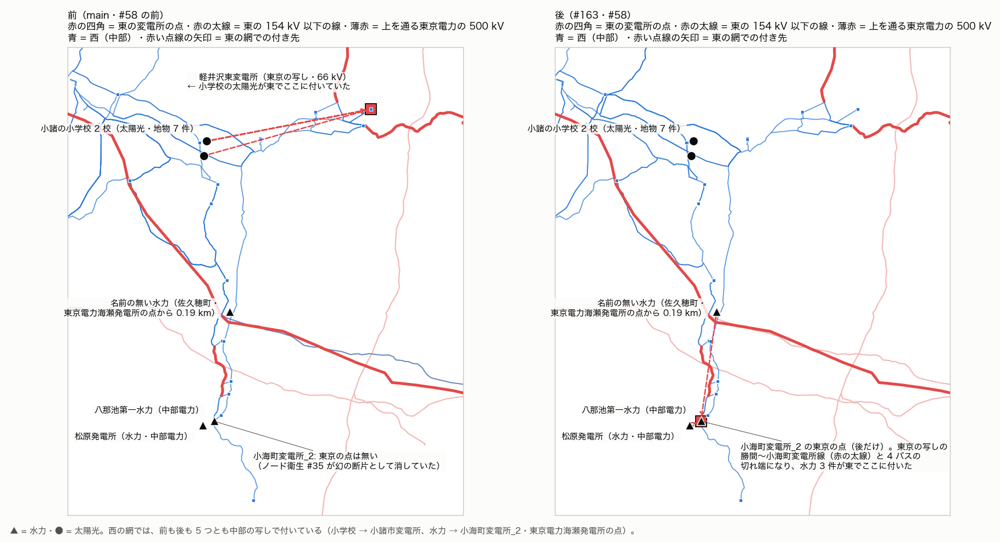

# 正典で、地域をまたぐ写しを 1 つにまとめる（介入#58 案・設計と試算・2026-11-07）

**正典を変える直し。採用は先生の確認のあと**（この PR のマージ = 採用）。先生の「設計も進めて」（2026-11-07）に応えるもの。

## なにが起きているか

- 正典は、地域ごとに OSM を取り出して作り（`data/<地域>_lines.geojson`、取り出しは地域の外接矩形）、全国でつなげている（`scripts/build_editor_data.py` の `build_national`）。
- 外接矩形は重なっていて（例: 東京の経度 138.4〜140.9 と中部の 136.0〜139.2）、境の線は **2 つの地域の取り出しに丸ごと入る**（取り出しは線を切らない）。
- `build_national` は地域ごとの点と枝をつなげるだけで、**写しをまとめていない**。

今の正典での数:

| | 数 |
|---|---:|
| 頂点まで同じ形の枝が、2 つ以上の地域から出ている組 | 2,513 |
| うち両端の点まで同じ組 | 2,449 |
| 地域の違う点が同じ座標に並ぶ所 | 2,040 |
| 正典の線の延長（写しを二重に数えた分を含む） | 90,971 km |

写しがあると、次の 3 つのことが起きる。

1. **正典の数が水増しされる**（点・枝・延長・地図の線が二重）。
2. **電圧が食い違う写しが、潮流計算で「無い変圧器」になる**。電圧の推し量りは地域ごとなので、片方だけ電圧が分からない、分かる電圧どうしが違う（66 kV と 77 kV など）ことがある。潮流計算の網は、同じ座標の電圧の違う点を変圧器でつなぐ（#155 の点検で見つけた分岐点の変圧器 96 台のうち 51 台）。
3. 電圧が同じ写しは、潮流計算の側で 1 つのバス・1 本の線にまとめている（B 案、#21）ので、潮流そのものへの効き目は小さい。

## 直し方（`src/topology/region_dedup.py`、`build_editor_data.py` が全国をまとめる前に呼ぶ）

- **写しの根拠**: 枝の**両端の点と形**（頂点の並び。小数 5 桁、向きをそろえる）が同じで、2 つ以上の地域から出ている。
  - 形だけでは足りなかった（下の「試算で踏んだこと」）。端の結び方が違うものは、まだ写しと決めない（控えめな側）。
- **残す写し**: 線の中ほどの頂点の座標の**領土**（都道府県→エリア、正典の #5 と同じ `area_of_coord`）の地域。その地域が写しの中に無ければ、地域の並びの最初。
- **電圧**: 残す写しが電圧不明で、ほかの地域の写しの電圧が 1 つに決まるなら、その電圧を採る（`kv_from_copy`、帳簿に書く）。分かる電圧どうしが違うときは、残す写し（領土の地域の推し量り）のまま。
- **併架**（同じ形で電圧の違う回線）: 地域ごとにひとまとまりで扱い、残す地域の回線をそのまま残す。
- **点**: 写しを落として枝が 1 本も付かなくなった点は消す。変電所の点は、ほかの地域に同じ座標の点があるときだけ消す。まだ枝の付く点は残す。
- **地域ごとの正典**（`docs/data/built/<地域>.json`）は変えない。変えるのは全国の正典（`all.json`）だけ。
- **帳簿**: `docs/data/fragments/region_dedup_ledger.json`（組の数・種類・地域の組・電圧を補った枝・電圧が食い違う組の一覧）。実行ログ「介入#58 region-dedup」。
- **無効化**: `build_editor_data.py --no-region-dedup`／環境変数 `AJG_REGION_DEDUP=0`。

## 試算で踏んだこと（最初の版）

最初の版は「形が同じ」だけを写しの根拠にした。正典の全段を回すと、**西の主系統のバスが 7,467 → 6,959**（N-1 の主成分）になり、**徳島の 469 バス（需要 4,025 MW・発電 3,836 MW）が西の主系統から外れた**。

- 原因: 同じ形の写しでも、端をどの点に結ぶかが地域の取り出しで違う。阿波変電所〜鉢変電所線（500 kV）は、中国の写しは線の端の分岐点で終わり、四国の写しは阿南周波数変換所の点に結ばれていた（数十 m 違う）。
- 境の網は、それぞれの地域の結び方を混ぜてつながっていた。片方を落とすと、潮流計算の網（座標がぴったり同じ点だけをつなぐ）が切れる。
- 正典の `main` の印は、地域をまたいで約 110 m 以内の同じ電圧の点を結ぶ「つなぎ」込みで数えるので、この切れ目が見えなかった。
- → 写しの根拠を「両端の点まで同じ」に絞った（組 2,513 → 2,449）。

## 試算（前と後）

前 = main（介入#57 まで入った正典と出力）、後 = この直しを入れて `regenerate_all.py` の全段（30 段すべて ok）を回したもの。比べ方は `canon_region_dedup_2026-11-07/compare.py`（→ `compare.json`）。

### 正典

| | 前 | 後 |
|---|---:|---:|
| 点 | 17,744 | 15,664 |
| 枝 | 19,909 | 17,391 |
| 変電所の点 | 9,274 | 8,367 |
| 線の延長 | 90,971 km | **81,003 km**（−11%） |
| 地域の違う点が同じ座標に並ぶ所 | 2,040 | 277 |
| 地域をまたいで二重に入っている枝 | 2,536 本・9,505 km | 22 本・7 km |

落とした写しは 2,449 組・2,549 本。地域の組は 中部と北陸 700・中部と関西 609・中国と四国 472・中国と九州 362・東北と東京 133・中部と東京 91 など。電圧が同じ写しが 2,404 組、電圧の分からない写しをほかの写しの電圧で補ったのが 7 組、帳簿の種類が `kv_differs` の組が 38 組（帳簿 `region_dedup_ledger.json` の `kv_rows`）。`kv_differs` の 38 組のうち 30 組は、残す写し（領土の地域）の電圧が分かっていて、ほかの写しが電圧不明なだけで、食い違いではない。分かる電圧どうしが本当に違うのは 8 組で、残す写しの電圧を採った（2026-11-07 訂正。前は「電圧が食い違うまま残す写しを採ったのが 38 組」と書いていた）。

### 潮流（全規模、既定の設定）

| | 東 | 西 |
|---|---|---|
| バス | 6,245 → 6,228 | 7,983 → 7,965 |
| 線 | 6,443 → 6,432 | 8,116 → 8,097 |
| 変圧器（うち #43a） | 670（28）→ 663（23） | 990（38）→ 979（32） |
| 主系統から外れたバス | 0 | 0 |
| AC | 解ける → 解ける | 解ける → 解ける |
| 最低電圧 | 0.8561 → 0.8561 | 0.7277 → 0.7277 |
| 最大負荷率 | 894.47 → 894.49% | 605.59 → 432.36%（下の注） |
| 損失 | 1,330.5 → 1,331.3 MW | 1,135.3 → 1,104.8 MW |

- 北海道・沖縄は変わらない。需要の合計は 4 島とも同じ。
- 潮流計算の側の B 案（#21）がまとめていた重複は、西で点 2,347 → 456・枝 2,031 → 17 に減った。写しが正典の段で先にまとまったので、ほぼそのまま置き換わっている。
- **西の最大負荷率の下がり方は、写しの直しの効き目ではない**。天草の 66 kV の網には正典の中に上位からの降圧点が無く、介入#37（仮の給電）が「塊の中で需要の最も大きいバス」をいちばん近い 275 kV 以上のバスにつないでいる。天草の塊では志岐変電所と浄南町変電所の需要が同じで、どちらを選ぶかがバスの番号の順で決まっていた。写しの直しで点の数が減って番号がずれ、選ぶバスが志岐（2.6 km）から浄南町（12 km）に替わった。そのため 66 kV の志岐〜一の勢線の潮流が 367 → 184 MW になった（前の 686% はこの線）。天草の網と発電機の出力は前も後も同じことを確かめた。#37 の選び方が並び順に依ることは、別の件で直す。
- 東の発電機の数は 8,233 → 8,229、容量は 99,038 → 99,188 MW。小諸の小学校 2 校の太陽光（地物 7 件、各 0.1 MW）が外れ、佐久の水力 3 件（容量は既定値の 50 MW）が東に結ばれた。**向きを確かめた結果は下の「佐久の水力と小諸の太陽光」**: 小諸が外れたのは正しく、佐久の水力を東に結んだのは誤り（2026-11-09）。

### N-1（実在の線の開放）

| | 東 | 西 |
|---|---|---|
| 主成分のバス | 5,804 → 5,795 | 7,467 → 7,449 |
| 新たな過負荷を生む開放 | 126 → 125 | 246 → 226 |
| うち 120% を超える | — | 55 → 58 |
| 分離される需要の合計 | 11,868 → 11,784 MW | 32,475 → 32,434 MW |

### 変電所の無い点の変圧器（#155 の点検）

潮流計算の網で両側が変電所でない変圧器は、**83 → 69 台**（電圧の分からない写し 51 → 38・作った枝 16 → 15）。

### 検査

固定していた数が 4 つ変わった（どれも写しをまとめた結果）。

- `test_not_in_service_lines`: 西谷八幡線に当たる枝 6 → 3（中国・九州の二重抽出 3 組が 1 つに）
- `test_topology_coords`: 1 つの座標に複数の点がある所で消える点 3,000 余り → 2,295
- `test_junction_trafos`: 点検の一覧（`mixed_kv_review.json`）の正典での形が今の正典と違う → 写真で確かめた時点の値は `canon_at_review`・`powerflow_at_review` に残し、今の値を書き直した
- `test_canonical_islands`（週次）: 東西の網の規模の記録（東は #57 のマージのあとも 676 のままで古かった）

## 佐久の水力と小諸の太陽光（先生の問い、2026-11-09）

問い: 佐久の水力 3 件が東に結ばれ、小諸の太陽光が東から外れたのは、その向きで正しいか。

**答え: 小諸の太陽光が東から外れたのは正しい。佐久の水力 3 件を東に結んだのは誤り。** 水力 3 件は、#58 のあとに東に残った 4 バスの切れ端に付いていた。西の網には前から付いているので、東と西で二重に数えている。

### どこに付いているか

前 = main（f54ac357）の正典、後 = この PR の正典。網を作るコードは同じ（この PR は潮流のコードを変えていない）。調べ方は `canon_region_dedup_2026-11-07/gens_dump.py`・`saku.py`（→ `saku.json`）。

| 発電所（OSM の地物） | 場所 | 東・前 | 東・後 | 西（前も後も同じ） |
|---|---|---|---|---|
| 小諸市立東小学校・美南ガ丘小学校（太陽光、地物 7 件） | 小諸市 | 軽井沢東変電所（東京の写し、13 km 東） | なし | 小諸市変電所（0.7 km） |
| 八那池第一水力発電所 | 小海町 | なし | 小海町変電所_2（東京の点） | 小海町変電所_2（中部の点） |
| 松原発電所（水力） | 小海町 | なし | 小海町変電所_2（東京の点） | 小海町変電所_2（中部の点） |
| 名前の無い水力（住所から「大字高野町佐久穂町発電所」） | 佐久穂町 | なし | 小海町変電所_2（東京の点） | 東京電力海瀬発電所の点（0.19 km） |

5 つとも、東京の取り出し（`data/tokyo_plants.geojson`）と中部の取り出し（`chubu_plants.geojson`）の両方に同じ osm_id で入っている。発電所の写しは島の中では領土で 1 つにまとめる（`attach_generators` の `territory`）が、島をまたいではまとめない。そのため、東の網の 20 km 以内に変電所の点があると、東京の写しが東に付く。

- 前は、小学校が東と西の両方に付いていた（二重）。#58 で東京の写しの軽井沢東変電所の点が落ち、東には付かなくなった。
- 後は、水力 3 件が東と西の両方に付く（二重）。

### 根拠

1. **供給区域**: 中部電力パワーグリッドの事業所一覧で、佐久営業所の担当区域に、小諸市・佐久市・小海町・佐久穂町・軽井沢町・御代田町が入っている（[長野県の支社・営業所](https://powergrid.chuden.co.jp/corporate/company/officelist/eigyosho/eig_nagano/)、2026-11-09 に見た）。5 つの発電所と軽井沢東変電所は、どれも中部電力の 60 Hz の区域にある。
2. **持ち主（OSM の札）**: 八那池第一水力発電所と松原発電所は `operator=中部電力株式会社`。
3. **周りの線（OSM の札）**
   - 小海町・海瀬・御代田を結ぶ 77 kV と 154 kV の線は、持ち主が中部電力か中部電力パワーグリッド。例: 小海町〜海瀬（way 133337469）、海瀬〜御代田（133346758）、海瀬〜小海町 154 kV（236238142）、小海町〜新羽 154 kV（738020213）。
   - この区域の東京電力パワーグリッドの線は、上を通る 500 kV（西群馬幹線・新信濃の線・神流川線）と、軽井沢の東の端の 66 kV（軽磯線・上信線）だけ。小海町・佐久穂町へ降りる東京電力の線は無い。
4. **名前の無い水力（佐久穂町）**
   - 正典の点「東京電力海瀬発電所」から 0.19 km にあり、その発電所の敷地と見るのがもっともらしい。
   - 持ち主が東京電力（いまの東京電力リニューアブルパワー）であることはありうる。同社は南佐久郡に水力（土村第三発電所）を持っている（[同社の発表、2026-03-24](https://www4.tepco.co.jp/rp/about/company/press-information/press/2026/pdf/260324j0101.pdf)）。
   - ただし、OSM でこの点から出る線は小海町と御代田の中部電力の変電所へ行き、線の持ち主も中部電力。系統は 60 Hz の側と見るのがもっともらしい。
   - 確からしさは、八那池第一・松原より一段低い（線の札による）。

### なぜ東に結ばれたか

- 東京の取り出しには、中部の区域にある勝間〜小海町変電所線（77 kV、OSM の way 727748854）の写しがある。
  - 東京の写しは、東京の変電所の写しへの引込の所で、分岐点 3 つで 4 本に区切られている（区切りの違う写し）。
  - 中部の写しは 1 本の枝（頂点 58 個）で、東京の写しの頂点はすべてその上にある。
- **前**: ノード衛生（介入#35、`scripts/apply_node_hygiene.py`）が、東の切れ端を地域の二重の取り出しでできた「幻の断片」として消していた。
  - 消した点は、東京の点の川上村変電所と小海町変電所_2 の 2 つで、どちらも同じ座標に西の点がある「完全双子」。
  - 帳簿は `node_hygiene_ledger.json` の east comp 5。
- **後**: #58 が、小海町〜川上村変電所線の東京の写し（中部の写しと端まで同じ）を落とした。
  - そのため川上村の東京の点が消え、残った切れ端の完全双子は小海町変電所_2 の 1 つだけになった。
  - 切れ端は、小海町変電所_2 と分岐点 3 つの 4 点。
  - #35 は「完全双子が 2 つ以上」か「全部が完全双子」の切れ端だけを扱うので、この切れ端は対象から外れて残った。
- 潮流計算の網では、この切れ端は東の主系統につながらない 4 バスの塊になり、仮の基準電源（合成の slack）が付く。
- 水力 3 件のいちばん近い東の変電所はこの点（0〜1.2 km）なので、ここに付いた。
- #167・#168 の正典でも同じ切れ端が残り、水力 3 件は東に付く（確かめた）。

### 響き

- **東の主系統の潮流には響かない**。切れ端は主系統とつながっておらず、水力の出力（合わせて 18 MW）は切れ端の中で仮の基準電源が受ける。
- 東の発電機の数が 3 つ、容量が 150 MW（既定値 50 MW × 3）、二重に入る。
- 西は前も後も同じ。

### 直し方（案。採るかは先生が決める）

ノード衛生（#35）の判定に「線の上の双子」を足す。

- **判定**: 切れ端の分岐点が、双子の島の本系統の線の頂点の上にあれば、それも双子と数える。切れ端の線がすべて双子の島の線の上にあれば、地域の二重の取り出しとみなす。
- **扱い**: 切れ端の点と、その線・引込を消す。
  - 長野のような混在県では、#35 は分岐点の地域の付け替えをしない（周波数の守り）。なので「付け替え」ではなく「消す」にする。
  - 引込の先の 4 点は東京の変電所の写しで、いまは中部に付け替え済み。どれも同一敷地タイで中部の変電所の点につながったままなので、西の主系統から外れない。
- **当たる範囲**: この PR の正典と #168 の正典で数えると、新たに当たる切れ端はこの 1 つだけ。
- **消したあと**: 水力 3 件の 20 km 以内に東の変電所は無く（いちばん近いのは 25 km 先）、東には付かない。
- **無効化**: スイッチを付け、介入台帳に #35 の追記として書く。
- **手順**: main に #161・#164・#165・#169 が入ったあと、この PR を載せ直すときに一緒に入れて全段を回す。前と後の図と数を付ける。

## 残り

- 端の結び方が違う写し（64 組）と、区切りの点が違って枝の分け方が違う写しは、まとめていない。まとめるには、どちらの結び方が正しいかを決める根拠（変電所の多角形・鉄塔）が要る。
