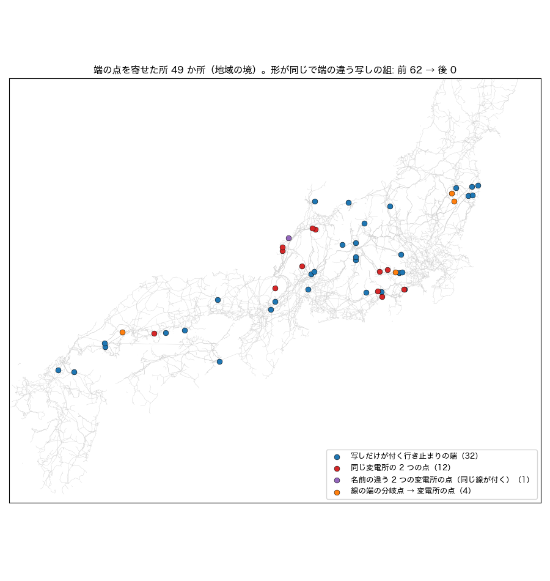
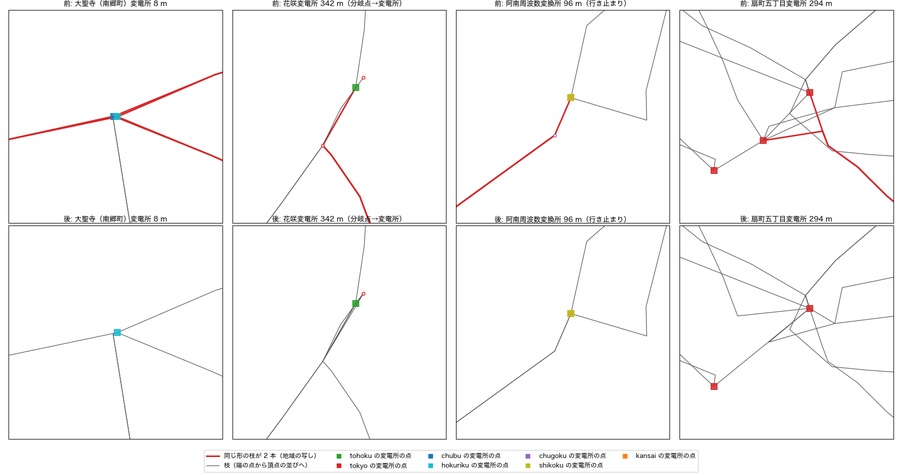

# 正典で、形は同じで端を結ぶ点だけが違う地域の写しを 1 つにまとめる（介入#59 案・設計と試算・2026-11-07）

**正典を変える直し。採用は先生の確認のあと**（この PR のマージ = 採用）。介入#58（PR #163、地域をまたぐ写しを 1 つにまとめる）の「残り」に書いた「端の結び方が違う写し（64 組）」を進めるもの。#58 の上に積んでいるので、#58 と一緒に見てください。

## なにが起きているか

#58 は、頂点の並び（形）と両端の点が同じ枝が 2 つ以上の地域から出ていれば写しとして 1 つにした。形は同じなのに端の点だけが違う組が残っていた（#58 の最初の版は形だけで写しとし、徳島の 469 バスを主系統から外したので、両端の点まで同じものに絞っていた）。#163 では「形が同じ組 2,513 − 両端まで同じ組 2,449 = 64 組」と数えたが、端の違う写しを含む組を数え直すと **67 組**（3 組は、3 本以上の写しのうち一部だけ端が違い、64 組の数に入っていなかった）。

同じ way の同じ端を、地域ごとの取り出しが別の点に結んでいた。67 組の違う端（68 か所）を見ると次のとおり。

| 違う端の形 | か所 |
|---|---:|
| 片方の写しの端が行き止まり（その点にほかの線が付かない。もう片方は変電所などに結ばれている） | 29 |
| 同じ名前の変電所の点が地域ごとに 8〜294 m ずれて 2 つあり、写しがそれぞれ自分の地域の点に結ばれている | 31 |
| 線の端の分岐点（変電所の無い地域の取り出し）と、変電所の点 | 4 |
| 名前の違う 2 つの変電所の点（南郷町変電所と大聖寺変電所。8 m・同じ線が 4 本付く） | 3 |
| 両方とも行き止まり | 1 |

写しが残ると、#58 の 3 つの問題（正典の水増し・電圧の食い違いが変圧器になる・写しの数え方）に加えて、潮流計算の網では 2 つの写しが別の点どうしを結ぶ並行の線になる。

## 直し方（`src/topology/region_dedup.py` の `align_copy_ends`、#58 の前に呼ぶ）

- **根拠**: 頂点の並びが同じ枝は同じ OSM の way。その同じ端が、地域 X では点 p、地域 Y では点 q に結ばれていた。p と q は同じ場所の 2 つの表し方なので、**p を q に寄せる**（その座標に付くすべての地域の枝の端を q に書き換える）。寄せると写しの両端の点がそろい、#58 がふつうの写しとしてまとめる。
- **寄せ先**（各組・各端）: ほかの線が付く点 > 変電所の点 > 付く線の数 > 線の中ほどの領土の地域の写しの点 > 座標の順。行き止まりの端は、ほかの線が付く方へ寄る（領土の地域の写しが行き止まりでも）。
  - **2026-11-08 追記**: 介入#60（区切りの違う写し、`canon_region_dedup_splits_2026-11-08.md`）で、前の 2 つの順を「変電所の点 > ほかの線が付く点」に替えた。区切った線の分岐点（ほかの線が付く）に、行き止まりの変電所の点（写しだけが付く）が寄せられて消えたため。#59 だけで寄せる 49 か所は、どちらの順でも同じ。
- **上限**: 寄せる 2 点が 600 m を超える組は寄せない（67 組の最大は 507 m。線の端を変電所の点に結ぶ距離）。
- **点**: 寄せ先に同じ電圧の点があれば消す。無ければ寄せ先の座標へ動かす。写しだけが付く行き止まりの点は動かさずに消す（寄せ先に変電所の点が無いときの変電所の点だけは動かして残す）。
- **周波数の境**: 消すのは、寄せ先に「潮流計算で同じ島（同期系統）に入る点」があるときだけ。島の違う点しか無ければ、消さずに動かして残す（下の「試算で踏んだこと」の 1）。島は潮流計算の網と同じく、領土で地域を再属性して（#5・#38）決める。
- **寄せて両端が同じ点になった枝**は消す（変電所の中の短い枝 5 本。2 つの点を結んでいた）。
- **後段の吸着**: `apply_disclosure_v2`（介入#29）は帳簿の座標を最寄りの点（500 m 以内）に吸着する。寄せて消えた点も吸着の候補に入れ、それが最寄りなら寄せ先に付ける。両端が同じ点になった帳簿の枝は張らない（下の「試算で踏んだこと」の 2）。
- **帳簿**: `docs/data/fragments/region_dedup_ledger.json` の `ends`（寄せた点ごとに 元・先・距離・種類・地域・変電所の名前・付く線の名前、消した枝、上限を超えた組）。実行ログ「介入#59 region-dedup-ends」。
- **無効化**: `build_editor_data.py --no-region-dedup-ends`／環境変数 `AJG_REGION_DEDUP_ENDS=0`。#58 を切ると（`--no-region-dedup`）この直しも当たらない。

寄せた点は 49 か所（1 つの点に複数の組が寄ることがある）。種類は、写しだけが付く行き止まりの端 32・同じ変電所の 2 つの点 12・線の端の分岐点 → 変電所の点 4・名前の違う 2 つの変電所の点 1。距離の中央値は 117 m、最大は 507 m。

## 試算で踏んだこと

1. **富士市変電所（50/60 Hz の境）**: 最初の版は、寄せ先に同じ電圧の点があれば島を見ずに消した。東京の点（東の島）を中部の点（西の島）にまとめると、東京の線の先が東の島から消えた → 島の違う点しか無ければ動かして残すようにした（7 点）。
2. **扇町五丁目変電所（小田原）**: 正典はもともと、地域ごとに 2 つある扇町五丁目変電所の点を、後段の介入#29（同一敷地の同定）の「同一敷地タイ」で結んでいた。2 つの点を 1 つにまとめると、#29 は帳簿の座標の点を見つけられず、最寄りの点として約 250 m 離れた**多古変電所**にタイを張った。後段の吸着が寄せた点を知るようにした。#29 の帳簿の枝のうち、両端が同じ点になった 12 本（同一敷地タイ 11・公表の接続 1）は張らない（どれも同じ変電所の 2 つの点を結んでいた）。
3. **西の損失の −82 MW は、この直しの効き目ではない**: 作り直した出力（既定の設定）では、西の損失が 1,104.8 → 1,022.9 MW、最低電圧が 0.7277 → 0.7168 になった。損失の減りのほとんどは天草の 66 kV の網（一の勢変電所〜天草市変電所線 −62 MW など）で、介入#37（仮の給電）のつなぐ点が、バスの番号の順で替わった分（天草の塊のつなぐ点が上位のバスまで 12.0 → 16.1 km の所に）。#58 の試算で踏んだのと同じことで、PR #165 で直している。下の「潮流」は、#165 の直しを前と後の両方に当てて測り直した。

## 試算（前と後）

前 = #58 の PR（#163）の先頭 `b70cd295`、後 = この直しを入れて `regenerate_all.py` の全段（30 段すべて ok）を回したもの。比べ方は `canon_region_dedup_ends_2026-11-07/compare.py`（→ `compare.json`）。

### 正典

| | 前 | 後 |
|---|---:|---:|
| 点 | 15,664 | 15,562 |
| 枝 | 17,391 | 17,314 |
| 変電所の点 | 8,367 | 8,305 |
| 線の延長 | 81,003 km | **80,215 km**（−788 km） |
| 形が同じで端の違う写しの組 | 62 | **0** |
| 地域の違う点が同じ座標に並ぶ所 | 277 | 239 |
| 同じ形の枝の余分（写し・本物の並行を含む） | 693 | 631 |

#58 がまとめた写しは 2,449 → 2,515 組（端を寄せてそろった組が加わった）。帳簿の種類は 電圧が同じ 2,462・電圧不明をほかの写しで補った 8・`kv_differs` 45。`kv_differs` の 45 組のうち 37 組は残す写しの電圧が分かり、ほかの写しが電圧不明なだけで、分かる電圧どうしが違うのは 8 組（#58 と同じ）。

### 潮流（全規模、既定の設定。#165 の直しを前と後の両方に当てて測った）

| | 東 | 西 |
|---|---|---|
| バス | 6,228 → 6,219 | 7,965 → 7,926 |
| 線 | 6,432 → 6,419 | 8,097 → 8,041 |
| 変圧器 | 663 → 663 | 979 → 973 |
| 連結成分 | 233 → 235（下の注） | 295 → 295 |
| AC | 解ける → 解ける | 解ける → 解ける |
| 最低電圧 | 0.8561 → 0.8561 | 0.7262 → 0.7168（下の注） |
| 最大負荷率 | 894.49 → 894.51% | 605.62 → 605.63% |
| 損失 | 1,330.5 → 1,330.5 MW | 1,134.8 → 1,134.8 MW |
| 需要の合計 | 55,250 → 55,250 MW | 73,865 → 73,865 MW |

- 北海道・沖縄は変わらない。
- 作り直してコミットした出力（#165 の直しは入っていない）では、西の損失 1,104.8 → 1,022.9 MW・最大負荷率 432.36 → 432.71%、東の損失 1,331.3 → 1,334.3 MW。どちらも #37 のつなぐ点の替わりが混ざっている（上の 3）。#165 と一緒にマージするときは、あとからマージする方で全段を回し直す。
- **東の連結成分 +2**: 富士市変電所から出る短い行き止まりの線 2 本（電圧不明）の先の分岐点 2 つが、東の島で 1 バスの成分になった。需要も発電も無く、電気的な効き目は無い。後段の介入#29 が「富士市変電所は中部（西の島）の変電所」として東京の点の地域を中部に付け替える一方で、この 2 本は #58 の領土の決まりで東京の写しを残したため。前は、中部の写しと中部の分岐点が西の島にあった。どちらを正とするか（#29 の同一敷地の判定か、#58 の領土か）は別の件。
- **西の最低電圧 0.7262 → 0.7168**: 江田島変電所（広島湾の島の 66 kV の行き止まり）。網は前と後で同じ（呉のあたりの 35 バスは同じ）。需要の配り方が変わった分。エリアの需要の残りを変電所の数で配るので、まとめて消えた写しの変電所のバス（沼隈町 −27.6 MW・沼田一丁目 −27.1 MW など）の分がほかのバスに移り、江田島の側の塊（#37 の仮の給電）の需要が 103.4 → 105.2 MW になった。西で 0.05 MW を超えて需要が動いたバスは 882 で、ほとんどは 1.2 MW 以下。観測地点の需要（#30）のピン留めは前と後で同じ（15 バス・108.4 MW）。

### N-1（実在の線の開放。作り直してコミットした出力 = #165 の直しは入っていない）

| | 東 | 西 |
|---|---|---|
| 主成分のバス | 5,795 → 5,785 | 7,449 → 7,410 |
| 新たな過負荷を生む開放 | 125 → 125 | 226 → 229 |
| 分離される需要の合計 | 11,784 → 11,636 MW | 32,434 → 32,486 MW |

西は #37 のつなぐ点の替わりが混ざっている。

### 変電所の無い点の変圧器（#155 の点検）

潮流計算の網で両側が変電所でない変圧器は **69 → 67 台**（電圧の分からない写し 38 → 36）。

### 後段の作った枝

後段の段（公表の接続・断片の回収など）が足す枝を前と後で突き合わせ、寄せた点の表で説明できない差を 1 本ずつ見た。

- 変電所の中の短い枝 5 本: 寄せて両端が同じ点になったので消えた（2 つの点を結んでいた）。
- 同じ形の写しになって 1 本にまとまった枝: 残す方の名前が替わったもの（`中部送電線_845` → `東京送電線_113` など）。
- 断片の回収（介入#34 第三波）の `九州送電線_544 / 古開作変電所~美和町西畑変電所線`: 前は四国の取り出しの行き止まりの点（いまは東山口変電所に寄せた点）まで同じ線をなぞって 8 km 重なっていた。後は本系統に最初に触れる点で止まる（42.4 → 34.0 km）。
- **大月の近く（駒橋変電所）**: 中部の取り出しには駒橋変電所の点が無く、分岐点 4 つの小さな塊がある。前はどこにもつながらない切れ端だったので、後段のノード衛生（介入#35）が東京の駒橋変電所へまとめて消していた。大月の中部の分岐点を東京の大月変電所に寄せると、塊が中部の笛駒線の写しで本系統につながり、ノード衛生の対象から外れて残った。区切り方が違う写し（下の「残り」）なので、この直しではまとめられない。

## 検査

- `tests/test_region_dedup.py` に 7 本足した（同じ変電所の 2 つの点を寄せて #58 でまとめる・行き止まりの端はほかの線が付く方へ・600 m を超える組は寄せない・寄せて両端が同じ点になった枝を消す・端が同じ組は触らない・島の違う点は動かして残す・後段が読む寄せた点の表は今の正典と照合する）。全体で 1,957 本通る。
- 地図（MapLibre）の画面の件数を固定していた `tests/test_pages_map_gl_ui.py` は、#58 で線が 19,909 → 17,391 本になったあと直していなかった（ブラウザの要る検査で、手元でだけ落ちていた）。固定の数ではなく、地図のデータの件数と比べるようにした（#163 の枝で直し、ここに取り込んだ）。

## 残り

- **区切りの違う写し**: 同じ way を地域ごとに違う点で区切ったので、形が同じにならない写し。本系統の中で、頂点の 8 割以上を別の 1 本の枝と座標まで共有する組が約 800 組ある（前 802 → 後 794 組。本物の併架の線も含む）。まとめるには、共有する頂点で枝を分け直してから写しを見つける必要がある。
- **富士市変電所**: #29 の同一敷地の判定（中部）と #58 の領土（東京）が食い違う。行き止まりの線 2 本が東の島で 1 バスの成分になる。
