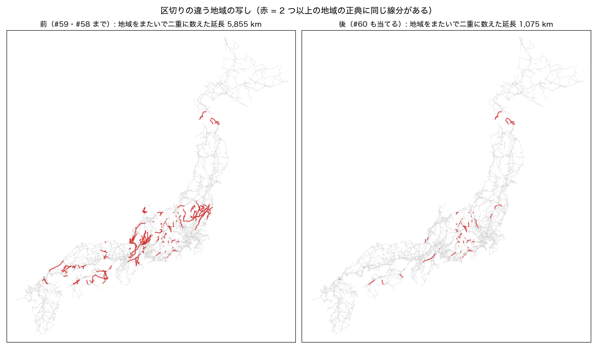
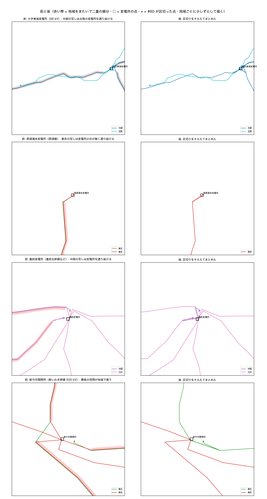
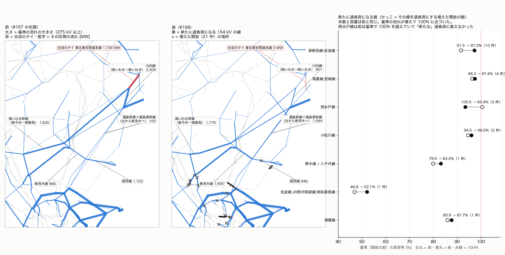

# 正典で、区切りの違う地域の写しの区切りをそろえてから 1 つにまとめる（介入#60 案・設計と試算・2026-11-08）

**正典を変える直し。採用は先生の確認のあと**（この PR のマージ = 採用）。介入#59（PR #167）の「残り」に書いた「区切りの違う写し」を進めるもの。#58（#163）・#59（#167）の上に積んでいるので、一緒に見てください。

## なにが起きているか

正典は、地域ごとに OSM を取り出して作り、全国でつなげている。#58 は形（頂点の並び）と両端の点が同じ写しを、#59 は形が同じで端の点だけが違う写しを 1 つにした。それでも、同じ線分（隣り合う 2 つの頂点。小数 5 桁で座標まで同じ）が 2 つ以上の地域の正典に入っている所が、**地域をまたいで二重に数えた延長で 5,855 km** 残っていた。地域の組は 東北と東京・中部と関西・中部と東京・中部と北陸・中国と四国が多い。

同じ way なのに形が同じにならないのは、枝の区切り方が地域で違うから。

- **取り出しが way の単位**: 地域の取り出しは、外接矩形に掛かる OSM の way を丸ごと拾う。その先に続く way が矩形に掛からなければ取り出しに無いので、線が途中で止まる（行き止まり）。
- **分岐や変電所が取り出しに無い**: 正典を作る段（`snapped_topology`）は、分岐点と変電所で線を区切り、次数 2 の点はつなげて 1 本にする。ある地域の取り出しに分岐の先の線や変電所が無いと、そこで区切られずに通り抜ける。たとえば 豊前変電所（九州）の近くでは、中国の取り出しに豊前変電所が無く、中国の写しは変電所の点を通り抜けて先へ続いていた。九州の写しは変電所で区切られ、変電所の点に結ばれている。

写しが残ると、#58 の 3 つの問題（正典の水増し・電圧の食い違いが変圧器になる・写しの数え方）に加えて、潮流計算の網では、変電所を素通りする「迂回の線」や、分岐を素通りする並行の線になる。

## 直し方（`src/topology/region_dedup.py`）

`build_editor_data.py` が、全国をまとめる前に **#60 で区切りをそろえる → #59 で端の点をそろえる → #58 で 1 つにする → #60 で要らなくなった区切りを戻す** の順に呼ぶ。

### 区切りをそろえる（`align_copy_splits`、#59 の前）

- **写しの根拠**: 地域をまたいで同じ線分を持つ枝は、同じ OSM の way の同じ径間（座標が小数 5 桁まで同じ頂点が 2 つ続く）。
- **区切る頂点**: 写しの線分の上で、
  - ある地域の枝の形がそこで終わる頂点（その地域では、そこに変電所・分岐・way の端がある）。
  - 写しが分かれる頂点（片側の線分だけをほかの地域と共有している）。
- その頂点を途中に持つ、ほかの地域の枝を区切る。区切った地域に、枝の電圧の分岐点を作る（id は `<地域>_jct_split_…`）。区切りの間の枝は、地域をまたいで形が同じになる。
- **区切らない頂点**:
  - その頂点を通る枝・そこにある点の、分かる電圧が 2 つ以上（電圧の違う併架）。同じ座標に電圧の違う点ができると、潮流計算の網が変電所の無い所に変圧器を作る（#155 の点検）。
  - 区切る地域と、区切りの理由になった地域とで、島が違う（周波数の境・北海道と本州）。島は 2 つの見方の両方で見る。潮流計算の島（#59 と同じく、領土で地域を再属性して決める。#5・#38）と、地域の名札の島（全国のつながり・断片の回収 #34・ノード衛生が使う）。下の「試算で踏んだこと」の 2 と 3。
  - 区切る地域に、その枝のものでない点がもうある（区切ると、その点に新しくつながってしまう）。

### 端をそろえて 1 つにする（#59・#58、そのまま）

区切ったあとの枝は、形が同じで端だけが違うか（#59 が寄せる）、端まで同じ（#58 がまとめる）になる。残す写しは #58 と同じく、線の中ほどの頂点の領土の地域。

- **#59 を 2 つ直した**（どちらも、#59 だけで寄せる 49 か所の結果は変わらないことを確かめた）。
  - 寄せ先の順: 変電所の点 > ほかの線が付く点（前は逆）。下の「試算で踏んだこと」の 1。
  - 寄せた点を消すか: 変電所でない点は、どちらかの電圧が不明（0）なら同じ電圧とみなし、寄せ先にまとめる。下の「試算で踏んだこと」の 4。

### 要らなくなった区切りを戻す（`heal_copy_splits`、#58 のあと）

- 同じ枝の隣り合う 2 つの切れ端が両方残り、継ぎ目に付く枝の端がその 2 本だけで、区切りで作った点のほかに点が無ければ、つなぎ直す（区切る前の枝に戻る）。
- どの枝も付かなくなった区切りの点は消す。
- 継ぎ目に、#59 が寄せた変電所の点などがあるときは、つなぎ直さない（下の「試算で踏んだこと」の 3）。

### 帳簿と無効化

- **帳簿**: `docs/data/fragments/region_dedup_ledger.json` の `splits`（区切った点ごとに地域・座標・理由・理由になった地域・電圧・線の名前。区切らなかった数・島の違いで区切らなかった所・つなぎ直した継ぎ目・残った区切りの点）。実行ログ「介入#60 region-dedup-splits」。
- **無効化**: `build_editor_data.py --no-region-dedup-splits`／環境変数 `AJG_REGION_DEDUP_SPLITS=0`。#58 を切ると（`--no-region-dedup`）この直しも当たらない。

## 試算で踏んだこと

全段を回して前と後を突き合わせ、説明の付かない差を 1 つずつ追って、4 つ直した。

1. **行き止まりの変電所の点が消えた（那須湯本・豊原・中郷区坂本・美波町）**
   - たとえば那須線は、東北の写しが那須湯本変電所の点で終わり、東京の写し（取り出しに那須湯本変電所が無い）はその先へ通り抜けていた。
   - 区切ると、#59 は東京の分岐点（先へ続く線が付く）を寄せ先に選び、写しだけが付く那須湯本変電所の点を寄せて消した。
   - 寄せても枝はすべて寄せ先に付け替わるので、つながりはどちらの順でも同じ。情報を残す方（変電所の点）を寄せ先にした。
2. **周波数の境で、中郷区坂本変電所が消えた**: 新潟（周波数が県の中で分かれる）では、地域の名札のまま島が決まる。中部の写し（西の島）と東京の写し（東の島）を区切ってまとめると、残った東京の線が中部の変電所の点を通り抜けたままになった → 潮流計算の島が違えば区切らない。
3. **東京の写しの切れ端が、116 km 先の東清水変電所へつながれた**
   - 愛知・静岡の 60 Hz の所の東京の写し（`tokyo_line_4094` など）は、潮流計算では領土で西の島に入るので、2 の決まりでは区切られた。区切って中部の写しを残すと、東京の写しの切れ端が残った。
   - 後段の断片の回収（#34）は地域の名札で島を見る。この切れ端を東の断片として、佐久間東幹線の OSM の線に沿って 116.6 km 先の東清水変電所までつないだ。小田原の足柄線でも、中部の切れ端が同じようにつながれた。
   - → 地域の名札の島も同じときだけ区切る。中部と東京、北海道と東北の写しは区切らない。
4. **桑野・多良変電所などの需要が外れた（7 か所）**
   - 中国の写しを区切った電圧不明（kv=0）の分岐点を、#59 が四国の桑野変電所（66 kV）の座標へ寄せた。寄せ先に同じ電圧の点が無いとみなされ、消さずに動かして残した。
   - 潮流計算の網は同じ座標・同じ電圧の点を 1 つのバスにまとめる（B 案。電圧不明の点は線の電圧で置く）。そのため 2 点が 1 つのバスになり、先に並ぶ分岐点の名前と性質（変電所でない）を取って、変電所の需要（各 20 MW ほど）がほかのバスへ移った。
   - → 変電所でない点は、どちらかの電圧が不明なら同じ電圧とみなして寄せ先にまとめる。7 か所は、下滝開閉所・北一宮・関開閉所・温泉・古池本町・多良・桑野。

## 区切って、まとめた所

- 区切りの候補の頂点は 477（枝の形の端 444・写しが分かれる所 33）。
  - 電圧の違う頂点 56 と、島の違う区切り 140 は区切らない。
  - 区切った枝は 223 本で、549 本の切れ端になった。区切った地域に作った点は 326。
  - 地域の組は 東北と東京 95・中部と関西 52・中部と北陸 46・中国と四国 43 など。
- 区切ったあと、#59 は 238 か所の端を寄せた（分岐点 → 変電所の点 163・写しだけが付く行き止まりの端 64・同じ変電所の 2 つの点 11。中央値 238 m・最大 507 m）。
  - 寄せて両端が同じ点になった枝 33 本を消した。#59 だけの 5 本に加え、変電所の中を通り抜けていた写しの切れ端（入る点と出る点が同じ変電所の点に寄った）。
- #58 がまとめた写しは 2,515 → 2,764 組（落とした枝 2,920 本）。
  - 種類は 電圧が同じ 2,687・電圧不明をほかの写しで補った 8・`kv_differs` 69。
  - `kv_differs` 69 組のうち、分かる電圧どうしが違うのは 3 組（残す写しの電圧を採る）。66 組は、残す写しの電圧が分かり、ほかの写しが電圧不明なだけ。
- #58 のあと、要らなくなった継ぎ目 37 をつなぎ直した。正典に残る区切りの点は 58。

## 試算（前と後）

前 = #59 の PR（#167）の先頭 `ac4b5d33`、後 = この直しを入れて、コミット済みのきれいな状態（`e1b915d2`）から `regenerate_all.py` の全段（30 段すべて ok）を回したもの。比べ方は `canon_region_dedup_splits_2026-11-08/compare.py`（→ `compare.json`）。

- 2026-11-09 に、main（516b453e、#161・#164・#165・#169 のあと）と #35 の追記 35b を入れた #163・#167 の上へ載せ直して、測り直した。
- #165（#37 のつなぐ点）は main に入ったので、前と後の両方に入っている。前の版のように #165 を別に当てて測る必要は無くなった。

### 正典

| | 前 | 後 |
|---|---:|---:|
| 点 | 15,526 | 15,349 |
| 枝 | 17,291 | 17,242 |
| 変電所の点 | 8,303 | 8,209 |
| 線の延長（頂点の並びの長さ） | 80,234 km | **75,348 km**（−4,886 km） |
| 地域をまたいで二重に数えた延長（地域ごとの正典から数える） | 5,855 km | **1,075 km** |
| 2 本以上の枝が通る線分の延長（本物の併架を含む） | 9,272 km | 4,400 km |
| 頂点の 8 割以上を別の 1 本と共有する組（本系統・形が同じものを除く。#167 の数え方） | 794 | 518 |
| 地域の違う点が同じ座標に並ぶ所 | 235 | 140 |
| 変電所でない行き止まりの点 | 2,787 | 2,757 |
| どの枝も付かない点 | 247 | 247 |

- 変電所の名前で見ると、消えた変電所は 0（揖保川町変電所が本系統に入った）。変電所の点の減り（−94）は、同じ変電所の写しの点がまとまった分。
- 残る二重の延長 1,075 km の内訳は 中部と東京 513・北海道と東北 210・中部と関西 108・中国と四国 95・東北と東京 76 km など。中部と東京・北海道と東北は、島の違う写しを区切らないので残る（上の 2・3）。そのほかは、電圧の違う頂点で区切らなかった所と、地域で頂点が少しずつ違う（OSM の版の違いなど）所。

### 潮流（全規模、既定の設定）

| | 東 | 西 |
|---|---|---|
| バス | 6,204 → 6,191 | 7,915 → 7,878 |
| 線 | 6,406 → 6,398 | 8,035 → 7,994 |
| 変圧器 | 662 → 662 | 968 → 960 |
| 連結成分 | 234 → 233 | 295 → 295 |
| AC | 解ける → 解ける | 解ける → 解ける |
| 最低電圧 | 0.8560 → 0.8559 | 0.7168 → 0.7168 |
| 最高電圧 | 1.0229 → 1.0087 | 1.0391 → 1.0099 |
| 最大負荷率 | 894.53 → 895.47% | 605.63 → 605.79% |
| 損失 | 1,331.6 → 1,304.1 MW | 1,134.6 → 1,149.9 MW |
| 需要の合計 | 55,250 → 55,250 MW | 73,865 → 73,865 MW |

- 北海道・沖縄は変わらない。
- **最高電圧が下がった**: 前の最高電圧の点は、どちらも長い写しの開いた端だった。東は南いわき幹線の東北の写し（南いわき開閉所から 194 km、先が行き止まり）、西は関西の写し（北大阪変電所から城端まで 216 km、城端の側が行き止まり）。開いた長い線は充電電流で先の電圧が上がる。写しをまとめて開いた端が無くなった。
- **東の損失 −27.5 MW: 東北と東京の間の流れ方が変わった**
  - 前は、合成の連系タイ「東北東京間連系線」（介入#31 の例外で通電のまま残している。全国をまとめる段が「東京の点のうち東北の重心に最も近い高圧の点」に端を付ける）の東京側の端が、南いわき幹線の東京の写しの端の分岐点（福島）だった。約 1,800 MW が、タイ（21.7 km）とこの写し（129 km）を通って新今市開閉所へ流れていた。
  - 写しをまとめると、東京の写しの端は #59 で南いわき開閉所に寄った（344 m）。2026-08-17 の点検（`tie_duplication_audit_2026-08-17.md`）が「相馬双葉幹線は南いわき地点で 340 m 未縫合（タイが偶然縫合）」と書いていた切れ端が、ここで縫われた。タイの東京側の端は別の行き止まりの分岐点に移り、流れは 0 MW になった。
  - 後は、相馬双葉幹線（南相馬〜南いわき）・南いわき幹線・新いわき幹線・福島幹線・福島東幹線に分かれて流れる（新茂木に約 1,150 MW）。
- **西の損失 +15.2 MW: 糸魚川発電所（214 MW）の付く先が替わった**
  - 前は 15 km 西の朝日町変電所に付いていた。後は、発電所のある糸魚川市青海の大字青海変電所に付く。
  - 西の発電機の付け方（介入#24 の capkv: 付く線の容量の合計が出力以上で、電圧の足りる最寄りのバス）が、中部の写しが青海変電所で区切られて付いたことで、青海変電所を選ぶようになった。
  - 66 kV の朝日町〜青海の線に 230 MW 流れる（負荷率 178%・損失 +11.9 MW。11-08 の試算で調べた値）。
- **需要の配り方**: エリアの需要の残りを変電所の数で配るので、まとめて消えた写しの変電所のバスの分がほかのバスに移る。
  - 同じ変電所の写しが 2 つのバスになっていた所が多い。たとえば安瀬変電所は、中国と九州の写しで 2 バス・各 15.8 MW だった。
  - 0.05 MW を超えて需要が動いたバスは、東 142・西 615（11-08 の試算）。
  - 古池本町変電所は、通り抜けていた関西の 77 kV の写しが変電所に付き、介入#43a が 275/77 kV の変圧器を足した（77 kV のバスに 26.4 MW）。

### N-1（実在の線の開放）

| | 東 | 西 |
|---|---|---|
| 主成分のバス | 5,774 → 5,762 | 7,399 → 7,362 |
| 新たな過負荷を生む開放 | 125 → **145** | 235 → 200 |
| うち 120% を超える | 50 → 50 | 58 → 60 |
| 分離される需要の合計 | 11,644 → 11,643 MW | 32,486 → 33,031 MW |

- 東の +20 は、上の東北と東京の間の流れ方が変わった分。内訳は次の「N-1 の東の +20 の内訳」（2026-11-09 に開放ごとに調べた）。
  - 前にここで書いた「東北からの電力が新今市・東群馬でなく新茂木から入るので、茨城・栃木・群馬の線（鹿島線・西水戸線・新新田線など）を開放したときの過負荷の顔ぶれが替わった」は不正確だった。
  - 新今市から東群馬への流れは、前も後もほぼ同じ（1,830 → 1,778 MW）。
  - 群馬・埼玉・茨城の 154 kV の線は、開放する側でなく、過負荷になる側だった。
- 西の −35 と分離される需要の +545 MW には、写しが作っていた見かけの並行の道が無くなった分が入りうる（1 つずつは確かめていない）。前の版で書いた「#37 のつなぐ点の替わりが混ざる」は、#165 が main に入って消えた。

### N-1 の東の +20 の内訳（先生の問い、2026-11-09）

問い: 東の「新たな過負荷を生む開放」が 125 → 145 に増えたのはなぜか。どの開放が増えたか。写しがまとまって並行の線が 1 本になったためか。

**答え: 並行の線が 1 本になったためではない。** 合成のタイの代わりに実在の幹線を流れるようになり、群馬・埼玉の 154 kV の線の基準の流れが増えて 100% に近づいた。そのため、近くの開放で 100% をわずかに超えるようになった。

調べ方は `canon_region_dedup_splits_2026-11-08/n1_east_dump.py` と `n1_east.py`（→ `n1_east.json`）。`n1_screening.py` と同じ手順で網を作り、開放ごとに、新たに過負荷になる線の一覧まで出した。前 = #167 の正典、後 = この PR の正典。コミットした数（125・145）を再現した。11-09 に main・35b の上へ載せ直したあとの正典で出し直した（顔ぶれは載せ直す前と同じ）。

- **数え方**
  - 見張るのは実在の線（OSM の線・回収線・公表の接続・銘板つきの変圧器）の 154 kV 以上。
  - 基準で 100% 以下だった線が、1 回線の開放で 100% を超えると「新たな過負荷」と数える。
- **顔ぶれ**: 増えた開放 21 件・減った開放 1 件・両方にある開放 124 件。
- **増えた 21 件のうち 18 件**は、新たな過負荷が 100.0〜102.9% の際どいもの。
  - 開放する所は、群馬・埼玉の変圧器（新岡部・新坂戸・北熊谷・東毛・生品・西袋・練馬・田端など）、154 kV と 275 kV の線（新岡部線;下児玉線・京北線・東京中線・野木線 / 八千代線など）、新古河線（500 kV）、新潟の 154 kV の公表の接続 2 本。
  - 過負荷になるのは右の図の線で、基準の負荷率が上がっていた（新新田線;佐波線 91.6 → 97.2%・南葛線;武南線 96.3 → 97.4%・小松川線 94.5 → 96.0%・野木線 / 八千代線 79.9 → 83.2% など）。
- **残る 3 件は西水戸線（茨城）**。
  - 西水戸線は、前は基準で 100.5% と既に過負荷で、「新たな」過負荷の数えから外れていた。後は 93.4% に下がったので、数えに入った。
  - 3 件は、西水戸線自身の 1 回線の開放（170.9%）、新筑波変電所の 500/154 kV 変圧器（109.8%）、那珂線（102.9%）。
- **減った 1 件**は筑南線 / 筑館線（茨城）。基準の流れが減り、開放しても 100% に届かなくなった。
- **120% を超える新たな過負荷を生む開放は 50 → 50** で変わらない。見張りを全部の枝に広げた数え方では 317 → 315。

**並行の線について**

- 見張る線のうち、前だけにあった 58 本（名前と両端の名前で見る）は、ほとんどが #60 でまとめた写しで、福島・栃木の 500 kV 幹線と、東北と東京の境の 154 kV の線。
- 増えた 21 件の開放にも、新たに過負荷になる 7 本の線にも、この 58 本は入っていない。
- 過負荷になる線の回線数と容量は、前も後も同じ。

**流れの変わり方（基準、275 kV 以上）**

| 線 | 前 | 後 |
|---|---:|---:|
| 合成のタイ 東北東京間連系線 | 1,739 MW | 0 MW |
| 川内線（南いわき → 新いわき） | 2,309 | 801 |
| 福島幹線＋福島東幹線（北から新茂木へ） | 100 | 1,094 |
| 新茂木線（新茂木 → 新栃木） | 966 | 1,595 |
| 新古河線（栗橋 → 新古河） | 3,582 | 3,733 |
| 那珂線（茨城 → 新茂木） | 1,103 | 846 |
| 南いわき幹線（新今市 → 東群馬） | 1,830 | 1,778 |

- 前は、東北からの約 1,740 MW が合成のタイを通り、南いわき幹線の東京の写しから新今市に入っていた。
- 後は、縫われた実在の線を通る。新今市へは南いわき幹線と新いわき幹線から、新茂木へは福島幹線と福島東幹線から入る。
- 新茂木から新栃木・新古河・埼玉へ流れる分が増え、群馬・埼玉の 154 kV の線の基準の流れが上がった。茨城の側（那珂線・西水戸線）は減った。

**#165 との関わり**: 載せ直す前に、#165 の直しを前と後の両方に当てて測っても 125 → 145 で、増えた 21 件も同じだった。#165 が main に入ったあとの載せ直しでも、125 → 145・増えた 21 件で変わらなかった。

**正しいかの見方**

- 後の網は、合成のタイの代わりに実在の幹線を通るので、こちらの方が実際の網に近い。
- ただし N-1 の件数は、線の容量の置き方（理論値）と出力の配り方に強く依る。増えた分の 18 件は 3% 以内の差で数えが変わるものなので、件数の増減は網の良し悪しの物差しにしない。

### 変電所の無い点の変圧器（#155 の点検）

潮流計算の網で両側が変電所でない変圧器は **61 → 53 台**（電圧の分からない写し 30 → 23・変電所から 300 m 以内 4 → 3）。

### 後段の作った枝

後段の段が足す枝を、帳簿どうしで前と後に突き合わせた。

- 断片の回収（#34）の OSM の線の橋渡しは 102 → 93 本。
  - 消えた 11 本は、まとめて落とした写しの切れ端（東京の写しの福島・四国の写しの広島・関西の写しの兵庫）を本系統へつないでいたもの。
  - 付け替わった 2 本（石岡第二線・丸沼線）は同じ線で、本系統の側の端の点が、まとめた写しのもう片方の点になった。
- 断片の回収の連なり（74 本）は前と同じ。上の 3 の 116 km の連なりは、直したあとは出ない。
- #29 の帳簿の枝で、両端が同じ点になって張らないものは前と同じ 12 本。
- ノード衛生（#35）の切れ端は前と同じ 22。周波数の付け替え（#42）の見送りは 61 → 58（写しの点が減った分）。

## 検査

- `tests/test_region_dedup.py` に 8 本足した。内容は次のとおり。
  - 一方の地域の分岐で、もう一方の写しを区切る
  - 要らなくなった区切りは戻す
  - 途中で止まる写しは長い写しにつながる
  - 電圧の違う頂点は区切らない
  - 潮流計算の島・名札の島が違えば区切らない
  - 線が入る変電所の点を残す
  - 電圧不明の区切りの点は変電所の点にまとめる
- 全体で 1,965 本通る。

## 残り

- **区切らなかった写し 1,075 km**: 中部と東京（513 km）・北海道と東北（210 km）は島の違う写し。まとめるには、後段（#34・ノード衛生・周波数の付け替え）が地域の名札でなく領土で島を見るようにする必要がある。
  - その 1 つの勝間〜小海町変電所線（長野）では、#58 のあとに東京の写しが東の 4 バスの切れ端として残り、佐久の水力 3 件が東にも付いていた（西と二重）。
  - #163 に入れた #35 の追記 35b（線の上の双子）で、この PR の正典でも切れ端は消え、水力は東に付かない（2026-11-09。#163 の報告 `canon_region_dedup_2026-11-07.md` の「佐久の水力と小諸の太陽光」）。
- **行き止まりの尻尾**: 一部を落とした写しの、行き止まりで終わる切れ端が 75 本残る（300 m 未満 38 本。11-08 の試算で数えた）。どれも前から写しの端の行き止まりだった所で、潮流には響かない。長いもの（数 km〜31 km）は、もう片方の写しに無い線の続き。
- **合成の連系タイ「東北東京間連系線」**: 340 m の切れ端が縫われたので、介入#31 の例外（`KEEP_LIVE_TIES`）から外せる（`full_from_built.py` のコメントが「縫合が完了したらこの集合から外して除外に揃える」としている）。いまは端が行き止まりの分岐点に付いて 0 MW。#60 を切ると切れ端が戻るので、この PR では変えない。#60 の採用のあとに外すのを提案する。
- **糸魚川発電所**: 66 kV の朝日町〜青海の線に 230 MW 流れる（178%）。大字青海変電所に付くのはもっともらしいが、自家発の出力（全量を系統に出す置き方）と接続の電圧は確かめていない。

