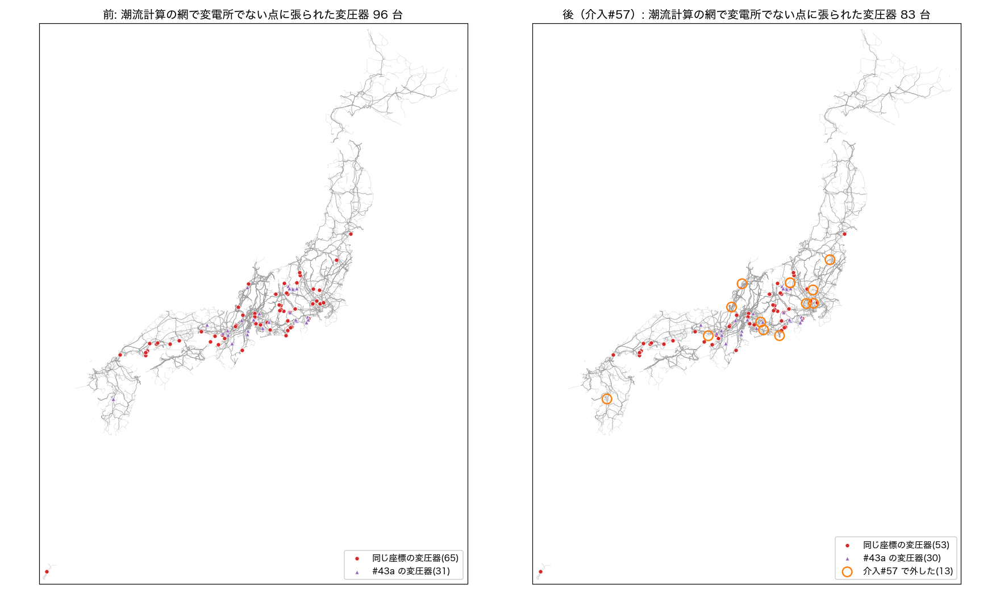
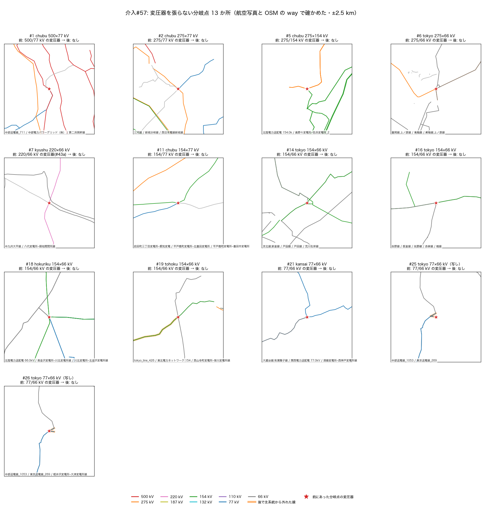

# 変電所の無い点に潮流計算が張っていた変圧器を、実在しないと確かめた 13 か所で外す（介入#57・2026-11-07）

**採用は先生の確認のあと**（この PR のマージ = 採用）。正典（`docs/data/built/all.json`）は変えない。変えるのは、正典から潮流計算の網を作るところ（`src/powerflow/full_from_built.py` の `build_island_net`）だけ。

## なにが起きていたか

正典の分岐点は**電圧ごとに別の点**で（id の末尾が電圧。例 `chubu_jct_34.6755:138.1592:500` と `…:77`）、交差する線や併架の線が同じ座標を通っても、正典の中ではつながっていない（`src/powerflow/snapped_topology.py` の `multi_voltage`）。ところが枝は**座標でしか点を指さない**ので、潮流計算の網は

- 同じ座標に電圧の違う点があると、**変電所かどうかを見ずに変圧器でつなぐ**（同じ座標の変圧器）
- 1 つの点に電圧の違う線がつながっていると、**介入#43a が変圧器を足す**（暗黙の降圧。「66 kV の線が 275 kV の母線に直結することは無いので、そこには変電所がある」という考え）

ので、交差や併架の鉄塔の座標にも変圧器ができていた。潮流計算の網で両側のバスが変電所でない変圧器は、全国で **96 台**（同じ座標 65・#43a 31、全部の変圧器 1,761 台の 5.5%）。一覧は PR #155 の `docs/data/route_audit/junction_trafos.json`（`scripts/audit_junction_trafos.py`）。

## どの点で外すか（写真と OSM の way で確かめた）

PR #155 で航空写真（国土地理院 全国最新写真・ズーム 17）を見て「変電所の無い所で電圧の違う線が交差するか同じ鉄塔に載る」と判定した 17 か所を、**正典の元の OSM の way**（`data/<地域>_lines.geojson`）で確かめ直した（`junction_cuts_2026-11-07/check_osm_ways.py` → `osm_ways.json`）。写真だけでは交差と分岐を取り違えることがあった。

| 種類 | 番号 | OSM で見えること | 外すか |
|---|---|---|---|
| **交差・併架** | #1・2・5・6・7・11・14・16・18・19・21（11） | 電圧タグの違う way（併架の `500000;77000` なども）が同じ点を頂点に持つ | **外す** |
| **地域の写し** | #25・26 | 同じ way が中部と東京の両方の取り出しに入り、推し量りの電圧が 77 kV と 66 kV に分かれた。写しの間に変圧器は無い | **外す** |
| 地域の写し | #24 | 同上。ただし 2 つの点が別の同期系統に入り、もともと変圧器が無い | 当てる物が無い |
| 推し量りの見かけ | #3・13・23 | 電圧タグの無い 1 本の線の途中から別の線が分かれる T 分岐。電圧の違いは推し量り（`propagate_voltage`）から来ている | 外さない |

- PR #155 の写真の判定で「#24〜26 は東京（50 Hz）と中部（60 Hz）の線を鉄塔でつないでいる」と書いたのは誤りで、**同じ線の写し**だった。
- #13 は、外すと 77 kV の太田分岐線の先の**太田変電所（負荷 25.8 MW）が主系統から外れ、合成のスラックが受け持つ**ことになった。OSM では電圧タグの無い「加茂野町鷹之巣変電所~西栃井変電所線」1 本の途中から 77 kV の太田分岐線が分かれていて、正典の「154 kV」はこの線の北東の半分に推し量りで付いた電圧だった。直すなら線の電圧の方（別の件）。

### 電圧の分からない線の付け先

外す点では、線の端を**自分の電圧のバス**へ付け替える（無ければその座標に作る。名前 `…@<kV>kV(#57)`）。電圧の分からない線（kv=0）は、台帳の点ごとの指定 → 同じ名前の線 → その座標の一番高い電圧（正典を作るときの決まりと同じ）の順で決める。7 か所に電圧の分からない線があり、写真・OSM の way・名前で確かめた（台帳の `unknown_kv_note`）。

| 番号 | 電圧の分からない線 | 付け先 | 根拠 | 確からしさ |
|---|---|---|---|---|
| #1 | 中部送電線_711 | **77 kV**（指定） | この点で 500 kV と 77 kV の併架の way が終わり、500 kV だけの way が続く。77 kV の回線は残りのこの way（西へ出て北へ）へ続く | 高い |
| #2 | 西日本電線新城線 | **77 kV**（指定） | 新城線はこの点を通り、77 kV の新城分岐線が北東へ分かれる。275 kV の三河線は交差するだけ | 高い |
| #11 | 豊田市変電所~愛知変電所線 | **77 kV**（指定） | 77 kV の前田町三丁目変電所~愛知変電所線とこの線がどちらもこの点で終わり、どちらも「~愛知変電所線」。154 kV の線は通り抜ける | 中（名前から） |
| #7 | 八代変電所~頭地開閉所線 | 66 kV（同じ名前） | 同じ線の 66 kV の部分と電圧の分からない部分 | 高い |
| #16 | 楠線 | 66 kV（同じ名前） | 同上。154;66 kV の併架の 66 kV の回線から分かれる | 高い |
| #13・#23 | — | — | 外さない（推し量りの見かけ） | — |

指定しないと #2 では新城線が 275 kV の側に残り、77 kV の新城分岐線と変電所が主系統から外れた（最初の版で踏んだ）。

## 前と後





網（`measure_topology.py` → `topology.json`）:

| 島 | 変圧器 | 分岐点の変圧器 | #43a | 連結成分 | 最大の成分のバス |
|---|---|---|---|---|---|
| 北海道 | 69 → 69 | 0 → 0 | 0 → 0 | 22 → 22 | 799 → 799 |
| 東 | 676 → **670** | 24 → **18** | 28 → 28 | 237 → **239** | 5,809 → 5,804 |
| 西 | 997 → **990** | 71 → **64** | 39 → **38** | 295 → 295 | 7,467 → 7,467 |
| 沖縄 | 19 → 19 | 1 → 1 | 0 → 0 | 7 → 7 | 94 → 94 |

- 主系統から外れたのは東の 5 バスだけで、どれも**写しの切れ端**（軽井沢の 77 kV の写し 3 バス・地域をまたいで写った 154 kV の線 2 バス）。負荷も発電も無い（`measure_islands.py` → `islands.json`。配布ケースと同じ組み方）。西では何も外れない。

全規模の潮流（`scripts/run_full_powerflow_from_db.py --max-ac-buses 20000`、既定の設定。`compare_powerflow.py` → `powerflow.json`）:

「前」は今の main で #57 だけを切ったもの（`--no-junction-cuts`）。これは公開中の `docs/data/powerflow_full`（10-31 の作り直し）と、作成時刻・解いた秒数を除いて**1 バイトも違わず一致**した（地点需要の表と構造 DB をそろえた条件。下の「作り直し方」）。

| | 東 | 西 |
|---|---|---|
| AC | 解ける → 解ける | 解ける → 解ける |
| 最低電圧（pu） | 0.8559 → 0.8561 | 0.7277 → 0.7277 |
| 最大負荷率 | 894.44 → 894.47% | 605.60 → 605.59% |
| 損失 | 1,329.8 → 1,330.5 MW | 1,136.2 → 1,135.3 MW |
| N-1: 新たな過負荷を生む開放（実在の線） | 129 → 126 | 変わらない |

- 北海道・沖縄は出力が 1 バイトも変わらない。定格を超える線は全国で 557 → 559 本。
- 負荷率が 10 ポイント以上動いた線は 52 本で、どれも 13 か所の近くの 66/77 kV の線。いちばん動いたのは #1 の**大須賀変電所~上ノ原変電所線（77 kV）88.5 → 189.9%**。前は、無い 500/77 kV の変圧器が第二浜岡幹線から 77 kV の網へじかに電気を入れていた。外すと、その分を実在の変電所から送ることになる。正しいのは後で、前の数字は無い変圧器に支えられていた。

## まだ残っている分岐点の変圧器（83 台）

| 種類 | 台数 | 次 |
|---|---:|---|
| 同じ座標に電圧の分からない点（隣の地域の取り出しの写し。仮の 66 kV と変圧器でつながる） | 51 | 写しを 1 つにまとめる（変圧器ではない）。別の直し |
| 作った枝（公表の経路づけ・回収・引込み・名前での結び付け）が関わる | 16 | 作った枝の根拠（各介入）と合わせて見る |
| 写真で決められない 7・変電所が OSM に無いだけの可能性 2 | 9 | 公表の系統図・変電所の一覧で確かめる |
| 推し量りの見かけ（#3・13・23） | 3 | 線の電圧の推し量りを直す |
| 変電所から 300 m 以内 | 4 | 変電所の敷地への結び付けを見る |

## 無効化

`--no-junction-cuts`（全規模の潮流・UC の潮流の両ドライバ）／環境変数 `AJG_JUNCTION_CUTS=0`／台帳 `data/reference/junction_misconnects.json` の `adopt` を false。

## 作り直し方

git の外の入力が 2 つ要る（worktree では無いことがある。無いと黙って違う結果になる）: 地点需要の表 `data/external/system_disclosure/normalized/point_demand.csv`（SHA256 は `docs/data/MODEL_VERSION.json` の `external_inputs` と照合）と、変電所の構造 DB `data/structures/`（`scripts/build_structures_batch.py --all` で追跡している OSM から作る。regenerate_all の最初の段）。

```bash
PYTHONPATH=. python3 docs/reports/junction_cuts_2026-11-07/check_osm_ways.py      # 台帳の点を OSM の way で確かめる
PYTHONPATH=. python3 docs/reports/junction_cuts_2026-11-07/measure_topology.py    # 網の前と後
PYTHONPATH=. python3 docs/reports/junction_cuts_2026-11-07/measure_islands.py     # 主系統から外れたバスの負荷・発電
PYTHONPATH=. python3 docs/reports/junction_cuts_2026-11-07/fig.py                 # 図
PYTHONPATH=. python3 scripts/run_full_powerflow_from_db.py --max-ac-buses 20000 --no-junction-cuts --output-dir /tmp/pf_before
PYTHONPATH=. python3 docs/reports/junction_cuts_2026-11-07/compare_powerflow.py /tmp/pf_before docs/data/powerflow_full
```
