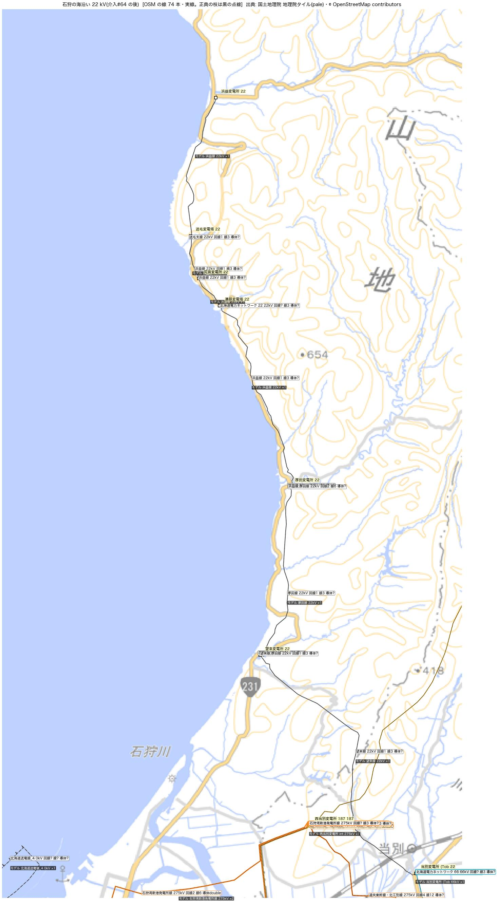

# 22・33 kV を正典の電圧の級にする(介入#64・2026-11-15)

## 何をしたか

正典(`docs/data/built/all.json`)は、OSM の線の電圧を決まった級に寄せる(`_clean_voltage`)。級の表は
66・77・110・132・154・187・220・275・500 kV で、22 kV と 33 kV の線は 66 kV に丸めていた。
この丸めは介入台帳に載っておらず、2026-11-10 に佐渡(33 kV)で見つけて先生の判断待ちにしていた。
2026-11-15 に先生から「ちゃんと DB や正典を整えておいて」と言われ、22・33 kV を級として持つことにした。

- 級の表を `src/utils/voltage.KV_CLASSES` の 1 か所にまとめ、正典の組み立て(`snapped_topology`)・潮流(`full_from_built`)・
  線の容量(`line_capacity`)・変圧器(`transforms`)が同じ表を読む。30・44 kV は 33 kV に、25 kV は 22 kV に寄る
- 線の定数(`config/line_types.yaml`)に 33 kV と 22 kV の行を足した。ほかの級と同じく典型値(出典なしの合成値)
- 需要の電圧ごとの重み(`config/regional_demand.yaml`)に 33・22 kV を 0.066 で足した(下の「重みの根拠」)
- 断片の回収(介入#34、`scripts/hunt_fragment_osm_bridges.py`)が OSM の生の電圧(30 kV など)をそのまま枝に書いていたので、級に寄せる
- 地図の色(`grid_map.js`・`map_gl.js`・`site_plan.js`・`powerflow.js`・`sld.js`)と desk のデモ(場面 6「33・22 kV」)
- 潮流の出力の線に電圧(`kv`)を書き、全国の概観と単線結線図はそれを先に読む(下の「見つけた取り違え」)
- 切り替え: 環境変数 `AJG_LOW_KV_CLASSES=0` で前の丸めに戻る(`tests/test_low_kv_classes.py`)

## 根拠

- **OSM のタグ**: 線の `voltage` が 22000・33000 のもの。地図に重ねると線の形も名前も合っている(下の図)
- **各社の公表の変圧器の一覧**(介入#50 で集計した `config/transformer_capacity_by_pair.json`)に、154/33・154/22・110/22・77/33・77/22・
  66/33・66/22・33/6.6・22/6.6 kV の組がある。各社が自分でこの級を持っている
- **重みの根拠**: 配電用の変圧器の容量の中央値は 66/6.6 kV が 38 MVA、33/6.6 kV と 22/6.6 kV が 5 MVA。66 kV の重み 0.5 × 5/38 ≈ 0.066。
  1 回目の作り直しでは 22・33 kV に重みを足しておらず(既定の 0.5)、北海道の 22・33 kV の点に 66 kV と同じ 8.5 MW ずつ置かれて、
  北海道の AC が解けなくなった(vm 0.50・最大負荷率 214%)。重みを入れた 2 回目で解けた

## 前と後(前 = main 04a150cc の正典)

正典の網:

| | 前 | 後 |
|---|---:|---:|
| 点 | 15,509 | 15,605 |
| 枝 | 17,416 | 17,510 |
| 枝 22 kV | 0 | 135(延長 485 km) |
| 枝 33 kV | 0 | 223(延長 1,280 km) |
| 枝 66 kV | 7,634 | 7,373 |
| 点 22 kV / 33 kV | 0 / 0 | 230 / 290 |

22・33 kV の点の地域: 北海道 42/73・東北 22/119(佐渡を含む)・東京 63/10・中部 5/18・北陸 0/2・関西 81/66・中国 11/2・四国 1/0・九州 5/0(22 kV/33 kV)。

併架の線(`66;22`・`77;22` などのタグ)は、22・33 kV が級になったので 2 つの回線に分かれる(`_parse_voltage_classes`)。
22・33 kV と別の級が同じ端を持つ組は 34(大久野線;秋川線・足柄線・末広町線/浅野線・花総線/市川線・昆陽線;昆陽宝塚線・黒部幹線 など)。
前は `66;22` は 66 kV の 1 回線、`77;22` は 77 kV と 66 kV(22 kV を丸めた架空の回線)の 2 回線になっていた。

正典の潮流(`docs/data/powerflow_full/summary.json`、地点需要あり):

| 島 | バス | 線 | 変圧器 | vm の最小 | 最大負荷率 % | 損失 MW |
|---|---|---|---|---|---|---|
| 北海道 | 831→860 | 858→854 | 69→103 | 0.860→0.684 | 85.2→88.7 | 100.4→89.2 |
| 東 | 6,328→6,391 | 6,557→6,546 | 674→754 | 0.857→0.854 | 862.8→877.3 | 1,175.4→1,184.0 |
| 西 | 7,878→7,888 | 7,995→7,993 | 960→971 | 0.717→0.694 | 605.9→605.0 | 1,158.2→1,130.6 |
| 沖縄 | 100 | 96 | 19 | 0.755 | 233.0 | 29.2 |

4 島とも AC で解ける。需要の合計は同じ。配布ケースの網(`tests/test_canonical_islands.py`、地点需要なし)も 4 島とも素朴な NR で解ける:
北海道 (860, 854, 103, 0, 0.7233, 1.0043, 2.13%)・東 (6391, 6546, 754, 0, 0.8535, 1.0087, 2.61%)・西 (7882, 7987, 971, 6, 0.7307, 1.0099, 1.88%)・沖縄は同じ。

N-1(`docs/reports/n1_screening_2026-11-15.md`、154 kV 以上の実在線を監視):

| 島 | 新たな過負荷を生む開放(実在線) | 平常時の過負荷(実在線) | 切り離しになる開放 |
|---|---|---|---|
| 北海道 | 0→0(全体 21→7) | 0→0(全体 1→0) | 149→169 |
| 東 | 169→227 | 49→48 | 961→997 |
| 西 | 200→199 | 22→24 | 2,089→2,097 |

東の 169→227 は、開放した枝の名前で前後を比べると、後だけの 20 本(並行の回線を数えると 58)はすべて 2 本の線の閾値またぎだった。
秋田の 牛島変電所~牛島西三丁目変電所線 は平常時の負荷率が AC で 99.2→100.7%(直流の N-1 では 99.6%)になり、遠くの 10 本の開放で 100.1〜101.3% になる。
残りは 北葛飾線/野田線(6 本)など。前だけの開放は 0。東北に 33 kV の点が 119 あり、その点の需要が減った分がほかの点に回ったため。

発電機の付け方の試験(`tests/test_gen_attach_modes.py`、北海道・直流・銘板なし)の最大負荷率: nearest 136.5→155.5%(過負荷 2→3 本)・
cap 318.0→310.6%・島の既定の capkv 79.1→79.3%(過負荷 0 本のまま)。nearest は電圧を見ずにいちばん近い母線に付けるので、22 kV の津別線に発電機が載る。

## 目で見たこと



北海道で電圧の最も低い所は、石狩の海沿いの 22 kV の鎖(当別 22 kV → 望来 → 厚田 → 濃昼変電塔 → 尻苗 → 送毛変電塔 → 浜益)。
OSM の線は 浜益線・厚田線・望来線 で、どれも 22 kV・1 回線。正典の枝は同じ形・同じ回線数で通っている。
電圧が下がる理由は線ではなく需要の配り方で、22 kV の点 6 つに 1.33 MW ずつ(計 8 MW)置いている(地点需要は電圧の重み × 点の数で配る)。
「変電塔」は需要の点ではないとみられ、浜益・厚田は人口千人台の地区なので、8 MW は多すぎる。直すなら需要の配り方の介入で、ここでは入れていない。

## 見つけた取り違え(全国の概観と単線結線図)

22・33 kV の線の潮流を点検したら、全国の概観(`national_overview_66kv.geojson`)で 22 kV の「花総線/市川線」に 252 MW・
「昆陽線;昆陽宝塚線」に 442 MW が流れていた。網の中では 22 kV の回線は 1〜10 MW で、252・442 MW は同じ区間の 66・77 kV の回線だった。
`gen_national_overview_from_full.py` が線の電圧を端の座標から母線の電圧で引いていて、同じ敷地(同じ座標)に電圧の違う母線が重なると、
あとに書いた母線の電圧になる。`gen_sld_from_built.py` も端の組で線の負荷を引くので、同じ 2 つの敷地を結ぶ電圧の違う線の負荷が混ざる。
この取り違えは #64 の前からある(154・77 kV が重なる敷地でも起きる)。潮流の出力の線に `kv` を書き、2 つともそれを先に読むようにした。

直したあとの全国の概観の帯ごとの線の数(前 → 後): 500 kV 269→427・275 kV 688→868・154 kV 2,553→2,823・110 kV 813→838・
77 kV 2,269→2,164・66 kV 以下 8,979→8,436。500 kV の帯に移った 158 本は、前は 275 kV(40)・154 kV(64)・110 kV(7)・77 kV(23)・
66 kV(48)の帯にあった(新三河幹線・駿遠幹線・浜岡幹線・信濃幹線・第二浜岡幹線 など)。直したあと、100% を超える 22・33 kV の線は 357 本のうち 5 本、
22・33 kV の線の流れは最大 41 MW。

desk のデモ(`docs/demos/grid_assembly.html`)の数の札も、説明文と 1〜6 km 食い違っていた(77・66 kV で 34,545 と 34,551)。
線ごとの km を 0.1 km 単位で丸めて足すので、構内のつなぎなどの 0.05 km 未満の線が 0 になっていた。0.01 km 単位にし、説明文の合計も同じ値から数える
(場面 2〜9 で札と説明文が同じになることを、ブラウザで場面ごとに開いて確かめた)。

## CI の関門(full-ac-light)が落ちた — 北海道は初めて「無効電力の上限を守る解」で解けた

PR #181 の CI で、検証の関門(`scripts/ci/verify_matrix.py`、UC の 18 時の断面を AC で解く)の北海道の最低電圧が 0.68 になり、
下限 0.83 を下回った。調べた順:

1. いちばん低いのは浜益変電所 22 kV(石狩の海沿いの鎖、上の図)。ただし 66 kV 以上の網でも 0.714 で、北の宗谷・名寄の 110・66 kV が
   全体に 6〜7% 下がっていた(小頓別 110 kV 0.959→0.890、浜頓別開閉所 66 kV 0.861→0.745)
2. 北の需要は 315→220 MW に減っている(22・33 kV の点の需要が減った)。北へ延びる道も切れていない(猿払線は 33 kV になったが、前から北にはつながっていない)
3. **解き方が変わっていた**。AC は「発電機の無効電力の上限を守る NR」から試し、解けなければ上限を外した NR に落とす
   (`src/powerflow/batch_solve.run_powerflow`・`uc_to_pf_built._bounded_ac`)。前の正典の北海道は上限を守る段で解けず、上限を外した段で解けていた。
   その解では、上限 0.05 Mvar の 0.1 MW の太陽光(稚内メガソーラー)が 27 Mvar、上限 25.5 Mvar の雨竜発電所が 122.9 Mvar を出して、北の電圧を 1.0 に保っていた。
   #64 の後は上限を守る段で解ける。上限を守ると北は無効電力が足りず、電圧が下がる

| 北海道 18 時(関門と同じ計算) | 前 | 後 |
|---|---|---|
| 解き方 | 上限を外した NR | 上限を守る NR |
| 最低電圧(全部) | 0.859(ユーラス浜頓別 WF 66 kV) | 0.680(浜益 22 kV) |
| 最低電圧(66 kV 以上) | 0.859 | 0.714(ユーラス浜頓別 WF 66 kV) |
| スラックの絶対値 | 807.4 MW | 797.1 MW |

前の 0.859 は上限を外した解なので物理的ではない。関門の下限 0.83 は 2026-09-02 にこの種の解で決めた値だった。
**関門は緩めていない**(見張りの決まり: 試験が見つけた劣化は緩めずに報告する)。関門の表に、どの解き方で解けたか・66 kV 以上の最低・
いちばん低い母線を添えるようにした(合否は変えない)。

先生の判断がほしいこと:
- 上限を守る解を正とみなし、関門の下限をその解で決め直すか(北海道は上限を守る解で解けることも関門に入れる)
- 北の無効電力の不足を、モデルに調相設備(変電所の電力用コンデンサなど)を足して埋めるか(出典の要る介入になる)
- 北海道の 22 kV の鎖の需要の配り方(変電塔に需要を置くか)

## 限界

- **線の定数は典型値**(ACSR 120 mm²・地中は CV)。出典のある値ではない
- **北海道の 22 kV の鎖の電圧**(上の図)。vm 0.68(地点需要あり)・0.72(なし)
- **大阪の三国・三津屋の 77 kV**: 前から西で電圧の最も低い所が 0.776→0.731 に下がった(配布ケースの網)。関西の 22・33 kV の点 147 の需要が減り、
  その分がほかの点に回った。上流の西三国 154 kV が 0.837→0.806 なので、22・33 kV の線ではなく 154 kV の網の弱さ
- **22・33 kV の網の通り抜け**: 開放点(常時開いている区分の点)が分からないので、22・33 kV の網が上の級と並列になる所で、
  上の級の流れが通り抜ける。100% を超える 22・33 kV の線は 357 本のうち 5 本(関西の 南河内喜志線 22 kV・中部の 毛受~起・祖父江 の 33 kV など)
- 22・33 kV の線は OSM に載っている分だけ。地中の多い都市部(東京の 22 kV)は少ない
- 22 kV より低い電圧のタグ(佐渡の 11 kV の線など)は 22 kV に寄る(前は 66 kV に寄っていた)。配電の電圧は AJG の対象外なので級を足していない

## 無効化

`AJG_LOW_KV_CLASSES=0` を付けて全段を作り直す(`scripts/regenerate_all.py`)。22・33 kV は前のとおり 66 kV に丸まる。
線の定数と需要の重みの行は、級が無ければ使われない。

## 再現

```
PYTHONPATH=. python scripts/regenerate_all.py          # 2 回(2 回目の出力を採る。3 回目で同じになる)
AJGRID_SLOW_TESTS=1 python -m pytest tests/test_canonical_islands.py
python docs/reports/sync_scoreboard_2026-11-10/inspect_map.py --root . --bbox 141.25 43.20 141.55 43.62 \
  --zoom 11 --labels --model --out fig.jpg
```
