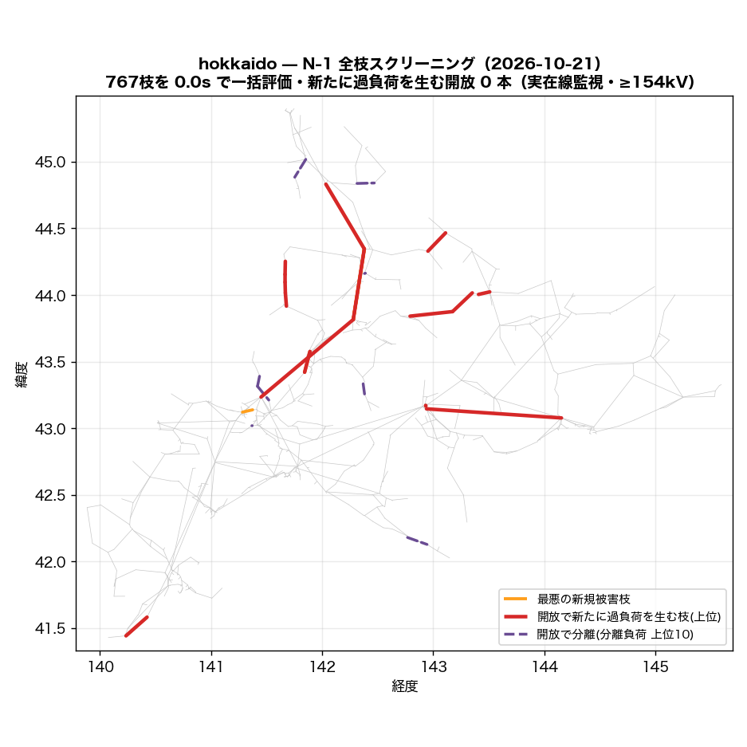
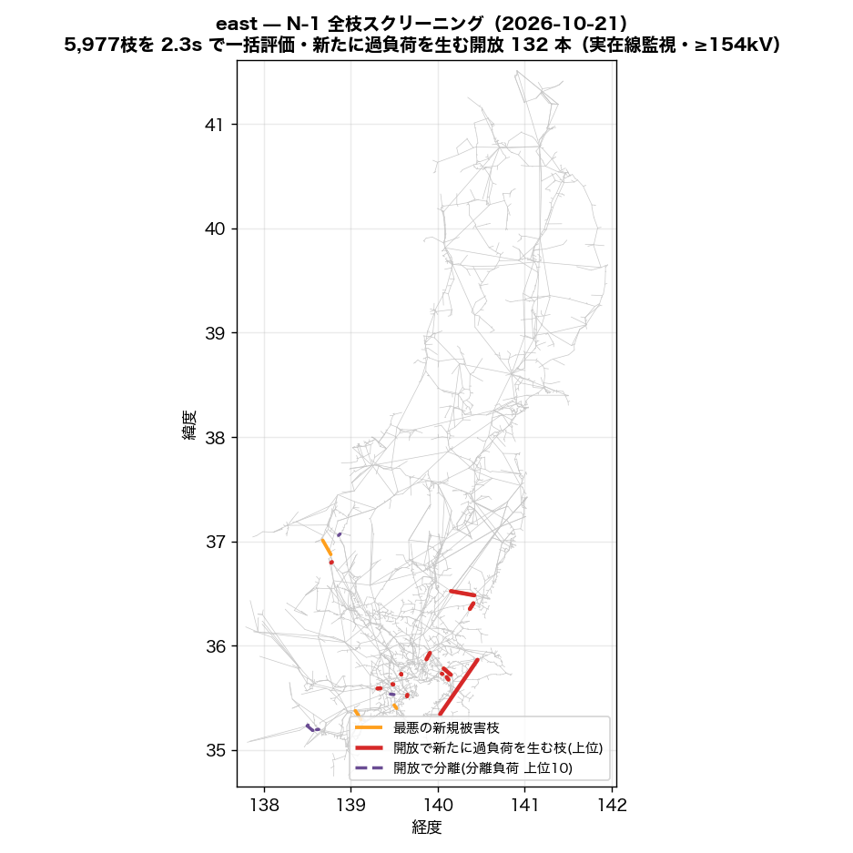
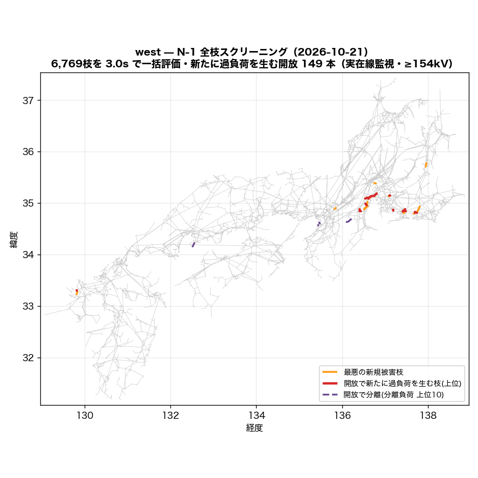
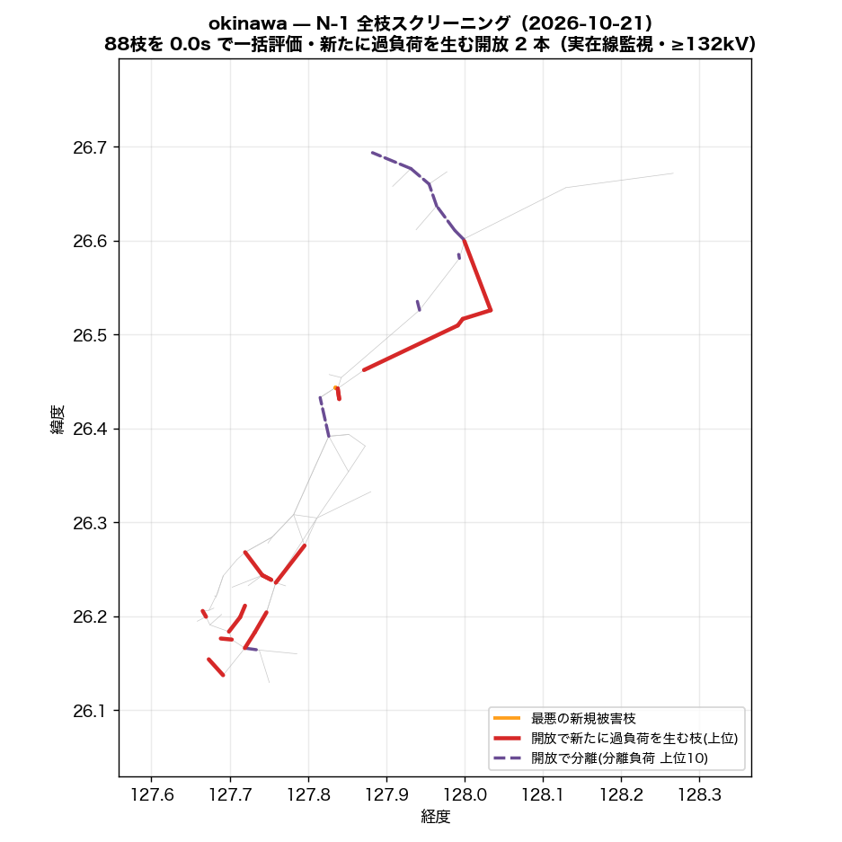

# N-1 全枝スクリーニング — LODF で全枝開放を一括評価（2026-10-21）

枝 k を開放したときの枝 j の潮流は `f_j + LODF[j,k]·f_k`（直流近似）で閉じているので、
全枝分の「開放後の最大負荷率・過負荷本数・最悪被害枝」が行列 1 枚の列演算で出る。
並列回線は **1 回線開放**（残回線容量で評価）、開放で分離する枝（橋）は LODF が定義できないため
**分離側の負荷・発電を別勘定**にした。

**合成定格の錯視を主結果に混ぜない**: 主表は監視枝を「実在線（OSM実線形・回収線・公表接続）＋銘板つき変圧器」に限った順位。
同一敷地タイ（同定）・発電所取付線・推定容量の変圧器などが最悪枝になる開放は別表で開示する。

| 島 | 主成分 | 枝 | 評価した開放 | 橋(分離) | 監視枝(実在/全) | 基準過負荷(実在) | 新規過負荷を生む開放 実在/全 | 新規側 >120% (実在) | 分離負荷≥100MW | PTDF | 一括評価 |
|---|---:|---:|---:|---:|---:|---:|---:|---:|---:|---:|---:|
| hokkaido | 799 | 916 | 767 | 149 | 127/187 | 0 | **0** / 13 | 0 | 0 | 0.0s | 0.0s |
| east | 5,831 | 6,941 | 5,977 | 964 | 1,415/2,127 | 66 | **132** / 253 | 33 | 3 | 2.9s | 2.3s |
| west | 7,494 | 8,913 | 6,769 | 2,139 | 2,469/3,249 | 22 | **149** / 309 | 40 | 40 | 4.8s | 3.0s |
| okinawa | 94 | 115 | 88 | 27 | 23/43 | 0 | **2** / 6 | 0 | 3 | 0.0s | 0.0s |

監視は ≥154kV（最高階級が届かない島はその階級: hokkaido 154kV、east 154kV、west 154kV、okinawa 132kV）・容量係数 1.0（理論値 √3·V·I に対する較正。公表運用容量との比較では約 0.5）。

## hokkaido

要素の内訳: 公表接続(直線) 2、発電所取付線 15、OSM実線 820、OSM実線(回収) 8、同一敷地タイ(同定) 2、変圧器(推定容量) 68、変圧器(銘板) 1

### 実在線監視 — 開放すると新たに過負荷を生む枝（上位 20）

基準ケースで既に >100% の実在監視枝: 0 本（最大 40.9%）。基準の過負荷は開放と無関係に居座るので、指標は**基準で過負荷でない枝の側**で取る（新規過負荷本数 → 新規側の最大負荷率）。新規側が 120% を超える開放: 0 本。

| # | 開放する枝 | 種別 | kV | 回線 | 開放枝の基準負荷率 | 新規過負荷 本数 | 新規側の最大負荷率 | 最大増分 | 最悪の新規被害枝 (種別・基準→開放後) |
|---:|---|---|---:|---:|---:|---:|---:|---:|---|
| 1 | 名寄幹線 | OSM実線 | 187 | 2 | 40.9% | **0** | **78%** | +37pt | 名寄幹線 (OSM実線, 187kV, 40.9→78%) |
| 2 | 滝川幹線 (Takikawa-kansen) | OSM実線 | 187 | 2 | 36.3% | **0** | **66%** | +29pt | 滝川幹線 (Takikawa-kansen) (OSM実線, 187kV, 36.3→66%) |
| 3 | trafo_275/187kV@pairmed@osm | 変圧器(推定容量) | 275 | 1 | 32.0% | **0** | **47%** | +28pt | 西札幌線 (OSM実線, 187kV, 18.5→47%) |
| 4 | 北幌延線 | OSM実線 | 187 | 2 | 25.7% | **0** | **46%** | +20pt | 北幌延線 (OSM実線, 187kV, 25.7→46%) |
| 5 | 北海道電力ネットワーク 187.0kV線 | OSM実線 | 187 | 1 | 5.6% | **0** | **46%** | +6pt | 十勝幹線 (OSM実線, 187kV, 39.9→46%) |
| 6 | 泉町一丁目変電所~小平変電所 (Obira Hendensho)線 | OSM実線 | 66 | 1 | 70.7% | **0** | **46%** | +4pt | 名寄幹線 (OSM実線, 187kV, 40.9→46%) |
| 7 | 十勝幹線 | OSM実線 | 187 | 1 | 39.9% | **0** | **45%** | +40pt | 北海道電力ネットワーク 187.0kV線 (OSM実線, 187kV, 5.6→45%) |
| 8 | 道東幹線 | OSM実線 | 187 | 2 | 9.4% | **0** | **45%** | +5pt | 十勝幹線 (OSM実線, 187kV, 39.9→45%) |
| 9 | 日東変電所~丸瀬布西町変電所線 | OSM実線 | 66 | 1 | 62.2% | **0** | **45%** | +5pt | 十勝幹線 (OSM実線, 187kV, 39.9→45%) |
| 10 | 小平町変電所~小平変電所 (Obira Hendensho)線 | OSM実線 | 66 | 1 | 57.5% | **0** | **45%** | +4pt | 名寄幹線 (OSM実線, 187kV, 40.9→45%) |
| 11 | 小平町変電所~鬼鹿田代変電所線 | OSM実線 | 66 | 1 | 44.3% | **0** | **44%** | +3pt | 名寄幹線 (OSM実線, 187kV, 40.9→44%) |
| 12 | 日東変電所~丸瀬布西町変電所線 | OSM実線 | 66 | 1 | 49.0% | **0** | **44%** | +4pt | 十勝幹線 (OSM実線, 187kV, 39.9→44%) |
| 13 | trafo_187/66kV@pairmed@osm | 変圧器(推定容量) | 187 | 1 | 49.3% | **0** | **44%** | +8pt | 名寄幹線 (OSM実線, 187kV, 40.9→44%) |
| 14 | trafo_275/187kV@nameplate@osm | 変圧器(銘板) | 275 | 2 | 29.5% | **0** | **43%** | +14pt | trafo_275/187kV@nameplate@osm (変圧器(銘板), 275kV, 29.5→43%) |
| 15 | 道北幹線 (Dōhoku-kansen) | OSM実線 | 187 | 2 | 24.2% | **0** | **43%** | +8pt | 滝川幹線 (Takikawa-kansen) (OSM実線, 187kV, 36.3→43%) |
| 16 | 吉岡線 (お客さま接続線 JR北海道) | OSM実線 | 187 | 2 | 22.4% | **0** | **43%** | +21pt | 吉岡線 (お客さま接続線 JR北海道) (OSM実線, 187kV, 22.4→43%) |
| 17 | 石北線 | OSM実線 | 66 | 1 | 41.9% | **0** | **43%** | +3pt | 十勝幹線 (OSM実線, 187kV, 39.9→43%) |
| 18 | 興部線 | OSM実線 | 66 | 1 | 32.5% | **0** | **43%** | +2pt | 名寄幹線 (OSM実線, 187kV, 40.9→43%) |
| 19 | trafo_275/187kV@pairmed@osm | 変圧器(推定容量) | 275 | 1 | 21.5% | **0** | **43%** | +17pt | trafo_275/187kV@nameplate@osm (変圧器(銘板), 275kV, 29.5→43%) |
| 20 | 鬼鹿田代変電所~苫前町変電所線 | OSM実線 | 66 | 1 | 31.1% | **0** | **43%** | +2pt | 名寄幹線 (OSM実線, 187kV, 40.9→43%) |

### AC 検証（上位を本番 solve_island で開放して解き直し）

| 開放する枝 | 開放 | DC 新規側最大 (新規本数) | AC | AC 新規側最大 (新規本数) | DC最悪新規枝の AC 負荷率（基準→開放後） | 秒 |
|---|---|---:|---|---:|---|---:|
| 名寄幹線 | 1回線 | 78% (0) | 収束 (給電100%) | 84.5% (0) | 43.4 → 84.5% | 0.1 |
| 滝川幹線 (Takikawa-kansen) | 1回線 | 66% (0) | 収束 (給電100%) | 69.4% (0) | 38.3 → 69.4% | 0.1 |
| trafo_275/187kV@pairmed@osm | 全回線 | 47% (0) | 収束 (給電100%) | 50.9% (0) | 20.6 → 50.9% | 0.1 |
| 北幌延線 | 1回線 | 46% (0) | 収束 (給電100%) | 47.3% (0) | 26.6 → 47.3% | 0.1 |
| 北海道電力ネットワーク 187.0kV線 | 全回線 | 46% (0) | 収束 (給電100%) | 47.9% (0) | 42.1 → 47.9% | 0.1 |

AC の負荷率は |P|/容量（直流の定義に揃えた）。1 回線開放は parallel を 1 減らして解き直し、残回線の容量で評価。prune はしごで落ちた枝は比較から除外。

### 別表 — 合成定格の要素が最悪枝になる開放（錯視の開示・上位 20）

| # | 開放する枝 | 種別 | kV | 回線 | 開放枝の基準負荷率 | 新規過負荷 本数 | 新規側の最大負荷率 | 最大増分 | 最悪の新規被害枝 (種別・基準→開放後) |
|---:|---|---|---:|---:|---:|---:|---:|---:|---|
| 1 | trafo_187/110kV | 変圧器(推定容量) | 187 | 1 | 61.7% | **1** | **120%** | +26pt | trafo_187/110kV (変圧器(推定容量), 187kV, 96.5→120%) |
| 2 | 泉町一丁目変電所~小平変電所 (Obira Hendensho)線 | OSM実線 | 66 | 1 | 70.7% | **1** | **115%** | +19pt | trafo_187/110kV (変圧器(推定容量), 187kV, 96.5→115%) |
| 3 | 小平町変電所~小平変電所 (Obira Hendensho)線 | OSM実線 | 66 | 1 | 57.5% | **1** | **112%** | +15pt | trafo_187/110kV (変圧器(推定容量), 187kV, 96.5→112%) |
| 4 | 北幌延線 | OSM実線 | 187 | 2 | 25.7% | **1** | **111%** | +20pt | trafo_187/110kV (変圧器(推定容量), 187kV, 96.5→111%) |
| 5 | trafo_187/110kV | 変圧器(推定容量) | 187 | 1 | 96.5% | **1** | **111%** | +49pt | trafo_187/110kV (変圧器(推定容量), 187kV, 61.7→111%) |
| 6 | 小平町変電所~鬼鹿田代変電所線 | OSM実線 | 66 | 1 | 44.3% | **1** | **108%** | +12pt | trafo_187/110kV (変圧器(推定容量), 187kV, 96.5→108%) |
| 7 | trafo_187/66kV@pairmed@osm | 変圧器(推定容量) | 187 | 1 | 49.3% | **1** | **107%** | +32pt | trafo_187/110kV (変圧器(推定容量), 187kV, 96.5→107%) |
| 8 | trafo_187/66kV@pairmed@osm | 変圧器(推定容量) | 187 | 1 | 44.2% | **1** | **106%** | +61pt | trafo_187/66kV (変圧器(推定容量), 187kV, 44.5→106%) |
| 9 | 興部線 | OSM実線 | 66 | 1 | 32.5% | **1** | **105%** | +9pt | trafo_187/110kV (変圧器(推定容量), 187kV, 96.5→105%) |
| 10 | 鬼鹿田代変電所~苫前町変電所線 | OSM実線 | 66 | 1 | 31.1% | **1** | **105%** | +8pt | trafo_187/110kV (変圧器(推定容量), 187kV, 96.5→105%) |
| 11 | trafo_187/110kV | 変圧器(推定容量) | 187 | 1 | 47.6% | **1** | **103%** | +20pt | trafo_187/110kV (変圧器(推定容量), 187kV, 96.5→103%) |
| 12 | trafo_187/66kV@pairmed@osm | 変圧器(推定容量) | 187 | 1 | 38.7% | **1** | **102%** | +25pt | trafo_187/110kV (変圧器(推定容量), 187kV, 96.5→102%) |
| 13 | 苫前町変電所~苫前変電所 (Tomamae Hendensho)線 | OSM実線 | 66 | 1 | 17.9% | **1** | **101%** | +5pt | trafo_187/110kV (変圧器(推定容量), 187kV, 96.5→101%) |
| 14 | 日東変電所~丸瀬布西町変電所線 | OSM実線 | 66 | 1 | 62.2% | **0** | **100%** | +35pt | trafo_187/110kV (変圧器(推定容量), 187kV, 96.5→100%) |
| 15 | trafo_275/187kV@pairmed@osm | 変圧器(推定容量) | 275 | 1 | 21.5% | **0** | **99%** | +17pt | trafo_187/110kV (変圧器(推定容量), 187kV, 96.5→99%) |
| 16 | 日東変電所~丸瀬布西町変電所線 | OSM実線 | 66 | 1 | 49.0% | **0** | **99%** | +28pt | trafo_187/110kV (変圧器(推定容量), 187kV, 96.5→99%) |
| 17 | trafo_187/66kV@pairmed@osm | 変圧器(推定容量) | 187 | 1 | 15.7% | **0** | **99%** | +21pt | trafo_187/110kV (変圧器(推定容量), 187kV, 96.5→99%) |
| 18 | 石北線 | OSM実線 | 66 | 1 | 41.9% | **0** | **99%** | +24pt | trafo_187/110kV (変圧器(推定容量), 187kV, 96.5→99%) |
| 19 | trafo_187/66kV@pairmed@osm | 変圧器(推定容量) | 187 | 1 | 32.6% | **0** | **99%** | +24pt | trafo_187/110kV (変圧器(推定容量), 187kV, 96.5→99%) |
| 20 | 豊富中川幹線 | OSM実線 | 187 | 2 | 14.4% | **0** | **99%** | +11pt | trafo_187/110kV (変圧器(推定容量), 187kV, 96.5→99%) |

### 分離（橋）— 開放で切り離される負荷の大きい枝（上位 20）

橋 149 本（うち数値的な擬似橋 0）。分離側の負荷合計 1,799 MW。放射系の末端はそもそも N-1 で守れない（実系統では配電側の切替で対処）ので、ここは「モデルが放射になっている箇所」の一覧として読む。

| # | 開放する枝 | 種別 | kV | 分離バス数 | 分離側の負荷 | 分離側の発電 |
|---:|---|---|---:|---:|---:|---:|
| 1 | trafo_110/66kV | 変圧器(推定容量) | 110 | 9 | **72 MW** | 0 MW |
| 2 | 望来線 | OSM実線 | 66 | 6 | **54 MW** | 0 MW |
| 3 | trafo_187/66kV@pairmed@osm | 変圧器(推定容量) | 187 | 9 | **54 MW** | 0 MW |
| 4 | 同一敷地タイ(同定) | 同一敷地タイ(同定) | 66 | 5 | **45 MW** | 88 MW |
| 5 | 厚田線 | OSM実線 | 66 | 5 | **45 MW** | 0 MW |
| 6 | 山部線 | OSM実線 | 66 | 4 | **36 MW** | 11 MW |
| 7 | 浦河東線 | OSM実線 | 66 | 5 | **36 MW** | 5 MW |
| 8 | 天塩線 | OSM実線 | 66 | 6 | **36 MW** | 0 MW |
| 9 | 北海道送電線_53 | OSM実線 | 110 | 7 | **36 MW** | 0 MW |
| 10 | 枝幸線 | OSM実線 | 66 | 4 | **36 MW** | 0 MW |
| 11 | 浜益線 | OSM実線 | 66 | 4 | **36 MW** | 0 MW |
| 12 | 岩知志線 | OSM実線 | 66 | 5 | **27 MW** | 17 MW |
| 13 | 長流線 | OSM実線 | 66 | 4 | **27 MW** | 0 MW |
| 14 | 昆布線 | OSM実線 | 66 | 7 | **27 MW** | 9 MW |
| 15 | 瓜幕線 | OSM実線 | 66 | 3 | **27 MW** | 0 MW |
| 16 | 金山線 | OSM実線 | 66 | 3 | **27 MW** | 11 MW |
| 17 | 昆布線 | OSM実線 | 66 | 5 | **27 MW** | 9 MW |
| 18 | 遠別線 | OSM実線 | 66 | 5 | **27 MW** | 0 MW |
| 19 | 西一条十二丁目変電所~士別市変電所線 | OSM実線 | 66 | 5 | **27 MW** | 0 MW |
| 20 | 頓別線 | OSM実線 | 66 | 3 | **27 MW** | 0 MW |

## east

要素の内訳: 公表接続(直線) 61、発電所取付線 278、OSM実線 5,777、OSM実線(回収) 93、同一敷地タイ(同定) 51、合成連系タイ 1、変圧器(推定容量) 674、変圧器(銘板) 6

### 実在線監視 — 開放すると新たに過負荷を生む枝（上位 20）

基準ケースで既に >100% の実在監視枝: 66 本（最大 771.0%）。基準の過負荷は開放と無関係に居座るので、指標は**基準で過負荷でない枝の側**で取る（新規過負荷本数 → 新規側の最大負荷率）。新規側が 120% を超える開放: 33 本。

| # | 開放する枝 | 種別 | kV | 回線 | 開放枝の基準負荷率 | 新規過負荷 本数 | 新規側の最大負荷率 | 最大増分 | 最悪の新規被害枝 (種別・基準→開放後) |
|---:|---|---|---:|---:|---:|---:|---:|---:|---|
| 1 | trafo_500/275kV@pairmed@osm | 変圧器(推定容量) | 500 | 1 | 37.3% | **6** | **124%** | +31pt | 北千葉線 (OSM実線, 275kV, 95.2→124%) |
| 2 | trafo_500/275kV@pairmed@osm | 変圧器(推定容量) | 500 | 1 | 48.2% | **4** | **196%** | +101pt | 石岡線;岩間線 (OSM実線, 154kV, 97.8→196%) |
| 3 | trafo_500/154kV@pairmed@pub | 変圧器(推定容量) | 500 | 1 | 52.7% | **3** | **108%** | +68pt | 新富士変電所~小田急電鉄 松田変電所線 (OSM実線, 154kV, 90.6→108%) |
| 4 | 浅貝線 | OSM実線 | 500 | 1 | 17.3% | **2** | **228%** | +224pt | 神立変電所~灰雨変電所線 (OSM実線, 154kV, 4.1→228%) |
| 5 | 北千葉線 | OSM実線 | 275 | 2 | 95.2% | **2** | **161%** | +65pt | 北千葉線 (OSM実線, 275kV, 95.2→161%) |
| 6 | 那珂線 | OSM実線 | 275 | 2 | 72.3% | **2** | **121%** | +49pt | 那珂線 (OSM実線, 275kV, 72.3→121%) |
| 7 | trafo_275/154kV@pairmed@osm | 変圧器(推定容量) | 275 | 1 | 86.5% | **2** | **108%** | +89pt | 北多摩線;吉武線 (OSM実線, 154kV, 97.1→108%) |
| 8 | trafo_275/154kV@pairmed@osm | 変圧器(推定容量) | 275 | 1 | 38.2% | **2** | **106%** | +16pt | 桜ヶ丘線; 長峰線 (OSM実線, 154kV, 98.4→106%) |
| 9 | trafo_275/154kV | 変圧器(推定容量) | 275 | 1 | 112.0% | **2** | **106%** | +27pt | 南横浜火力線 / 戸塚線 (OSM実線, 154kV, 80.8→106%) |
| 10 | 新袖ヶ浦線 | OSM実線 | 500 | 2 | 34.9% | **2** | **105%** | +22pt | 長沼線 (OSM実線, 154kV, 96.4→105%) |
| 11 | trafo_500/275kV@pairmed@pub | 変圧器(推定容量) | 500 | 1 | 32.6% | **2** | **100%** | +18pt | 北多摩線;吉武線 (OSM実線, 154kV, 97.1→100%) |
| 12 | 桜ヶ丘線; 長峰線 | OSM実線 | 154 | 2 | 98.4% | **1** | **193%** | +94pt | 桜ヶ丘線; 長峰線 (OSM実線, 154kV, 98.4→193%) |
| 13 | 北多摩線;吉武線 | OSM実線 | 154 | 2 | 97.1% | **1** | **190%** | +93pt | 北多摩線;吉武線 (OSM実線, 154kV, 97.1→190%) |
| 14 | 長沼線 | OSM実線 | 154 | 2 | 96.4% | **1** | **177%** | +80pt | 長沼線 (OSM実線, 154kV, 96.4→177%) |
| 15 | 石岡線;岩間線 | OSM実線 | 154 | 2 | 97.8% | **1** | **175%** | +77pt | 石岡線;岩間線 (OSM実線, 154kV, 97.8→175%) |
| 16 | 橋本西線 | OSM実線 | 154 | 2 | 86.8% | **1** | **161%** | +75pt | 橋本西線 (OSM実線, 154kV, 86.8→161%) |
| 17 | 坪井線 | OSM実線 | 154 | 2 | 82.2% | **1** | **161%** | +79pt | 坪井線 (OSM実線, 154kV, 82.2→161%) |
| 18 | 北葛飾線/野田線 | OSM実線 | 275 | 2 | 88.1% | **1** | **157%** | +69pt | 北葛飾線/野田線 (OSM実線, 275kV, 88.1→157%) |
| 19 | 北多摩線;吉武線 | OSM実線 | 154 | 2 | 79.9% | **1** | **156%** | +76pt | 北多摩線;吉武線 (OSM実線, 154kV, 79.9→156%) |
| 20 | 横浜火力南線 / 子安線 | OSM実線 | 154 | 2 | 85.4% | **1** | **155%** | +70pt | 横浜火力南線 / 子安線 (OSM実線, 154kV, 85.4→155%) |

### AC 検証（上位を本番 solve_island で開放して解き直し）

| 開放する枝 | 開放 | DC 新規側最大 (新規本数) | AC | AC 新規側最大 (新規本数) | DC最悪新規枝の AC 負荷率（基準→開放後） | 秒 |
|---|---|---:|---|---:|---|---:|
| trafo_500/275kV@pairmed@osm | 全回線 | 124% (6) | 収束 (給電100%) | 135.9% (7) | 102.5 → 135.9% | 1.0 |
| trafo_500/275kV@pairmed@osm | 全回線 | 196% (4) | 収束 (給電100%) | 186.7% (5) | 93.7 → 186.7% | 0.7 |
| trafo_500/154kV@pairmed@pub | 全回線 | 108% (3) | 収束 (給電100%) | 113.2% (6) | 95.0 → 113.2% | 1.1 |
| 浅貝線 | 全回線 | 228% (2) | 収束 (給電100%) | 111.4% (3) | 5.8 → 0.0% | 2.7 |
| 北千葉線 | 1回線 | 161% (2) | 収束 (給電100%) | 172.9% (5) | 102.5 → 172.9% | 1.1 |

AC の負荷率は |P|/容量（直流の定義に揃えた）。1 回線開放は parallel を 1 減らして解き直し、残回線の容量で評価。prune はしごで落ちた枝は比較から除外。

### 別表 — 合成定格の要素が最悪枝になる開放（錯視の開示・上位 20）

| # | 開放する枝 | 種別 | kV | 回線 | 開放枝の基準負荷率 | 新規過負荷 本数 | 新規側の最大負荷率 | 最大増分 | 最悪の新規被害枝 (種別・基準→開放後) |
|---:|---|---|---:|---:|---:|---:|---:|---:|---|
| 1 | 浅貝線 | OSM実線 | 500 | 1 | 17.3% | **6** | **659%** | +598pt | trafo_154/66kV (変圧器(推定容量), 154kV, 61.2→659%) |
| 2 | trafo_275/66kV | 変圧器(推定容量) | 275 | 1 | 160.0% | **6** | **116%** | +19pt | trafo_154/66kV (変圧器(推定容量), 154kV, 97.7→116%) |
| 3 | trafo_154/66kV | 変圧器(推定容量) | 154 | 1 | 102.5% | **6** | **115%** | +18pt | trafo_154/66kV (変圧器(推定容量), 154kV, 97.7→115%) |
| 4 | 柿ノ沢線 | OSM実線 | 66 | 1 | 258.7% | **5** | **116%** | +66pt | trafo_154/66kV (変圧器(推定容量), 154kV, 97.7→116%) |
| 5 | trafo_154/66kV | 変圧器(推定容量) | 154 | 1 | 97.7% | **5** | **108%** | +17pt | trafo_154/66kV (変圧器(推定容量), 154kV, 99.1→108%) |
| 6 | trafo_275/66kV@pairmed@osm | 変圧器(推定容量) | 275 | 1 | 68.4% | **4** | **165%** | +82pt | trafo_500/66kV (変圧器(推定容量), 500kV, 83.2→165%) |
| 7 | trafo_154/66kV@pairmed@osm | 変圧器(推定容量) | 154 | 1 | 62.0% | **4** | **164%** | +65pt | trafo_154/66kV (変圧器(推定容量), 154kV, 98.2→164%) |
| 8 | trafo_275/154kV@pairmed@osm | 変圧器(推定容量) | 275 | 1 | 60.0% | **4** | **129%** | +49pt | trafo_275/154kV (変圧器(推定容量), 275kV, 92.7→129%) |
| 9 | trafo_275/66kV@pairmed@pub | 変圧器(推定容量) | 275 | 1 | 45.6% | **4** | **127%** | +60pt | trafo_500/66kV (変圧器(推定容量), 500kV, 82.9→127%) |
| 10 | trafo_275/66kV@pairmed@osm | 変圧器(推定容量) | 275 | 1 | 47.5% | **4** | **120%** | +68pt | trafo_275/66kV (変圧器(推定容量), 275kV, 51.9→120%) |
| 11 | trafo_154/66kV | 変圧器(推定容量) | 154 | 1 | 94.3% | **4** | **114%** | +18pt | trafo_154/66kV (変圧器(推定容量), 154kV, 99.1→114%) |
| 12 | trafo_154/66kV | 変圧器(推定容量) | 154 | 1 | 89.2% | **4** | **114%** | +22pt | trafo_154/66kV (変圧器(推定容量), 154kV, 92.0→114%) |
| 13 | trafo_154/66kV | 変圧器(推定容量) | 154 | 1 | 75.7% | **4** | **113%** | +15pt | trafo_154/66kV (変圧器(推定容量), 154kV, 97.7→113%) |
| 14 | trafo_154/66kV | 変圧器(推定容量) | 154 | 1 | 99.1% | **4** | **111%** | +17pt | trafo_154/66kV (変圧器(推定容量), 154kV, 94.3→111%) |
| 15 | trafo_154/66kV | 変圧器(推定容量) | 154 | 1 | 92.0% | **4** | **111%** | +22pt | trafo_154/66kV (変圧器(推定容量), 154kV, 89.2→111%) |
| 16 | 菅谷線 | OSM実線 | 66 | 1 | 100.9% | **4** | **109%** | +17pt | trafo_154/66kV (変圧器(推定容量), 154kV, 92.0→109%) |
| 17 | leadin | 発電所取付線 | 275 | 1 | 33.1% | **3** | **180%** | +108pt | trafo_154/66kV#43a@推定 (変圧器(推定容量), 154kV, 72.1→180%) |
| 18 | trafo_275/66kV#43a@推定 | 変圧器(推定容量) | 275 | 1 | 100.7% | **3** | **176%** | +104pt | trafo_154/66kV#43a@推定 (変圧器(推定容量), 154kV, 72.1→176%) |
| 19 | trafo_275/66kV@pairmed@pub | 変圧器(推定容量) | 275 | 1 | 50.4% | **3** | **155%** | +112pt | trafo_154/66kV (変圧器(推定容量), 154kV, 42.3→155%) |
| 20 | 新袖ヶ浦線 | OSM実線 | 500 | 2 | 34.9% | **3** | **115%** | +24pt | trafo_500/66kV (変圧器(推定容量), 500kV, 91.7→115%) |

### 分離（橋）— 開放で切り離される負荷の大きい枝（上位 20）

橋 964 本（うち数値的な擬似橋 0）。分離側の負荷合計 11,918 MW。放射系の末端はそもそも N-1 で守れない（実系統では配電側の切替で対処）ので、ここは「モデルが放射になっている箇所」の一覧として読む。

| # | 開放する枝 | 種別 | kV | 分離バス数 | 分離側の負荷 | 分離側の発電 |
|---:|---|---|---:|---:|---:|---:|
| 1 | trafo_275/66kV | 変圧器(推定容量) | 275 | 9 | **159 MW** | 0 MW |
| 2 | 東京電力パワーグリッド 66.0kV線 | OSM実線 | 66 | 19 | **132 MW** | 61 MW |
| 3 | trafo_154/66kV | 変圧器(推定容量) | 154 | 3 | **110 MW** | 0 MW |
| 4 | 東京電力パワーグリッド 66.0kV線 | OSM実線 | 66 | 13 | **98 MW** | 61 MW |
| 5 | 中野台二丁目変電所~富士川第一変電所線 | OSM実線 | 66 | 11 | **98 MW** | 61 MW |
| 6 | trafo_154/66kV@pairmed@osm | 変圧器(推定容量) | 154 | 8 | **92 MW** | 0 MW |
| 7 | trafo_154/66kV | 変圧器(推定容量) | 154 | 8 | **92 MW** | 0 MW |
| 8 | namebind | OSM実線 | 66 | 6 | **81 MW** | 61 MW |
| 9 | 長津田町田線 | OSM実線 | 66 | 5 | **76 MW** | 0 MW |
| 10 | tokyo_line_4208 | OSM実線 | 66 | 19 | **73 MW** | 50 MW |
| 11 | 東京電力パワーグリッド 66.0kV線 | OSM実線 | 66 | 8 | **72 MW** | 0 MW |
| 12 | 東京電力パワーグリッド 66.0kV線 | OSM実線 | 66 | 6 | **72 MW** | 0 MW |
| 13 | (154kV・旭→横浜大黒) | 公表接続(直線) | 154 | 3 | **66 MW** | 19 MW |
| 14 | 佐野川線 | OSM実線 | 66 | 5 | **64 MW** | 61 MW |
| 15 | 衛星判読回収線 sat-001-ojiya66 | OSM実線(回収) | 66 | 6 | **55 MW** | 19 MW |
| 16 | tokyo_line_4210 | OSM実線 | 66 | 18 | **55 MW** | 50 MW |
| 17 | tokyo_line_4225 | OSM実線 | 66 | 5 | **55 MW** | 19 MW |
| 18 | tokyo_line_4228 | OSM実線 | 66 | 14 | **55 MW** | 50 MW |
| 19 | 梅木変電所~三福変電所線 | OSM実線 | 66 | 5 | **54 MW** | 0 MW |
| 20 | 伊東市変電所~田方変電所線 | OSM実線 | 66 | 5 | **54 MW** | 0 MW |

## west

要素の内訳: 公表接続(直線) 63、公表接続の取付スタブ 5、発電所取付線 301、OSM実線 7,388、OSM実線(回収) 140、同一敷地タイ(同定) 13、合成連系タイ 5、変圧器(推定容量) 994、変圧器(銘板) 4

### 実在線監視 — 開放すると新たに過負荷を生む枝（上位 20）

基準ケースで既に >100% の実在監視枝: 22 本（最大 255.7%）。基準の過負荷は開放と無関係に居座るので、指標は**基準で過負荷でない枝の側**で取る（新規過負荷本数 → 新規側の最大負荷率）。新規側が 120% を超える開放: 40 本。

| # | 開放する枝 | 種別 | kV | 回線 | 開放枝の基準負荷率 | 新規過負荷 本数 | 新規側の最大負荷率 | 最大増分 | 最悪の新規被害枝 (種別・基準→開放後) |
|---:|---|---|---:|---:|---:|---:|---:|---:|---|
| 1 | trafo_500/275kV | 変圧器(推定容量) | 500 | 1 | 49.0% | **5** | **134%** | +50pt | 駒ヶ根変電所~田畑変電所線 (OSM実線, 154kV, 84.1→134%) |
| 2 | 山代変電所~久原変電所線 | OSM実線 | 500 | 1 | 35.6% | **4** | **170%** | +146pt | 山代変電所~九州電力　日宇変電所線 (OSM実線, 220kV, 24.0→170%) |
| 3 | 西日本電線新城線 | OSM実線 | 66 | 1 | 517.6% | **4** | **154%** | +98pt | 豊川玉川線 (OSM実線, 154kV, 56.3→154%) |
| 4 | 西日本電線新城線 | OSM実線 | 275 | 1 | 37.3% | **4** | **154%** | +98pt | 豊川玉川線 (OSM実線, 154kV, 56.3→154%) |
| 5 | 麻生田分岐線 | OSM実線 | 66 | 1 | 466.2% | **4** | **144%** | +88pt | 豊川玉川線 (OSM実線, 154kV, 56.3→144%) |
| 6 | 中勢亀山線 | OSM実線 | 275 | 1 | 85.0% | **4** | **134%** | +73pt | 南勢北勢線 (OSM実線, 154kV, 89.5→134%) |
| 7 | namebind | OSM実線 | 275 | 1 | 89.6% | **4** | **125%** | +32pt | 北一宮加納線 (Kita Ichinomiya Kanō Sen) (OSM実線, 154kV, 97.4→125%) |
| 8 | 中部電力パワーグリッド 275.0kV線 | OSM実線 | 275 | 1 | 145.5% | **3** | **147%** | +114pt | 西尾張~西名古屋変電所線 (OSM実線, 275kV, 99.1→147%) |
| 9 | 関西幹線 | OSM実線 | 154 | 2 | 89.1% | **3** | **139%** | +50pt | 関西幹線 (OSM実線, 154kV, 89.1→139%) |
| 10 | 三河遠江線 | OSM実線 | 275 | 1 | 34.0% | **3** | **137%** | +68pt | 秋葉浜松線 (OSM実線, 154kV, 83.3→137%) |
| 11 | 新鈴鹿分岐線 | OSM実線 | 275 | 1 | 65.4% | **3** | **136%** | +51pt | 南勢北勢線 (OSM実線, 154kV, 89.5→136%) |
| 12 | trafo_275/77kV@pairmed@osm | 変圧器(推定容量) | 275 | 1 | 106.9% | **3** | **135%** | +50pt | 南勢北勢線 (OSM実線, 154kV, 89.5→135%) |
| 13 | 中勢亀山線 | OSM実線 | 275 | 1 | 72.5% | **3** | **119%** | +55pt | 南勢北勢線 (OSM実線, 154kV, 89.5→119%) |
| 14 | 中部電力パワーグリッド 日進変電所~北豊田変電所 (Kita Toyota Hendensho)線 | OSM実線 | 275 | 1 | 59.6% | **3** | **114%** | +26pt | 中部電力パワーグリッド 154.0kV線 (OSM実線, 154kV, 94.8→114%) |
| 15 | 中部電力パワーグリッド 275.0kV線 | OSM実線 | 275 | 1 | 77.8% | **3** | **108%** | +33pt | 中部電力パワーグリッド 154.0kV線 (OSM実線, 154kV, 94.8→108%) |
| 16 | 垂坂町変電所~北勢変電所 (Hokusei Hendensho)線 | OSM実線 | 154 | 1 | 109.1% | **2** | **146%** | +93pt | 垂坂町変電所~北勢変電所 (Hokusei Hendensho)線 (OSM実線, 154kV, 53.4→146%) |
| 17 | trafo_500/154kV@pairmed@pub | 変圧器(推定容量) | 500 | 1 | 49.8% | **2** | **145%** | +82pt | 宇治市変電所~喜撰山開閉所線 (OSM実線, 154kV, 62.5→145%) |
| 18 | 秋葉浜松線 | OSM実線 | 154 | 1 | 106.8% | **2** | **145%** | +70pt | 遠江浜松線 (OSM実線, 154kV, 75.1→145%) |
| 19 | 中勢亀山線 | OSM実線 | 275 | 2 | 72.7% | **2** | **135%** | +62pt | 中勢亀山線 (OSM実線, 275kV, 72.7→135%) |
| 20 | 東海鉄道二川線 | OSM実線 | 154 | 1 | 73.9% | **2** | **132%** | +57pt | 三河玉川線 (OSM実線, 154kV, 75.3→132%) |

### AC 検証（上位を本番 solve_island で開放して解き直し）

| 開放する枝 | 開放 | DC 新規側最大 (新規本数) | AC | AC 新規側最大 (新規本数) | DC最悪新規枝の AC 負荷率（基準→開放後） | 秒 |
|---|---|---:|---|---:|---|---:|
| trafo_500/275kV | 全回線 | 134% (5) | 収束 (給電100%) | 142.1% (7) | 87.7 → 142.1% | 7.5 |
| 山代変電所~久原変電所線 | 全回線 | 170% (4) | 収束 (給電100%) | 170.7% (5) | 26.1 → 170.7% | 5.1 |
| 西日本電線新城線 | 全回線 | 154% (4) | 収束 (給電100%) | 154.6% (5) | 59.9 → 154.6% | 4.4 |
| 西日本電線新城線 | 全回線 | 154% (4) | 収束 (給電100%) | 154.6% (5) | 59.9 → 154.6% | 6.1 |
| 麻生田分岐線 | 全回線 | 144% (4) | 収束 (給電100%) | 144.7% (5) | 59.9 → 144.7% | 3.5 |

AC の負荷率は |P|/容量（直流の定義に揃えた）。1 回線開放は parallel を 1 減らして解き直し、残回線の容量で評価。prune はしごで落ちた枝は比較から除外。

### 別表 — 合成定格の要素が最悪枝になる開放（錯視の開示・上位 20）

| # | 開放する枝 | 種別 | kV | 回線 | 開放枝の基準負荷率 | 新規過負荷 本数 | 新規側の最大負荷率 | 最大増分 | 最悪の新規被害枝 (種別・基準→開放後) |
|---:|---|---|---:|---:|---:|---:|---:|---:|---|
| 1 | trafo_154/77kV@pairmed@osm | 変圧器(推定容量) | 154 | 1 | 73.2% | **6** | **116%** | +35pt | trafo_275/77kV (変圧器(推定容量), 275kV, 99.1→116%) |
| 2 | trafo_220/66kV@pairmed@pub | 変圧器(推定容量) | 220 | 1 | 81.2% | **5** | **134%** | +51pt | trafo_220/66kV (変圧器(推定容量), 220kV, 83.0→134%) |
| 3 | 中部電力パワーグリッド 日進変電所~北豊田変電所 (Kita Toyota Hendensho)線 | OSM実線 | 275 | 1 | 59.6% | **5** | **116%** | +57pt | trafo_275/77kV (変圧器(推定容量), 275kV, 59.3→116%) |
| 4 | trafo_275/77kV@pairmed@osm | 変圧器(推定容量) | 275 | 1 | 76.4% | **4** | **122%** | +29pt | trafo_500/77kV (変圧器(推定容量), 500kV, 97.2→122%) |
| 5 | 梶原六丁目変電所~高槻変電所線 | OSM実線 | 500 | 1 | 105.5% | **4** | **116%** | +38pt | trafo_500/77kV (変圧器(推定容量), 500kV, 97.2→116%) |
| 6 | 垂坂町変電所~北勢変電所 (Hokusei Hendensho)線 | OSM実線 | 154 | 1 | 162.6% | **3** | **152%** | +71pt | trafo_275/154kV (変圧器(推定容量), 275kV, 81.8→152%) |
| 7 | 大畑町変電所~中部電力八草変電所線 | OSM実線 | 275 | 1 | 29.7% | **3** | **147%** | +88pt | trafo_275/77kV (変圧器(推定容量), 275kV, 59.3→147%) |
| 8 | trafo_187/66kV@pairmed@osm | 変圧器(推定容量) | 187 | 1 | 56.5% | **3** | **133%** | +58pt | trafo_187/66kV (変圧器(推定容量), 187kV, 74.9→133%) |
| 9 | trafo_220/66kV@pairmed@osm | 変圧器(推定容量) | 220 | 1 | 49.6% | **3** | **131%** | +32pt | trafo_220/66kV (変圧器(推定容量), 220kV, 98.4→131%) |
| 10 | trafo_187/66kV@pairmed@osm | 変圧器(推定容量) | 187 | 1 | 56.6% | **3** | **122%** | +54pt | trafo_187/66kV (変圧器(推定容量), 187kV, 95.9→122%) |
| 11 | trafo_275/77kV@pairmed@osm | 変圧器(推定容量) | 275 | 1 | 55.3% | **3** | **112%** | +34pt | trafo_275/77kV (変圧器(推定容量), 275kV, 78.2→112%) |
| 12 | trafo_220/66kV | 変圧器(推定容量) | 220 | 1 | 125.0% | **3** | **108%** | +15pt | trafo_220/66kV (変圧器(推定容量), 220kV, 92.4→108%) |
| 13 | trafo_220/66kV | 変圧器(推定容量) | 220 | 1 | 78.1% | **3** | **103%** | +12pt | trafo_220/66kV (変圧器(推定容量), 220kV, 98.4→103%) |
| 14 | 塩尻送電所~長野市変電所線 | OSM実線 | 275 | 1 | 34.1% | **2** | **182%** | +124pt | trafo_275/77kV (変圧器(推定容量), 275kV, 58.0→182%) |
| 15 | 美波町変電所~桑野変電所線 | OSM実線 | 187 | 1 | 25.8% | **2** | **147%** | +54pt | trafo_187/66kV (変圧器(推定容量), 187kV, 93.0→147%) |
| 16 | 桑野変電所~美波町変電所線 | OSM実線 | 66 | 1 | 182.8% | **2** | **147%** | +54pt | trafo_187/66kV (変圧器(推定容量), 187kV, 93.0→147%) |
| 17 | 大畑町変電所~中部電力八草変電所線 | OSM実線 | 77 | 1 | 311.1% | **2** | **136%** | +77pt | trafo_275/77kV (変圧器(推定容量), 275kV, 59.3→136%) |
| 18 | trafo_275/77kV@pairmed@pub | 変圧器(推定容量) | 275 | 1 | 64.0% | **2** | **128%** | +87pt | trafo_154/77kV (変圧器(推定容量), 154kV, 40.5→128%) |
| 19 | trafo_220/66kV@pairmed@osm | 変圧器(推定容量) | 220 | 1 | 45.5% | **2** | **124%** | +34pt | trafo_220/66kV (変圧器(推定容量), 220kV, 89.9→124%) |
| 20 | 豊崎線 | OSM実線 | 154 | 1 | 48.8% | **2** | **118%** | +105pt | trafo_154/77kV (変圧器(推定容量), 154kV, 12.4→118%) |

### 分離（橋）— 開放で切り離される負荷の大きい枝（上位 20）

橋 2,139 本（うち数値的な擬似橋 0）。分離側の負荷合計 32,717 MW。放射系の末端はそもそも N-1 で守れない（実系統では配電側の切替で対処）ので、ここは「モデルが放射になっている箇所」の一覧として読む。

| # | 開放する枝 | 種別 | kV | 分離バス数 | 分離側の負荷 | 分離側の発電 |
|---:|---|---|---:|---:|---:|---:|
| 1 | trafo_275/77kV@pairmed@osm | 変圧器(推定容量) | 275 | 24 | **407 MW** | 1 MW |
| 2 | 関西送電線_129 | OSM実線 | 77 | 19 | **402 MW** | 122 MW |
| 3 | trafo_154/77kV#43a@推定 | 変圧器(推定容量) | 154 | 24 | **370 MW** | 23 MW |
| 4 | 敷津変電所~御崎七丁目変電所線 | OSM実線 | 154 | 16 | **344 MW** | 122 MW |
| 5 | 泉北線〔取付〕 | 公表接続の取付スタブ | 77 | 23 | **340 MW** | 23 MW |
| 6 | 中勢青山線 | OSM実線 | 77 | 9 | **209 MW** | 19 MW |
| 7 | 青山名張線 | OSM実線 | 77 | 7 | **209 MW** | 19 MW |
| 8 | 大柿線 | OSM実線 | 66 | 6 | **172 MW** | 0 MW |
| 9 | 青山名張線 | OSM実線 | 77 | 5 | **167 MW** | 19 MW |
| 10 | trafo_187/66kV | 変圧器(推定容量) | 187 | 12 | **165 MW** | 19 MW |
| 11 | 熊野川町相須変電所~新宮変電所線 | OSM実線 | 275 | 18 | **162 MW** | 1 MW |
| 12 | trafo_187/110kV | 変圧器(推定容量) | 187 | 19 | **158 MW** | 170 MW |
| 13 | trafo_154/77kV | 変圧器(推定容量) | 154 | 7 | **157 MW** | 0 MW |
| 14 | 川口線+川口連絡線 | 公表接続(直線) | 66 | 12 | **156 MW** | 30 MW |
| 15 | trafo_154/77kV#43a@推定 | 変圧器(推定容量) | 154 | 5 | **147 MW** | 0 MW |
| 16 | trafo_154/77kV | 変圧器(推定容量) | 154 | 6 | **144 MW** | 99 MW |
| 17 | 大柿線 | OSM実線 | 66 | 5 | **138 MW** | 0 MW |
| 18 | 西三国変電所~味生変電所線 | OSM実線 | 154 | 6 | **137 MW** | 0 MW |
| 19 | 南港南二丁目変電所~南港東七丁目変電所線 | OSM実線 | 154 | 8 | **137 MW** | 21 MW |
| 20 | 日和佐支線〔取付〕 | 公表接続の取付スタブ | 66 | 11 | **136 MW** | 0 MW |

## okinawa

要素の内訳: 発電所取付線 8、OSM実線 88、変圧器(推定容量) 19

### 実在線監視 — 開放すると新たに過負荷を生む枝（上位 20）

基準ケースで既に >100% の実在監視枝: 0 本（最大 89.9%）。基準の過負荷は開放と無関係に居座るので、指標は**基準で過負荷でない枝の側**で取る（新規過負荷本数 → 新規側の最大負荷率）。新規側が 120% を超える開放: 0 本。

| # | 開放する枝 | 種別 | kV | 回線 | 開放枝の基準負荷率 | 新規過負荷 本数 | 新規側の最大負荷率 | 最大増分 | 最悪の新規被害枝 (種別・基準→開放後) |
|---:|---|---|---:|---:|---:|---:|---:|---:|---|
| 1 | trafo_132/66kV | 変圧器(推定容量) | 132 | 1 | 133.6% | **1** | **113%** | +49pt | 石川東山一丁目変電所~石川東山二丁目変電所線 (OSM実線, 132kV, 89.9→113%) |
| 2 | trafo_132/66kV | 変圧器(推定容量) | 132 | 1 | 47.8% | **1** | **100%** | +10pt | 石川東山一丁目変電所~石川東山二丁目変電所線 (OSM実線, 132kV, 89.9→100%) |
| 3 | trafo_132/66kV | 変圧器(推定容量) | 132 | 1 | 45.5% | **0** | **100%** | +10pt | 石川東山一丁目変電所~石川東山二丁目変電所線 (OSM実線, 132kV, 89.9→100%) |
| 4 | namebind | OSM実線 | 66 | 2 | 83.6% | **0** | **92%** | +5pt | 石川東山一丁目変電所~石川東山二丁目変電所線 (OSM実線, 132kV, 89.9→92%) |
| 5 | Henoko Substation~名護市変電所線 | OSM実線 | 66 | 2 | 45.3% | **0** | **91%** | +2pt | 石川東山一丁目変電所~石川東山二丁目変電所線 (OSM実線, 132kV, 89.9→91%) |
| 6 | 松田変電所~Henoko Substation線 | OSM実線 | 66 | 2 | 56.1% | **0** | **90%** | +1pt | 石川東山一丁目変電所~石川東山二丁目変電所線 (OSM実線, 132kV, 89.9→90%) |
| 7 | leadin | 発電所取付線 | 66 | 2 | 33.1% | **0** | **90%** | +0pt | 石川東山一丁目変電所~石川東山二丁目変電所線 (OSM実線, 132kV, 89.9→90%) |
| 8 | 松田変電所~Henoko Substation線 | OSM実線 | 66 | 2 | 69.9% | **0** | **90%** | +0pt | 石川東山一丁目変電所~石川東山二丁目変電所線 (OSM実線, 132kV, 89.9→90%) |
| 9 | leadin | 発電所取付線 | 132 | 2 | 8.3% | **0** | **90%** | +0pt | 石川東山一丁目変電所~石川東山二丁目変電所線 (OSM実線, 132kV, 89.9→90%) |
| 10 | 西原幹線;前田線 | OSM実線 | 66 | 1 | 18.2% | **0** | **90%** | +0pt | 石川東山一丁目変電所~石川東山二丁目変電所線 (OSM実線, 132kV, 89.9→90%) |
| 11 | 西原変電所~渡口変電所線 | OSM実線 | 66 | 1 | 29.0% | **0** | **90%** | +1pt | 石川東山一丁目変電所~石川東山二丁目変電所線 (OSM実線, 132kV, 89.9→90%) |
| 12 | 那覇高安線; 那覇小禄線 | OSM実線 | 66 | 2 | 10.6% | **0** | **90%** | +0pt | 石川東山一丁目変電所~石川東山二丁目変電所線 (OSM実線, 132kV, 89.9→90%) |
| 13 | 繁多川線 | OSM実線 | 66 | 2 | 13.8% | **0** | **90%** | +0pt | 石川東山一丁目変電所~石川東山二丁目変電所線 (OSM実線, 132kV, 89.9→90%) |
| 14 | 沖縄電力 66.0kV線 | OSM実線 | 66 | 2 | 13.8% | **0** | **90%** | +0pt | 石川東山一丁目変電所~石川東山二丁目変電所線 (OSM実線, 132kV, 89.9→90%) |
| 15 | 西原幹線 | OSM実線 | 132 | 3 | 15.7% | **0** | **90%** | +7pt | 石川東山一丁目変電所~石川東山二丁目変電所線 (OSM実線, 132kV, 89.9→90%) |
| 16 | 西原幹線;前田線 | OSM実線 | 132 | 2 | 13.1% | **0** | **90%** | +12pt | 石川東山一丁目変電所~石川東山二丁目変電所線 (OSM実線, 132kV, 89.9→90%) |
| 17 | leadin | 発電所取付線 | 66 | 3 | 0.0% | **0** | **90%** | +0pt | 石川東山一丁目変電所~石川東山二丁目変電所線 (OSM実線, 132kV, 89.9→90%) |
| 18 | namebind | OSM実線 | 66 | 2 | 0.0% | **0** | **90%** | +0pt | 石川東山一丁目変電所~石川東山二丁目変電所線 (OSM実線, 132kV, 89.9→90%) |
| 19 | 友寄変電所~南風原変電所線 | OSM実線 | 132 | 3 | 10.7% | **0** | **90%** | +5pt | 石川東山一丁目変電所~石川東山二丁目変電所線 (OSM実線, 132kV, 89.9→90%) |
| 20 | 南風原変電所~与那原変電所線 | OSM実線 | 132 | 3 | 19.6% | **0** | **90%** | +10pt | 石川東山一丁目変電所~石川東山二丁目変電所線 (OSM実線, 132kV, 89.9→90%) |

### AC 検証（上位を本番 solve_island で開放して解き直し）

| 開放する枝 | 開放 | DC 新規側最大 (新規本数) | AC | AC 新規側最大 (新規本数) | DC最悪新規枝の AC 負荷率（基準→開放後） | 秒 |
|---|---|---:|---|---:|---|---:|
| trafo_132/66kV | 全回線 | 113% (1) | 収束 (給電100%) | 131.5% (1) | 95.5 → 131.5% | 0.1 |
| trafo_132/66kV | 全回線 | 100% (1) | 収束 (給電100%) | 106.9% (1) | 95.5 → 106.9% | 0.0 |
| trafo_132/66kV | 全回線 | 100% (0) | 収束 (給電100%) | 106.1% (1) | 95.5 → 106.1% | 0.0 |
| namebind | 1回線 | 92% (0) | 収束 (給電100%) | 97.1% (0) | 95.5 → 97.1% | 0.2 |
| Henoko Substation~名護市変電所線 | 1回線 | 91% (0) | 収束 (給電100%) | 96.7% (0) | 95.5 → 96.7% | 0.0 |

AC の負荷率は |P|/容量（直流の定義に揃えた）。1 回線開放は parallel を 1 減らして解き直し、残回線の容量で評価。prune はしごで落ちた枝は比較から除外。

### 別表 — 合成定格の要素が最悪枝になる開放（錯視の開示・上位 9）

| # | 開放する枝 | 種別 | kV | 回線 | 開放枝の基準負荷率 | 新規過負荷 本数 | 新規側の最大負荷率 | 最大増分 | 最悪の新規被害枝 (種別・基準→開放後) |
|---:|---|---|---:|---:|---:|---:|---:|---:|---|
| 1 | 仲泊変電所~石川東山一丁目変電所線 | OSM実線 | 132 | 1 | 68.4% | **4** | **151%** | +115pt | trafo_132/66kV (変圧器(推定容量), 132kV, 36.3→151%) |
| 2 | 石川東山一丁目変電所~石川東山二丁目変電所線 | OSM実線 | 132 | 1 | 89.9% | **2** | **160%** | +113pt | trafo_132/66kV (変圧器(推定容量), 132kV, 47.8→160%) |
| 3 | 友寄変電所~南風原変電所線 | OSM実線 | 66 | 1 | 159.1% | **1** | **129%** | +54pt | trafo_132/66kV@osm (変圧器(推定容量), 132kV, 75.2→129%) |
| 4 | 伊佐一丁目変電所_2~牧港五丁目変電所線 | OSM実線 | 66 | 1 | 142.7% | **1** | **125%** | +48pt | trafo_132/66kV (変圧器(推定容量), 132kV, 76.4→125%) |
| 5 | 南風原変電所~与那原変電所線 | OSM実線 | 66 | 1 | 99.2% | **0** | **95%** | +26pt | trafo_132/66kV@osm (変圧器(推定容量), 132kV, 75.2→95%) |
| 6 | trafo_132/66kV | 変圧器(推定容量) | 132 | 1 | 60.0% | **0** | **90%** | +15pt | trafo_132/66kV@osm (変圧器(推定容量), 132kV, 75.2→90%) |
| 7 | 恩納村変電所~喜瀬変電所線 | OSM実線 | 66 | 1 | 145.8% | **0** | **76%** | +100pt | trafo_132/66kV (変圧器(推定容量), 132kV, 76.4→76%) |
| 8 | 伊芸変電所~石川東山二丁目変電所線 | OSM実線 | 132 | 1 | 45.4% | **0** | **76%** | +124pt | trafo_132/66kV (変圧器(推定容量), 132kV, 76.4→76%) |
| 9 | 石川東山二丁目変電所~石川東山一丁目変電所線 | OSM実線 | 66 | 1 | 173.3% | **0** | **76%** | +119pt | trafo_132/66kV (変圧器(推定容量), 132kV, 76.4→76%) |

### 分離（橋）— 開放で切り離される負荷の大きい枝（上位 20）

橋 27 本（うち数値的な擬似橋 0）。分離側の負荷合計 1,755 MW。放射系の末端はそもそも N-1 で守れない（実系統では配電側の切替で対処）ので、ここは「モデルが放射になっている箇所」の一覧として読む。

| # | 開放する枝 | 種別 | kV | 分離バス数 | 分離側の負荷 | 分離側の発電 |
|---:|---|---|---:|---:|---:|---:|
| 1 | うるま市変電所~仲泊変電所線 | OSM実線 | 132 | 61 | **873 MW** | 716 MW |
| 2 | 名護市変電所~名護電力所線 | OSM実線 | 66 | 12 | **132 MW** | 8 MW |
| 3 | 沖縄電力 66.0kV線 | OSM実線 | 66 | 9 | **113 MW** | 2 MW |
| 4 | 沖縄電力 66.0kV線 | OSM実線 | 66 | 8 | **94 MW** | 2 MW |
| 5 | 名護電力所~仲宗根変電所線 | OSM実線 | 66 | 6 | **76 MW** | 2 MW |
| 6 | 仲宗根変電所~東変電所線 | OSM実線 | 66 | 4 | **57 MW** | 2 MW |
| 7 | 沖縄電力 66.0kV線 | OSM実線 | 66 | 3 | **38 MW** | 0 MW |
| 8 | 東変電所~海洋博変電所線 | OSM実線 | 66 | 2 | **38 MW** | 1 MW |
| 9 | 沖縄電力 66.0kV線 | OSM実線 | 66 | 1 | **19 MW** | 0 MW |
| 10 | 沖縄電力 66.0kV線 | OSM実線 | 66 | 1 | **19 MW** | 0 MW |
| 11 | 恩納村変電所~喜瀬変電所線 | OSM実線 | 66 | 1 | **19 MW** | 0 MW |
| 12 | 名護電力所~田港変電所線 | OSM実線 | 66 | 2 | **19 MW** | 6 MW |
| 13 | leadin | 発電所取付線 | 66 | 1 | **19 MW** | 0 MW |
| 14 | leadin | 発電所取付線 | 66 | 1 | **19 MW** | 0 MW |
| 15 | leadin | 発電所取付線 | 66 | 1 | **19 MW** | 0 MW |
| 16 | 浦添大名線 | OSM実線 | 66 | 1 | **19 MW** | 0 MW |
| 17 | 友寄変電所~大里変電所線 | OSM実線 | 66 | 2 | **19 MW** | 0 MW |
| 18 | 久茂地変電所~西那覇変電所線 | OSM実線 | 66 | 1 | **19 MW** | 0 MW |
| 19 | leadin | 発電所取付線 | 66 | 1 | **19 MW** | 0 MW |
| 20 | 友寄変電所~佐敷変電所線 | OSM実線 | 66 | 1 | **19 MW** | 0 MW |

## 前提と限界

- 直流近似・熱容量のみ（無効電力・電圧・安定度・保護協調は見ない）。合成インピーダンス（電圧階級の標準定数）上の線形化
- 容量は理論値（線路 √3·V·I·回線数、変圧器 sn·回線数）。公表運用容量ではない（`--cap-factor` で較正）
- 対象は各島の最大連結成分。連系線・FC・非通電の合成タイ（介入#31）は開放候補に入らない
- 発電機の再配分（AGC・予備力）は考慮しない＝開放直後の潮流再配分だけ
- **screening であって運用可否の判定ではない**。順位で候補を絞り、確定は AC・実データ・実系統の定格で

---
生成: `scripts/sensitivity/n1_screening.py`
