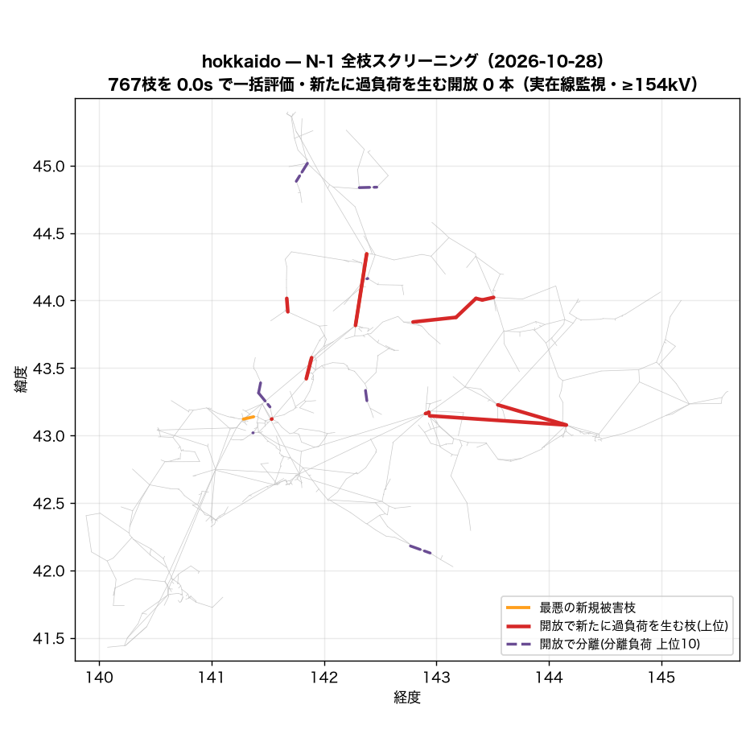
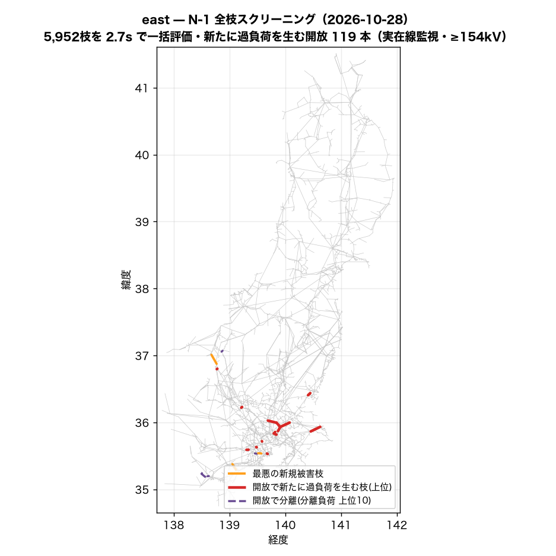
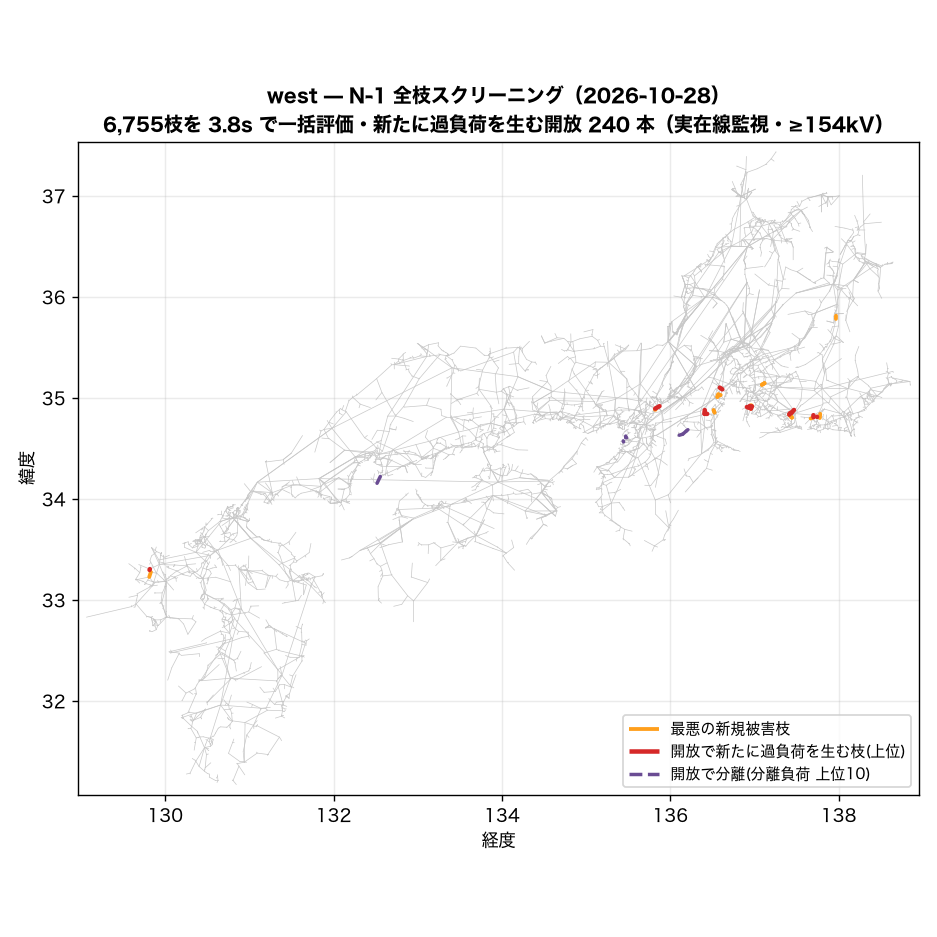
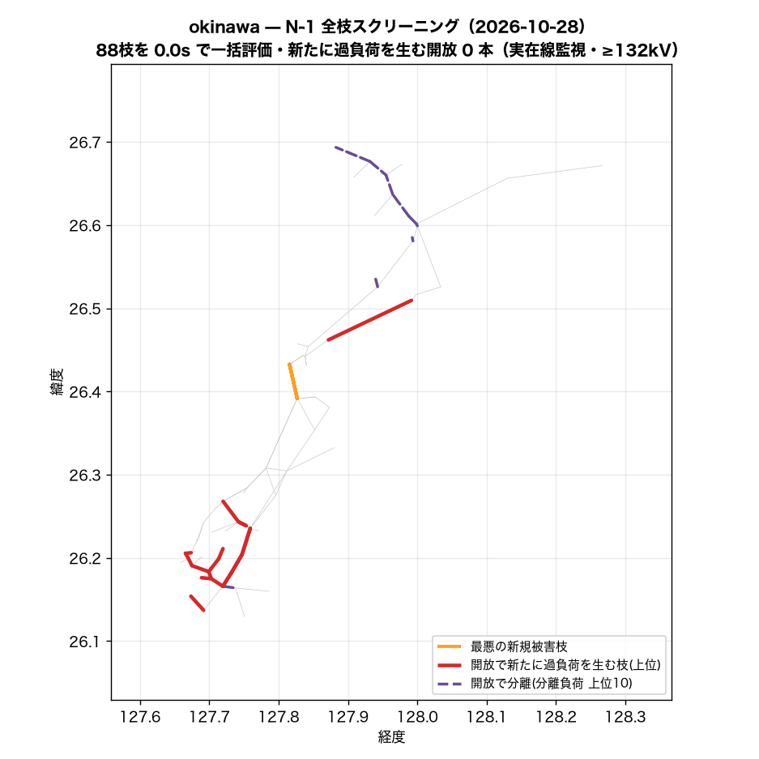

# N-1 全枝スクリーニング — LODF で全枝開放を一括評価（2026-10-28）

枝 k を開放したときの枝 j の潮流は `f_j + LODF[j,k]·f_k`（直流近似）で閉じているので、
全枝分の「開放後の最大負荷率・過負荷本数・最悪被害枝」が行列 1 枚の列演算で出る。
並列回線は **1 回線開放**（残回線容量で評価）、開放で分離する枝（橋）は LODF が定義できないため
**分離側の負荷・発電を別勘定**にした。

**合成定格の錯視を主結果に混ぜない**: 主表は監視枝を「実在線（OSM実線形・回収線・公表接続）＋銘板つき変圧器」に限った順位。
同一敷地タイ（同定）・発電所取付線・推定容量の変圧器などが最悪枝になる開放は別表で開示する。

| 島 | 主成分 | 枝 | 評価した開放 | 橋(分離) | 監視枝(実在/全) | 基準過負荷(実在) | 新規過負荷を生む開放 実在/全 | 新規側 >120% (実在) | 分離負荷≥100MW | PTDF | 一括評価 |
|---|---:|---:|---:|---:|---:|---:|---:|---:|---:|---:|---:|
| hokkaido | 799 | 916 | 767 | 149 | 127/187 | 0 | **0** / 21 | 0 | 0 | 0.0s | 0.0s |
| east | 5,809 | 6,913 | 5,952 | 957 | 1,405/2,112 | 70 | **119** / 255 | 38 | 3 | 3.2s | 2.7s |
| west | 7,467 | 8,883 | 6,755 | 2,120 | 2,467/3,243 | 33 | **240** / 512 | 53 | 41 | 3.5s | 3.8s |
| okinawa | 94 | 115 | 88 | 27 | 23/43 | 2 | **0** / 4 | 0 | 3 | 0.0s | 0.0s |

監視は ≥154kV（最高階級が届かない島はその階級: hokkaido 154kV、east 154kV、west 154kV、okinawa 132kV）・容量係数 1.0（理論値 √3·V·I に対する較正。公表運用容量との比較では約 0.5）。

## hokkaido

要素の内訳: 公表接続(直線) 2、発電所取付線 14、OSM実線 822、OSM実線(回収) 8、同一敷地タイ(同定) 1、変圧器(推定容量) 68、変圧器(銘板) 1

### 実在線監視 — 開放すると新たに過負荷を生む枝（上位 20）

基準ケースで既に >100% の実在監視枝: 0 本（最大 44.3%）。基準の過負荷は開放と無関係に居座るので、指標は**基準で過負荷でない枝の側**で取る（新規過負荷本数 → 新規側の最大負荷率）。新規側が 120% を超える開放: 0 本。

| # | 開放する枝 | 種別 | kV | 回線 | 開放枝の基準負荷率 | 新規過負荷 本数 | 新規側の最大負荷率 | 最大増分 | 最悪の新規被害枝 (種別・基準→開放後) |
|---:|---|---|---:|---:|---:|---:|---:|---:|---|
| 1 | 名寄幹線 | OSM実線 | 187 | 2 | 41.5% | **0** | **79%** | +38pt | 名寄幹線 (OSM実線, 187kV, 41.5→79%) |
| 2 | 滝川幹線 (Takikawa-kansen) | OSM実線 | 187 | 2 | 37.3% | **0** | **67%** | +30pt | 滝川幹線 (Takikawa-kansen) (OSM実線, 187kV, 37.3→67%) |
| 3 | trafo_275/187kV@pairmed@osm | 変圧器(推定容量) | 275 | 1 | 34.5% | **0** | **53%** | +30pt | 西札幌線 (OSM実線, 187kV, 22.6→53%) |
| 4 | 奈井江幹線 (Naie-kansen) | OSM実線 | 187 | 2 | 25.7% | **0** | **51%** | +26pt | 奈井江幹線 (Naie-kansen) (OSM実線, 187kV, 25.7→51%) |
| 5 | 道東幹線 | OSM実線 | 187 | 2 | 11.0% | **0** | **50%** | +6pt | 十勝幹線 (OSM実線, 187kV, 44.3→50%) |
| 6 | 北海道電力ネットワーク 187.0kV線 | OSM実線 | 187 | 1 | 5.3% | **0** | **50%** | +5pt | 十勝幹線 (OSM実線, 187kV, 44.3→50%) |
| 7 | 十勝幹線 | OSM実線 | 187 | 1 | 44.3% | **0** | **49%** | +44pt | 北海道電力ネットワーク 187.0kV線 (OSM実線, 187kV, 5.3→49%) |
| 8 | 日東変電所~丸瀬布西町変電所線 | OSM実線 | 66 | 1 | 57.4% | **0** | **49%** | +4pt | 十勝幹線 (OSM実線, 187kV, 44.3→49%) |
| 9 | 日東変電所~丸瀬布西町変電所線 | OSM実線 | 66 | 1 | 44.2% | **0** | **48%** | +3pt | 十勝幹線 (OSM実線, 187kV, 44.3→48%) |
| 10 | 北海道電力ネットワーク 187.0kV線 | OSM実線 | 187 | 1 | 2.9% | **0** | **47%** | +3pt | 十勝幹線 (OSM実線, 187kV, 44.3→47%) |
| 11 | 石北線 | OSM実線 | 66 | 1 | 35.4% | **0** | **47%** | +3pt | 十勝幹線 (OSM実線, 187kV, 44.3→47%) |
| 12 | trafo_187/66kV@pairmed@osm | 変圧器(推定容量) | 187 | 1 | 24.6% | **0** | **47%** | +9pt | 十勝幹線 (OSM実線, 187kV, 44.3→47%) |
| 13 | trafo_187/110kV | 変圧器(推定容量) | 187 | 1 | 98.0% | **0** | **47%** | +13pt | 十勝幹線 (OSM実線, 187kV, 44.3→47%) |
| 14 | 石北線 | OSM実線 | 66 | 1 | 31.0% | **0** | **47%** | +2pt | 十勝幹線 (OSM実線, 187kV, 44.3→47%) |
| 15 | 十勝幹線 | OSM実線 | 187 | 2 | 23.6% | **0** | **46%** | +23pt | 十勝幹線 (OSM実線, 187kV, 23.6→46%) |
| 16 | trafo_275/187kV@pairmed@osm | 変圧器(推定容量) | 275 | 1 | 24.2% | **0** | **46%** | +20pt | trafo_275/187kV@nameplate@osm (変圧器(銘板), 275kV, 31.3→46%) |
| 17 | trafo_110/66kV | 変圧器(推定容量) | 110 | 1 | 15.6% | **0** | **46%** | +2pt | 十勝幹線 (OSM実線, 187kV, 44.3→46%) |
| 18 | 泉町一丁目変電所~小平変電所 (Obira Hendensho)線 | OSM実線 | 66 | 1 | 70.8% | **0** | **46%** | +5pt | 名寄幹線 (OSM実線, 187kV, 41.5→46%) |
| 19 | trafo_187/66kV@pairmed@osm | 変圧器(推定容量) | 187 | 1 | 22.6% | **0** | **46%** | +6pt | 十勝幹線 (OSM実線, 187kV, 44.3→46%) |
| 20 | 釧路幹線 | OSM実線 | 187 | 2 | 4.9% | **0** | **46%** | +3pt | 十勝幹線 (OSM実線, 187kV, 44.3→46%) |

### AC 検証（上位を本番 solve_island で開放して解き直し）

| 開放する枝 | 開放 | DC 新規側最大 (新規本数) | AC | AC 新規側最大 (新規本数) | DC最悪新規枝の AC 負荷率（基準→開放後） | 秒 |
|---|---|---:|---|---:|---|---:|
| 名寄幹線 | 1回線 | 79% (0) | 収束 (給電100%) | 85.2% (0) | 43.8 → 85.2% | 0.4 |
| 滝川幹線 (Takikawa-kansen) | 1回線 | 67% (0) | 収束 (給電100%) | 70.6% (0) | 39.0 → 70.6% | 0.4 |
| trafo_275/187kV@pairmed@osm | 全回線 | 53% (0) | 収束 (給電100%) | 55.3% (0) | 23.6 → 55.3% | 0.3 |
| 奈井江幹線 (Naie-kansen) | 1回線 | 51% (0) | 収束 (給電100%) | 54.5% (0) | 27.3 → 54.5% | 0.3 |
| 道東幹線 | 1回線 | 50% (0) | 収束 (給電100%) | 51.2% (0) | 45.4 → 51.2% | 0.4 |

AC の負荷率は |P|/容量（直流の定義に揃えた）。1 回線開放は parallel を 1 減らして解き直し、残回線の容量で評価。prune はしごで落ちた枝は比較から除外。

### 別表 — 合成定格の要素が最悪枝になる開放（錯視の開示・上位 20）

| # | 開放する枝 | 種別 | kV | 回線 | 開放枝の基準負荷率 | 新規過負荷 本数 | 新規側の最大負荷率 | 最大増分 | 最悪の新規被害枝 (種別・基準→開放後) |
|---:|---|---|---:|---:|---:|---:|---:|---:|---|
| 1 | trafo_187/110kV | 変圧器(推定容量) | 187 | 1 | 62.0% | **1** | **121%** | +27pt | trafo_187/110kV (変圧器(推定容量), 187kV, 98.0→121%) |
| 2 | 泉町一丁目変電所~小平変電所 (Obira Hendensho)線 | OSM実線 | 66 | 1 | 70.8% | **1** | **117%** | +19pt | trafo_187/110kV (変圧器(推定容量), 187kV, 98.0→117%) |
| 3 | 小平町変電所~小平変電所 (Obira Hendensho)線 | OSM実線 | 66 | 1 | 57.6% | **1** | **113%** | +15pt | trafo_187/110kV (変圧器(推定容量), 187kV, 98.0→113%) |
| 4 | 北幌延線 | OSM実線 | 187 | 2 | 25.8% | **1** | **113%** | +20pt | trafo_187/110kV (変圧器(推定容量), 187kV, 98.0→113%) |
| 5 | trafo_187/110kV | 変圧器(推定容量) | 187 | 1 | 98.0% | **1** | **112%** | +50pt | trafo_187/110kV (変圧器(推定容量), 187kV, 62.0→112%) |
| 6 | 小平町変電所~鬼鹿田代変電所線 | OSM実線 | 66 | 1 | 44.4% | **1** | **110%** | +12pt | trafo_187/110kV (変圧器(推定容量), 187kV, 98.0→110%) |
| 7 | trafo_187/66kV@pairmed@osm | 変圧器(推定容量) | 187 | 1 | 46.0% | **1** | **110%** | +63pt | trafo_187/66kV (変圧器(推定容量), 187kV, 46.2→110%) |
| 8 | trafo_187/66kV@pairmed@osm | 変圧器(推定容量) | 187 | 1 | 51.1% | **1** | **109%** | +33pt | trafo_187/110kV (変圧器(推定容量), 187kV, 98.0→109%) |
| 9 | 鬼鹿田代変電所~苫前町変電所線 | OSM実線 | 66 | 1 | 31.2% | **1** | **106%** | +8pt | trafo_187/110kV (変圧器(推定容量), 187kV, 98.0→106%) |
| 10 | 興部線 | OSM実線 | 66 | 1 | 29.9% | **1** | **106%** | +8pt | trafo_187/110kV (変圧器(推定容量), 187kV, 98.0→106%) |
| 11 | trafo_187/110kV | 変圧器(推定容量) | 187 | 1 | 47.7% | **1** | **104%** | +20pt | trafo_187/110kV (変圧器(推定容量), 187kV, 98.0→104%) |
| 12 | trafo_187/66kV@pairmed@osm | 変圧器(推定容量) | 187 | 1 | 40.1% | **1** | **104%** | +26pt | trafo_187/110kV (変圧器(推定容量), 187kV, 98.0→104%) |
| 13 | 苫前町変電所~苫前変電所 (Tomamae Hendensho)線 | OSM実線 | 66 | 1 | 18.0% | **1** | **103%** | +5pt | trafo_187/110kV (変圧器(推定容量), 187kV, 98.0→103%) |
| 14 | 日東変電所~丸瀬布西町変電所線 | OSM実線 | 66 | 1 | 57.4% | **1** | **101%** | +32pt | trafo_187/110kV (変圧器(推定容量), 187kV, 98.0→101%) |
| 15 | trafo_275/187kV@pairmed@osm | 変圧器(推定容量) | 275 | 1 | 24.2% | **1** | **101%** | +20pt | trafo_187/110kV (変圧器(推定容量), 187kV, 98.0→101%) |
| 16 | 日東変電所~丸瀬布西町変電所線 | OSM実線 | 66 | 1 | 44.2% | **1** | **100%** | +25pt | trafo_187/110kV (変圧器(推定容量), 187kV, 98.0→100%) |
| 17 | trafo_187/66kV@pairmed@osm | 変圧器(推定容量) | 187 | 1 | 22.8% | **1** | **100%** | +21pt | trafo_275/66kV (変圧器(推定容量), 275kV, 79.7→100%) |
| 18 | trafo_187/66kV@pairmed@osm | 変圧器(推定容量) | 187 | 1 | 15.8% | **1** | **100%** | +21pt | trafo_187/110kV (変圧器(推定容量), 187kV, 98.0→100%) |
| 19 | trafo_187/66kV@pairmed@osm | 変圧器(推定容量) | 187 | 1 | 33.2% | **1** | **100%** | +24pt | trafo_187/110kV (変圧器(推定容量), 187kV, 98.0→100%) |
| 20 | 豊富中川幹線 | OSM実線 | 187 | 2 | 14.4% | **1** | **100%** | +11pt | trafo_187/110kV (変圧器(推定容量), 187kV, 98.0→100%) |

### 分離（橋）— 開放で切り離される負荷の大きい枝（上位 20）

橋 149 本（うち数値的な擬似橋 0）。分離側の負荷合計 1,790 MW。放射系の末端はそもそも N-1 で守れない（実系統では配電側の切替で対処）ので、ここは「モデルが放射になっている箇所」の一覧として読む。

| # | 開放する枝 | 種別 | kV | 分離バス数 | 分離側の負荷 | 分離側の発電 |
|---:|---|---|---:|---:|---:|---:|
| 1 | trafo_110/66kV | 変圧器(推定容量) | 110 | 9 | **72 MW** | 0 MW |
| 2 | 望来線 | OSM実線 | 66 | 6 | **54 MW** | 0 MW |
| 3 | trafo_187/66kV@pairmed@osm | 変圧器(推定容量) | 187 | 9 | **54 MW** | 0 MW |
| 4 | 同一敷地タイ(同定) | 同一敷地タイ(同定) | 66 | 5 | **45 MW** | 80 MW |
| 5 | 厚田線 | OSM実線 | 66 | 5 | **45 MW** | 0 MW |
| 6 | 山部線 | OSM実線 | 66 | 4 | **36 MW** | 10 MW |
| 7 | 浦河東線 | OSM実線 | 66 | 5 | **36 MW** | 4 MW |
| 8 | 天塩線 | OSM実線 | 66 | 6 | **36 MW** | 0 MW |
| 9 | 北海道送電線_53 | OSM実線 | 110 | 7 | **36 MW** | 0 MW |
| 10 | 枝幸線 | OSM実線 | 66 | 4 | **36 MW** | 0 MW |
| 11 | 浜益線 | OSM実線 | 66 | 4 | **36 MW** | 0 MW |
| 12 | 岩知志線 | OSM実線 | 66 | 5 | **27 MW** | 16 MW |
| 13 | 長流線 | OSM実線 | 66 | 4 | **27 MW** | 0 MW |
| 14 | 昆布線 | OSM実線 | 66 | 7 | **27 MW** | 8 MW |
| 15 | 瓜幕線 | OSM実線 | 66 | 3 | **27 MW** | 0 MW |
| 16 | 金山線 | OSM実線 | 66 | 3 | **27 MW** | 10 MW |
| 17 | 昆布線 | OSM実線 | 66 | 5 | **27 MW** | 8 MW |
| 18 | 遠別線 | OSM実線 | 66 | 5 | **27 MW** | 0 MW |
| 19 | 西一条十二丁目変電所~士別市変電所線 | OSM実線 | 66 | 5 | **27 MW** | 0 MW |
| 20 | 頓別線 | OSM実線 | 66 | 3 | **27 MW** | 0 MW |

## east

要素の内訳: 公表接続(直線) 61、発電所取付線 280、OSM実線 5,765、OSM実線(回収) 79、同一敷地タイ(同定) 51、合成連系タイ 1、変圧器(推定容量) 668、変圧器(銘板) 8

### 実在線監視 — 開放すると新たに過負荷を生む枝（上位 20）

基準ケースで既に >100% の実在監視枝: 70 本（最大 688.6%）。基準の過負荷は開放と無関係に居座るので、指標は**基準で過負荷でない枝の側**で取る（新規過負荷本数 → 新規側の最大負荷率）。新規側が 120% を超える開放: 38 本。

| # | 開放する枝 | 種別 | kV | 回線 | 開放枝の基準負荷率 | 新規過負荷 本数 | 新規側の最大負荷率 | 最大増分 | 最悪の新規被害枝 (種別・基準→開放後) |
|---:|---|---|---:|---:|---:|---:|---:|---:|---|
| 1 | trafo_275/154kV@pairmed@osm | 変圧器(推定容量) | 275 | 1 | 72.8% | **4** | **103%** | +75pt | 橋本線 (OSM実線, 154kV, 94.7→103%) |
| 2 | trafo_500/275kV@pairmed@osm | 変圧器(推定容量) | 500 | 1 | 34.8% | **3** | **171%** | +74pt | 西水戸線 (OSM実線, 154kV, 97.0→171%) |
| 3 | trafo_500/275kV | 変圧器(推定容量) | 500 | 1 | 125.7% | **3** | **147%** | +56pt | 鹿島線 (OSM実線, 275kV, 98.4→147%) |
| 4 | trafo_275/66kV@pairmed@osm | 変圧器(推定容量) | 275 | 1 | 70.4% | **3** | **122%** | +36pt | 鹿島線 (OSM実線, 275kV, 98.4→122%) |
| 5 | 浅貝線 | OSM実線 | 500 | 1 | 15.0% | **2** | **205%** | +195pt | 神立変電所~灰雨変電所線 (OSM実線, 154kV, 10.5→205%) |
| 6 | 東京北線 | OSM実線 | 275 | 2 | 81.2% | **2** | **133%** | +52pt | 東京北線 (OSM実線, 275kV, 81.2→133%) |
| 7 | 東京北線 | OSM実線 | 275 | 2 | 76.7% | **2** | **119%** | +43pt | 東京北線 (OSM実線, 275kV, 76.7→119%) |
| 8 | 香取線 / 湖南線 | OSM実線 | 275 | 2 | 63.2% | **2** | **112%** | +49pt | 香取線 / 湖南線 (OSM実線, 275kV, 63.2→112%) |
| 9 | trafo_500/154kV@pairmed@pub | 変圧器(推定容量) | 500 | 1 | 54.0% | **2** | **110%** | +70pt | 新富士変電所~小田急電鉄 松田変電所線 (OSM実線, 154kV, 92.0→110%) |
| 10 | 小松川線 | OSM実線 | 154 | 2 | 73.1% | **2** | **106%** | +33pt | 小松川線 (OSM実線, 154kV, 73.1→106%) |
| 11 | 南武線 / 南崎線 | OSM実線 | 154 | 2 | 443.1% | **1** | **227%** | +146pt | 京南線（休止線） (OSM実線, 154kV, 91.6→227%) |
| 12 | 北多摩線;吉武線 | OSM実線 | 154 | 2 | 92.3% | **1** | **179%** | +86pt | 北多摩線;吉武線 (OSM実線, 154kV, 92.3→179%) |
| 13 | 西水戸線 | OSM実線 | 154 | 2 | 97.0% | **1** | **178%** | +80pt | 西水戸線 (OSM実線, 154kV, 97.0→178%) |
| 14 | 北葛飾線/野田線 | OSM実線 | 275 | 2 | 97.4% | **1** | **173%** | +76pt | 北葛飾線/野田線 (OSM実線, 275kV, 97.4→173%) |
| 15 | 鹿島線 | OSM実線 | 275 | 2 | 98.4% | **1** | **167%** | +69pt | 鹿島線 (OSM実線, 275kV, 98.4→167%) |
| 16 | 桜ヶ丘線; 長峰線 | OSM実線 | 154 | 2 | 83.7% | **1** | **164%** | +81pt | 桜ヶ丘線; 長峰線 (OSM実線, 154kV, 83.7→164%) |
| 17 | 新新田線;佐波線 | OSM実線 | 154 | 2 | 89.2% | **1** | **164%** | +75pt | 新新田線;佐波線 (OSM実線, 154kV, 89.2→164%) |
| 18 | 東京北線 | OSM実線 | 275 | 2 | 78.9% | **1** | **156%** | +77pt | 東京北線 (OSM実線, 275kV, 78.9→156%) |
| 19 | 橋本西線 | OSM実線 | 154 | 2 | 81.2% | **1** | **151%** | +70pt | 橋本西線 (OSM実線, 154kV, 81.2→151%) |
| 20 | 小松川線 | OSM実線 | 154 | 2 | 91.2% | **1** | **150%** | +59pt | 小松川線 (OSM実線, 154kV, 91.2→150%) |

### AC 検証（上位を本番 solve_island で開放して解き直し）

| 開放する枝 | 開放 | DC 新規側最大 (新規本数) | AC | AC 新規側最大 (新規本数) | DC最悪新規枝の AC 負荷率（基準→開放後） | 秒 |
|---|---|---:|---|---:|---|---:|
| trafo_275/154kV@pairmed@osm | 全回線 | 103% (4) | 収束 (給電100%) | 105.5% (5) | 96.6 → 105.5% | 8.2 |
| trafo_500/275kV@pairmed@osm | 全回線 | 171% (3) | 収束 (給電100%) | 179.1% (4) | 100.8 → 179.1% | 8.1 |
| trafo_500/275kV | 全回線 | 147% (3) | 収束 (給電100%) | 143.8% (3) | 98.2 → 143.8% | 4.4 |
| trafo_275/66kV@pairmed@osm | 全回線 | 122% (3) | 収束 (給電100%) | 121.8% (3) | 98.2 → 121.8% | 6.4 |
| 浅貝線 | 全回線 | 205% (2) | 収束 (給電100%) | 115.6% (2) | 10.2 → 0.0% | 10.2 |

AC の負荷率は |P|/容量（直流の定義に揃えた）。1 回線開放は parallel を 1 減らして解き直し、残回線の容量で評価。prune はしごで落ちた枝は比較から除外。

### 別表 — 合成定格の要素が最悪枝になる開放（錯視の開示・上位 20）

| # | 開放する枝 | 種別 | kV | 回線 | 開放枝の基準負荷率 | 新規過負荷 本数 | 新規側の最大負荷率 | 最大増分 | 最悪の新規被害枝 (種別・基準→開放後) |
|---:|---|---|---:|---:|---:|---:|---:|---:|---|
| 1 | trafo_275/154kV@pairmed@osm | 変圧器(推定容量) | 275 | 1 | 72.8% | **8** | **138%** | +75pt | trafo_275/154kV (変圧器(推定容量), 275kV, 96.0→138%) |
| 2 | trafo_154/66kV | 変圧器(推定容量) | 154 | 1 | 104.5% | **6** | **117%** | +18pt | trafo_154/66kV (変圧器(推定容量), 154kV, 99.1→117%) |
| 3 | trafo_275/66kV | 変圧器(推定容量) | 275 | 1 | 158.3% | **6** | **116%** | +19pt | trafo_154/66kV (変圧器(推定容量), 154kV, 99.1→116%) |
| 4 | 浅貝線 | OSM実線 | 500 | 1 | 15.0% | **5** | **590%** | +520pt | trafo_154/66kV (変圧器(推定容量), 154kV, 70.5→590%) |
| 5 | trafo_275/66kV@pairmed@osm | 変圧器(推定容量) | 275 | 1 | 70.4% | **5** | **178%** | +84pt | trafo_500/66kV (変圧器(推定容量), 500kV, 93.7→178%) |
| 6 | trafo_154/66kV | 変圧器(推定容量) | 154 | 1 | 89.9% | **5** | **114%** | +22pt | trafo_154/66kV (変圧器(推定容量), 154kV, 92.7→114%) |
| 7 | 柿ノ沢線 | OSM実線 | 66 | 1 | 228.0% | **5** | **114%** | +59pt | trafo_154/66kV (変圧器(推定容量), 154kV, 99.1→114%) |
| 8 | trafo_154/66kV | 変圧器(推定容量) | 154 | 1 | 99.5% | **5** | **114%** | +17pt | trafo_154/66kV (変圧器(推定容量), 154kV, 96.7→114%) |
| 9 | trafo_154/66kV | 変圧器(推定容量) | 154 | 1 | 92.7% | **5** | **112%** | +22pt | trafo_154/66kV (変圧器(推定容量), 154kV, 89.9→112%) |
| 10 | trafo_154/66kV | 変圧器(推定容量) | 154 | 1 | 99.1% | **5** | **108%** | +17pt | trafo_154/66kV (変圧器(推定容量), 154kV, 99.5→108%) |
| 11 | trafo_275/66kV@pairmed@pub | 変圧器(推定容量) | 275 | 1 | 53.7% | **4** | **166%** | +121pt | trafo_154/66kV (変圧器(推定容量), 154kV, 45.2→166%) |
| 12 | trafo_275/66kV@pairmed@pub | 変圧器(推定容量) | 275 | 1 | 50.2% | **4** | **130%** | +56pt | trafo_500/66kV (変圧器(推定容量), 500kV, 89.1→130%) |
| 13 | trafo_275/66kV@pairmed@osm | 変圧器(推定容量) | 275 | 1 | 48.9% | **4** | **123%** | +69pt | trafo_275/66kV (変圧器(推定容量), 275kV, 53.4→123%) |
| 14 | trafo_154/66kV | 変圧器(推定容量) | 154 | 1 | 81.1% | **4** | **116%** | +16pt | trafo_154/66kV (変圧器(推定容量), 154kV, 99.1→116%) |
| 15 | 菅谷線 | OSM実線 | 66 | 1 | 101.9% | **4** | **110%** | +17pt | trafo_154/66kV (変圧器(推定容量), 154kV, 92.7→110%) |
| 16 | trafo_154/66kV | 変圧器(推定容量) | 154 | 1 | 211.2% | **4** | **108%** | +32pt | trafo_275/154kV (変圧器(推定容量), 275kV, 96.0→108%) |
| 17 | trafo_500/66kV | 変圧器(推定容量) | 500 | 1 | 87.0% | **4** | **102%** | +12pt | trafo_500/66kV (変圧器(推定容量), 500kV, 90.5→102%) |
| 18 | leadin | 発電所取付線 | 275 | 1 | 35.8% | **3** | **189%** | +118pt | trafo_154/66kV#43a@推定 (変圧器(推定容量), 154kV, 71.0→189%) |
| 19 | trafo_275/66kV#43a@推定 | 変圧器(推定容量) | 275 | 1 | 109.4% | **3** | **185%** | +114pt | trafo_154/66kV#43a@推定 (変圧器(推定容量), 154kV, 71.0→185%) |
| 20 | trafo_154/66kV@pairmed@osm | 変圧器(推定容量) | 154 | 1 | 60.0% | **3** | **155%** | +63pt | trafo_154/66kV (変圧器(推定容量), 154kV, 91.8→155%) |

### 分離（橋）— 開放で切り離される負荷の大きい枝（上位 20）

橋 957 本（うち数値的な擬似橋 0）。分離側の負荷合計 11,868 MW。放射系の末端はそもそも N-1 で守れない（実系統では配電側の切替で対処）ので、ここは「モデルが放射になっている箇所」の一覧として読む。

| # | 開放する枝 | 種別 | kV | 分離バス数 | 分離側の負荷 | 分離側の発電 |
|---:|---|---|---:|---:|---:|---:|
| 1 | trafo_275/66kV | 変圧器(推定容量) | 275 | 9 | **159 MW** | 0 MW |
| 2 | 東京電力パワーグリッド 66.0kV線 | OSM実線 | 66 | 15 | **132 MW** | 55 MW |
| 3 | trafo_154/66kV | 変圧器(推定容量) | 154 | 3 | **110 MW** | 0 MW |
| 4 | 東京電力パワーグリッド 66.0kV線 | OSM実線 | 66 | 9 | **98 MW** | 55 MW |
| 5 | 中野台二丁目変電所~富士川第一変電所線 | OSM実線 | 66 | 7 | **98 MW** | 55 MW |
| 6 | trafo_154/66kV@pairmed@osm | 変圧器(推定容量) | 154 | 8 | **92 MW** | 0 MW |
| 7 | trafo_154/66kV | 変圧器(推定容量) | 154 | 8 | **92 MW** | 0 MW |
| 8 | namebind | OSM実線 | 66 | 5 | **81 MW** | 55 MW |
| 9 | 長津田町田線 | OSM実線 | 66 | 5 | **76 MW** | 0 MW |
| 10 | tokyo_line_4207 | OSM実線 | 66 | 19 | **73 MW** | 45 MW |
| 11 | 東京電力パワーグリッド 66.0kV線 | OSM実線 | 66 | 8 | **73 MW** | 0 MW |
| 12 | 東京電力パワーグリッド 66.0kV線 | OSM実線 | 66 | 6 | **73 MW** | 0 MW |
| 13 | (154kV・旭→横浜大黒) | 公表接続(直線) | 154 | 3 | **66 MW** | 17 MW |
| 14 | 佐野川線 | OSM実線 | 66 | 4 | **64 MW** | 55 MW |
| 15 | 衛星判読回収線 sat-001-ojiya66 | OSM実線(回収) | 66 | 6 | **55 MW** | 17 MW |
| 16 | tokyo_line_4209 | OSM実線 | 66 | 18 | **55 MW** | 45 MW |
| 17 | tokyo_line_4224 | OSM実線 | 66 | 5 | **55 MW** | 17 MW |
| 18 | tokyo_line_4227 | OSM実線 | 66 | 14 | **55 MW** | 45 MW |
| 19 | 梅木変電所~三福変電所線 | OSM実線 | 66 | 5 | **54 MW** | 0 MW |
| 20 | 伊東市変電所~田方変電所線 | OSM実線 | 66 | 5 | **54 MW** | 0 MW |

## west

要素の内訳: 公表接続(直線) 63、公表接続の取付スタブ 5、発電所取付線 301、OSM実線 7,377、OSM実線(回収) 123、同一敷地タイ(同定) 13、合成連系タイ 5、変圧器(推定容量) 991、変圧器(銘板) 5

### 実在線監視 — 開放すると新たに過負荷を生む枝（上位 20）

基準ケースで既に >100% の実在監視枝: 33 本（最大 284.7%）。基準の過負荷は開放と無関係に居座るので、指標は**基準で過負荷でない枝の側**で取る（新規過負荷本数 → 新規側の最大負荷率）。新規側が 120% を超える開放: 53 本。

| # | 開放する枝 | 種別 | kV | 回線 | 開放枝の基準負荷率 | 新規過負荷 本数 | 新規側の最大負荷率 | 最大増分 | 最悪の新規被害枝 (種別・基準→開放後) |
|---:|---|---|---:|---:|---:|---:|---:|---:|---|
| 1 | trafo_500/275kV | 変圧器(推定容量) | 500 | 1 | 63.0% | **6** | **162%** | +68pt | 駒ヶ根変電所~田畑変電所線 (OSM実線, 154kV, 97.9→162%) |
| 2 | 西日本電線新城線 | OSM実線 | 275 | 1 | 35.0% | **6** | **146%** | +92pt | 豊川玉川線 (OSM実線, 154kV, 53.9→146%) |
| 3 | 西日本電線新城線 | OSM実線 | 66 | 1 | 486.2% | **6** | **146%** | +92pt | 豊川玉川線 (OSM実線, 154kV, 53.9→146%) |
| 4 | 麻生田分岐線 | OSM実線 | 66 | 1 | 434.8% | **6** | **136%** | +82pt | 豊川玉川線 (OSM実線, 154kV, 53.9→136%) |
| 5 | 新鈴鹿分岐線 | OSM実線 | 275 | 1 | 65.5% | **6** | **130%** | +51pt | namebind (OSM実線, 154kV, 78.9→130%) |
| 6 | trafo_275/154kV | 変圧器(推定容量) | 275 | 1 | 263.0% | **6** | **120%** | +46pt | 中部電力パワーグリッド 154.0kV線 (OSM実線, 154kV, 99.4→120%) |
| 7 | 中部電力パワーグリッド 275.0kV線 | OSM実線 | 275 | 1 | 134.3% | **5** | **197%** | +134pt | 垂坂町変電所~北勢変電所 (Hokusei Hendensho)線 (OSM実線, 154kV, 62.4→197%) |
| 8 | 中勢亀山線 | OSM実線 | 275 | 1 | 92.5% | **5** | **153%** | +76pt | まきの木台二丁目変電所~赤水町変電所線 (OSM実線, 154kV, 89.7→153%) |
| 9 | 中勢亀山線 | OSM実線 | 275 | 1 | 79.9% | **5** | **136%** | +57pt | まきの木台二丁目変電所~赤水町変電所線 (OSM実線, 154kV, 89.7→136%) |
| 10 | trafo_275/77kV@pairmed@osm | 変圧器(推定容量) | 275 | 1 | 107.1% | **5** | **128%** | +50pt | namebind (OSM実線, 154kV, 78.9→128%) |
| 11 | trafo_275/154kV | 変圧器(推定容量) | 275 | 1 | 167.4% | **5** | **111%** | +40pt | 中部電力パワーグリッド 154.0kV線 (OSM実線, 154kV, 99.4→111%) |
| 12 | 三河遠江線 | OSM実線 | 275 | 1 | 35.2% | **4** | **170%** | +71pt | 笹岡貴布祢線 (OSM実線, 154kV, 98.7→170%) |
| 13 | 山代変電所~久原変電所線 | OSM実線 | 500 | 1 | 31.3% | **4** | **158%** | +128pt | 山代変電所~九州電力　日宇変電所線 (OSM実線, 220kV, 30.0→158%) |
| 14 | 明星町四丁目変電所~喜撰山開閉所線 | OSM実線 | 154 | 1 | 63.9% | **4** | **148%** | +54pt | 関西送電線_564 (OSM実線, 154kV, 93.3→148%) |
| 15 | 中勢亀山線 | OSM実線 | 275 | 1 | 67.4% | **4** | **124%** | +45pt | まきの木台二丁目変電所~赤水町変電所線 (OSM実線, 154kV, 89.7→124%) |
| 16 | trafo_275/154kV | 変圧器(推定容量) | 275 | 1 | 172.8% | **4** | **116%** | +23pt | 中部電力パワーグリッド 154.0kV線 (OSM実線, 154kV, 99.4→116%) |
| 17 | 秋葉浜松線 | OSM実線 | 154 | 1 | 115.5% | **3** | **152%** | +75pt | 遠江浜松線 (OSM実線, 154kV, 77.2→152%) |
| 18 | 住吉町五丁目変電所~岩滑西町三丁目変電所線 | OSM実線 | 154 | 1 | 140.1% | **3** | **146%** | +93pt | 新居町五丁目変電所~南起変電所線 (OSM実線, 154kV, 53.2→146%) |
| 19 | 新居町五丁目変電所~南起変電所線 | OSM実線 | 154 | 1 | 53.2% | **3** | **136%** | +41pt | 新居町五丁目変電所~一本木町一丁目変電所線 (OSM実線, 154kV, 95.2→136%) |
| 20 | 一本木町一丁目変電所~住吉町五丁目変電所線 | OSM実線 | 154 | 1 | 111.0% | **3** | **127%** | +74pt | 新居町五丁目変電所~南起変電所線 (OSM実線, 154kV, 53.2→127%) |

### AC 検証（上位を本番 solve_island で開放して解き直し）

| 開放する枝 | 開放 | DC 新規側最大 (新規本数) | AC | AC 新規側最大 (新規本数) | DC最悪新規枝の AC 負荷率（基準→開放後） | 秒 |
|---|---|---:|---|---:|---|---:|
| trafo_500/275kV | 全回線 | 162% (6) | 収束 (給電100%) | 161.8% (7) | 97.3 → 161.8% | 10.5 |
| 西日本電線新城線 | 全回線 | 146% (6) | 収束 (給電100%) | 148.1% (7) | 57.8 → 148.1% | 17.8 |
| 西日本電線新城線 | 全回線 | 146% (6) | 収束 (給電100%) | 148.1% (7) | 57.8 → 148.1% | 11.6 |
| 麻生田分岐線 | 全回線 | 136% (6) | 収束 (給電100%) | 138.2% (7) | 57.8 → 138.2% | 20.5 |
| 新鈴鹿分岐線 | 全回線 | 130% (6) | 収束 (給電100%) | 139.9% (9) | 83.5 → 139.9% | 13.3 |

AC の負荷率は |P|/容量（直流の定義に揃えた）。1 回線開放は parallel を 1 減らして解き直し、残回線の容量で評価。prune はしごで落ちた枝は比較から除外。

### 別表 — 合成定格の要素が最悪枝になる開放（錯視の開示・上位 20）

| # | 開放する枝 | 種別 | kV | 回線 | 開放枝の基準負荷率 | 新規過負荷 本数 | 新規側の最大負荷率 | 最大増分 | 最悪の新規被害枝 (種別・基準→開放後) |
|---:|---|---|---:|---:|---:|---:|---:|---:|---|
| 1 | trafo_154/77kV@pairmed@osm | 変圧器(推定容量) | 154 | 1 | 75.7% | **11** | **115%** | +35pt | trafo_154/77kV (変圧器(推定容量), 154kV, 81.7→115%) |
| 2 | 新鈴鹿分岐線 | OSM実線 | 275 | 1 | 65.5% | **7** | **132%** | +165pt | trafo_154/77kV#43a@推定 (変圧器(推定容量), 154kV, 64.9→132%) |
| 3 | trafo_275/77kV@pairmed@osm | 変圧器(推定容量) | 275 | 1 | 107.1% | **6** | **131%** | +161pt | trafo_154/77kV#43a@推定 (変圧器(推定容量), 154kV, 64.9→131%) |
| 4 | trafo_220/66kV@pairmed@pub | 変圧器(推定容量) | 220 | 1 | 83.1% | **5** | **137%** | +52pt | trafo_220/66kV (変圧器(推定容量), 220kV, 84.8→137%) |
| 5 | 梶原六丁目変電所~高槻変電所線 | OSM実線 | 500 | 1 | 109.2% | **5** | **117%** | +39pt | trafo_500/77kV (変圧器(推定容量), 500kV, 97.7→117%) |
| 6 | 碧南岡崎線 | OSM実線 | 154 | 1 | 272.7% | **4** | **161%** | +101pt | trafo_275/154kV (変圧器(推定容量), 275kV, 59.9→161%) |
| 7 | 中部電力パワーグリッド 日進変電所~北豊田変電所 (Kita Toyota Hendensho)線 | OSM実線 | 275 | 1 | 75.5% | **4** | **139%** | +72pt | trafo_275/77kV (変圧器(推定容量), 275kV, 67.4→139%) |
| 8 | trafo_220/66kV@pairmed@osm | 変圧器(推定容量) | 220 | 1 | 50.8% | **4** | **132%** | +33pt | trafo_220/66kV (変圧器(推定容量), 220kV, 99.0→132%) |
| 9 | trafo_187/66kV@pairmed@osm | 変圧器(推定容量) | 187 | 1 | 58.1% | **4** | **126%** | +56pt | trafo_187/66kV (変圧器(推定容量), 187kV, 99.3→126%) |
| 10 | trafo_500/220kV | 変圧器(推定容量) | 500 | 1 | 72.8% | **4** | **112%** | +26pt | trafo_220/66kV (変圧器(推定容量), 220kV, 99.0→112%) |
| 11 | 垂坂町変電所~北勢変電所 (Hokusei Hendensho)線 | OSM実線 | 154 | 1 | 175.5% | **3** | **151%** | +76pt | trafo_275/154kV (変圧器(推定容量), 275kV, 74.6→151%) |
| 12 | trafo_275/154kV@pairmed@osm | 変圧器(推定容量) | 275 | 1 | 60.9% | **3** | **141%** | +133pt | trafo_154/77kV (変圧器(推定容量), 154kV, 98.7→141%) |
| 13 | trafo_275/77kV@pairmed@osm | 変圧器(推定容量) | 275 | 1 | 68.7% | **3** | **120%** | +26pt | trafo_500/77kV (変圧器(推定容量), 500kV, 97.7→120%) |
| 14 | trafo_275/77kV@pairmed@pub | 変圧器(推定容量) | 275 | 1 | 77.0% | **3** | **117%** | +40pt | trafo_275/77kV (変圧器(推定容量), 275kV, 76.4→117%) |
| 15 | trafo_275/77kV@pairmed@osm | 変圧器(推定容量) | 275 | 1 | 57.7% | **3** | **116%** | +36pt | trafo_275/77kV (変圧器(推定容量), 275kV, 79.9→116%) |
| 16 | trafo_220/66kV | 変圧器(推定容量) | 220 | 1 | 127.5% | **3** | **109%** | +16pt | trafo_220/66kV (変圧器(推定容量), 220kV, 93.9→109%) |
| 17 | trafo_187/66kV | 変圧器(推定容量) | 187 | 1 | 157.6% | **3** | **108%** | +36pt | trafo_187/66kV (変圧器(推定容量), 187kV, 99.3→108%) |
| 18 | trafo_500/220kV@pairmed@osm | 変圧器(推定容量) | 500 | 1 | 28.7% | **3** | **107%** | +19pt | trafo_220/66kV (変圧器(推定容量), 220kV, 96.6→107%) |
| 19 | trafo_220/66kV | 変圧器(推定容量) | 220 | 1 | 79.5% | **3** | **104%** | +12pt | trafo_220/66kV (変圧器(推定容量), 220kV, 99.0→104%) |
| 20 | 大畑町変電所~中部電力八草変電所線 | OSM実線 | 275 | 1 | 41.1% | **2** | **188%** | +121pt | trafo_275/77kV (変圧器(推定容量), 275kV, 67.4→188%) |

### 分離（橋）— 開放で切り離される負荷の大きい枝（上位 20）

橋 2,120 本（うち数値的な擬似橋 0）。分離側の負荷合計 32,506 MW。放射系の末端はそもそも N-1 で守れない（実系統では配電側の切替で対処）ので、ここは「モデルが放射になっている箇所」の一覧として読む。

| # | 開放する枝 | 種別 | kV | 分離バス数 | 分離側の負荷 | 分離側の発電 |
|---:|---|---|---:|---:|---:|---:|
| 1 | trafo_275/77kV@pairmed@osm | 変圧器(推定容量) | 275 | 24 | **407 MW** | 0 MW |
| 2 | 関西送電線_129 | OSM実線 | 77 | 19 | **402 MW** | 105 MW |
| 3 | trafo_154/77kV#43a@推定 | 変圧器(推定容量) | 154 | 24 | **370 MW** | 20 MW |
| 4 | 敷津変電所~御崎七丁目変電所線 | OSM実線 | 154 | 16 | **344 MW** | 105 MW |
| 5 | 泉北線〔取付〕 | 公表接続の取付スタブ | 77 | 23 | **340 MW** | 20 MW |
| 6 | 中勢青山線 | OSM実線 | 77 | 9 | **209 MW** | 17 MW |
| 7 | 青山名張線 | OSM実線 | 77 | 7 | **209 MW** | 17 MW |
| 8 | 大柿線 | OSM実線 | 66 | 6 | **172 MW** | 0 MW |
| 9 | 青山名張線 | OSM実線 | 77 | 5 | **167 MW** | 17 MW |
| 10 | trafo_187/66kV | 変圧器(推定容量) | 187 | 12 | **165 MW** | 18 MW |
| 11 | 熊野川町相須変電所~新宮変電所線 | OSM実線 | 275 | 18 | **161 MW** | 1 MW |
| 12 | trafo_187/110kV | 変圧器(推定容量) | 187 | 19 | **158 MW** | 159 MW |
| 13 | trafo_154/77kV | 変圧器(推定容量) | 154 | 7 | **157 MW** | 0 MW |
| 14 | 川口線+川口連絡線 | 公表接続(直線) | 66 | 12 | **156 MW** | 28 MW |
| 15 | trafo_275/154kV | 変圧器(推定容量) | 275 | 34 | **154 MW** | 30 MW |
| 16 | trafo_154/77kV#43a@推定 | 変圧器(推定容量) | 154 | 5 | **147 MW** | 0 MW |
| 17 | 竜島変電所~新信濃変電所線 | OSM実線 | 154 | 33 | **145 MW** | 30 MW |
| 18 | trafo_154/77kV | 変圧器(推定容量) | 154 | 6 | **144 MW** | 85 MW |
| 19 | 大柿線 | OSM実線 | 66 | 5 | **138 MW** | 0 MW |
| 20 | 西三国変電所~味生変電所線 | OSM実線 | 154 | 6 | **137 MW** | 0 MW |

## okinawa

要素の内訳: 発電所取付線 8、OSM実線 88、変圧器(推定容量) 19

### 実在線監視 — 開放すると新たに過負荷を生む枝（上位 20）

基準ケースで既に >100% の実在監視枝: 2 本（最大 123.4%）。基準の過負荷は開放と無関係に居座るので、指標は**基準で過負荷でない枝の側**で取る（新規過負荷本数 → 新規側の最大負荷率）。新規側が 120% を超える開放: 0 本。

| # | 開放する枝 | 種別 | kV | 回線 | 開放枝の基準負荷率 | 新規過負荷 本数 | 新規側の最大負荷率 | 最大増分 | 最悪の新規被害枝 (種別・基準→開放後) |
|---:|---|---|---:|---:|---:|---:|---:|---:|---|
| 1 | 那覇高安線; 那覇小禄線 | OSM実線 | 66 | 2 | 23.5% | **0** | **90%** | +0pt | うるま市変電所~仲泊変電所線 (OSM実線, 132kV, 90.2→90%) |
| 2 | 那覇高安線; 小禄線 | OSM実線 | 66 | 2 | 51.0% | **0** | **90%** | +0pt | うるま市変電所~仲泊変電所線 (OSM実線, 132kV, 90.2→90%) |
| 3 | 那覇高安線; 那覇小禄線 | OSM実線 | 66 | 2 | 9.7% | **0** | **90%** | +0pt | うるま市変電所~仲泊変電所線 (OSM実線, 132kV, 90.2→90%) |
| 4 | 那覇変電所~壷川変電所線 | OSM実線 | 66 | 1 | 8.1% | **0** | **90%** | +1pt | うるま市変電所~仲泊変電所線 (OSM実線, 132kV, 90.2→90%) |
| 5 | 那覇高安線; 小禄線 | OSM実線 | 66 | 2 | 64.8% | **0** | **90%** | +0pt | うるま市変電所~仲泊変電所線 (OSM実線, 132kV, 90.2→90%) |
| 6 | 繁多川線 | OSM実線 | 66 | 2 | 13.8% | **0** | **90%** | +0pt | うるま市変電所~仲泊変電所線 (OSM実線, 132kV, 90.2→90%) |
| 7 | 那覇高安線; 小禄線 | OSM実線 | 66 | 2 | 78.6% | **0** | **90%** | +0pt | うるま市変電所~仲泊変電所線 (OSM実線, 132kV, 90.2→90%) |
| 8 | 沖縄電力 66.0kV線 | OSM実線 | 66 | 2 | 13.8% | **0** | **90%** | +0pt | うるま市変電所~仲泊変電所線 (OSM実線, 132kV, 90.2→90%) |
| 9 | 西原幹線;前田線 | OSM実線 | 66 | 1 | 18.6% | **0** | **90%** | +0pt | うるま市変電所~仲泊変電所線 (OSM実線, 132kV, 90.2→90%) |
| 10 | 西原幹線 | OSM実線 | 132 | 2 | 25.3% | **0** | **90%** | +20pt | うるま市変電所~仲泊変電所線 (OSM実線, 132kV, 90.2→90%) |
| 11 | 西原幹線;前田線 | OSM実線 | 132 | 2 | 14.9% | **0** | **90%** | +14pt | うるま市変電所~仲泊変電所線 (OSM実線, 132kV, 90.2→90%) |
| 12 | leadin | 発電所取付線 | 66 | 3 | 0.0% | **0** | **90%** | +0pt | うるま市変電所~仲泊変電所線 (OSM実線, 132kV, 90.2→90%) |
| 13 | 友寄変電所~南風原変電所線 | OSM実線 | 66 | 1 | 158.1% | **0** | **90%** | +7pt | うるま市変電所~仲泊変電所線 (OSM実線, 132kV, 90.2→90%) |
| 14 | namebind | OSM実線 | 66 | 2 | 0.0% | **0** | **90%** | +0pt | うるま市変電所~仲泊変電所線 (OSM実線, 132kV, 90.2→90%) |
| 15 | 南風原変電所~与那原変電所線 | OSM実線 | 66 | 1 | 98.8% | **0** | **90%** | +6pt | うるま市変電所~仲泊変電所線 (OSM実線, 132kV, 90.2→90%) |
| 16 | 友寄変電所~南風原変電所線 | OSM実線 | 132 | 3 | 10.7% | **0** | **90%** | +5pt | うるま市変電所~仲泊変電所線 (OSM実線, 132kV, 90.2→90%) |
| 17 | 南風原変電所~与那原変電所線 | OSM実線 | 132 | 3 | 19.5% | **0** | **90%** | +10pt | うるま市変電所~仲泊変電所線 (OSM実線, 132kV, 90.2→90%) |
| 18 | 与那原変電所~西原変電所線 | OSM実線 | 66 | 1 | 55.0% | **0** | **90%** | +4pt | うるま市変電所~仲泊変電所線 (OSM実線, 132kV, 90.2→90%) |
| 19 | 与那原変電所~西原変電所線 | OSM実線 | 132 | 3 | 27.1% | **0** | **90%** | +13pt | うるま市変電所~仲泊変電所線 (OSM実線, 132kV, 90.2→90%) |
| 20 | namebind | OSM実線 | 66 | 2 | 84.0% | **0** | **90%** | +5pt | うるま市変電所~仲泊変電所線 (OSM実線, 132kV, 90.2→90%) |

### AC 検証（上位を本番 solve_island で開放して解き直し）

| 開放する枝 | 開放 | DC 新規側最大 (新規本数) | AC | AC 新規側最大 (新規本数) | DC最悪新規枝の AC 負荷率（基準→開放後） | 秒 |
|---|---|---:|---|---:|---|---:|
| 那覇高安線; 那覇小禄線 | 1回線 | 90% (0) | 収束 (給電100%) | 87.3% (0) | 87.3 → 87.3% | 0.1 |
| 那覇高安線; 小禄線 | 1回線 | 90% (0) | 収束 (給電100%) | 87.3% (0) | 87.3 → 87.3% | 0.1 |
| 那覇高安線; 那覇小禄線 | 1回線 | 90% (0) | 収束 (給電100%) | 87.3% (0) | 87.3 → 87.3% | 0.1 |
| 那覇変電所~壷川変電所線 | 全回線 | 90% (0) | 収束 (給電100%) | 87.3% (0) | 87.3 → 87.3% | 0.1 |
| 那覇高安線; 小禄線 | 1回線 | 90% (0) | 収束 (給電100%) | 87.3% (0) | 87.3 → 87.3% | 0.1 |

AC の負荷率は |P|/容量（直流の定義に揃えた）。1 回線開放は parallel を 1 減らして解き直し、残回線の容量で評価。prune はしごで落ちた枝は比較から除外。

### 別表 — 合成定格の要素が最悪枝になる開放（錯視の開示・上位 5）

| # | 開放する枝 | 種別 | kV | 回線 | 開放枝の基準負荷率 | 新規過負荷 本数 | 新規側の最大負荷率 | 最大増分 | 最悪の新規被害枝 (種別・基準→開放後) |
|---:|---|---|---:|---:|---:|---:|---:|---:|---|
| 1 | 仲泊変電所~石川東山一丁目変電所線 | OSM実線 | 132 | 1 | 101.6% | **4** | **244%** | +210pt | trafo_132/66kV (変圧器(推定容量), 132kV, 34.1→244%) |
| 2 | 石川東山一丁目変電所~石川東山二丁目変電所線 | OSM実線 | 132 | 1 | 123.4% | **4** | **204%** | +154pt | trafo_132/66kV (変圧器(推定容量), 132kV, 49.1→204%) |
| 3 | 友寄変電所~南風原変電所線 | OSM実線 | 66 | 1 | 158.1% | **1** | **129%** | +54pt | trafo_132/66kV@osm (変圧器(推定容量), 132kV, 74.7→129%) |
| 4 | 伊佐一丁目変電所_2~牧港五丁目変電所線 | OSM実線 | 66 | 1 | 144.1% | **1** | **126%** | +49pt | trafo_132/66kV (変圧器(推定容量), 132kV, 76.7→126%) |
| 5 | 南風原変電所~与那原変電所線 | OSM実線 | 66 | 1 | 98.8% | **0** | **94%** | +26pt | trafo_132/66kV@osm (変圧器(推定容量), 132kV, 74.7→94%) |

### 分離（橋）— 開放で切り離される負荷の大きい枝（上位 20）

橋 27 本（うち数値的な擬似橋 0）。分離側の負荷合計 1,755 MW。放射系の末端はそもそも N-1 で守れない（実系統では配電側の切替で対処）ので、ここは「モデルが放射になっている箇所」の一覧として読む。

| # | 開放する枝 | 種別 | kV | 分離バス数 | 分離側の負荷 | 分離側の発電 |
|---:|---|---|---:|---:|---:|---:|
| 1 | うるま市変電所~仲泊変電所線 | OSM実線 | 132 | 61 | **873 MW** | 625 MW |
| 2 | 名護市変電所~名護電力所線 | OSM実線 | 66 | 12 | **132 MW** | 7 MW |
| 3 | 沖縄電力 66.0kV線 | OSM実線 | 66 | 9 | **113 MW** | 2 MW |
| 4 | 沖縄電力 66.0kV線 | OSM実線 | 66 | 8 | **94 MW** | 2 MW |
| 5 | 名護電力所~仲宗根変電所線 | OSM実線 | 66 | 6 | **76 MW** | 2 MW |
| 6 | 仲宗根変電所~東変電所線 | OSM実線 | 66 | 4 | **57 MW** | 2 MW |
| 7 | 沖縄電力 66.0kV線 | OSM実線 | 66 | 3 | **38 MW** | 0 MW |
| 8 | 東変電所~海洋博変電所線 | OSM実線 | 66 | 2 | **38 MW** | 1 MW |
| 9 | 沖縄電力 66.0kV線 | OSM実線 | 66 | 1 | **19 MW** | 0 MW |
| 10 | 沖縄電力 66.0kV線 | OSM実線 | 66 | 1 | **19 MW** | 0 MW |
| 11 | 恩納村変電所~喜瀬変電所線 | OSM実線 | 66 | 1 | **19 MW** | 0 MW |
| 12 | 名護電力所~田港変電所線 | OSM実線 | 66 | 2 | **19 MW** | 5 MW |
| 13 | leadin | 発電所取付線 | 66 | 1 | **19 MW** | 0 MW |
| 14 | leadin | 発電所取付線 | 66 | 1 | **19 MW** | 0 MW |
| 15 | leadin | 発電所取付線 | 66 | 1 | **19 MW** | 0 MW |
| 16 | 浦添大名線 | OSM実線 | 66 | 1 | **19 MW** | 0 MW |
| 17 | 友寄変電所~大里変電所線 | OSM実線 | 66 | 2 | **19 MW** | 0 MW |
| 18 | 久茂地変電所~西那覇変電所線 | OSM実線 | 66 | 1 | **19 MW** | 0 MW |
| 19 | leadin | 発電所取付線 | 66 | 1 | **19 MW** | 0 MW |
| 20 | 友寄変電所~佐敷変電所線 | OSM実線 | 66 | 1 | **19 MW** | 0 MW |

## 前提と限界

- 直流近似・熱容量のみ（無効電力・電圧・安定度・保護協調は見ない）。合成インピーダンス（電圧階級の標準定数）上の線形化
- 容量は理論値（線路 √3·V·I·回線数、変圧器 sn·回線数）。公表運用容量ではない（`--cap-factor` で較正）
- 対象は各島の最大連結成分。連系線・FC・非通電の合成タイ（介入#31）は開放候補に入らない
- 発電機の再配分（AGC・予備力）は考慮しない＝開放直後の潮流再配分だけ
- **screening であって運用可否の判定ではない**。順位で候補を絞り、確定は AC・実データ・実系統の定格で

---
生成: `scripts/sensitivity/n1_screening.py`
