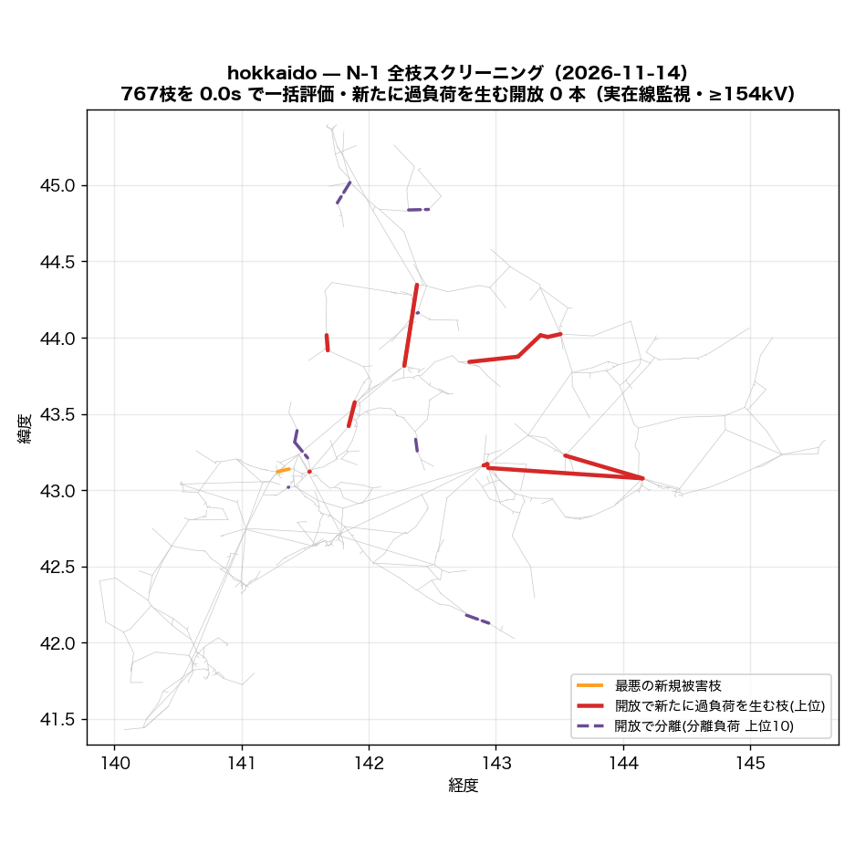
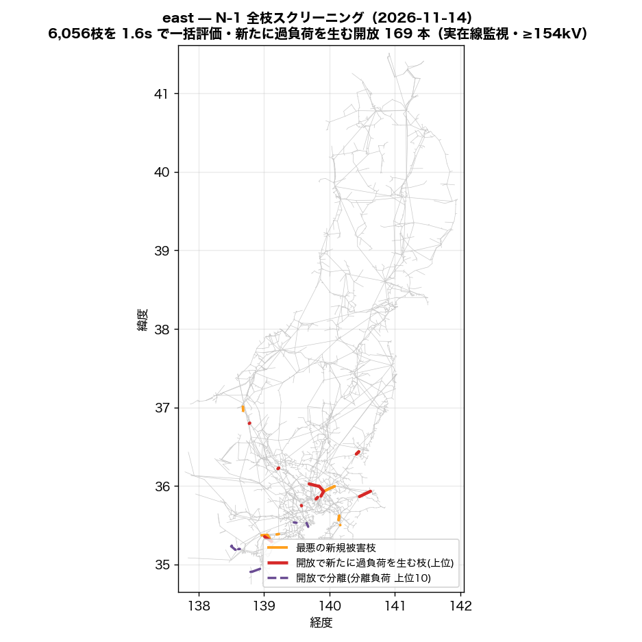
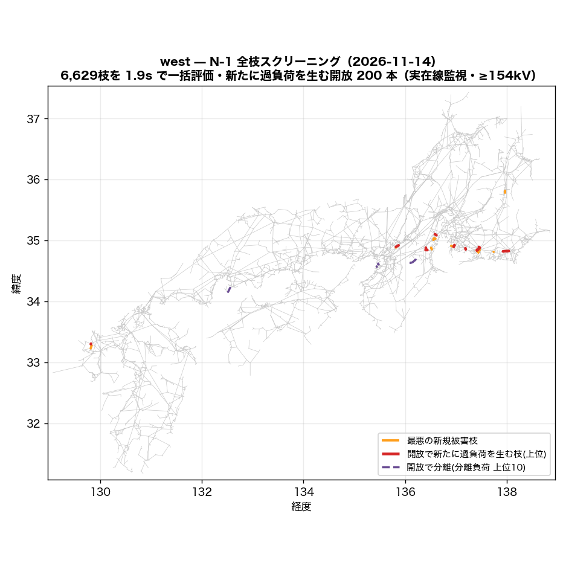
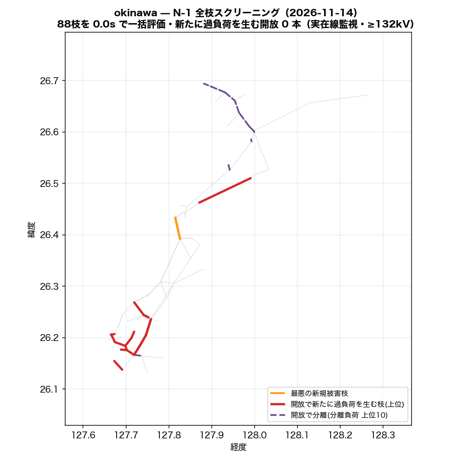

# N-1 全枝スクリーニング — LODF で全枝開放を一括評価（2026-11-14）

枝 k を開放したときの枝 j の潮流は `f_j + LODF[j,k]·f_k`（直流近似）で閉じているので、
全枝分の「開放後の最大負荷率・過負荷本数・最悪被害枝」が行列 1 枚の列演算で出る。
並列回線は **1 回線開放**（残回線容量で評価）、開放で分離する枝（橋）は LODF が定義できないため
**分離側の負荷・発電を別勘定**にした。

**合成定格の錯視を主結果に混ぜない**: 主表は監視枝を「実在線（OSM実線形・回収線・公表接続）＋銘板つき変圧器」に限った順位。
同一敷地タイ（同定）・発電所取付線・推定容量の変圧器などが最悪枝になる開放は別表で開示する。

| 島 | 主成分 | 枝 | 評価した開放 | 橋(分離) | 監視枝(実在/全) | 基準過負荷(実在) | 新規過負荷を生む開放 実在/全 | 新規側 >120% (実在) | 分離負荷≥100MW | PTDF | 一括評価 |
|---|---:|---:|---:|---:|---:|---:|---:|---:|---:|---:|---:|
| hokkaido | 799 | 916 | 767 | 149 | 127/187 | 0 | **0** / 21 | 0 | 0 | 0.0s | 0.0s |
| east | 5,890 | 7,022 | 6,056 | 961 | 1,448/2,162 | 49 | **169** / 349 | 54 | 3 | 1.9s | 1.6s |
| west | 7,364 | 8,726 | 6,629 | 2,089 | 2,414/3,167 | 22 | **200** / 423 | 60 | 44 | 3.4s | 1.9s |
| okinawa | 94 | 115 | 88 | 27 | 23/43 | 2 | **0** / 4 | 0 | 3 | 0.0s | 0.0s |

監視は ≥154kV（最高階級が届かない島はその階級: hokkaido 154kV、east 154kV、west 154kV、okinawa 132kV）・容量係数 1.0（理論値 √3·V·I に対する較正。公表運用容量との比較では約 0.5）。

## hokkaido

要素の内訳: 公表接続(直線) 2、発電所取付線 14、OSM実線 822、OSM実線(回収) 8、同一敷地タイ(同定) 1、変圧器(推定容量) 68、変圧器(銘板) 1

### 実在線監視 — 開放すると新たに過負荷を生む枝（上位 20）

基準ケースで既に >100% の実在監視枝: 0 本（最大 44.3%）。基準の過負荷は開放と無関係に居座るので、指標は**基準で過負荷でない枝の側**で取る（新規過負荷本数 → 新規側の最大負荷率）。新規側が 120% を超える開放: 0 本。

| # | 開放する枝 | 種別 | kV | 回線 | 開放枝の基準負荷率 | 新規過負荷 本数 | 新規側の最大負荷率 | 最大増分 | 最悪の新規被害枝 (種別・基準→開放後) |
|---:|---|---|---:|---:|---:|---:|---:|---:|---|
| 1 | 名寄幹線 | OSM実線 | 187 | 2 | 41.5% | **0** | **79%** | +38pt | 名寄幹線 (OSM実線, 187kV, 41.5→79%) |
| 2 | 滝川幹線 (Takikawa-kansen) | OSM実線 | 187 | 2 | 37.3% | **0** | **67%** | +30pt | 滝川幹線 (Takikawa-kansen) (OSM実線, 187kV, 37.3→67%) |
| 3 | trafo_275/187kV@pairmed@osm | 変圧器(推定容量) | 275 | 1 | 34.5% | **0** | **53%** | +31pt | 西札幌線 (OSM実線, 187kV, 22.7→53%) |
| 4 | 奈井江幹線 (Naie-kansen) | OSM実線 | 187 | 2 | 25.7% | **0** | **51%** | +26pt | 奈井江幹線 (Naie-kansen) (OSM実線, 187kV, 25.7→51%) |
| 5 | 道東幹線 | OSM実線 | 187 | 2 | 11.0% | **0** | **50%** | +6pt | 十勝幹線 (OSM実線, 187kV, 44.3→50%) |
| 6 | 北海道電力ネットワーク 187.0kV線 | OSM実線 | 187 | 1 | 5.3% | **0** | **50%** | +5pt | 十勝幹線 (OSM実線, 187kV, 44.3→50%) |
| 7 | 十勝幹線 | OSM実線 | 187 | 1 | 44.3% | **0** | **49%** | +44pt | 北海道電力ネットワーク 187.0kV線 (OSM実線, 187kV, 5.3→49%) |
| 8 | 日東変電所~丸瀬布西町変電所線 | OSM実線 | 66 | 1 | 57.4% | **0** | **49%** | +4pt | 十勝幹線 (OSM実線, 187kV, 44.3→49%) |
| 9 | 日東変電所~丸瀬布西町変電所線 | OSM実線 | 66 | 1 | 44.2% | **0** | **48%** | +3pt | 十勝幹線 (OSM実線, 187kV, 44.3→48%) |
| 10 | 北海道電力ネットワーク 187.0kV線 | OSM実線 | 187 | 1 | 2.9% | **0** | **47%** | +3pt | 十勝幹線 (OSM実線, 187kV, 44.3→47%) |
| 11 | 石北線 | OSM実線 | 66 | 1 | 35.5% | **0** | **47%** | +3pt | 十勝幹線 (OSM実線, 187kV, 44.3→47%) |
| 12 | trafo_187/66kV@pairmed@osm | 変圧器(推定容量) | 187 | 1 | 24.6% | **0** | **47%** | +9pt | 十勝幹線 (OSM実線, 187kV, 44.3→47%) |
| 13 | trafo_187/110kV | 変圧器(推定容量) | 187 | 1 | 98.0% | **0** | **47%** | +13pt | 十勝幹線 (OSM実線, 187kV, 44.3→47%) |
| 14 | 石北線 | OSM実線 | 66 | 1 | 31.0% | **0** | **47%** | +2pt | 十勝幹線 (OSM実線, 187kV, 44.3→47%) |
| 15 | 十勝幹線 | OSM実線 | 187 | 2 | 23.6% | **0** | **46%** | +23pt | 十勝幹線 (OSM実線, 187kV, 23.6→46%) |
| 16 | trafo_275/187kV@pairmed@osm | 変圧器(推定容量) | 275 | 1 | 24.2% | **0** | **46%** | +20pt | trafo_275/187kV@nameplate@osm (変圧器(銘板), 275kV, 31.3→46%) |
| 17 | trafo_110/66kV | 変圧器(推定容量) | 110 | 1 | 15.7% | **0** | **46%** | +2pt | 十勝幹線 (OSM実線, 187kV, 44.3→46%) |
| 18 | 泉町一丁目変電所~小平変電所 (Obira Hendensho)線 | OSM実線 | 66 | 1 | 70.8% | **0** | **46%** | +5pt | 名寄幹線 (OSM実線, 187kV, 41.5→46%) |
| 19 | trafo_187/66kV@pairmed@osm | 変圧器(推定容量) | 187 | 1 | 22.6% | **0** | **46%** | +6pt | 十勝幹線 (OSM実線, 187kV, 44.3→46%) |
| 20 | 釧路幹線 | OSM実線 | 187 | 2 | 4.9% | **0** | **46%** | +3pt | 十勝幹線 (OSM実線, 187kV, 44.3→46%) |

### AC 検証（上位を本番 solve_island で開放して解き直し）

| 開放する枝 | 開放 | DC 新規側最大 (新規本数) | AC | AC 新規側最大 (新規本数) | DC最悪新規枝の AC 負荷率（基準→開放後） | 秒 |
|---|---|---:|---|---:|---|---:|
| 名寄幹線 | 1回線 | 79% (0) | 収束 (給電100%) | 85.2% (0) | 43.8 → 85.2% | 0.2 |
| 滝川幹線 (Takikawa-kansen) | 1回線 | 67% (0) | 収束 (給電100%) | 70.6% (0) | 39.0 → 70.6% | 0.2 |
| trafo_275/187kV@pairmed@osm | 全回線 | 53% (0) | 収束 (給電100%) | 55.4% (0) | 23.7 → 55.4% | 0.2 |
| 奈井江幹線 (Naie-kansen) | 1回線 | 51% (0) | 収束 (給電100%) | 54.5% (0) | 27.3 → 54.5% | 0.2 |
| 道東幹線 | 1回線 | 50% (0) | 収束 (給電100%) | 51.2% (0) | 45.3 → 51.2% | 0.2 |

AC の負荷率は |P|/容量（直流の定義に揃えた）。1 回線開放は parallel を 1 減らして解き直し、残回線の容量で評価。prune はしごで落ちた枝は比較から除外。

### 別表 — 合成定格の要素が最悪枝になる開放（錯視の開示・上位 20）

| # | 開放する枝 | 種別 | kV | 回線 | 開放枝の基準負荷率 | 新規過負荷 本数 | 新規側の最大負荷率 | 最大増分 | 最悪の新規被害枝 (種別・基準→開放後) |
|---:|---|---|---:|---:|---:|---:|---:|---:|---|
| 1 | trafo_187/110kV | 変圧器(推定容量) | 187 | 1 | 62.0% | **1** | **121%** | +27pt | trafo_187/110kV (変圧器(推定容量), 187kV, 98.0→121%) |
| 2 | 泉町一丁目変電所~小平変電所 (Obira Hendensho)線 | OSM実線 | 66 | 1 | 70.8% | **1** | **117%** | +19pt | trafo_187/110kV (変圧器(推定容量), 187kV, 98.0→117%) |
| 3 | 小平町変電所~小平変電所 (Obira Hendensho)線 | OSM実線 | 66 | 1 | 57.6% | **1** | **113%** | +15pt | trafo_187/110kV (変圧器(推定容量), 187kV, 98.0→113%) |
| 4 | 北幌延線 | OSM実線 | 187 | 2 | 25.8% | **1** | **113%** | +20pt | trafo_187/110kV (変圧器(推定容量), 187kV, 98.0→113%) |
| 5 | trafo_187/110kV | 変圧器(推定容量) | 187 | 1 | 98.0% | **1** | **112%** | +50pt | trafo_187/110kV (変圧器(推定容量), 187kV, 62.0→112%) |
| 6 | 小平町変電所~鬼鹿田代変電所線 | OSM実線 | 66 | 1 | 44.4% | **1** | **110%** | +12pt | trafo_187/110kV (変圧器(推定容量), 187kV, 98.0→110%) |
| 7 | trafo_187/66kV@pairmed@osm | 変圧器(推定容量) | 187 | 1 | 45.9% | **1** | **110%** | +63pt | trafo_187/66kV (変圧器(推定容量), 187kV, 46.2→110%) |
| 8 | trafo_187/66kV@pairmed@osm | 変圧器(推定容量) | 187 | 1 | 51.1% | **1** | **109%** | +33pt | trafo_187/110kV (変圧器(推定容量), 187kV, 98.0→109%) |
| 9 | 鬼鹿田代変電所~苫前町変電所線 | OSM実線 | 66 | 1 | 31.2% | **1** | **106%** | +8pt | trafo_187/110kV (変圧器(推定容量), 187kV, 98.0→106%) |
| 10 | 興部線 | OSM実線 | 66 | 1 | 29.9% | **1** | **106%** | +8pt | trafo_187/110kV (変圧器(推定容量), 187kV, 98.0→106%) |
| 11 | trafo_187/110kV | 変圧器(推定容量) | 187 | 1 | 47.7% | **1** | **104%** | +20pt | trafo_187/110kV (変圧器(推定容量), 187kV, 98.0→104%) |
| 12 | trafo_187/66kV@pairmed@osm | 変圧器(推定容量) | 187 | 1 | 40.1% | **1** | **104%** | +26pt | trafo_187/110kV (変圧器(推定容量), 187kV, 98.0→104%) |
| 13 | 苫前町変電所~苫前変電所 (Tomamae Hendensho)線 | OSM実線 | 66 | 1 | 18.0% | **1** | **103%** | +5pt | trafo_187/110kV (変圧器(推定容量), 187kV, 98.0→103%) |
| 14 | trafo_187/66kV@pairmed@osm | 変圧器(推定容量) | 187 | 1 | 22.7% | **1** | **101%** | +21pt | trafo_275/66kV (変圧器(推定容量), 275kV, 80.6→101%) |
| 15 | 日東変電所~丸瀬布西町変電所線 | OSM実線 | 66 | 1 | 57.4% | **1** | **101%** | +32pt | trafo_187/110kV (変圧器(推定容量), 187kV, 98.0→101%) |
| 16 | trafo_275/187kV@pairmed@osm | 変圧器(推定容量) | 275 | 1 | 24.2% | **1** | **101%** | +20pt | trafo_187/110kV (変圧器(推定容量), 187kV, 98.0→101%) |
| 17 | 日東変電所~丸瀬布西町変電所線 | OSM実線 | 66 | 1 | 44.2% | **1** | **100%** | +25pt | trafo_187/110kV (変圧器(推定容量), 187kV, 98.0→100%) |
| 18 | trafo_187/66kV@pairmed@osm | 変圧器(推定容量) | 187 | 1 | 15.8% | **1** | **100%** | +21pt | trafo_187/110kV (変圧器(推定容量), 187kV, 98.0→100%) |
| 19 | trafo_187/66kV@pairmed@osm | 変圧器(推定容量) | 187 | 1 | 33.2% | **1** | **100%** | +24pt | trafo_187/110kV (変圧器(推定容量), 187kV, 98.0→100%) |
| 20 | 豊富中川幹線 | OSM実線 | 187 | 2 | 14.4% | **1** | **100%** | +11pt | trafo_187/110kV (変圧器(推定容量), 187kV, 98.0→100%) |

### 分離（橋）— 開放で切り離される負荷の大きい枝（上位 20）

橋 149 本（うち数値的な擬似橋 0）。分離側の負荷合計 1,790 MW。放射系の末端はそもそも N-1 で守れない（実系統では配電側の切替で対処）ので、ここは「モデルが放射になっている箇所」の一覧として読む。

| # | 開放する枝 | 種別 | kV | 分離バス数 | 分離側の負荷 | 分離側の発電 |
|---:|---|---|---:|---:|---:|---:|
| 1 | trafo_110/66kV | 変圧器(推定容量) | 110 | 9 | **72 MW** | 0 MW |
| 2 | 望来線 | OSM実線 | 66 | 6 | **54 MW** | 0 MW |
| 3 | trafo_187/66kV@pairmed@osm | 変圧器(推定容量) | 187 | 9 | **54 MW** | 0 MW |
| 4 | 同一敷地タイ(同定) | 同一敷地タイ(同定) | 66 | 5 | **45 MW** | 80 MW |
| 5 | 厚田線 | OSM実線 | 66 | 5 | **45 MW** | 0 MW |
| 6 | 山部線 | OSM実線 | 66 | 4 | **36 MW** | 10 MW |
| 7 | 浦河東線 | OSM実線 | 66 | 5 | **36 MW** | 4 MW |
| 8 | 天塩線 | OSM実線 | 66 | 6 | **36 MW** | 0 MW |
| 9 | 北海道送電線_53 | OSM実線 | 110 | 7 | **36 MW** | 0 MW |
| 10 | 枝幸線 | OSM実線 | 66 | 4 | **36 MW** | 0 MW |
| 11 | 浜益線 | OSM実線 | 66 | 4 | **36 MW** | 0 MW |
| 12 | 岩知志線 | OSM実線 | 66 | 5 | **27 MW** | 16 MW |
| 13 | 長流線 | OSM実線 | 66 | 4 | **27 MW** | 0 MW |
| 14 | 昆布線 | OSM実線 | 66 | 7 | **27 MW** | 8 MW |
| 15 | 瓜幕線 | OSM実線 | 66 | 3 | **27 MW** | 0 MW |
| 16 | 金山線 | OSM実線 | 66 | 3 | **27 MW** | 10 MW |
| 17 | 昆布線 | OSM実線 | 66 | 5 | **27 MW** | 8 MW |
| 18 | 遠別線 | OSM実線 | 66 | 5 | **27 MW** | 0 MW |
| 19 | 西一条十二丁目変電所~士別市変電所線 | OSM実線 | 66 | 5 | **27 MW** | 0 MW |
| 20 | 頓別線 | OSM実線 | 66 | 3 | **27 MW** | 0 MW |

## east

要素の内訳: 公表接続(直線) 61、発電所取付線 288、OSM実線 5,878、OSM実線(回収) 74、同一敷地タイ(同定) 47、合成連系タイ 1、変圧器(推定容量) 665、変圧器(銘板) 8

### 実在線監視 — 開放すると新たに過負荷を生む枝（上位 20）

基準ケースで既に >100% の実在監視枝: 49 本（最大 363.4%）。基準の過負荷は開放と無関係に居座るので、指標は**基準で過負荷でない枝の側**で取る（新規過負荷本数 → 新規側の最大負荷率）。新規側が 120% を超える開放: 54 本。

| # | 開放する枝 | 種別 | kV | 回線 | 開放枝の基準負荷率 | 新規過負荷 本数 | 新規側の最大負荷率 | 最大増分 | 最悪の新規被害枝 (種別・基準→開放後) |
|---:|---|---|---:|---:|---:|---:|---:|---:|---|
| 1 | trafo_500/275kV@pairmed@osm | 変圧器(推定容量) | 500 | 1 | 72.6% | **5** | **130%** | +70pt | 北千葉線 (OSM実線, 275kV, 60.7→130%) |
| 2 | 浅貝線 | OSM実線 | 500 | 1 | 18.7% | **4** | **249%** | +243pt | 神立変電所~灰雨変電所線 (OSM実線, 154kV, 5.4→249%) |
| 3 | trafo_500/154kV@pairmed@pub | 変圧器(推定容量) | 500 | 1 | 59.7% | **4** | **114%** | +78pt | 田代幹線 (OSM実線, 154kV, 36.3→114%) |
| 4 | trafo_500/275kV@pairmed@osm | 変圧器(推定容量) | 500 | 1 | 57.6% | **3** | **104%** | +39pt | 新新田線;佐波線 (OSM実線, 154kV, 90.6→104%) |
| 5 | trafo_500/275kV@pairmed@osm | 変圧器(推定容量) | 500 | 1 | 23.3% | **2** | **137%** | +47pt | 西水戸線 (OSM実線, 154kV, 90.6→137%) |
| 6 | trafo_500/275kV | 変圧器(推定容量) | 500 | 1 | 117.9% | **2** | **131%** | +53pt | 鹿島線 (OSM実線, 275kV, 85.6→131%) |
| 7 | 東京北線 | OSM実線 | 275 | 2 | 75.7% | **2** | **124%** | +49pt | 東京北線 (OSM実線, 275kV, 75.7→124%) |
| 8 | 小山町変電所~西相模変電所線 | OSM実線 | 154 | 2 | 69.4% | **2** | **118%** | +32pt | 新富士変電所~小田急電鉄 松田変電所線 (OSM実線, 154kV, 92.3→118%) |
| 9 | 東京北線 | OSM実線 | 275 | 2 | 70.9% | **2** | **110%** | +39pt | 東京北線 (OSM実線, 275kV, 70.9→110%) |
| 10 | trafo_275/66kV@pairmed@osm | 変圧器(推定容量) | 275 | 1 | 68.4% | **2** | **109%** | +35pt | 鹿島線 (OSM実線, 275kV, 85.6→109%) |
| 11 | trafo_500/154kV@pairmed@pub | 変圧器(推定容量) | 500 | 1 | 48.3% | **2** | **108%** | +92pt | 田代幹線 (OSM実線, 154kV, 15.6→108%) |
| 12 | trafo_500/154kV@pairmed@osm | 変圧器(推定容量) | 500 | 1 | 44.9% | **2** | **107%** | +39pt | 西水戸線 (OSM実線, 154kV, 90.6→107%) |
| 13 | 小松川線 | OSM実線 | 154 | 2 | 72.5% | **2** | **106%** | +33pt | 小松川線 (OSM実線, 154kV, 72.5→106%) |
| 14 | 香取線 / 湖南線 | OSM実線 | 275 | 2 | 59.3% | **2** | **106%** | +46pt | 香取線 / 湖南線 (OSM実線, 275kV, 59.3→106%) |
| 15 | trafo_275/154kV@pairmed@pub | 変圧器(推定容量) | 275 | 1 | 51.9% | **2** | **103%** | +25pt | 千葉中央線 / 生実線 (OSM実線, 154kV, 98.3→103%) |
| 16 | trafo_500/154kV | 変圧器(推定容量) | 500 | 1 | 82.4% | **2** | **102%** | +20pt | 千葉中央線 / 生実線 (OSM実線, 154kV, 98.3→102%) |
| 17 | 北葛飾線/野田線 | OSM実線 | 275 | 2 | 99.6% | **1** | **177%** | +78pt | 北葛飾線/野田線 (OSM実線, 275kV, 99.6→177%) |
| 18 | 新新田線;佐波線 | OSM実線 | 154 | 2 | 90.6% | **1** | **166%** | +76pt | 新新田線;佐波線 (OSM実線, 154kV, 90.6→166%) |
| 19 | 西水戸線 | OSM実線 | 154 | 2 | 90.6% | **1** | **166%** | +75pt | 西水戸線 (OSM実線, 154kV, 90.6→166%) |
| 20 | 北多摩線;吉武線 | OSM実線 | 154 | 2 | 83.1% | **1** | **160%** | +77pt | 北多摩線;吉武線 (OSM実線, 154kV, 83.1→160%) |

### AC 検証（上位を本番 solve_island で開放して解き直し）

| 開放する枝 | 開放 | DC 新規側最大 (新規本数) | AC | AC 新規側最大 (新規本数) | DC最悪新規枝の AC 負荷率（基準→開放後） | 秒 |
|---|---|---:|---|---:|---|---:|
| trafo_500/275kV@pairmed@osm | 全回線 | 130% (5) | 収束 (給電100%) | 134.3% (7) | 62.5 → 134.3% | 2.4 |
| 浅貝線 | 全回線 | 249% (4) | 収束 (給電100%) | 101.7% (2) | 3.9 → 0.0% | 4.4 |
| trafo_500/154kV@pairmed@pub | 全回線 | 114% (4) | 収束 (給電100%) | 117.8% (5) | 37.4 → 117.8% | 3.2 |
| trafo_500/275kV@pairmed@osm | 全回線 | 104% (3) | 収束 (給電100%) | 104.3% (5) | 90.8 → 104.3% | 2.9 |
| trafo_500/275kV@pairmed@osm | 全回線 | 137% (2) | 収束 (給電100%) | 142.1% (4) | 93.6 → 142.1% | 3.4 |

AC の負荷率は |P|/容量（直流の定義に揃えた）。1 回線開放は parallel を 1 減らして解き直し、残回線の容量で評価。prune はしごで落ちた枝は比較から除外。

### 別表 — 合成定格の要素が最悪枝になる開放（錯視の開示・上位 20）

| # | 開放する枝 | 種別 | kV | 回線 | 開放枝の基準負荷率 | 新規過負荷 本数 | 新規側の最大負荷率 | 最大増分 | 最悪の新規被害枝 (種別・基準→開放後) |
|---:|---|---|---:|---:|---:|---:|---:|---:|---|
| 1 | trafo_154/66kV@pairmed@osm | 変圧器(推定容量) | 154 | 1 | 85.9% | **12** | **114%** | +24pt | trafo_154/66kV (変圧器(推定容量), 154kV, 89.9→114%) |
| 2 | 浅貝線 | OSM実線 | 500 | 1 | 18.7% | **10** | **373%** | +325pt | trafo_154/66kV (変圧器(推定容量), 154kV, 48.1→373%) |
| 3 | trafo_275/66kV@pairmed@osm | 変圧器(推定容量) | 275 | 1 | 53.8% | **7** | **135%** | +76pt | trafo_275/66kV (変圧器(推定容量), 275kV, 58.8→135%) |
| 4 | trafo_500/275kV@pairmed@osm | 変圧器(推定容量) | 500 | 1 | 46.5% | **7** | **107%** | +54pt | trafo_500/154kV (変圧器(推定容量), 500kV, 97.0→107%) |
| 5 | trafo_275/66kV@pairmed@osm | 変圧器(推定容量) | 275 | 1 | 68.4% | **6** | **179%** | +82pt | trafo_500/66kV (変圧器(推定容量), 500kV, 97.4→179%) |
| 6 | trafo_500/154kV@pairmed@pub | 変圧器(推定容量) | 500 | 1 | 59.7% | **6** | **135%** | +78pt | trafo_500/154kV (変圧器(推定容量), 500kV, 97.0→135%) |
| 7 | trafo_500/275kV@pairmed@osm | 変圧器(推定容量) | 500 | 1 | 57.6% | **6** | **132%** | +40pt | trafo_500/66kV (変圧器(推定容量), 500kV, 91.8→132%) |
| 8 | trafo_275/66kV@pairmed@pub | 変圧器(推定容量) | 275 | 1 | 54.2% | **5** | **168%** | +122pt | trafo_154/66kV (変圧器(推定容量), 154kV, 45.7→168%) |
| 9 | trafo_275/66kV@pairmed@pub | 変圧器(推定容量) | 275 | 1 | 51.5% | **5** | **130%** | +57pt | trafo_500/66kV (変圧器(推定容量), 500kV, 87.3→130%) |
| 10 | trafo_500/154kV@pairmed@pub | 変圧器(推定容量) | 500 | 1 | 48.3% | **5** | **122%** | +92pt | trafo_275/154kV (変圧器(推定容量), 275kV, 44.8→122%) |
| 11 | trafo_500/154kV@pairmed@osm | 変圧器(推定容量) | 500 | 1 | 44.9% | **5** | **114%** | +39pt | trafo_500/66kV (変圧器(推定容量), 500kV, 97.8→114%) |
| 12 | 南池上線 | 公表接続(直線) | 66 | 1 | 284.4% | **5** | **108%** | +18pt | trafo_154/66kV (変圧器(推定容量), 154kV, 99.3→108%) |
| 13 | leadin | 発電所取付線 | 275 | 1 | 35.9% | **4** | **192%** | +118pt | trafo_154/66kV#43a@推定 (変圧器(推定容量), 154kV, 73.7→192%) |
| 14 | trafo_275/66kV#43a@推定 | 変圧器(推定容量) | 275 | 1 | 109.7% | **4** | **188%** | +114pt | trafo_154/66kV#43a@推定 (変圧器(推定容量), 154kV, 73.7→188%) |
| 15 | 鹿島線 | OSM実線 | 275 | 2 | 135.0% | **4** | **109%** | +82pt | trafo_500/66kV (変圧器(推定容量), 500kV, 97.4→109%) |
| 16 | trafo_275/154kV@pairmed@pub | 変圧器(推定容量) | 275 | 1 | 51.9% | **4** | **104%** | +25pt | trafo_275/154kV (変圧器(推定容量), 275kV, 99.6→104%) |
| 17 | trafo_154/66kV | 変圧器(推定容量) | 154 | 1 | 232.8% | **3** | **153%** | +66pt | trafo_154/66kV#43a@推定 (変圧器(推定容量), 154kV, 86.9→153%) |
| 18 | trafo_275/66kV#43a@推定 | 変圧器(推定容量) | 275 | 1 | 94.4% | **3** | **135%** | +43pt | trafo_275/66kV#43a@推定 (変圧器(推定容量), 275kV, 99.5→135%) |
| 19 | trafo_275/66kV#43a@推定 | 変圧器(推定容量) | 275 | 1 | 99.5% | **3** | **131%** | +36pt | trafo_275/66kV#43a@推定 (変圧器(推定容量), 275kV, 94.4→131%) |
| 20 | trafo_275/154kV@pairmed@osm | 変圧器(推定容量) | 275 | 1 | 56.9% | **3** | **121%** | +48pt | trafo_275/154kV (変圧器(推定容量), 275kV, 73.5→121%) |

### 分離（橋）— 開放で切り離される負荷の大きい枝（上位 20）

橋 961 本（うち数値的な擬似橋 0）。分離側の負荷合計 11,096 MW。放射系の末端はそもそも N-1 で守れない（実系統では配電側の切替で対処）ので、ここは「モデルが放射になっている箇所」の一覧として読む。

| # | 開放する枝 | 種別 | kV | 分離バス数 | 分離側の負荷 | 分離側の発電 |
|---:|---|---|---:|---:|---:|---:|
| 1 | trafo_275/66kV | 変圧器(推定容量) | 275 | 9 | **159 MW** | 0 MW |
| 2 | 東京電力パワーグリッド 66.0kV線 | OSM実線 | 66 | 14 | **119 MW** | 51 MW |
| 3 | trafo_154/66kV | 変圧器(推定容量) | 154 | 3 | **110 MW** | 0 MW |
| 4 | 東京電力パワーグリッド 66.0kV線 | OSM実線 | 66 | 8 | **84 MW** | 51 MW |
| 5 | 中野台二丁目変電所~富士川第一変電所線 | OSM実線 | 66 | 6 | **84 MW** | 51 MW |
| 6 | 長津田町田線 | OSM実線 | 66 | 5 | **76 MW** | 0 MW |
| 7 | 東京電力パワーグリッド 66.0kV線 | OSM実線 | 66 | 8 | **74 MW** | 0 MW |
| 8 | 東京電力パワーグリッド 66.0kV線 | OSM実線 | 66 | 6 | **74 MW** | 0 MW |
| 9 | namebind | OSM実線 | 66 | 4 | **66 MW** | 51 MW |
| 10 | (154kV・旭→横浜大黒) | 公表接続(直線) | 154 | 3 | **66 MW** | 16 MW |
| 11 | trafo_154/66kV@pairmed@osm | 変圧器(推定容量) | 154 | 8 | **60 MW** | 0 MW |
| 12 | 梅木変電所~三福変電所線 | OSM実線 | 66 | 5 | **55 MW** | 0 MW |
| 13 | 伊東市変電所~田方変電所線 | OSM実線 | 66 | 5 | **55 MW** | 0 MW |
| 14 | 渋沢二丁目変電所~金子変電所線 | OSM実線 | 66 | 2 | **51 MW** | 1 MW |
| 15 | 新町変電所~三屋変電所線 | OSM実線 | 66 | 2 | **51 MW** | 0 MW |
| 16 | trafo_154/66kV | 変圧器(推定容量) | 154 | 2 | **51 MW** | 16 MW |
| 17 | 長津田町田線 | OSM実線 | 66 | 3 | **51 MW** | 0 MW |
| 18 | trafo_154/66kV#43a@推定 | 変圧器(推定容量) | 154 | 2 | **51 MW** | 16 MW |
| 19 | leadin | 発電所取付線 | 66 | 1 | **42 MW** | 0 MW |
| 20 | leadin | 発電所取付線 | 66 | 1 | **42 MW** | 0 MW |

## west

要素の内訳: 公表接続(直線) 62、公表接続の取付スタブ 5、発電所取付線 298、OSM実線 7,269、OSM実線(回収) 116、同一敷地タイ(同定) 12、合成連系タイ 5、変圧器(推定容量) 954、変圧器(銘板) 5

### 実在線監視 — 開放すると新たに過負荷を生む枝（上位 20）

基準ケースで既に >100% の実在監視枝: 22 本（最大 247.3%）。基準の過負荷は開放と無関係に居座るので、指標は**基準で過負荷でない枝の側**で取る（新規過負荷本数 → 新規側の最大負荷率）。新規側が 120% を超える開放: 60 本。

| # | 開放する枝 | 種別 | kV | 回線 | 開放枝の基準負荷率 | 新規過負荷 本数 | 新規側の最大負荷率 | 最大増分 | 最悪の新規被害枝 (種別・基準→開放後) |
|---:|---|---|---:|---:|---:|---:|---:|---:|---|
| 1 | trafo_500/275kV | 変圧器(推定容量) | 500 | 1 | 63.9% | **6** | **167%** | +73pt | 駒ヶ根変電所~田畑変電所線 (OSM実線, 154kV, 97.8→167%) |
| 2 | 新居町五丁目変電所~南起変電所線 | OSM実線 | 154 | 1 | 92.0% | **6** | **164%** | +68pt | 住吉町五丁目変電所~岩滑西町三丁目変電所線 (OSM実線, 154kV, 95.5→164%) |
| 3 | 新居町五丁目変電所~南起変電所線 | OSM実線 | 154 | 1 | 84.1% | **6** | **158%** | +63pt | 住吉町五丁目変電所~岩滑西町三丁目変電所線 (OSM実線, 154kV, 95.5→158%) |
| 4 | 中勢亀山線 | OSM実線 | 275 | 1 | 102.8% | **6** | **154%** | +76pt | まきの木台二丁目変電所~赤水町変電所線 (OSM実線, 154kV, 78.6→154%) |
| 5 | 中勢亀山線 | OSM実線 | 275 | 1 | 90.2% | **6** | **133%** | +54pt | まきの木台二丁目変電所~赤水町変電所線 (OSM実線, 154kV, 78.6→133%) |
| 6 | 中部電力パワーグリッド 275.0kV線 | OSM実線 | 275 | 1 | 140.4% | **5** | **230%** | +149pt | 垂坂町変電所~北勢変電所 (Hokusei Hendensho)線 (OSM実線, 154kV, 81.8→230%) |
| 7 | 新鈴鹿分岐線 | OSM実線 | 275 | 1 | 65.3% | **5** | **132%** | +51pt | namebind (OSM実線, 154kV, 81.1→132%) |
| 8 | trafo_275/77kV@pairmed@osm | 変圧器(推定容量) | 275 | 1 | 106.7% | **5** | **131%** | +49pt | namebind (OSM実線, 154kV, 81.1→131%) |
| 9 | 中勢亀山線 | OSM実線 | 275 | 1 | 77.6% | **5** | **120%** | +41pt | まきの木台二丁目変電所~赤水町変電所線 (OSM実線, 154kV, 78.6→120%) |
| 10 | 山代変電所~久原変電所線 | OSM実線 | 500 | 1 | 31.3% | **4** | **158%** | +128pt | 山代変電所~九州電力　日宇変電所線 (OSM実線, 220kV, 30.0→158%) |
| 11 | 西日本電線新城線 | OSM実線 | 77 | 1 | 78.9% | **4** | **152%** | +58pt | 豊川玉川線 (OSM実線, 154kV, 95.0→152%) |
| 12 | 中部送電線_160 | OSM実線 | 500 | 1 | 46.0% | **4** | **152%** | +58pt | 豊川玉川線 (OSM実線, 154kV, 95.0→152%) |
| 13 | 明星町四丁目変電所~喜撰山開閉所線 | OSM実線 | 154 | 1 | 65.3% | **4** | **149%** | +56pt | 関西送電線_564 (OSM実線, 154kV, 93.3→149%) |
| 14 | 西日本電線新城線 | OSM実線 | 77 | 1 | 67.4% | **4** | **144%** | +49pt | 豊川玉川線 (OSM実線, 154kV, 95.0→144%) |
| 15 | 西日本電線新城線 | OSM実線 | 66 | 1 | 262.2% | **4** | **144%** | +49pt | 豊川玉川線 (OSM実線, 154kV, 95.0→144%) |
| 16 | trafo_77/66kV#43a@推定 | 変圧器(推定容量) | 77 | 1 | 41.1% | **4** | **141%** | +46pt | 豊川玉川線 (OSM実線, 154kV, 95.0→141%) |
| 17 | 麻生田分岐線 | OSM実線 | 66 | 1 | 210.8% | **4** | **134%** | +40pt | 豊川玉川線 (OSM実線, 154kV, 95.0→134%) |
| 18 | trafo_275/77kV | 変圧器(推定容量) | 275 | 1 | 169.1% | **4** | **108%** | +14pt | 三河玉川線 (OSM実線, 154kV, 95.9→108%) |
| 19 | 中部電力パワーグリッド 275.0kV線 | OSM実線 | 275 | 1 | 89.6% | **4** | **107%** | +46pt | 豊川玉川線 (OSM実線, 154kV, 95.0→107%) |
| 20 | 山科変電所~駿遠変電所線 | OSM実線 | 275 | 1 | 34.5% | **3** | **136%** | +74pt | 秋葉浜松線 (OSM実線, 154kV, 92.7→136%) |

### AC 検証（上位を本番 solve_island で開放して解き直し）

| 開放する枝 | 開放 | DC 新規側最大 (新規本数) | AC | AC 新規側最大 (新規本数) | DC最悪新規枝の AC 負荷率（基準→開放後） | 秒 |
|---|---|---:|---|---:|---|---:|
| trafo_500/275kV | 全回線 | 167% (6) | 収束 (給電100%) | 167.9% (9) | 97.4 → 167.9% | 4.4 |
| 新居町五丁目変電所~南起変電所線 | 全回線 | 164% (6) | 収束 (給電100%) | 165.6% (8) | 96.0 → 165.6% | 6.0 |
| 新居町五丁目変電所~南起変電所線 | 全回線 | 158% (6) | 収束 (給電100%) | 159.7% (8) | 96.0 → 159.7% | 4.2 |
| 中勢亀山線 | 全回線 | 154% (6) | 収束 (給電100%) | 158.6% (8) | 78.0 → 158.6% | 3.4 |
| 中勢亀山線 | 全回線 | 133% (6) | 収束 (給電100%) | 136.2% (7) | 78.0 → 136.2% | 5.6 |

AC の負荷率は |P|/容量（直流の定義に揃えた）。1 回線開放は parallel を 1 減らして解き直し、残回線の容量で評価。prune はしごで落ちた枝は比較から除外。

### 別表 — 合成定格の要素が最悪枝になる開放（錯視の開示・上位 20）

| # | 開放する枝 | 種別 | kV | 回線 | 開放枝の基準負荷率 | 新規過負荷 本数 | 新規側の最大負荷率 | 最大増分 | 最悪の新規被害枝 (種別・基準→開放後) |
|---:|---|---|---:|---:|---:|---:|---:|---:|---|
| 1 | trafo_154/77kV@pairmed@osm | 変圧器(推定容量) | 154 | 1 | 75.7% | **10** | **115%** | +35pt | trafo_154/77kV (変圧器(推定容量), 154kV, 81.8→115%) |
| 2 | 新鈴鹿分岐線 | OSM実線 | 275 | 1 | 65.3% | **6** | **135%** | +164pt | trafo_154/77kV#43a@推定 (変圧器(推定容量), 154kV, 67.8→135%) |
| 3 | trafo_275/77kV@pairmed@osm | 変圧器(推定容量) | 275 | 1 | 106.7% | **6** | **134%** | +160pt | trafo_154/77kV#43a@推定 (変圧器(推定容量), 154kV, 67.8→134%) |
| 4 | 中部電力パワーグリッド 275.0kV線 | OSM実線 | 275 | 1 | 89.6% | **6** | **118%** | +90pt | trafo_275/77kV (変圧器(推定容量), 275kV, 27.9→118%) |
| 5 | trafo_220/66kV@pairmed@pub | 変圧器(推定容量) | 220 | 1 | 83.4% | **5** | **137%** | +52pt | trafo_220/66kV (変圧器(推定容量), 220kV, 85.1→137%) |
| 6 | 中部電力パワーグリッド 日進変電所~北豊田変電所 (Kita Toyota Hendensho)線 | OSM実線 | 275 | 1 | 59.7% | **5** | **119%** | +57pt | trafo_275/77kV (変圧器(推定容量), 275kV, 61.8→119%) |
| 7 | 梶原六丁目変電所~高槻変電所線 | OSM実線 | 500 | 1 | 109.0% | **5** | **117%** | +39pt | trafo_500/77kV (変圧器(推定容量), 500kV, 97.4→117%) |
| 8 | trafo_187/66kV@pairmed@osm | 変圧器(推定容量) | 187 | 1 | 58.0% | **4** | **132%** | +54pt | trafo_187/66kV (変圧器(推定容量), 187kV, 99.4→132%) |
| 9 | trafo_500/220kV | 変圧器(推定容量) | 500 | 1 | 73.0% | **4** | **112%** | +26pt | trafo_220/66kV (変圧器(推定容量), 220kV, 99.3→112%) |
| 10 | trafo_500/220kV@pairmed@osm | 変圧器(推定容量) | 500 | 1 | 28.6% | **4** | **103%** | +23pt | trafo_220/66kV (変圧器(推定容量), 220kV, 94.9→103%) |
| 11 | 大畑町変電所~中部電力八草変電所線 | OSM実線 | 275 | 1 | 36.3% | **3** | **169%** | +107pt | trafo_275/77kV (変圧器(推定容量), 275kV, 61.8→169%) |
| 12 | 大畑町変電所~中部電力八草変電所線 | OSM実線 | 77 | 1 | 388.5% | **3** | **158%** | +96pt | trafo_275/77kV (変圧器(推定容量), 275kV, 61.8→158%) |
| 13 | 垂坂町変電所~北勢変電所 (Hokusei Hendensho)線 | OSM実線 | 154 | 1 | 180.3% | **3** | **152%** | +79pt | trafo_275/154kV (変圧器(推定容量), 275kV, 72.6→152%) |
| 14 | trafo_275/154kV@pairmed@osm | 変圧器(推定容量) | 275 | 1 | 60.8% | **3** | **141%** | +133pt | trafo_154/77kV (変圧器(推定容量), 154kV, 98.3→141%) |
| 15 | trafo_220/66kV@pairmed@osm | 変圧器(推定容量) | 220 | 1 | 51.0% | **3** | **132%** | +33pt | trafo_220/66kV (変圧器(推定容量), 220kV, 99.3→132%) |
| 16 | trafo_275/77kV@pairmed@osm | 変圧器(推定容量) | 275 | 1 | 68.3% | **3** | **120%** | +26pt | trafo_500/77kV (変圧器(推定容量), 500kV, 97.4→120%) |
| 17 | trafo_275/77kV@pairmed@pub | 変圧器(推定容量) | 275 | 1 | 76.8% | **3** | **116%** | +40pt | trafo_275/77kV (変圧器(推定容量), 275kV, 76.2→116%) |
| 18 | trafo_275/77kV@pairmed@osm | 変圧器(推定容量) | 275 | 1 | 58.3% | **3** | **114%** | +34pt | trafo_275/77kV (変圧器(推定容量), 275kV, 80.2→114%) |
| 19 | trafo_220/66kV | 変圧器(推定容量) | 220 | 1 | 127.9% | **3** | **110%** | +16pt | trafo_220/66kV (変圧器(推定容量), 220kV, 94.2→110%) |
| 20 | trafo_275/154kV | 変圧器(推定容量) | 275 | 1 | 161.8% | **3** | **108%** | +20pt | trafo_275/154kV (変圧器(推定容量), 275kV, 95.2→108%) |

### 分離（橋）— 開放で切り離される負荷の大きい枝（上位 20）

橋 2,089 本（うち数値的な擬似橋 0）。分離側の負荷合計 33,006 MW。放射系の末端はそもそも N-1 で守れない（実系統では配電側の切替で対処）ので、ここは「モデルが放射になっている箇所」の一覧として読む。

| # | 開放する枝 | 種別 | kV | 分離バス数 | 分離側の負荷 | 分離側の発電 |
|---:|---|---|---:|---:|---:|---:|
| 1 | trafo_275/77kV@pairmed@osm | 変圧器(推定容量) | 275 | 24 | **405 MW** | 0 MW |
| 2 | 関西送電線_129 | OSM実線 | 77 | 19 | **402 MW** | 105 MW |
| 3 | trafo_154/77kV#43a@推定 | 変圧器(推定容量) | 154 | 24 | **370 MW** | 20 MW |
| 4 | 敷津変電所~御崎七丁目変電所線 | OSM実線 | 154 | 16 | **344 MW** | 105 MW |
| 5 | 泉北線〔取付〕 | 公表接続の取付スタブ | 77 | 23 | **340 MW** | 20 MW |
| 6 | 中勢青山線 | OSM実線 | 77 | 9 | **209 MW** | 17 MW |
| 7 | 青山名張線 | OSM実線 | 77 | 7 | **209 MW** | 17 MW |
| 8 | trafo_187/77kV | 変圧器(推定容量) | 187 | 18 | **185 MW** | 6 MW |
| 9 | 大柿線 | OSM実線 | 66 | 6 | **175 MW** | 0 MW |
| 10 | 青山名張線 | OSM実線 | 77 | 5 | **167 MW** | 17 MW |
| 11 | trafo_187/66kV | 変圧器(推定容量) | 187 | 12 | **165 MW** | 18 MW |
| 12 | 熊野川町相須変電所~新宮変電所線 | OSM実線 | 275 | 18 | **162 MW** | 1 MW |
| 13 | trafo_187/110kV | 変圧器(推定容量) | 187 | 19 | **158 MW** | 159 MW |
| 14 | trafo_154/77kV | 変圧器(推定容量) | 154 | 7 | **157 MW** | 0 MW |
| 15 | 尾道変電所~因島変電所線 | OSM実線 | 110 | 14 | **156 MW** | 1 MW |
| 16 | 川口線+川口連絡線 | 公表接続(直線) | 66 | 12 | **156 MW** | 28 MW |
| 17 | 東京電力パワーグリッド 275.0kV線 | OSM実線 | 275 | 31 | **148 MW** | 30 MW |
| 18 | trafo_154/77kV#43a@推定 | 変圧器(推定容量) | 154 | 5 | **147 MW** | 0 MW |
| 19 | trafo_154/77kV | 変圧器(推定容量) | 154 | 6 | **144 MW** | 85 MW |
| 20 | trafo_275/154kV | 変圧器(推定容量) | 275 | 30 | **143 MW** | 30 MW |

## okinawa

要素の内訳: 発電所取付線 8、OSM実線 88、変圧器(推定容量) 19

### 実在線監視 — 開放すると新たに過負荷を生む枝（上位 20）

基準ケースで既に >100% の実在監視枝: 2 本（最大 123.4%）。基準の過負荷は開放と無関係に居座るので、指標は**基準で過負荷でない枝の側**で取る（新規過負荷本数 → 新規側の最大負荷率）。新規側が 120% を超える開放: 0 本。

| # | 開放する枝 | 種別 | kV | 回線 | 開放枝の基準負荷率 | 新規過負荷 本数 | 新規側の最大負荷率 | 最大増分 | 最悪の新規被害枝 (種別・基準→開放後) |
|---:|---|---|---:|---:|---:|---:|---:|---:|---|
| 1 | 那覇高安線; 那覇小禄線 | OSM実線 | 66 | 2 | 23.5% | **0** | **90%** | +0pt | うるま市変電所~仲泊変電所線 (OSM実線, 132kV, 90.2→90%) |
| 2 | 那覇高安線; 小禄線 | OSM実線 | 66 | 2 | 51.0% | **0** | **90%** | +0pt | うるま市変電所~仲泊変電所線 (OSM実線, 132kV, 90.2→90%) |
| 3 | 那覇高安線; 那覇小禄線 | OSM実線 | 66 | 2 | 9.7% | **0** | **90%** | +0pt | うるま市変電所~仲泊変電所線 (OSM実線, 132kV, 90.2→90%) |
| 4 | 那覇変電所~壷川変電所線 | OSM実線 | 66 | 1 | 8.1% | **0** | **90%** | +1pt | うるま市変電所~仲泊変電所線 (OSM実線, 132kV, 90.2→90%) |
| 5 | 那覇高安線; 小禄線 | OSM実線 | 66 | 2 | 64.8% | **0** | **90%** | +0pt | うるま市変電所~仲泊変電所線 (OSM実線, 132kV, 90.2→90%) |
| 6 | 繁多川線 | OSM実線 | 66 | 2 | 13.8% | **0** | **90%** | +0pt | うるま市変電所~仲泊変電所線 (OSM実線, 132kV, 90.2→90%) |
| 7 | 那覇高安線; 小禄線 | OSM実線 | 66 | 2 | 78.6% | **0** | **90%** | +0pt | うるま市変電所~仲泊変電所線 (OSM実線, 132kV, 90.2→90%) |
| 8 | 沖縄電力 66.0kV線 | OSM実線 | 66 | 2 | 13.8% | **0** | **90%** | +0pt | うるま市変電所~仲泊変電所線 (OSM実線, 132kV, 90.2→90%) |
| 9 | 西原幹線;前田線 | OSM実線 | 66 | 1 | 18.6% | **0** | **90%** | +0pt | うるま市変電所~仲泊変電所線 (OSM実線, 132kV, 90.2→90%) |
| 10 | 西原幹線 | OSM実線 | 132 | 2 | 25.3% | **0** | **90%** | +20pt | うるま市変電所~仲泊変電所線 (OSM実線, 132kV, 90.2→90%) |
| 11 | 西原幹線;前田線 | OSM実線 | 132 | 2 | 14.9% | **0** | **90%** | +14pt | うるま市変電所~仲泊変電所線 (OSM実線, 132kV, 90.2→90%) |
| 12 | leadin | 発電所取付線 | 66 | 3 | 0.0% | **0** | **90%** | +0pt | うるま市変電所~仲泊変電所線 (OSM実線, 132kV, 90.2→90%) |
| 13 | 友寄変電所~南風原変電所線 | OSM実線 | 66 | 1 | 158.1% | **0** | **90%** | +7pt | うるま市変電所~仲泊変電所線 (OSM実線, 132kV, 90.2→90%) |
| 14 | namebind | OSM実線 | 66 | 2 | 0.0% | **0** | **90%** | +0pt | うるま市変電所~仲泊変電所線 (OSM実線, 132kV, 90.2→90%) |
| 15 | 南風原変電所~与那原変電所線 | OSM実線 | 66 | 1 | 98.8% | **0** | **90%** | +6pt | うるま市変電所~仲泊変電所線 (OSM実線, 132kV, 90.2→90%) |
| 16 | 友寄変電所~南風原変電所線 | OSM実線 | 132 | 3 | 10.7% | **0** | **90%** | +5pt | うるま市変電所~仲泊変電所線 (OSM実線, 132kV, 90.2→90%) |
| 17 | 南風原変電所~与那原変電所線 | OSM実線 | 132 | 3 | 19.5% | **0** | **90%** | +10pt | うるま市変電所~仲泊変電所線 (OSM実線, 132kV, 90.2→90%) |
| 18 | 与那原変電所~西原変電所線 | OSM実線 | 66 | 1 | 55.0% | **0** | **90%** | +4pt | うるま市変電所~仲泊変電所線 (OSM実線, 132kV, 90.2→90%) |
| 19 | 与那原変電所~西原変電所線 | OSM実線 | 132 | 3 | 27.1% | **0** | **90%** | +13pt | うるま市変電所~仲泊変電所線 (OSM実線, 132kV, 90.2→90%) |
| 20 | namebind | OSM実線 | 66 | 2 | 84.0% | **0** | **90%** | +5pt | うるま市変電所~仲泊変電所線 (OSM実線, 132kV, 90.2→90%) |

### AC 検証（上位を本番 solve_island で開放して解き直し）

| 開放する枝 | 開放 | DC 新規側最大 (新規本数) | AC | AC 新規側最大 (新規本数) | DC最悪新規枝の AC 負荷率（基準→開放後） | 秒 |
|---|---|---:|---|---:|---|---:|
| 那覇高安線; 那覇小禄線 | 1回線 | 90% (0) | 収束 (給電100%) | 87.3% (0) | 87.3 → 87.3% | 0.0 |
| 那覇高安線; 小禄線 | 1回線 | 90% (0) | 収束 (給電100%) | 87.3% (0) | 87.3 → 87.3% | 0.0 |
| 那覇高安線; 那覇小禄線 | 1回線 | 90% (0) | 収束 (給電100%) | 87.3% (0) | 87.3 → 87.3% | 0.0 |
| 那覇変電所~壷川変電所線 | 全回線 | 90% (0) | 収束 (給電100%) | 87.3% (0) | 87.3 → 87.3% | 0.0 |
| 那覇高安線; 小禄線 | 1回線 | 90% (0) | 収束 (給電100%) | 87.3% (0) | 87.3 → 87.3% | 0.0 |

AC の負荷率は |P|/容量（直流の定義に揃えた）。1 回線開放は parallel を 1 減らして解き直し、残回線の容量で評価。prune はしごで落ちた枝は比較から除外。

### 別表 — 合成定格の要素が最悪枝になる開放（錯視の開示・上位 5）

| # | 開放する枝 | 種別 | kV | 回線 | 開放枝の基準負荷率 | 新規過負荷 本数 | 新規側の最大負荷率 | 最大増分 | 最悪の新規被害枝 (種別・基準→開放後) |
|---:|---|---|---:|---:|---:|---:|---:|---:|---|
| 1 | 仲泊変電所~石川東山一丁目変電所線 | OSM実線 | 132 | 1 | 101.6% | **4** | **244%** | +210pt | trafo_132/66kV (変圧器(推定容量), 132kV, 34.1→244%) |
| 2 | 石川東山一丁目変電所~石川東山二丁目変電所線 | OSM実線 | 132 | 1 | 123.4% | **4** | **204%** | +154pt | trafo_132/66kV (変圧器(推定容量), 132kV, 49.1→204%) |
| 3 | 友寄変電所~南風原変電所線 | OSM実線 | 66 | 1 | 158.1% | **1** | **129%** | +54pt | trafo_132/66kV@osm (変圧器(推定容量), 132kV, 74.7→129%) |
| 4 | 伊佐一丁目変電所_2~牧港五丁目変電所線 | OSM実線 | 66 | 1 | 144.1% | **1** | **126%** | +49pt | trafo_132/66kV (変圧器(推定容量), 132kV, 76.7→126%) |
| 5 | 南風原変電所~与那原変電所線 | OSM実線 | 66 | 1 | 98.8% | **0** | **94%** | +26pt | trafo_132/66kV@osm (変圧器(推定容量), 132kV, 74.7→94%) |

### 分離（橋）— 開放で切り離される負荷の大きい枝（上位 20）

橋 27 本（うち数値的な擬似橋 0）。分離側の負荷合計 1,755 MW。放射系の末端はそもそも N-1 で守れない（実系統では配電側の切替で対処）ので、ここは「モデルが放射になっている箇所」の一覧として読む。

| # | 開放する枝 | 種別 | kV | 分離バス数 | 分離側の負荷 | 分離側の発電 |
|---:|---|---|---:|---:|---:|---:|
| 1 | うるま市変電所~仲泊変電所線 | OSM実線 | 132 | 61 | **873 MW** | 625 MW |
| 2 | 名護市変電所~名護電力所線 | OSM実線 | 66 | 12 | **132 MW** | 7 MW |
| 3 | 沖縄電力 66.0kV線 | OSM実線 | 66 | 9 | **113 MW** | 2 MW |
| 4 | 沖縄電力 66.0kV線 | OSM実線 | 66 | 8 | **94 MW** | 2 MW |
| 5 | 名護電力所~仲宗根変電所線 | OSM実線 | 66 | 6 | **76 MW** | 2 MW |
| 6 | 仲宗根変電所~東変電所線 | OSM実線 | 66 | 4 | **57 MW** | 2 MW |
| 7 | 沖縄電力 66.0kV線 | OSM実線 | 66 | 3 | **38 MW** | 0 MW |
| 8 | 東変電所~海洋博変電所線 | OSM実線 | 66 | 2 | **38 MW** | 1 MW |
| 9 | 沖縄電力 66.0kV線 | OSM実線 | 66 | 1 | **19 MW** | 0 MW |
| 10 | 沖縄電力 66.0kV線 | OSM実線 | 66 | 1 | **19 MW** | 0 MW |
| 11 | 恩納村変電所~喜瀬変電所線 | OSM実線 | 66 | 1 | **19 MW** | 0 MW |
| 12 | 名護電力所~田港変電所線 | OSM実線 | 66 | 2 | **19 MW** | 5 MW |
| 13 | leadin | 発電所取付線 | 66 | 1 | **19 MW** | 0 MW |
| 14 | leadin | 発電所取付線 | 66 | 1 | **19 MW** | 0 MW |
| 15 | leadin | 発電所取付線 | 66 | 1 | **19 MW** | 0 MW |
| 16 | 浦添大名線 | OSM実線 | 66 | 1 | **19 MW** | 0 MW |
| 17 | 友寄変電所~大里変電所線 | OSM実線 | 66 | 2 | **19 MW** | 0 MW |
| 18 | 久茂地変電所~西那覇変電所線 | OSM実線 | 66 | 1 | **19 MW** | 0 MW |
| 19 | leadin | 発電所取付線 | 66 | 1 | **19 MW** | 0 MW |
| 20 | 友寄変電所~佐敷変電所線 | OSM実線 | 66 | 1 | **19 MW** | 0 MW |

## 前提と限界

- 直流近似・熱容量のみ（無効電力・電圧・安定度・保護協調は見ない）。合成インピーダンス（電圧階級の標準定数）上の線形化
- 容量は理論値（線路 √3·V·I·回線数、変圧器 sn·回線数）。公表運用容量ではない（`--cap-factor` で較正）
- 対象は各島の最大連結成分。連系線・FC・非通電の合成タイ（介入#31）は開放候補に入らない
- 発電機の再配分（AGC・予備力）は考慮しない＝開放直後の潮流再配分だけ
- **screening であって運用可否の判定ではない**。順位で候補を絞り、確定は AC・実データ・実系統の定格で

---
生成: `scripts/sensitivity/n1_screening.py`
