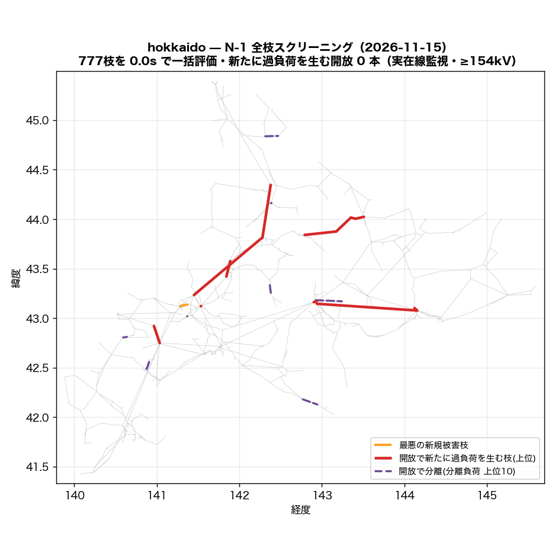
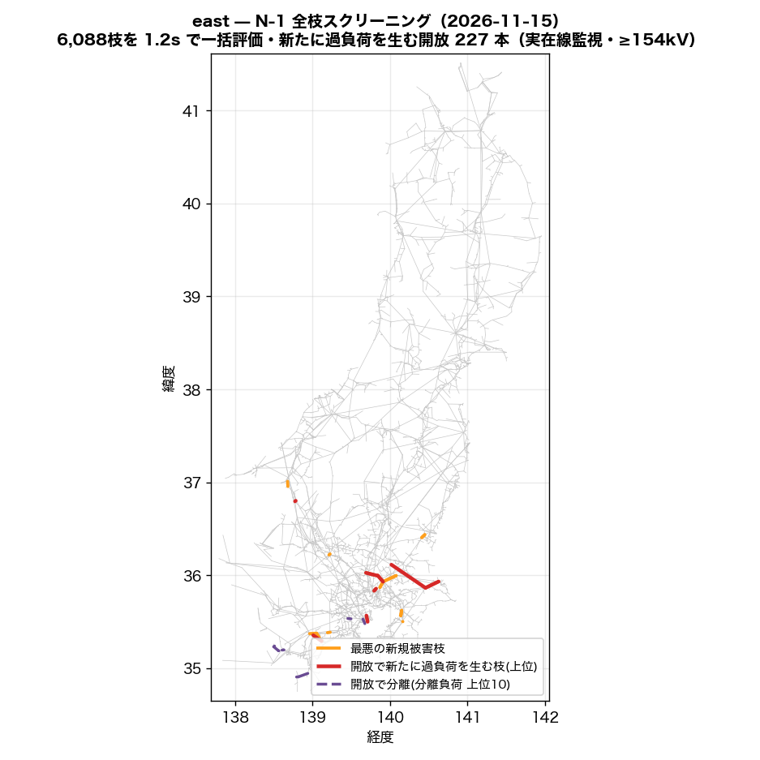
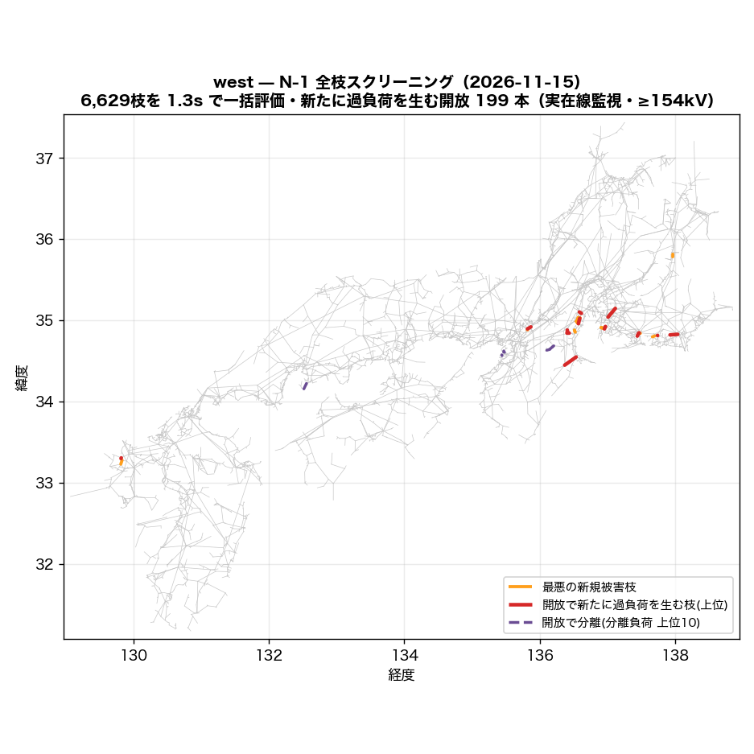
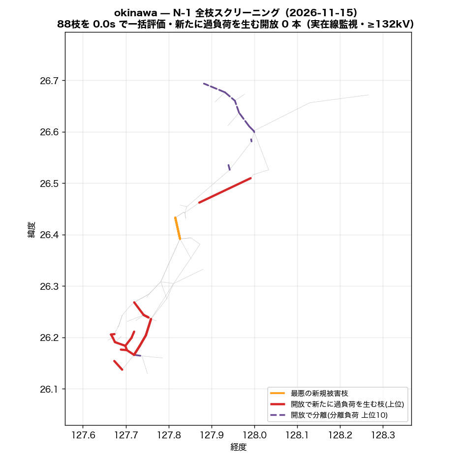

# N-1 全枝スクリーニング — LODF で全枝開放を一括評価（2026-11-15）

枝 k を開放したときの枝 j の潮流は `f_j + LODF[j,k]·f_k`（直流近似）で閉じているので、
全枝分の「開放後の最大負荷率・過負荷本数・最悪被害枝」が行列 1 枚の列演算で出る。
並列回線は **1 回線開放**（残回線容量で評価）、開放で分離する枝（橋）は LODF が定義できないため
**分離側の負荷・発電を別勘定**にした。

**合成定格の錯視を主結果に混ぜない**: 主表は監視枝を「実在線（OSM実線形・回収線・公表接続）＋銘板つき変圧器」に限った順位。
同一敷地タイ（同定）・発電所取付線・推定容量の変圧器などが最悪枝になる開放は別表で開示する。

| 島 | 主成分 | 枝 | 評価した開放 | 橋(分離) | 監視枝(実在/全) | 基準過負荷(実在) | 新規過負荷を生む開放 実在/全 | 新規側 >120% (実在) | 分離負荷≥100MW | PTDF | 一括評価 |
|---|---:|---:|---:|---:|---:|---:|---:|---:|---:|---:|---:|
| hokkaido | 828 | 946 | 777 | 169 | 127/187 | 0 | **0** / 7 | 0 | 0 | 0.0s | 0.0s |
| east | 5,945 | 7,090 | 6,088 | 997 | 1,448/2,167 | 48 | **227** / 362 | 54 | 3 | 2.3s | 1.2s |
| west | 7,371 | 8,734 | 6,629 | 2,097 | 2,414/3,167 | 24 | **199** / 390 | 57 | 46 | 3.6s | 1.3s |
| okinawa | 94 | 115 | 88 | 27 | 23/43 | 2 | **0** / 4 | 0 | 3 | 0.0s | 0.0s |

監視は ≥154kV（最高階級が届かない島はその階級: hokkaido 154kV、east 154kV、west 154kV、okinawa 132kV）・容量係数 1.0（理論値 √3·V·I に対する較正。公表運用容量との比較では約 0.5）。

## hokkaido

要素の内訳: 公表接続(直線) 2、発電所取付線 14、OSM実線 816、OSM実線(回収) 9、同一敷地タイ(同定) 2、変圧器(推定容量) 102、変圧器(銘板) 1

### 実在線監視 — 開放すると新たに過負荷を生む枝（上位 20）

基準ケースで既に >100% の実在監視枝: 0 本（最大 40.9%）。基準の過負荷は開放と無関係に居座るので、指標は**基準で過負荷でない枝の側**で取る（新規過負荷本数 → 新規側の最大負荷率）。新規側が 120% を超える開放: 0 本。

| # | 開放する枝 | 種別 | kV | 回線 | 開放枝の基準負荷率 | 新規過負荷 本数 | 新規側の最大負荷率 | 最大増分 | 最悪の新規被害枝 (種別・基準→開放後) |
|---:|---|---|---:|---:|---:|---:|---:|---:|---|
| 1 | 滝川幹線 (Takikawa-kansen) | OSM実線 | 187 | 2 | 35.5% | **0** | **64%** | +29pt | 滝川幹線 (Takikawa-kansen) (OSM実線, 187kV, 35.5→64%) |
| 2 | 名寄幹線 | OSM実線 | 187 | 2 | 32.6% | **0** | **64%** | +31pt | 名寄幹線 (OSM実線, 187kV, 32.6→64%) |
| 3 | trafo_275/187kV@pairmed@osm | 変圧器(推定容量) | 275 | 1 | 33.4% | **0** | **50%** | +30pt | 西札幌線 (OSM実線, 187kV, 20.9→50%) |
| 4 | 奈井江幹線 (Naie-kansen) | OSM実線 | 187 | 2 | 23.6% | **0** | **47%** | +24pt | 奈井江幹線 (Naie-kansen) (OSM実線, 187kV, 23.6→47%) |
| 5 | 道東幹線 | OSM実線 | 187 | 2 | 11.5% | **0** | **47%** | +6pt | 十勝幹線 (OSM実線, 187kV, 40.9→47%) |
| 6 | trafo_275/187kV@pairmed@osm | 変圧器(推定容量) | 275 | 1 | 23.8% | **0** | **47%** | +20pt | trafo_275/187kV@nameplate@osm (変圧器(銘板), 275kV, 31.5→47%) |
| 7 | trafo_275/187kV@nameplate@osm | 変圧器(銘板) | 275 | 2 | 31.5% | **0** | **46%** | +15pt | trafo_275/187kV@nameplate@osm (変圧器(銘板), 275kV, 31.5→46%) |
| 8 | 北海道電力ネットワーク 187.0kV線 | OSM実線 | 187 | 1 | 4.6% | **0** | **46%** | +5pt | 十勝幹線 (OSM実線, 187kV, 40.9→46%) |
| 9 | 日東変電所~丸瀬布西町変電所線 | OSM実線 | 66 | 1 | 49.3% | **0** | **45%** | +4pt | 十勝幹線 (OSM実線, 187kV, 40.9→45%) |
| 10 | 十勝幹線 | OSM実線 | 187 | 1 | 40.9% | **0** | **45%** | +41pt | 北海道電力ネットワーク 187.0kV線 (OSM実線, 187kV, 4.6→45%) |
| 11 | 後志幹線 | OSM実線 | 275 | 2 | 25.2% | **0** | **44%** | +19pt | 後志幹線 (OSM実線, 275kV, 25.2→44%) |
| 12 | 日東変電所~丸瀬布西町変電所線 | OSM実線 | 66 | 1 | 34.6% | **0** | **44%** | +3pt | 十勝幹線 (OSM実線, 187kV, 40.9→44%) |
| 13 | 北海道電力ネットワーク 187.0kV線 | OSM実線 | 187 | 1 | 3.0% | **0** | **44%** | +3pt | 十勝幹線 (OSM実線, 187kV, 40.9→44%) |
| 14 | trafo_187/66kV@pairmed@osm | 変圧器(推定容量) | 187 | 1 | 26.1% | **0** | **44%** | +9pt | 十勝幹線 (OSM実線, 187kV, 40.9→44%) |
| 15 | 十勝幹線 | OSM実線 | 187 | 2 | 22.0% | **0** | **43%** | +21pt | 十勝幹線 (OSM実線, 187kV, 22.0→43%) |
| 16 | 石北線 | OSM実線 | 66 | 1 | 22.8% | **0** | **43%** | +2pt | 十勝幹線 (OSM実線, 187kV, 40.9→43%) |
| 17 | 石北線 | OSM実線 | 66 | 1 | 20.0% | **0** | **43%** | +2pt | 十勝幹線 (OSM実線, 187kV, 40.9→43%) |
| 18 | trafo_187/66kV@pairmed@osm | 変圧器(推定容量) | 187 | 1 | 23.9% | **0** | **43%** | +6pt | 十勝幹線 (OSM実線, 187kV, 40.9→43%) |
| 19 | 飽別線 | OSM実線 | 66 | 1 | 68.3% | **0** | **42%** | +2pt | 十勝幹線 (OSM実線, 187kV, 40.9→42%) |
| 20 | 道北幹線 (Dōhoku-kansen) | OSM実線 | 187 | 2 | 23.4% | **0** | **42%** | +8pt | 滝川幹線 (Takikawa-kansen) (OSM実線, 187kV, 35.5→42%) |

### AC 検証（上位を本番 solve_island で開放して解き直し）

| 開放する枝 | 開放 | DC 新規側最大 (新規本数) | AC | AC 新規側最大 (新規本数) | DC最悪新規枝の AC 負荷率（基準→開放後） | 秒 |
|---|---|---:|---|---:|---|---:|
| 滝川幹線 (Takikawa-kansen) | 1回線 | 64% (0) | 収束 (給電100%) | 67.9% (0) | 37.3 → 67.9% | 0.1 |
| 名寄幹線 | 1回線 | 64% (0) | 収束 (給電100%) | 67.8% (0) | 34.2 → 67.8% | 0.2 |
| trafo_275/187kV@pairmed@osm | 全回線 | 50% (0) | 収束 (給電100%) | 52.3% (0) | 21.7 → 52.3% | 0.1 |
| 奈井江幹線 (Naie-kansen) | 1回線 | 47% (0) | 収束 (給電100%) | 50.4% (0) | 25.2 → 50.4% | 0.1 |
| 道東幹線 | 1回線 | 47% (0) | 収束 (給電100%) | 48.0% (0) | 41.8 → 48.0% | 0.1 |

AC の負荷率は |P|/容量（直流の定義に揃えた）。1 回線開放は parallel を 1 減らして解き直し、残回線の容量で評価。prune はしごで落ちた枝は比較から除外。

### 別表 — 合成定格の要素が最悪枝になる開放（錯視の開示・上位 20）

| # | 開放する枝 | 種別 | kV | 回線 | 開放枝の基準負荷率 | 新規過負荷 本数 | 新規側の最大負荷率 | 最大増分 | 最悪の新規被害枝 (種別・基準→開放後) |
|---:|---|---|---:|---:|---:|---:|---:|---:|---|
| 1 | 富川線 | OSM実線 | 66 | 1 | 50.9% | **1** | **115%** | +31pt | trafo_187/66kV (変圧器(推定容量), 187kV, 84.0→115%) |
| 2 | 富川線 | OSM実線 | 66 | 1 | 36.3% | **1** | **106%** | +22pt | trafo_187/66kV (変圧器(推定容量), 187kV, 84.0→106%) |
| 3 | trafo_187/66kV@pairmed@osm | 変圧器(推定容量) | 187 | 1 | 24.0% | **1** | **106%** | +22pt | trafo_275/66kV (変圧器(推定容量), 275kV, 84.2→106%) |
| 4 | 泉町一丁目変電所~小平変電所 (Obira Hendensho)線 | OSM実線 | 66 | 1 | 70.5% | **1** | **104%** | +20pt | trafo_187/110kV (変圧器(推定容量), 187kV, 83.5→104%) |
| 5 | trafo_187/110kV | 変圧器(推定容量) | 187 | 1 | 49.0% | **1** | **103%** | +21pt | trafo_187/110kV (変圧器(推定容量), 187kV, 83.5→103%) |
| 6 | trafo_187/66kV@pairmed@osm | 変圧器(推定容量) | 187 | 1 | 42.5% | **1** | **102%** | +59pt | trafo_187/66kV (変圧器(推定容量), 187kV, 42.6→102%) |
| 7 | 有珠線 | OSM実線 | 66 | 1 | 58.0% | **1** | **101%** | +32pt | trafo_187/66kV (変圧器(推定容量), 187kV, 68.8→101%) |
| 8 | 小平町変電所~小平変電所 (Obira Hendensho)線 | OSM実線 | 66 | 1 | 55.8% | **0** | **100%** | +16pt | trafo_187/110kV (変圧器(推定容量), 187kV, 83.5→100%) |
| 9 | 富川線 | OSM実線 | 66 | 1 | 22.6% | **0** | **98%** | +14pt | trafo_187/66kV (変圧器(推定容量), 187kV, 84.0→98%) |
| 10 | trafo_187/110kV | 変圧器(推定容量) | 187 | 1 | 83.5% | **0** | **96%** | +47pt | trafo_187/110kV (変圧器(推定容量), 187kV, 49.0→96%) |
| 11 | trafo_187/66kV@pairmed@osm | 変圧器(推定容量) | 187 | 1 | 57.3% | **0** | **96%** | +37pt | trafo_187/110kV (変圧器(推定容量), 187kV, 83.5→96%) |
| 12 | 小平町変電所~鬼鹿田代変電所線 | OSM実線 | 66 | 1 | 41.1% | **0** | **95%** | +12pt | trafo_187/110kV (変圧器(推定容量), 187kV, 83.5→95%) |
| 13 | 北幌延線 | OSM実線 | 187 | 2 | 19.5% | **0** | **95%** | +15pt | trafo_187/110kV (変圧器(推定容量), 187kV, 83.5→95%) |
| 14 | 岩知志線 | OSM実線 | 66 | 1 | 28.9% | **0** | **94%** | +10pt | trafo_187/66kV (変圧器(推定容量), 187kV, 84.0→94%) |
| 15 | trafo_187/66kV@pairmed@osm | 変圧器(推定容量) | 187 | 1 | 28.7% | **0** | **94%** | +50pt | trafo_275/66kV (変圧器(推定容量), 275kV, 43.7→94%) |
| 16 | 有珠線 | OSM実線 | 66 | 1 | 43.4% | **0** | **93%** | +24pt | trafo_187/66kV (変圧器(推定容量), 187kV, 68.8→93%) |
| 17 | 来馬線 | OSM実線 | 66 | 1 | 22.7% | **0** | **92%** | +8pt | trafo_275/66kV (変圧器(推定容量), 275kV, 84.2→92%) |
| 18 | 虻田線 | OSM実線 | 66 | 1 | 55.8% | **0** | **91%** | +7pt | trafo_275/66kV (変圧器(推定容量), 275kV, 84.2→91%) |
| 19 | 鬼鹿田代変電所~苫前町変電所線 | OSM実線 | 66 | 1 | 26.5% | **0** | **91%** | +8pt | trafo_187/110kV (変圧器(推定容量), 187kV, 83.5→91%) |
| 20 | 振内支線 | OSM実線 | 66 | 1 | 18.5% | **0** | **91%** | +7pt | trafo_187/66kV (変圧器(推定容量), 187kV, 84.0→91%) |

### 分離（橋）— 開放で切り離される負荷の大きい枝（上位 20）

橋 169 本（うち数値的な擬似橋 0）。分離側の負荷合計 1,411 MW。放射系の末端はそもそも N-1 で守れない（実系統では配電側の切替で対処）ので、ここは「モデルが放射になっている箇所」の一覧として読む。

| # | 開放する枝 | 種別 | kV | 分離バス数 | 分離側の負荷 | 分離側の発電 |
|---:|---|---|---:|---:|---:|---:|
| 1 | trafo_110/66kV | 変圧器(推定容量) | 110 | 10 | **73 MW** | 0 MW |
| 2 | trafo_187/66kV@pairmed@osm | 変圧器(推定容量) | 187 | 9 | **60 MW** | 0 MW |
| 3 | 同一敷地タイ(同定) | 同一敷地タイ(同定) | 66 | 5 | **50 MW** | 80 MW |
| 4 | 山部線 | OSM実線 | 66 | 4 | **40 MW** | 10 MW |
| 5 | 北海道送電線_53 | OSM実線 | 110 | 7 | **40 MW** | 0 MW |
| 6 | 枝幸線 | OSM実線 | 66 | 4 | **40 MW** | 0 MW |
| 7 | 浦河東線 | OSM実線 | 66 | 7 | **33 MW** | 4 MW |
| 8 | 長流線 | OSM実線 | 66 | 4 | **30 MW** | 0 MW |
| 9 | 昆布線 | OSM実線 | 66 | 7 | **30 MW** | 8 MW |
| 10 | 瓜幕線 | OSM実線 | 66 | 3 | **30 MW** | 0 MW |
| 11 | 金山線 | OSM実線 | 66 | 3 | **30 MW** | 10 MW |
| 12 | 昆布線 | OSM実線 | 66 | 5 | **30 MW** | 8 MW |
| 13 | 西一条十二丁目変電所~士別市変電所線 | OSM実線 | 66 | 5 | **30 MW** | 0 MW |
| 14 | 枝幸線 | OSM実線 | 66 | 3 | **30 MW** | 0 MW |
| 15 | 岩知志線 | OSM実線 | 66 | 6 | **23 MW** | 16 MW |
| 16 | 頓別線 | OSM実線 | 66 | 4 | **23 MW** | 0 MW |
| 17 | 南七条東一丁目変電所~女満別西一条六丁目変電所線 | OSM実線 | 66 | 3 | **20 MW** | 0 MW |
| 18 | 長流線 | OSM実線 | 66 | 2 | **20 MW** | 0 MW |
| 19 | ニセコ線 | OSM実線 | 66 | 4 | **20 MW** | 5 MW |
| 20 | 西一条十二丁目変電所~士別市変電所線 | OSM実線 | 66 | 3 | **20 MW** | 0 MW |

## east

要素の内訳: 公表接続(直線) 61、発電所取付線 282、OSM実線 5,872、OSM実線(回収) 74、同一敷地タイ(同定) 47、合成連系タイ 1、変圧器(推定容量) 745、変圧器(銘板) 8

### 実在線監視 — 開放すると新たに過負荷を生む枝（上位 20）

基準ケースで既に >100% の実在監視枝: 48 本（最大 363.8%）。基準の過負荷は開放と無関係に居座るので、指標は**基準で過負荷でない枝の側**で取る（新規過負荷本数 → 新規側の最大負荷率）。新規側が 120% を超える開放: 54 本。

| # | 開放する枝 | 種別 | kV | 回線 | 開放枝の基準負荷率 | 新規過負荷 本数 | 新規側の最大負荷率 | 最大増分 | 最悪の新規被害枝 (種別・基準→開放後) |
|---:|---|---|---:|---:|---:|---:|---:|---:|---|
| 1 | trafo_500/275kV@pairmed@osm | 変圧器(推定容量) | 500 | 1 | 72.8% | **7** | **130%** | +70pt | 北千葉線 (OSM実線, 275kV, 60.8→130%) |
| 2 | 浅貝線 | OSM実線 | 500 | 1 | 18.8% | **4** | **251%** | +244pt | 神立変電所~灰雨変電所線 (OSM実線, 154kV, 6.6→251%) |
| 3 | trafo_500/154kV@pairmed@pub | 変圧器(推定容量) | 500 | 1 | 59.8% | **4** | **114%** | +78pt | 田代幹線 (OSM実線, 154kV, 36.2→114%) |
| 4 | trafo_500/275kV@pairmed@osm | 変圧器(推定容量) | 500 | 1 | 23.7% | **3** | **138%** | +47pt | 西水戸線 (OSM実線, 154kV, 91.1→138%) |
| 5 | trafo_500/275kV@pairmed@osm | 変圧器(推定容量) | 500 | 1 | 57.8% | **3** | **105%** | +39pt | 新新田線;佐波線 (OSM実線, 154kV, 91.6→105%) |
| 6 | trafo_500/275kV | 変圧器(推定容量) | 500 | 1 | 118.2% | **2** | **132%** | +53pt | 鹿島線 (OSM実線, 275kV, 85.9→132%) |
| 7 | 東京北線 | OSM実線 | 275 | 2 | 76.2% | **2** | **125%** | +49pt | 東京北線 (OSM実線, 275kV, 76.2→125%) |
| 8 | 小山町変電所~西相模変電所線 | OSM実線 | 154 | 2 | 69.5% | **2** | **118%** | +32pt | 新富士変電所~小田急電鉄 松田変電所線 (OSM実線, 154kV, 92.3→118%) |
| 9 | 東京北線 | OSM実線 | 275 | 2 | 71.4% | **2** | **111%** | +40pt | 東京北線 (OSM実線, 275kV, 71.4→111%) |
| 10 | trafo_275/66kV@pairmed@osm | 変圧器(推定容量) | 275 | 1 | 68.5% | **2** | **109%** | +35pt | 鹿島線 (OSM実線, 275kV, 85.9→109%) |
| 11 | trafo_500/154kV@pairmed@pub | 変圧器(推定容量) | 500 | 1 | 48.5% | **2** | **108%** | +92pt | 田代幹線 (OSM実線, 154kV, 15.8→108%) |
| 12 | trafo_500/154kV@pairmed@osm | 変圧器(推定容量) | 500 | 1 | 45.2% | **2** | **107%** | +39pt | 西水戸線 (OSM実線, 154kV, 91.1→107%) |
| 13 | 小松川線 | OSM実線 | 154 | 2 | 73.3% | **2** | **107%** | +33pt | 小松川線 (OSM実線, 154kV, 73.3→107%) |
| 14 | 香取線 / 湖南線 | OSM実線 | 275 | 2 | 59.5% | **2** | **106%** | +46pt | 香取線 / 湖南線 (OSM実線, 275kV, 59.5→106%) |
| 15 | trafo_275/154kV@pairmed@pub | 変圧器(推定容量) | 275 | 1 | 52.1% | **2** | **104%** | +25pt | 千葉中央線 / 生実線 (OSM実線, 154kV, 98.6→104%) |
| 16 | trafo_500/154kV | 変圧器(推定容量) | 500 | 1 | 82.6% | **2** | **102%** | +20pt | 千葉中央線 / 生実線 (OSM実線, 154kV, 98.6→102%) |
| 17 | 南池上線 | 公表接続(直線) | 66 | 1 | 269.0% | **2** | **102%** | +17pt | 白石線 (OSM実線, 154kV, 95.9→102%) |
| 18 | 新佐原線 | OSM実線 | 500 | 2 | 38.3% | **2** | **101%** | +17pt | 北葛飾線/野田線 (OSM実線, 275kV, 99.7→101%) |
| 19 | trafo_500/154kV | 変圧器(推定容量) | 500 | 1 | 77.9% | **2** | **100%** | +26pt | 千葉中央線 / 生実線 (OSM実線, 154kV, 98.6→100%) |
| 20 | trafo_275/66kV@pairmed@pub | 変圧器(推定容量) | 275 | 1 | 51.7% | **2** | **100%** | +8pt | 北葛飾線/野田線 (OSM実線, 275kV, 99.7→100%) |

### AC 検証（上位を本番 solve_island で開放して解き直し）

| 開放する枝 | 開放 | DC 新規側最大 (新規本数) | AC | AC 新規側最大 (新規本数) | DC最悪新規枝の AC 負荷率（基準→開放後） | 秒 |
|---|---|---:|---|---:|---|---:|
| trafo_500/275kV@pairmed@osm | 全回線 | 130% (7) | 収束 (給電100%) | 134.6% (7) | 62.6 → 134.6% | 2.3 |
| 浅貝線 | 全回線 | 251% (4) | 収束 (給電100%) | 101.9% (3) | 5.1 → 0.0% | 3.6 |
| trafo_500/154kV@pairmed@pub | 全回線 | 114% (4) | 収束 (給電100%) | 117.8% (6) | 37.4 → 117.8% | 2.6 |
| trafo_500/275kV@pairmed@osm | 全回線 | 138% (3) | 収束 (給電100%) | 143.3% (6) | 94.1 → 143.3% | 3.7 |
| trafo_500/275kV@pairmed@osm | 全回線 | 105% (3) | 収束 (給電100%) | 105.5% (6) | 91.9 → 105.5% | 2.6 |

AC の負荷率は |P|/容量（直流の定義に揃えた）。1 回線開放は parallel を 1 減らして解き直し、残回線の容量で評価。prune はしごで落ちた枝は比較から除外。

### 別表 — 合成定格の要素が最悪枝になる開放（錯視の開示・上位 20）

| # | 開放する枝 | 種別 | kV | 回線 | 開放枝の基準負荷率 | 新規過負荷 本数 | 新規側の最大負荷率 | 最大増分 | 最悪の新規被害枝 (種別・基準→開放後) |
|---:|---|---|---:|---:|---:|---:|---:|---:|---|
| 1 | trafo_154/66kV@pairmed@osm | 変圧器(推定容量) | 154 | 1 | 85.0% | **13** | **113%** | +24pt | trafo_154/66kV (変圧器(推定容量), 154kV, 89.1→113%) |
| 2 | 浅貝線 | OSM実線 | 500 | 1 | 18.8% | **9** | **376%** | +326pt | trafo_154/66kV (変圧器(推定容量), 154kV, 49.5→376%) |
| 3 | trafo_500/275kV@pairmed@osm | 変圧器(推定容量) | 500 | 1 | 47.0% | **8** | **107%** | +54pt | trafo_500/154kV (変圧器(推定容量), 500kV, 97.4→107%) |
| 4 | trafo_275/66kV@pairmed@osm | 変圧器(推定容量) | 275 | 1 | 54.2% | **7** | **136%** | +77pt | trafo_275/66kV (変圧器(推定容量), 275kV, 59.3→136%) |
| 5 | trafo_500/275kV@pairmed@osm | 変圧器(推定容量) | 500 | 1 | 57.8% | **7** | **133%** | +41pt | trafo_500/66kV (変圧器(推定容量), 500kV, 92.3→133%) |
| 6 | trafo_275/66kV@pairmed@pub | 変圧器(推定容量) | 275 | 1 | 51.7% | **7** | **130%** | +58pt | trafo_500/66kV (変圧器(推定容量), 500kV, 87.4→130%) |
| 7 | trafo_275/66kV@pairmed@osm | 変圧器(推定容量) | 275 | 1 | 68.5% | **6** | **179%** | +82pt | trafo_500/66kV (変圧器(推定容量), 500kV, 97.4→179%) |
| 8 | 南池上線 | 公表接続(直線) | 66 | 1 | 269.0% | **6** | **104%** | +17pt | trafo_154/66kV (変圧器(推定容量), 154kV, 95.4→104%) |
| 9 | trafo_500/154kV@pairmed@pub | 変圧器(推定容量) | 500 | 1 | 59.8% | **5** | **135%** | +78pt | trafo_500/154kV (変圧器(推定容量), 500kV, 97.4→135%) |
| 10 | trafo_500/154kV@pairmed@osm | 変圧器(推定容量) | 500 | 1 | 45.2% | **5** | **115%** | +39pt | trafo_500/66kV (変圧器(推定容量), 500kV, 98.1→115%) |
| 11 | trafo_500/275kV@pairmed@pub | 変圧器(推定容量) | 500 | 1 | 46.0% | **5** | **106%** | +26pt | trafo_500/66kV (変圧器(推定容量), 500kV, 92.3→106%) |
| 12 | leadin | 発電所取付線 | 275 | 1 | 36.3% | **4** | **194%** | +120pt | trafo_154/66kV#43a@推定 (変圧器(推定容量), 154kV, 74.4→194%) |
| 13 | trafo_275/66kV#43a@推定 | 変圧器(推定容量) | 275 | 1 | 111.0% | **4** | **190%** | +115pt | trafo_154/66kV#43a@推定 (変圧器(推定容量), 154kV, 74.4→190%) |
| 14 | trafo_275/66kV@pairmed@pub | 変圧器(推定容量) | 275 | 1 | 54.7% | **4** | **169%** | +123pt | trafo_154/66kV (変圧器(推定容量), 154kV, 46.1→169%) |
| 15 | trafo_500/154kV@pairmed@pub | 変圧器(推定容量) | 500 | 1 | 48.5% | **4** | **122%** | +92pt | trafo_275/154kV (変圧器(推定容量), 275kV, 45.2→122%) |
| 16 | trafo_275/66kV | 変圧器(推定容量) | 275 | 1 | 163.7% | **4** | **106%** | +44pt | trafo_154/66kV (変圧器(推定容量), 154kV, 97.5→106%) |
| 17 | trafo_275/66kV | 変圧器(推定容量) | 275 | 1 | 190.9% | **4** | **105%** | +10pt | trafo_154/66kV (変圧器(推定容量), 154kV, 96.6→105%) |
| 18 | trafo_275/154kV@pairmed@pub | 変圧器(推定容量) | 275 | 1 | 52.1% | **4** | **104%** | +25pt | trafo_275/154kV (変圧器(推定容量), 275kV, 99.8→104%) |
| 19 | 東池袋線 | 公表接続(直線) | 66 | 1 | 281.6% | **3** | **161%** | +73pt | trafo_154/66kV#43a@推定 (変圧器(推定容量), 154kV, 87.8→161%) |
| 20 | trafo_275/66kV#43a@推定 | 変圧器(推定容量) | 275 | 1 | 93.9% | **3** | **134%** | +43pt | trafo_275/66kV#43a@推定 (変圧器(推定容量), 275kV, 98.6→134%) |

### 分離（橋）— 開放で切り離される負荷の大きい枝（上位 20）

橋 997 本（うち数値的な擬似橋 0）。分離側の負荷合計 10,770 MW。放射系の末端はそもそも N-1 で守れない（実系統では配電側の切替で対処）ので、ここは「モデルが放射になっている箇所」の一覧として読む。

| # | 開放する枝 | 種別 | kV | 分離バス数 | 分離側の負荷 | 分離側の発電 |
|---:|---|---|---:|---:|---:|---:|
| 1 | trafo_275/66kV | 変圧器(推定容量) | 275 | 9 | **160 MW** | 0 MW |
| 2 | 東京電力パワーグリッド 66.0kV線 | OSM実線 | 66 | 14 | **119 MW** | 51 MW |
| 3 | trafo_154/66kV | 変圧器(推定容量) | 154 | 3 | **112 MW** | 0 MW |
| 4 | 東京電力パワーグリッド 66.0kV線 | OSM実線 | 66 | 8 | **84 MW** | 51 MW |
| 5 | 中野台二丁目変電所~富士川第一変電所線 | OSM実線 | 66 | 6 | **84 MW** | 51 MW |
| 6 | 長津田町田線 | OSM実線 | 66 | 5 | **78 MW** | 0 MW |
| 7 | 東京電力パワーグリッド 66.0kV線 | OSM実線 | 66 | 8 | **74 MW** | 0 MW |
| 8 | 東京電力パワーグリッド 66.0kV線 | OSM実線 | 66 | 6 | **74 MW** | 0 MW |
| 9 | (154kV・旭→横浜大黒) | 公表接続(直線) | 154 | 3 | **68 MW** | 16 MW |
| 10 | namebind | OSM実線 | 66 | 4 | **66 MW** | 51 MW |
| 11 | trafo_154/66kV@pairmed@osm | 変圧器(推定容量) | 154 | 8 | **63 MW** | 0 MW |
| 12 | 梅木変電所~三福変電所線 | OSM実線 | 66 | 5 | **56 MW** | 0 MW |
| 13 | 伊東市変電所~田方変電所線 | OSM実線 | 66 | 5 | **56 MW** | 0 MW |
| 14 | 渋沢二丁目変電所~金子変電所線 | OSM実線 | 66 | 2 | **52 MW** | 1 MW |
| 15 | 新町変電所~三屋変電所線 | OSM実線 | 66 | 2 | **52 MW** | 0 MW |
| 16 | 長津田町田線 | OSM実線 | 66 | 3 | **52 MW** | 0 MW |
| 17 | trafo_154/66kV#43a@推定 | 変圧器(推定容量) | 154 | 2 | **52 MW** | 16 MW |
| 18 | leadin | 発電所取付線 | 66 | 1 | **43 MW** | 0 MW |
| 19 | leadin | 発電所取付線 | 66 | 1 | **43 MW** | 0 MW |
| 20 | leadin | 発電所取付線 | 66 | 1 | **43 MW** | 0 MW |

## west

要素の内訳: 公表接続(直線) 62、公表接続の取付スタブ 5、発電所取付線 297、OSM実線 7,267、OSM実線(回収) 116、同一敷地タイ(同定) 12、合成連系タイ 5、変圧器(推定容量) 965、変圧器(銘板) 5

### 実在線監視 — 開放すると新たに過負荷を生む枝（上位 20）

基準ケースで既に >100% の実在監視枝: 24 本（最大 253.4%）。基準の過負荷は開放と無関係に居座るので、指標は**基準で過負荷でない枝の側**で取る（新規過負荷本数 → 新規側の最大負荷率）。新規側が 120% を超える開放: 57 本。

| # | 開放する枝 | 種別 | kV | 回線 | 開放枝の基準負荷率 | 新規過負荷 本数 | 新規側の最大負荷率 | 最大増分 | 最悪の新規被害枝 (種別・基準→開放後) |
|---:|---|---|---:|---:|---:|---:|---:|---:|---|
| 1 | 新居町五丁目変電所~南起変電所線 | OSM実線 | 154 | 1 | 91.9% | **6** | **164%** | +68pt | 住吉町五丁目変電所~岩滑西町三丁目変電所線 (OSM実線, 154kV, 95.8→164%) |
| 2 | 新居町五丁目変電所~南起変電所線 | OSM実線 | 154 | 1 | 83.9% | **6** | **158%** | +62pt | 住吉町五丁目変電所~岩滑西町三丁目変電所線 (OSM実線, 154kV, 95.8→158%) |
| 3 | 中勢亀山線 | OSM実線 | 275 | 1 | 101.8% | **6** | **154%** | +75pt | まきの木台二丁目変電所~赤水町変電所線 (OSM実線, 154kV, 78.7→154%) |
| 4 | 中勢亀山線 | OSM実線 | 275 | 1 | 89.3% | **6** | **133%** | +54pt | まきの木台二丁目変電所~赤水町変電所線 (OSM実線, 154kV, 78.7→133%) |
| 5 | 中部電力パワーグリッド 275.0kV線 | OSM実線 | 275 | 1 | 139.6% | **5** | **230%** | +148pt | 垂坂町変電所~北勢変電所 (Hokusei Hendensho)線 (OSM実線, 154kV, 82.5→230%) |
| 6 | trafo_500/275kV | 変圧器(推定容量) | 500 | 1 | 63.7% | **5** | **167%** | +73pt | 駒ヶ根変電所~田畑変電所線 (OSM実線, 154kV, 97.7→167%) |
| 7 | 中勢亀山線 | OSM実線 | 275 | 1 | 76.8% | **5** | **120%** | +41pt | 垂坂町変電所~北勢変電所 (Hokusei Hendensho)線 (OSM実線, 154kV, 98.4→120%) |
| 8 | 山代変電所~久原変電所線 | OSM実線 | 500 | 1 | 31.1% | **4** | **158%** | +127pt | 山代変電所~九州電力　日宇変電所線 (OSM実線, 220kV, 30.9→158%) |
| 9 | 明星町四丁目変電所~喜撰山開閉所線 | OSM実線 | 154 | 1 | 60.1% | **4** | **136%** | +51pt | 関西送電線_564 (OSM実線, 154kV, 85.4→136%) |
| 10 | 新鈴鹿分岐線 | OSM実線 | 275 | 1 | 64.7% | **4** | **131%** | +50pt | namebind (OSM実線, 154kV, 80.5→131%) |
| 11 | trafo_275/77kV@pairmed@osm | 変圧器(推定容量) | 275 | 1 | 105.6% | **4** | **130%** | +49pt | namebind (OSM実線, 154kV, 80.5→130%) |
| 12 | 山科変電所~駿遠変電所線 | OSM実線 | 275 | 1 | 35.4% | **3** | **139%** | +75pt | 秋葉浜松線 (OSM実線, 154kV, 94.8→139%) |
| 13 | 東浦北豊田線 | OSM実線 | 275 | 2 | 91.0% | **3** | **135%** | +44pt | 東浦北豊田線 (OSM実線, 275kV, 91.0→135%) |
| 14 | 秋葉浜松線 | OSM実線 | 154 | 1 | 94.8% | **3** | **133%** | +59pt | 遠江浜松線 (OSM実線, 154kV, 73.8→133%) |
| 15 | 伊勢南勢線 | OSM実線 | 275 | 1 | 21.8% | **3** | **118%** | +52pt | 垂坂町変電所~北勢変電所 (Hokusei Hendensho)線 (OSM実線, 154kV, 93.2→118%) |
| 16 | trafo_275/154kV | 変圧器(推定容量) | 275 | 1 | 72.7% | **3** | **117%** | +49pt | 垂坂町変電所~北勢変電所 (Hokusei Hendensho)線 (OSM実線, 154kV, 93.2→117%) |
| 17 | trafo_275/154kV | 変圧器(推定容量) | 275 | 1 | 161.5% | **3** | **108%** | +20pt | 住吉町五丁目変電所~岩滑西町三丁目変電所線 (OSM実線, 154kV, 95.8→108%) |
| 18 | 三河玉川線 | OSM実線 | 154 | 1 | 101.3% | **2** | **180%** | +82pt | 東海鉄道二川線 (OSM実線, 154kV, 98.3→180%) |
| 19 | 三河玉川線 | OSM実線 | 154 | 1 | 93.4% | **2** | **174%** | +76pt | 東海鉄道二川線 (OSM実線, 154kV, 98.3→174%) |
| 20 | 垂坂町変電所~北勢変電所 (Hokusei Hendensho)線 | OSM実線 | 154 | 1 | 87.4% | **2** | **171%** | +77pt | 垂坂町変電所~北勢変電所 (Hokusei Hendensho)線 (OSM実線, 154kV, 93.2→171%) |

### AC 検証（上位を本番 solve_island で開放して解き直し）

| 開放する枝 | 開放 | DC 新規側最大 (新規本数) | AC | AC 新規側最大 (新規本数) | DC最悪新規枝の AC 負荷率（基準→開放後） | 秒 |
|---|---|---:|---|---:|---|---:|
| 新居町五丁目変電所~南起変電所線 | 全回線 | 164% (6) | 収束 (給電100%) | 165.8% (9) | 96.3 → 165.8% | 7.0 |
| 新居町五丁目変電所~南起変電所線 | 全回線 | 158% (6) | 収束 (給電100%) | 159.8% (9) | 96.3 → 159.8% | 4.8 |
| 中勢亀山線 | 全回線 | 154% (6) | 収束 (給電100%) | 157.7% (9) | 78.1 → 157.7% | 3.7 |
| 中勢亀山線 | 全回線 | 133% (6) | 収束 (給電100%) | 135.6% (8) | 78.1 → 135.6% | 4.7 |
| 中部電力パワーグリッド 275.0kV線 | 全回線 | 230% (5) | 収束 (給電100%) | 242.1% (7) | 88.2 → 242.1% | 4.6 |

AC の負荷率は |P|/容量（直流の定義に揃えた）。1 回線開放は parallel を 1 減らして解き直し、残回線の容量で評価。prune はしごで落ちた枝は比較から除外。

### 別表 — 合成定格の要素が最悪枝になる開放（錯視の開示・上位 20）

| # | 開放する枝 | 種別 | kV | 回線 | 開放枝の基準負荷率 | 新規過負荷 本数 | 新規側の最大負荷率 | 最大増分 | 最悪の新規被害枝 (種別・基準→開放後) |
|---:|---|---|---:|---:|---:|---:|---:|---:|---|
| 1 | trafo_154/77kV@pairmed@osm | 変圧器(推定容量) | 154 | 1 | 78.0% | **10** | **119%** | +36pt | trafo_154/77kV (変圧器(推定容量), 154kV, 84.3→119%) |
| 2 | trafo_220/66kV@pairmed@pub | 変圧器(推定容量) | 220 | 1 | 83.4% | **5** | **137%** | +52pt | trafo_220/66kV (変圧器(推定容量), 220kV, 85.1→137%) |
| 3 | 新鈴鹿分岐線 | OSM実線 | 275 | 1 | 64.7% | **5** | **133%** | +162pt | trafo_154/77kV#43a@推定 (変圧器(推定容量), 154kV, 66.5→133%) |
| 4 | trafo_275/77kV@pairmed@osm | 変圧器(推定容量) | 275 | 1 | 105.6% | **5** | **132%** | +159pt | trafo_154/77kV#43a@推定 (変圧器(推定容量), 154kV, 66.5→132%) |
| 5 | trafo_275/154kV@pairmed@osm | 変圧器(推定容量) | 275 | 1 | 56.6% | **5** | **124%** | +122pt | trafo_154/77kV (変圧器(推定容量), 154kV, 2.1→124%) |
| 6 | 中部電力パワーグリッド 日進変電所~北豊田変電所 (Kita Toyota Hendensho)線 | OSM実線 | 275 | 1 | 59.7% | **5** | **119%** | +57pt | trafo_275/77kV (変圧器(推定容量), 275kV, 61.9→119%) |
| 7 | trafo_187/66kV@pairmed@osm | 変圧器(推定容量) | 187 | 1 | 57.2% | **4** | **131%** | +54pt | trafo_187/66kV (変圧器(推定容量), 187kV, 99.3→131%) |
| 8 | trafo_275/77kV@pairmed@osm | 変圧器(推定容量) | 275 | 1 | 59.8% | **4** | **118%** | +36pt | trafo_275/77kV (変圧器(推定容量), 275kV, 82.3→118%) |
| 9 | 中部電力パワーグリッド 275.0kV線 | OSM実線 | 275 | 1 | 88.1% | **4** | **116%** | +88pt | trafo_275/77kV (変圧器(推定容量), 275kV, 27.8→116%) |
| 10 | 垂坂町変電所~北勢変電所 (Hokusei Hendensho)線 | OSM実線 | 154 | 1 | 180.6% | **3** | **152%** | +79pt | trafo_275/154kV (変圧器(推定容量), 275kV, 72.7→152%) |
| 11 | trafo_220/66kV@pairmed@osm | 変圧器(推定容量) | 220 | 1 | 59.3% | **3** | **134%** | +41pt | trafo_220/66kV (変圧器(推定容量), 220kV, 99.2→134%) |
| 12 | trafo_220/66kV@pairmed@osm | 変圧器(推定容量) | 220 | 1 | 51.0% | **3** | **132%** | +33pt | trafo_220/66kV (変圧器(推定容量), 220kV, 99.3→132%) |
| 13 | trafo_275/77kV | 変圧器(推定容量) | 275 | 1 | 169.3% | **3** | **128%** | +34pt | trafo_154/77kV (変圧器(推定容量), 154kV, 97.7→128%) |
| 14 | trafo_275/77kV | 変圧器(推定容量) | 275 | 1 | 154.6% | **3** | **124%** | +32pt | trafo_154/77kV (変圧器(推定容量), 154kV, 97.7→124%) |
| 15 | trafo_500/220kV | 変圧器(推定容量) | 500 | 1 | 72.9% | **3** | **112%** | +26pt | trafo_220/66kV (変圧器(推定容量), 220kV, 99.3→112%) |
| 16 | 関西電力送配電 77.0kV線 | OSM実線 | 77 | 1 | 423.9% | **3** | **112%** | +43pt | trafo_275/77kV@pairmed@osm (変圧器(推定容量), 275kV, 68.9→112%) |
| 17 | trafo_220/66kV | 変圧器(推定容量) | 220 | 1 | 127.9% | **3** | **110%** | +16pt | trafo_220/66kV (変圧器(推定容量), 220kV, 94.2→110%) |
| 18 | 川崎町変電所~大塚変電所線 | OSM実線 | 77 | 1 | 126.0% | **3** | **108%** | +10pt | trafo_154/77kV (変圧器(推定容量), 154kV, 97.7→108%) |
| 19 | 川崎町変電所~大塚変電所線 | OSM実線 | 77 | 1 | 126.0% | **3** | **108%** | +10pt | trafo_154/77kV (変圧器(推定容量), 154kV, 97.7→108%) |
| 20 | namebind | OSM実線 | 77 | 1 | 126.0% | **3** | **108%** | +10pt | trafo_154/77kV (変圧器(推定容量), 154kV, 97.7→108%) |

### 分離（橋）— 開放で切り離される負荷の大きい枝（上位 20）

橋 2,097 本（うち数値的な擬似橋 0）。分離側の負荷合計 33,101 MW。放射系の末端はそもそも N-1 で守れない（実系統では配電側の切替で対処）ので、ここは「モデルが放射になっている箇所」の一覧として読む。

| # | 開放する枝 | 種別 | kV | 分離バス数 | 分離側の負荷 | 分離側の発電 |
|---:|---|---|---:|---:|---:|---:|
| 1 | trafo_275/77kV@pairmed@osm | 変圧器(推定容量) | 275 | 24 | **425 MW** | 0 MW |
| 2 | 関西送電線_129 | OSM実線 | 77 | 19 | **420 MW** | 104 MW |
| 3 | trafo_154/77kV#43a@推定 | 変圧器(推定容量) | 154 | 24 | **386 MW** | 20 MW |
| 4 | 敷津変電所~御崎七丁目変電所線 | OSM実線 | 154 | 16 | **359 MW** | 104 MW |
| 5 | 泉北線〔取付〕 | 公表接続の取付スタブ | 77 | 23 | **355 MW** | 20 MW |
| 6 | trafo_187/77kV | 変圧器(推定容量) | 187 | 18 | **222 MW** | 6 MW |
| 7 | 中勢青山線 | OSM実線 | 77 | 9 | **212 MW** | 17 MW |
| 8 | 青山名張線 | OSM実線 | 77 | 7 | **212 MW** | 17 MW |
| 9 | 大柿線 | OSM実線 | 66 | 6 | **182 MW** | 0 MW |
| 10 | 青山名張線 | OSM実線 | 77 | 5 | **169 MW** | 17 MW |
| 11 | 熊野川町相須変電所~新宮変電所線 | OSM実線 | 275 | 18 | **169 MW** | 1 MW |
| 12 | trafo_187/66kV | 変圧器(推定容量) | 187 | 12 | **165 MW** | 18 MW |
| 13 | trafo_154/77kV | 変圧器(推定容量) | 154 | 7 | **164 MW** | 0 MW |
| 14 | 尾道変電所~因島変電所線 | OSM実線 | 110 | 14 | **161 MW** | 1 MW |
| 15 | trafo_187/110kV | 変圧器(推定容量) | 187 | 19 | **158 MW** | 159 MW |
| 16 | 川口線+川口連絡線 | 公表接続(直線) | 66 | 12 | **156 MW** | 28 MW |
| 17 | trafo_154/77kV#43a@推定 | 変圧器(推定容量) | 154 | 5 | **154 MW** | 0 MW |
| 18 | trafo_154/77kV | 変圧器(推定容量) | 154 | 6 | **150 MW** | 84 MW |
| 19 | 東京電力パワーグリッド 275.0kV線 | OSM実線 | 275 | 31 | **148 MW** | 30 MW |
| 20 | 大柿線 | OSM実線 | 66 | 5 | **146 MW** | 0 MW |

## okinawa

要素の内訳: 発電所取付線 8、OSM実線 88、変圧器(推定容量) 19

### 実在線監視 — 開放すると新たに過負荷を生む枝（上位 20）

基準ケースで既に >100% の実在監視枝: 2 本（最大 123.4%）。基準の過負荷は開放と無関係に居座るので、指標は**基準で過負荷でない枝の側**で取る（新規過負荷本数 → 新規側の最大負荷率）。新規側が 120% を超える開放: 0 本。

| # | 開放する枝 | 種別 | kV | 回線 | 開放枝の基準負荷率 | 新規過負荷 本数 | 新規側の最大負荷率 | 最大増分 | 最悪の新規被害枝 (種別・基準→開放後) |
|---:|---|---|---:|---:|---:|---:|---:|---:|---|
| 1 | 那覇高安線; 那覇小禄線 | OSM実線 | 66 | 2 | 23.5% | **0** | **90%** | +0pt | うるま市変電所~仲泊変電所線 (OSM実線, 132kV, 90.2→90%) |
| 2 | 那覇高安線; 小禄線 | OSM実線 | 66 | 2 | 51.0% | **0** | **90%** | +0pt | うるま市変電所~仲泊変電所線 (OSM実線, 132kV, 90.2→90%) |
| 3 | 那覇高安線; 那覇小禄線 | OSM実線 | 66 | 2 | 9.7% | **0** | **90%** | +0pt | うるま市変電所~仲泊変電所線 (OSM実線, 132kV, 90.2→90%) |
| 4 | 那覇変電所~壷川変電所線 | OSM実線 | 66 | 1 | 8.1% | **0** | **90%** | +1pt | うるま市変電所~仲泊変電所線 (OSM実線, 132kV, 90.2→90%) |
| 5 | 那覇高安線; 小禄線 | OSM実線 | 66 | 2 | 64.8% | **0** | **90%** | +0pt | うるま市変電所~仲泊変電所線 (OSM実線, 132kV, 90.2→90%) |
| 6 | 繁多川線 | OSM実線 | 66 | 2 | 13.8% | **0** | **90%** | +0pt | うるま市変電所~仲泊変電所線 (OSM実線, 132kV, 90.2→90%) |
| 7 | 那覇高安線; 小禄線 | OSM実線 | 66 | 2 | 78.6% | **0** | **90%** | +0pt | うるま市変電所~仲泊変電所線 (OSM実線, 132kV, 90.2→90%) |
| 8 | 沖縄電力 66.0kV線 | OSM実線 | 66 | 2 | 13.8% | **0** | **90%** | +0pt | うるま市変電所~仲泊変電所線 (OSM実線, 132kV, 90.2→90%) |
| 9 | 西原幹線;前田線 | OSM実線 | 66 | 1 | 18.6% | **0** | **90%** | +0pt | うるま市変電所~仲泊変電所線 (OSM実線, 132kV, 90.2→90%) |
| 10 | 西原幹線 | OSM実線 | 132 | 2 | 25.3% | **0** | **90%** | +20pt | うるま市変電所~仲泊変電所線 (OSM実線, 132kV, 90.2→90%) |
| 11 | 西原幹線;前田線 | OSM実線 | 132 | 2 | 14.9% | **0** | **90%** | +14pt | うるま市変電所~仲泊変電所線 (OSM実線, 132kV, 90.2→90%) |
| 12 | leadin | 発電所取付線 | 66 | 3 | 0.0% | **0** | **90%** | +0pt | うるま市変電所~仲泊変電所線 (OSM実線, 132kV, 90.2→90%) |
| 13 | 友寄変電所~南風原変電所線 | OSM実線 | 66 | 1 | 158.1% | **0** | **90%** | +7pt | うるま市変電所~仲泊変電所線 (OSM実線, 132kV, 90.2→90%) |
| 14 | namebind | OSM実線 | 66 | 2 | 0.0% | **0** | **90%** | +0pt | うるま市変電所~仲泊変電所線 (OSM実線, 132kV, 90.2→90%) |
| 15 | 南風原変電所~与那原変電所線 | OSM実線 | 66 | 1 | 98.8% | **0** | **90%** | +6pt | うるま市変電所~仲泊変電所線 (OSM実線, 132kV, 90.2→90%) |
| 16 | 友寄変電所~南風原変電所線 | OSM実線 | 132 | 3 | 10.7% | **0** | **90%** | +5pt | うるま市変電所~仲泊変電所線 (OSM実線, 132kV, 90.2→90%) |
| 17 | 南風原変電所~与那原変電所線 | OSM実線 | 132 | 3 | 19.5% | **0** | **90%** | +10pt | うるま市変電所~仲泊変電所線 (OSM実線, 132kV, 90.2→90%) |
| 18 | 与那原変電所~西原変電所線 | OSM実線 | 66 | 1 | 55.0% | **0** | **90%** | +4pt | うるま市変電所~仲泊変電所線 (OSM実線, 132kV, 90.2→90%) |
| 19 | 与那原変電所~西原変電所線 | OSM実線 | 132 | 3 | 27.1% | **0** | **90%** | +13pt | うるま市変電所~仲泊変電所線 (OSM実線, 132kV, 90.2→90%) |
| 20 | namebind | OSM実線 | 66 | 2 | 84.0% | **0** | **90%** | +5pt | うるま市変電所~仲泊変電所線 (OSM実線, 132kV, 90.2→90%) |

### AC 検証（上位を本番 solve_island で開放して解き直し）

| 開放する枝 | 開放 | DC 新規側最大 (新規本数) | AC | AC 新規側最大 (新規本数) | DC最悪新規枝の AC 負荷率（基準→開放後） | 秒 |
|---|---|---:|---|---:|---|---:|
| 那覇高安線; 那覇小禄線 | 1回線 | 90% (0) | 収束 (給電100%) | 87.3% (0) | 87.3 → 87.3% | 0.0 |
| 那覇高安線; 小禄線 | 1回線 | 90% (0) | 収束 (給電100%) | 87.3% (0) | 87.3 → 87.3% | 0.0 |
| 那覇高安線; 那覇小禄線 | 1回線 | 90% (0) | 収束 (給電100%) | 87.3% (0) | 87.3 → 87.3% | 0.0 |
| 那覇変電所~壷川変電所線 | 全回線 | 90% (0) | 収束 (給電100%) | 87.3% (0) | 87.3 → 87.3% | 0.0 |
| 那覇高安線; 小禄線 | 1回線 | 90% (0) | 収束 (給電100%) | 87.3% (0) | 87.3 → 87.3% | 0.0 |

AC の負荷率は |P|/容量（直流の定義に揃えた）。1 回線開放は parallel を 1 減らして解き直し、残回線の容量で評価。prune はしごで落ちた枝は比較から除外。

### 別表 — 合成定格の要素が最悪枝になる開放（錯視の開示・上位 5）

| # | 開放する枝 | 種別 | kV | 回線 | 開放枝の基準負荷率 | 新規過負荷 本数 | 新規側の最大負荷率 | 最大増分 | 最悪の新規被害枝 (種別・基準→開放後) |
|---:|---|---|---:|---:|---:|---:|---:|---:|---|
| 1 | 仲泊変電所~石川東山一丁目変電所線 | OSM実線 | 132 | 1 | 101.6% | **4** | **244%** | +210pt | trafo_132/66kV (変圧器(推定容量), 132kV, 34.1→244%) |
| 2 | 石川東山一丁目変電所~石川東山二丁目変電所線 | OSM実線 | 132 | 1 | 123.4% | **4** | **204%** | +154pt | trafo_132/66kV (変圧器(推定容量), 132kV, 49.1→204%) |
| 3 | 友寄変電所~南風原変電所線 | OSM実線 | 66 | 1 | 158.1% | **1** | **129%** | +54pt | trafo_132/66kV@osm (変圧器(推定容量), 132kV, 74.7→129%) |
| 4 | 伊佐一丁目変電所_2~牧港五丁目変電所線 | OSM実線 | 66 | 1 | 144.1% | **1** | **126%** | +49pt | trafo_132/66kV (変圧器(推定容量), 132kV, 76.7→126%) |
| 5 | 南風原変電所~与那原変電所線 | OSM実線 | 66 | 1 | 98.8% | **0** | **94%** | +26pt | trafo_132/66kV@osm (変圧器(推定容量), 132kV, 74.7→94%) |

### 分離（橋）— 開放で切り離される負荷の大きい枝（上位 20）

橋 27 本（うち数値的な擬似橋 0）。分離側の負荷合計 1,755 MW。放射系の末端はそもそも N-1 で守れない（実系統では配電側の切替で対処）ので、ここは「モデルが放射になっている箇所」の一覧として読む。

| # | 開放する枝 | 種別 | kV | 分離バス数 | 分離側の負荷 | 分離側の発電 |
|---:|---|---|---:|---:|---:|---:|
| 1 | うるま市変電所~仲泊変電所線 | OSM実線 | 132 | 61 | **873 MW** | 625 MW |
| 2 | 名護市変電所~名護電力所線 | OSM実線 | 66 | 12 | **132 MW** | 7 MW |
| 3 | 沖縄電力 66.0kV線 | OSM実線 | 66 | 9 | **113 MW** | 2 MW |
| 4 | 沖縄電力 66.0kV線 | OSM実線 | 66 | 8 | **94 MW** | 2 MW |
| 5 | 名護電力所~仲宗根変電所線 | OSM実線 | 66 | 6 | **76 MW** | 2 MW |
| 6 | 仲宗根変電所~東変電所線 | OSM実線 | 66 | 4 | **57 MW** | 2 MW |
| 7 | 沖縄電力 66.0kV線 | OSM実線 | 66 | 3 | **38 MW** | 0 MW |
| 8 | 東変電所~海洋博変電所線 | OSM実線 | 66 | 2 | **38 MW** | 1 MW |
| 9 | 沖縄電力 66.0kV線 | OSM実線 | 66 | 1 | **19 MW** | 0 MW |
| 10 | 沖縄電力 66.0kV線 | OSM実線 | 66 | 1 | **19 MW** | 0 MW |
| 11 | 恩納村変電所~喜瀬変電所線 | OSM実線 | 66 | 1 | **19 MW** | 0 MW |
| 12 | 名護電力所~田港変電所線 | OSM実線 | 66 | 2 | **19 MW** | 5 MW |
| 13 | leadin | 発電所取付線 | 66 | 1 | **19 MW** | 0 MW |
| 14 | leadin | 発電所取付線 | 66 | 1 | **19 MW** | 0 MW |
| 15 | leadin | 発電所取付線 | 66 | 1 | **19 MW** | 0 MW |
| 16 | 浦添大名線 | OSM実線 | 66 | 1 | **19 MW** | 0 MW |
| 17 | 友寄変電所~大里変電所線 | OSM実線 | 66 | 2 | **19 MW** | 0 MW |
| 18 | 久茂地変電所~西那覇変電所線 | OSM実線 | 66 | 1 | **19 MW** | 0 MW |
| 19 | leadin | 発電所取付線 | 66 | 1 | **19 MW** | 0 MW |
| 20 | 友寄変電所~佐敷変電所線 | OSM実線 | 66 | 1 | **19 MW** | 0 MW |

## 前提と限界

- 直流近似・熱容量のみ（無効電力・電圧・安定度・保護協調は見ない）。合成インピーダンス（電圧階級の標準定数）上の線形化
- 容量は理論値（線路 √3·V·I·回線数、変圧器 sn·回線数）。公表運用容量ではない（`--cap-factor` で較正）
- 対象は各島の最大連結成分。連系線・FC・非通電の合成タイ（介入#31）は開放候補に入らない
- 発電機の再配分（AGC・予備力）は考慮しない＝開放直後の潮流再配分だけ
- **screening であって運用可否の判定ではない**。順位で候補を絞り、確定は AC・実データ・実系統の定格で

---
生成: `scripts/sensitivity/n1_screening.py`
