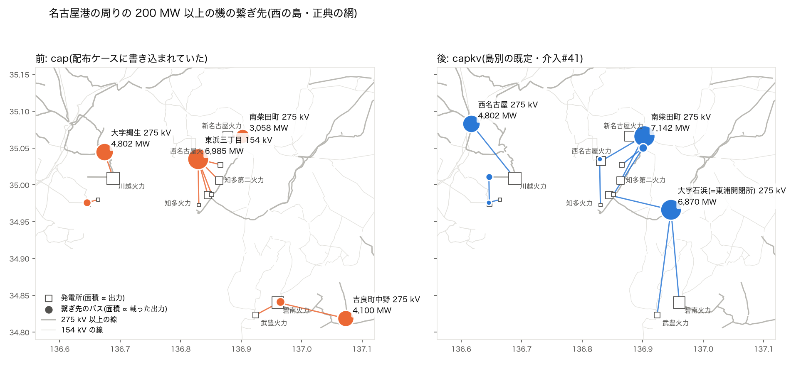

# 名古屋港の周りの大型機の繋ぎ先(2026-10-28)

issue #99 の報告(`west_slack_surplus_2026-10-26.md`)の「残り 2」の続き。そこでは「知多・東海の 6 発電所 6,985 MW が 1 個の 154 kV バスに載っていて、西の N-1 の増えた分の元」と書いた。調べると、前半は配布ケースの網だけの話で、後半は誤りだった(その報告に訂正を書いた)。

## 要点

- 6,985 MW が東浜三丁目 154 kV に載るのは**配布ケースの網だけ**。配布ケースの組み立て(`scripts/export_matpower_canonical.build_canonical_net`)は、発電機の繋ぎ先の規則を `"cap"` に固定していた。介入#41(2026-09-02・西と北海道は `capkv`)に追随していなかった。全規模の潮流と N-1 は `capkv` で組んでいる。
- **島別の既定にそろえた。** 新しい介入ではなく、#41 の追随漏れの是正。配布 MATPOWER・CIM Level 2・ゾーンのケース・正典の島の試験が同じ網を組むようになる。
- 中部の公表(送電線の一覧)と照合すると、**接続の電圧が合う機は 5 機中 3 → 4**。相手の変電所まで合うのは 0 → 2。
- ⚠ ~~ただし、名前で接続が分かる西の 13 機に広げて採点すると、`capkv` は `cap` より合わない(電圧が合う機 5 対 9)。~~ (2026-10-28 訂正: 複数の電圧を持つ機を「どれかに合えば正解」と数えた甘い数え方だった。主な接続電圧で数え直すと、台帳の 21 機で 最寄り 12・`cap` 14・`capkv` 13。規則は替えず、公表の分かる機を台帳で直した → `plant_connections_2026-10-28.md`・介入#55)
- ⚠ 直しても、名古屋港の周りの大型機は 275 kV の 2 か所に約 7 GW ずつ寄る。潮流は良くならない(西の 154 kV 以上の過負荷 42 → 47 本)。原因は、網に発電所の電源線が無いことと、`capkv` の選び方。残りの節に書いた。

## 一次資料

中部電力パワーグリッド「275kV 以上送電線空容量・予想潮流一覧表」(KRSIH010、2026 年 8 月 31 日更新)と「154kV 以下系統送電線空容量・予想潮流一覧表(愛知県西部 尾張・知多半島方面)」(KRSIH011)。手元の写しは `data/external/system_disclosure/chubu/capacity/`(git の外)。使ったのは線名・電圧・回線数・区間(どこからどこへ)だけで、容量の値は使っていない。

| 発電所 | 出力 | 公表の接続 |
|---|---:|---|
| 川越火力 | 4,802 MW | 川越火力線(No.270)275 kV 2 回線: 川越火力変電所 → 西名古屋変電所 |
| 碧南火力 | 4,100 MW | 幸田碧南線(No.680)275 kV 2 回線: 碧南変電所 → 幸田変電所 |
| 知多第二火力 | 1,708 MW | 知多第二東海線(No.580)275 kV 2 回線(区間の記載なし。線名から東海変電所へ) |
| 知多火力 | 1,700 MW | 知多火力線(No.620)275 kV 2 回線: 知多火力変電所 → 東名古屋変電所。知多火力東浦線(No.500)275 kV 2 回線: 知多火力変電所 → 東浦開閉所。154 kV の知多火力知多・知多火力東海(KRSIH011)もある |
| 武豊火力 | 1,070 MW | 武豊火力-1・武豊火力線-2(No.10271・10272)154 kV 各 2 回線: 武豊変電所 → 知多変電所 |

新名古屋 3,058 MW・西名古屋 2,376 MW・名古屋東海 600 MW・名南共同 375 MW・愛知製油所 226 MW は、どちらの一覧にも線名が無く、判定できない。

## 同定(住所から付いた名前の正体)

網の変電所名の多くは OSM の住所から付いている。公表の線名と OSM の線名が同じ線の端で、2 つを同定した。

- **大字石浜変電所 = 東浦開閉所。** OSM の「東浦北豊田線」(275 kV、4 回線)がこのバスで終わる。公表では東浦北豊田線は「東浦開閉所 → 北豊田変電所」。網のこのバスは 275 kV だけで変圧器が無く、開閉所と合う。場所も東浦町石浜。
- **川口町五丁目変電所 = 碧南変電所。** OSM の「碧南岡崎線」(154 kV)がこのバスから出る。公表では碧南岡崎線は「碧南変電所 → 岡崎変電所」。碧南火力の点から 0.4 km。

東海変電所は同定できなかった(網に東海変電所に当たる線名の端が無い)。

## 照合

数字は `nagoya_port_attach_2026-10-28/stats.json`(`measure.py` の出力)。距離は発電所の点(`data/chubu_plants.geojson`)からバスまで。

| 発電所 | 前(`cap`) | 後(`capkv`) | 電圧 前→後 | 相手 前→後 |
|---|---|---|---|---|
| 川越火力 | 大字縄生 275 kV(4.2 km) | 西名古屋 275 kV(10.6 km) | ○ → ○ | ? → ○ |
| 碧南火力 | 吉良町中野 275 kV(10.5 km) | 大字石浜 275 kV(14.0 km) | ○ → ○ | × → × |
| 知多第二火力 | 東浜三丁目 154 kV(4.6 km) | 南柴田町 275 kV(7.6 km) | × → ○ | 判定できない |
| 知多火力 | 東浜三丁目 154 kV(5.7 km) | 大字石浜 = 東浦開閉所 275 kV(9.5 km) | ○ → ○ | × → ○ |
| 武豊火力 | 川口町五丁目 275 kV(4.2 km) | 大字石浜 275 kV(16.0 km) | × → × | × → × |

- 電圧が合う機: 3 → 4(5 機中)。知多火力は 154 kV の線も公表にあるので、前の 154 kV も電圧としては合う(場所は名古屋港の対岸)。相手まで合う機: 0 → 2。前の川越の大字縄生は、川越火力変電所(構内)かどうかがわからない(4.2 km 先)。
- 前の東浜三丁目 154 kV は西名古屋火力の構内(飛島村東浜三丁目・0.4 km)。知多の 3 機と名古屋東海・名南共同・愛知製油所は、名古屋港を挟んで 3.5〜6.9 km 先のこのバスに載っていた。`cap` は「バスに集まる枝の合計容量 ≥ 出力」だけを見る。このバスは 154 kV の枝の合計が 2,667 MVA あり、近いので選ばれた。

図(`nagoya_port_attach_2026-10-28/attach_map.png`): 左が前、右が後。四角が発電所、丸が繋ぎ先のバス(面積は載った出力)、線が発電所から繋ぎ先へ。



## 直したこと

- `build_canonical_net(attach_mode=None)`: None はモデル既定 = `attach_default_for(island)`。
- `tests/test_gen_attach_modes.py::test_model_building_pipelines_use_the_shared_default` に、配布ケースの経路を加えた(`"cap"` の書き込みが戻ると落ちる)。
- `tests/test_canonical_islands.py` の記録を更新した(網の規模は同じ)。
- 台帳は `docs/MODEL_INTERVENTIONS.md` の #41 の行に追記した。無効化は従来どおり(`--gen-attach cap` は全規模の潮流の CLI。配布ケースは `build_canonical_net(attach_mode="cap")`)。

## 前後(配布ケースの網・地点需要なし)

| | 北海道 前 → 後 | 西 前 → 後 |
|---|---|---|
| 規則 | `cap` → `capkv` | `cap` → `capkv` |
| AC | 解ける → 解ける | 解ける(6 バス畳む)→ 解ける(同じ) |
| 網の規模 | 不変 | 不変 |
| vm の範囲 | 0.860〜1.004 → 同じ | 0.776〜1.038 → 0.776〜1.038 |
| 損失 | 2.67 → 2.50 % | 1.95 → 2.05 % |
| 154 kV 以上の線の過負荷 | 0 → 0 本 | 42 → 47 本(最大 305 → 280 %) |
| 変圧器の過負荷 | 2 → 2 台 | 58 → 68 台(最大 299 → 303 %) |

東と沖縄はもとから `cap` が既定で、変わらない。git に入っている出力(CIM Level 2 の沖縄と目次)は値が同じだった。配布 MATPOWER(`dist/matpower_national`)は git の外で、次のリリースから変わる。

## 残り(オーナーの判断)

後でも、南柴田町 275 kV に 7,142 MW(新名古屋・西名古屋・知多第二)、大字石浜 275 kV に 6,870 MW(碧南・知多・武豊)が寄る。理由は 2 つ。

1. **網に発電所の電源線が無い。** 知多火力線・知多火力東浦線・知多第二東海線(どれも 275 kV、2 回線)は網に無い。碧南変電所(川口町五丁目)の 275 kV は 1 回線だけで、受けられる容量は 1,219 MVA。幸田碧南線(2 回線)に当たる線は、西尾(上矢田町)へ行く 1 回線の切れ端かもしれない。
   - 直すなら、公表の接続を足す台帳(`config/disclosure_supplement_nodes.yaml`・`config/disclosure_map_connections.yaml`)に、知多火力変電所(構内)と、知多火力線・知多火力東浦線を載せる。両端とも網で引ける(東名古屋は名前で、東浦は上の同定で)。
   - 正典の構造(`docs/data/built/all.json`)が変わるので、全部を作り直す。
2. **`capkv` の選び方。** 953 MW を超える機には 500 kV を求める(「1 回線で運べる最下位の階級」・モデルの導体から測った 275 kV の 1 回線の中央値が 953 MVA)。この 7 機から最寄りの 500 kV のバスは 25.9〜44.0 km で、探す範囲(25 km)の外。そのため、どの大型機も「距離を見ずに、受けられる容量の最も大きい 275 kV バス」に落ちる。
   - 公表では、1.7〜4.8 GW の機が 275 kV の 2 回線の線を複数持って繋がっている(川越・碧南・知多)。「1 回線で運べる」の物差しは中部では一次資料と合わない。
   - 碧南火力は 0.4 km 先の碧南変電所(275 kV)ではなく、14 km 先の東浦に載る。
   - 選び方を変えると全国の繋ぎ先が動く。#41 の採用の測り直しが要る。

武豊火力(公表は 154 kV)は、どちらの規則でも 275 kV に載る。

3. **島別の既定(#41)の見直し。** (2026-10-28 訂正: 下の数は甘い数え方だった。主な接続電圧での数え直しと台帳での直しは `plant_connections_2026-10-28.md`・介入#55) 各社の空容量一覧で名前から接続の電圧が分かる西の 13 機(中部・中国・北陸・四国)で、繋いだバスの電圧が公表の電圧のどれかと合うかを数えた。最寄り 10・`cap` 9・`capkv` 5。`capkv` は 1 GW 級の機を 500 kV へ回すが、公表では水島・玉島 110 kV、坂出 187 kV、敦賀 275 kV。様式5(インピーダンスの公表)の区間の電圧とも一致する。標本が西だけで小さいので、東を足して次の PR で採点し直す。

## 再現

```
PYTHONPATH=. python docs/reports/nagoya_port_attach_2026-10-28/measure.py   # stats.json(数分)
python docs/reports/nagoya_port_attach_2026-10-28/fig.py                     # attach_map.png
```
