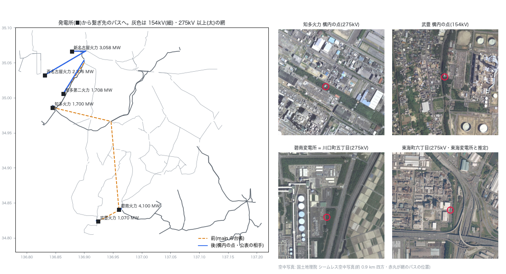

# 名古屋港の周りの大型機の構内の点と公表の相手(介入#55 の追補・2026-10-29)

`plant_connections_2026-10-28.md` の「残り」の 2(相手の同定)と 3(電源線)の続き。オーナーの指示は「一番もっともらしいの採用しておいて。画像から、地図から、衛星から判断するのもいい」。一次資料(各社の空容量一覧)で分かる接続を、網の線の端・地図(地理院の逆ジオコーダ)・空中写真(国土地理院 シームレス空中写真)で網の場所に当て、最ももっともらしいものを採った。確かめられなかったものは確からしさを「中」と書いた。

## 要点

- 4 機の繋ぎ先を直した。
  - 知多火力と武豊は、構内の変電所から公表の線が出る点(網では変電所でない分岐点)へ繋ぐ。
  - 知多第二は東海変電所(網の東海町六丁目変電所と推定)へ繋ぐ。
  - 碧南は台帳に足し、碧南変電所(網の川口町五丁目変電所)へ繋ぐ。
  - 台帳は 22 機になった。
- 幸田碧南線(275 kV)と碧南岡崎線(154 kV)の回線数を、公表どおり 2 にした(介入#44 の手動の台帳)。正典(`docs/data/built/all.json`)の差はこの 2 枝の回線数だけ。
- **大字石浜(東浦開閉所)275 kV への集中は消えた。** 前は碧南と知多の 5,800 MW が 14 km・9.5 km 先のここに載っていた。南柴田町 275 kV の 5,434 MW(新名古屋と西名古屋火力)は残る(残り 1)。
- ⚠ **訂正**: `nagoya_port_attach_2026-10-28.md` と `plant_connections_2026-10-28.md` の「知多火力線・知多火力東浦線は網に無い」は誤りだった。
  - 線は網にある(名前は端の変電所から自動で付いた「原二丁目変電所~東名古屋変電所線」など)。
  - 構内の点が変電所でない分岐点なので、発電機の繋ぎ先の候補(変電所のバス)に入っていなかった。
- ⚠ 碧南の 4,100 MW が網の碧南 → 西尾 → 幸田の線に流れ、全規模の潮流でこの線が 116〜200% になる。網の線の容量は導体からの推定で、公表の容量の値は使っていない(残り 2)。

## 判断の材料

| 機 | 公表(線名・電圧・回線数・区間) | 網での場所 | 地図・空中写真 | 採ったもの | 確からしさ |
|---|---|---|---|---|---|
| 知多火力 1,700 MW | 知多火力東浦線 275 kV 2 回線(知多火力変電所 → 東浦開閉所)、知多火力線 275 kV 2 回線(→ 東名古屋変電所)。知多火力変電所 275/154・275/77 kV | 発電所の点から 0.27 km の 275 kV の分岐点。ここから網の 275 kV の線が東浦開閉所(OSM 2 回線)・東名古屋・東海へ出る | 逆ジオコーダで知多市北浜町。空中写真で、点は構内の屋外変電所の脇の鉄塔 | 構内の点(`at`) | 高 |
| 武豊 1,070 MW | 武豊火力-1・武豊火力線-2 154 kV 各 2 回線(武豊変電所 → 知多変電所)。武豊火力変電所 154/77 kV | 発電所の点から 0.27 km の 154 kV の分岐点。網の 154 kV を北へ辿ると、岩滑を経て原二丁目変電所(知多市八幡)に届く | 空中写真で、点は発電所の西の屋外変電所の脇の鉄塔 | 構内の点(`at`) | 高 |
| 碧南 4,100 MW | 幸田碧南線 275 kV 2 回線(碧南変電所 → 幸田変電所)。碧南変電所 275/154・275/77 kV。碧南岡崎線 154 kV 2 回線 | 川口町五丁目変電所 = 碧南変電所(OSM の「碧南岡崎線」の端・10-28 の同定)。発電所の点から 0.41 km。網の 275 kV は吉良町中野の手前の分岐を経て幸田まで繋がるが、最初の区間が 1 回線(OSM に回線数のタグが無い) | 空中写真で、発電所の東隣の屋外変電所 | 公表の相手(`to`)+ 回線数 2 | 高 |
| 知多第二 1,708 MW | 知多第二東海線 275 kV 2 回線(区間の記載なし)。東海変電所 275/154 kV(東海昭和町・東海潮見の 154 kV) | 東海町六丁目変電所: OSM の変電所(osm_id 253528801)に `ref=東海`。網で新名古屋側(4 回線)と知多側(4 回線)の 275 kV が集まる | 逆ジオコーダで東海市新宝町。空中写真は工場地帯で、変電所の敷地は判別できなかった | 公表の相手(`to`)= 東海町六丁目 | 中 |

- 知多変電所 = 原二丁目変電所(知多市八幡・知多火力の方から 154 kV が来る)は推定のまま。空中写真では住宅地で判別できなかった。武豊は構内の点に繋ぐので、この同定は使わない。
- 西名古屋変電所(網では三重県の 35.08, 136.62)は西名古屋火力の隣ではなかった。西名古屋火力は公表の一覧に線の名前が無く、台帳に入れていない。
  - ⚠ 訂正(2026-10-30): 「線の名前が無い」は誤り。275 kV 以上の一覧(KRSIH010)だけを見ていた。尾張・知多の 154 kV 以下の一覧(KRSIH011)に西名古屋名南-1・-2(154 kV 各 2 回線 名南変電所 → 西名古屋変電所)があり、構内の変電所(網の東浜三丁目 154 kV)へ繋いだ → `plant_sites_by_eye_2026-10-30.md`



図: 左は発電所(■)から繋ぎ先のバスへの線。橙の破線が前(main の台帳)、青が後。右は網のバスの位置(赤丸)の空中写真(国土地理院 シームレス空中写真・約 0.9 km 四方)。

## 直したこと

- 台帳 `config/plant_connections.yaml` に `at`(構内の点 [緯度, 経度])を足した。`attach_generators(plant_ledger=)` は、`at` から 0.5 km 以内で台帳の電圧のバスがあれば、それを先に選ぶ。全バスが対象で、変電所でない分岐点も含む。選ぶ順は 構内の点 → 公表の相手 → 公表の電圧の最寄り。`at` が無い機は今までと同じ。
- 知多火力に `at`、武豊に `at`、知多第二に `to: [東海町六丁目変電所]` を足し、碧南を新しく載せた。
- 介入#44 の手動の台帳 `data/reference/circuit_counts_manual.jsonl` に 2 行(幸田碧南線・碧南岡崎線、quote と URL つき)を足し、clone で使う写し `data/reference/circuit_counts.jsonl` にも同じ 2 行を足した。写しを原本から作り直すと、今回と関係のない 257 行の日付まで変わる(原本の側が更新されている)ため。写しだけから当てても 2 枝に当たることを確かめた(`apply_circuit_sources.py --from-ledger`)。
- 試験 `tests/test_plant_connections.py` に、構内の点が分岐点に届き相手より先に選ばれること、点の近くに台帳の電圧のバスが無ければ相手 → 最寄りに戻ることを足した。

## 前後

数字は `nagoya_port_sites_2026-10-29/stats.json`(`measure.py` の出力)、`docs/data/powerflow_full/summary.json`、`docs/data/n1_canon/summary.json`。前は main `6ede44e6` の正典と台帳。

**繋ぎ先**(西の島の既定 `capkv` + 台帳)

| 機 | 前 | 後 |
|---|---|---|
| 碧南火力 4,100 MW | 大字石浜(東浦開閉所)275 kV・14.0 km | 川口町五丁目(碧南変電所)275 kV・0.41 km |
| 知多火力 1,700 MW | 大字石浜(東浦開閉所)275 kV・9.5 km | 構内の点 275 kV・0.27 km |
| 知多第二火力 1,708 MW | 浅山一丁目 275 kV・6.0 km | 東海町六丁目(東海変電所と推定)275 kV・6.2 km |
| 武豊火力 1,070 MW | 川口町五丁目(碧南変電所)154 kV・4.2 km(衣浦湾の向かい) | 構内の点 154 kV・0.27 km |
| 新名古屋・西名古屋・川越 | 南柴田町・南柴田町・西名古屋 | 同じ |

**名古屋港の周りでバスに載る出力の上位**: 前は 大字石浜 275 kV 5,800 MW・南柴田町 275 kV 5,434 MW・西名古屋 275 kV 4,802 MW。後は 南柴田町 5,434 MW・西名古屋 4,802 MW・川口町五丁目 275 kV 4,236 MW。

**全規模の潮流**(地点需要あり・4 島とも AC)

- 北海道・東・沖縄は数字が main と同じ。
- 西は、損失 1,188.3 → 1,180.1 MW、最大負荷率 606.3 → 606.1 %、vm の最小 0.728(同じ)。
- 中部で負荷率が 15 ポイント以上動いた線は 109 本。大きいのは碧南の東側。
  - 上矢田町~川口町五丁目(幸田碧南線の最初の区間)25 → 116 %
  - 吉良町中野~幸田 44 → 134 %
  - 西尾~上矢田町 88 → 200 %
  - 南安城西尾線 50 → 200 %
  - 碧南岡崎線は回線数が 2 になって 200 → 122 %
  - 東浦(大字石浜)~原二丁目 40 → 154 %
  - (2026-10-30 注)負荷率の 200 % は書き出しの上限で、実際はそれ以上(西尾~上矢田町の後・碧南岡崎線の前)。

**N-1**(≥154 kV の実在の枝を監視)

| 島 | 平常時の過負荷 | 平常時の最大負荷率 | 新しい過負荷を起こす開放 | うち 120 % 超 |
|---|---|---|---|---|
| 西 | 33 → 35 | 284.7 → 284.1 % | 240 → 229 | 53 → 56 |
| 北海道・東・沖縄 | 不変 | 不変 | 不変 | 不変 |

**配布ケースの網**(地点需要なし・正典の島の試験と同じ組み方・西)

- AC で解け、網の規模と vm の範囲は同じ。
- 損失は 1.97 → 1.96 %。
- 154 kV 以上の線の過負荷は 42 → 44 本(最大 282.8 → 286.4 %)、変圧器の過負荷は 67 → 68 台。
- ⚠ 訂正(2026-10-30): この 3 行の前後には台帳の差し替えが効いていない。`measure.py` は `export_matpower_canonical.load_plant_connections` を差し替えていたが、`build_canonical_net` は呼ばれるたびに `run_full_powerflow_from_db` から台帳を読むので、前も後もいまの台帳で組まれ、差は #44 の回線数 2 本だけだった。前の台帳と正典(`6ede44e6`)で測り直すと、損失 1.98 → 1.96 %、154 kV 以上の線の過負荷 43 → 44 本(最大 287.2 → 286.4 %)、変圧器の過負荷 66 → 68 台。全規模の潮流と N-1 は再生成した出力から読んだので正しい → `plant_sites_by_eye_2026-10-30.md`

潮流は採否の根拠にしていない(良くなる指標と悪くなる指標が混ざる)。採ったのは、公表の接続と網・地図・空中写真の一致による。

## 残り

1. **南柴田町 275 kV への集中**(新名古屋 3,058 MW・2.2 km、西名古屋火力 2,376 MW・7.5 km)。
   - 新名古屋の 275 kV の線(OSM「南柴田町~東海町六丁目線」4 回線)は発電所の構内から出ている。網ではその端が 1.4 km 東の分岐点で切れていて、南柴田町に載るのは線の筋としてはもっともらしい。
   - 西名古屋火力は公表の一覧に線の名前が無い。網の発電所の脇(東浜三丁目・飛島村)は 154 kV だけ。
   - ⚠ 訂正(2026-10-30): 154 kV の一覧に西名古屋名南がある。西名古屋火力は 154 kV で構内の変電所へ繋いだ。南柴田町に残るのは新名古屋の 3,058 MW → `plant_sites_by_eye_2026-10-30.md`
2. **碧南 → 幸田の線の容量。** 網の容量は導体からの推定で、4,100 MW を受ける実際の太さは網に入っていない。公表の運用容量は転載できないので、使うなら集計か私的な照合に限る。
3. **知多変電所の場所。** 原二丁目変電所(知多市八幡)は推定のまま。
4. 東の台帳・沖縄の照合(`plant_connections_2026-10-28.md` の残り 1・4)はそのまま。

## 再現

```
PYTHONPATH=. python scripts/regenerate_all.py                                   # 正典(重い段も)
PYTHONPATH=. python docs/reports/nagoya_port_sites_2026-10-29/measure.py        # stats.json(数分・前は git の履歴から読む)
python docs/reports/nagoya_port_sites_2026-10-29/fig.py                          # sites.png(空中写真をその場で取る)
```

全規模の潮流の地点需要(介入#30)は `data/external/system_disclosure/normalized/point_demand.csv`(git の外)を使う。無いと東・沖縄の数字も少し変わる(このセッションで一度踏んだ)。
