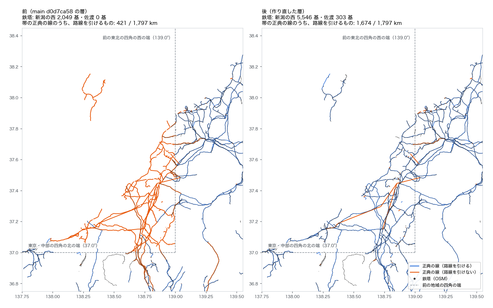

# 路線・鉄塔の層とつながりの点検を、今の正典と広げた四角で作り直す（2026-11-09）

系統図マップの「路線」「鉄塔」「横断検索」の層（`docs/data/osm_routes/`）と「つながりの点検」の層（`docs/data/route_audit/audit.json`）を作り直した。どちらも観測（OSM）から作った derived の層で、**正典（`docs/data/built`）は変えない**。

## なぜ

1. **正典が変わった**: #58〜#60（地域をまたぐ写しをまとめる）と #61（東北の四角を広げる）で、正典の枝は 19,909 → 17,416 本になった。地図の線から路線を引く鍵（`edge_routes.json`、枝の始点・終点・頂点数）は 11-07 の正典で作ったままで、区切りの変わった線は路線を引けなくなっていた（間違った路線は出さず、「対応づけられない」と出るだけ）。
2. **四角の外の鉄塔が落ちていた**: 鉄塔の生データは、OSM の抽出を地域の外接矩形の和で絞っている（`scripts/osm_pbf_to_power_json.py`）。#61 の前は、新潟の西（上越・柏崎・長岡・十日町・魚沼）と佐渡がどの地域の四角にも入らず、そこの鉄塔が層に無かった。

## 作り直し方

研究室の計算機で、main（d0d7ca58）を新しいフォルダにクローンして回した（取得データは Mac に置かない決まり）。`<抽出>` は研究室の NAS の `osm_jp_power/20261105_agj_transmission/`（場所は公開しない）。

```bash
# 同じ抽出(OSM 2026-11-05)を、今の config/regions.yaml の四角で絞り直す
python scripts/osm_pbf_to_power_json.py <抽出>/power_lines_towers.osm.pbf <抽出>/json_20261109
export AJG_OSM_RAW_TOWERS=<抽出>/json_20261109             # 読み先は環境変数だけで渡す
PYTHONPATH=. python scripts/export_osm_routes.py
PYTHONPATH=. python scripts/audit_route_connectivity.py
```

- 新しい JSON: `<抽出>/json_20261109/tw_japan_t0.json`（52 MB、SHA256 `d070e1ae…f5fce4`、同じ場所の `MANIFEST.sha256` と `README.md` に追記）。鉄塔 246,609 → **250,409 基**（+3,800）、way 36,965 → 37,380、route=power 577 → 578
- 11-07 の `json/` は前の四角の分で、比べるときのために残した
- `osm_routes.default_raw_dir()` は環境変数 `AJG_OSM_RAW_TOWERS` だけを見るようにした（前は研究室の NAS のマウント先を既定に持っていた。公開のリポジトリに研究室の場所を書かない決まりに合わせた）。環境変数で渡して回し直した出力は、`--raw` で渡したものとバイトまで同じだった
- 図と数: `osm_routes_refresh_2026-11-09/fig.py`（`fig_niigata_sado.png`・`numbers.json`）、行き止まりの内訳: `deadends.py`（`deadends.json`）、A の測定: `ab_cmp.py`（`ab_measure.json`）

## 前と後

違いを分けるため、2 通り回した。

- **A**: 11-07 の JSON に今の正典を当てた。正典が変わった分だけが出る
- **B**: 11-09 の JSON に今の正典を当てた。B をコミットした

| | 前（main d0d7ca58 の層） | A | **後（B）** |
|---|---:|---:|---:|
| 鉄塔 | 246,609 | 246,609 | **250,409** |
| 　うち新潟の西（#61 の帯、佐渡を除く） | 2,049 | 2,049 | **5,546** |
| 　うち佐渡 | 0 | 0 | **303** |
| 路線 | 26,975 | 26,975 | 27,316 |
| 地図の線のうち路線を引けるもの（頂点 3 つ以上の線 16,105 本） | 12,155 | 12,323 | **12,512** |
| 同じく延長（全 76,808 km） | 70,277 km（91.5%） | 72,413 km（94.3%） | **73,332 km（95.5%）** |
| #61 の帯の正典の線のうち路線を引けるもの（全 1,797 km） | 421 km | 755 km | **1,674 km** |

- 層を 11-07 に作ったときは、そのときの正典の延長の 95.4% が路線を引けた。作り直して同じ水準に戻った
- #61 の帯でまだ路線を引けない 123 km は、公表の接続（0698 長岡〜南長岡〜魚沼縦幹線・0700・0701・0709）と合成の引込み線で、OSM の way から作った線ではない。路線が無いのが正しい



### 鉄塔の地域の数が A でも変わる

鉄塔の地域は「いちばん近い正典の点の地域」で決める（`export_osm_routes.region_lookup`）。#58 が写しを領土の地域の写しに寄せたので、正典が変わっただけの A でも、境の鉄塔の地域が替わった（例: 四国 9,242 → 8,961 基。中国・九州の中にあった四国の写しが消えた分）。全体の鉄塔の数は A で変わらない。

## つながりの点検

| 種類 | 前 | A | **後（B）** |
|---|---:|---:|---:|
| 観測: 線の端の 60 m 以内に別の線 | 3,017 | 3,017 | 3,027 |
| 観測: 線の端の 300 m 以内に変電所 | 234 | 236 | 239 |
| 観測: 線の端が何もない所で終わる | 2,871 | 2,888 | 2,915 |
| 観測: 線の端が取得範囲の外 | 47 | 24 | **24** |
| 観測: 同じ名前・電圧の路線が 2 km 以内の隙間で途切れる | 12 | 12 | 12 |
| 正典: 変電所でない点の座標に電圧の違う枝が集まる | 59 | 51 | 51 |
| 正典: 変電所でない接続点で枝が 1 本（行き止まり） | 2,268 | 2,764 | **2,764** |

- **取得範囲の外 47 → 24**: 範囲を東北の広げた四角で見るので、新潟の西で止まっていた線の端が範囲の中に入り、近くに何があるかで数え直された。残る 24 は関西・九州・沖縄の四角の端
- 観測の候補の地域ごとの数は、鉄塔と同じく「いちばん近い正典の点の地域」で数えるので、#58 の領土の寄せで中部 → 北陸などへ移った（`route_connectivity_audit_2026-11-05.md`）

### 正典の行き止まりが 2,268 → 2,764 に増えた内訳

点検は点を座標でまとめ、その座標に付く枝の数で行き止まりを決める。新しく行き止まりになった 603 か所（消えたのは 107 か所）を、前の正典でその座標に付いていた枝で分けた（`deadends.py`）。

| 内訳 | か所 |
|---|---:|
| 前は同じ線分の写しが 2〜3 本重なっていて、座標で見ると「枝 2 本の点」に見えていた | **574** |
| 同じく写しだが、頂点が少しずれていた（先の端が 100 m 以内・長さが 3 割以内） | 2 |
| 前の正典にその座標の点が無い（#61 の帯の線など） | 24 |
| 変電所から出る 500 m 未満の尻尾 | 3 |

- **576 か所は、前から行き止まりだった**。地域の写しが重なっていたので、点検の数え方では見えていなかった。#58〜#60 で写しが 1 本になり、見えるようになった。例: 揖斐洞戸幹線・今市線・塩原線（500 kV）の端
- 尻尾の 3 本は、広野町変電所（500 kV、170 m）・吉和変電所（110 kV、320 m）・好間変電所（66 kV、260 m）から出る。別の地域の写しが変電所を素通りしていた先の残りで、#168 の報告の「行き止まりの尻尾」に当たる。需要も発電も付かず、潮流には響かない
- つまり、正典が悪くなったのではなく、点検が写しで数え落としていた分が出た

## 確かめたこと

- `tests/test_osm_routes.py`（研究室の計算機と手元、今の正典と作り直した層で）。CI の pytest 1,974 本・reproduce-canon・full-ac-light
- 環境変数で渡して回し直し、`--raw` で回した出力とバイトまで同じ
- NAS の `MANIFEST.sha256` の 4 件を照合した
- 画面の検査（`tests/test_pages_map_ui.py` の路線・鉄塔・検索・点検の印）は CI の map-interaction で 23 本（データだけの PR では自動で回らないので、手で回した）

## 変えないもの

- 正典（`docs/data/built`）と潮流計算の出力
- 層の作り方の規則（`src/topology/osm_routes.py` の路線のまとめ方・補完）。替えたのは生データの読み先の渡し方だけ
