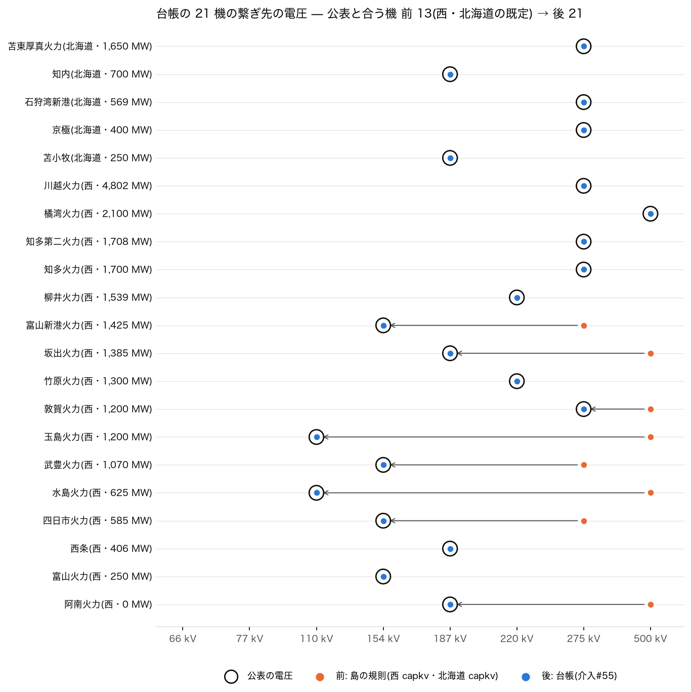

# 公表の接続で電圧が分かる大型機の繋ぎ先(介入#55・2026-10-28)

`nagoya_port_attach_2026-10-28.md` の「残り」の続き。発電機の繋ぎ先は、#24(`cap`)・#41(`capkv`)の規則で推定していて、外部の接続電圧表は持ち込んでいなかった。ところが各社の「系統情報の公表」(空容量・予想潮流一覧)には、発電所の名前のついた線や構内の変電所が載っている機がある。これは一次資料そのものなので、台帳にしてその電圧へ繋ぐ。

## 要点

- 台帳 `config/plant_connections.yaml` に 21 機を載せた(中部 5・北陸 3・中国 4・四国 4・北海道 5)。書いたのは資料・番号・線名・電圧・回線数・区間だけで、容量・潮流の値は書いていない。
- 島の規則(西・北海道とも `capkv`)のままで、主な接続電圧が公表と合っていたのは **21 機中 13 機**。台帳を使うと 21 機すべて(網に公表の電圧のバスが見つからない機は 0)。
- 規則そのもの(#41)は変えない。どの規則も 21 機中 12〜14 機しか合わず、外れる機が規則ごとに違う(下の採点)。
- ⚠ 相手の変電所まで同定できたのは知多(東浦開閉所)と川越(西名古屋)だけ。ほかは「公表の電圧のバスのうち最寄り」で、相手は推定のまま。
- 潮流は少し変わる。N-1 の西の平常時の過負荷 37 → 33、新しい過負荷を起こす開放 263 → 240。全規模の潮流の西の vm の最小 0.569 → 0.728(江田島の 66 kV のアンテナ)。

## 台帳の作り方

- 資料: 各社の空容量・予想潮流一覧(手元の写しは `data/external/system_disclosure/<社>/capacity/`、git の外)。中部 KRSIH010・011・013(2026-08-31 更新)、北陸 sys_capa_kikan01(2026-08)、中国 sys_capa_kikan01・local33/45/46/53(2026-07〜08)、四国 sys_capa_kikan00(2026-08)、北海道 sys_capa_kikan01(2026-08)。
- 載せた機: 一覧の線名・変電所名に発電所の名前がある機(知多火力線・武豊火力変電所・京極幹線など)。名前を網の発電所(OSM)の名前と 1 機ずつ目で突き合わせた。
  - 竹原は、新竹原火力線(220 kV、新広島(変)→発電所)と竹原火力線(110 kV)の両方がある。網の竹原火力(1,300 MW)には新 1 号機が含まれるので、主な電圧は 220 kV とした。
  - 石狩湾新港は、北海道の一覧の「石狩火力幹線」(275 kV)で取った。
- 主な電圧: 構内の変電所の一次側の電圧と、発電所の名前のついた線の電圧のうち最も高いもの。知多火力変電所は 275/154 kV と 275/77 kV の変圧器を持つので 275 kV。武豊火力変電所・四日市火力変電所は 154/77 kV なので 154 kV。
- 同定(住所から付いた名前の正体)は `nagoya_port_attach_2026-10-28.md` と同じ方法: 公表の線名と OSM の線名が同じ線の端。大字石浜変電所 = 東浦開閉所。
- 東の各社(東京・東北)の一覧は発電所の名前を伏せているので、東の機は 0。沖縄はまだ照合していない(残り 4)。

## 繋ぎ方

`attach_generators(plant_ledger=)`。台帳にある機は、規則の選んだバスの代わりに、25 km 以内で電圧が台帳の値のバスのうち、公表の相手(`to`)→ 最寄り を選ぶ。該当が無ければ規則のまま(未解決として数える)。台帳に無い機は何も変わらない。関数の引数既定は台帳なしで、モデルを組む経路(全規模の潮流・N-1・配布ケース・CIM Level 2・UC の橋・感度)だけが渡す。無効化は `--no-plant-connections`。

## 採点(主な接続電圧が公表と合う機)

数字は `plant_connections_2026-10-28/stats.json`(`measure.py` の出力)。どの規則も本物の `attach_generators` で繋いで数えた。

| 規則 | 21 機 | 西 16 機 | 北海道 5 機 |
|---|---:|---:|---:|
| 最寄り(#24 の前) | 12 | 8 | 4 |
| `cap`(#24) | 14 | 10 | 4 |
| `kvfit` | 13 | 8 | 5 |
| `capkv`(#41・西と北海道の既定) | 13 | 8 | 5 |
| 台帳(#55) | 21 | 16 | 5 |

- `capkv` は「1 回線で運べる最下位の階級」を求めるので、1 GW 級を 500 kV へ回す。玉島・水島(公表 110 kV)、坂出・阿南(187 kV)、敦賀(275 kV)が外れる。
- `cap` は電圧を見ないので、知多・知多第二を名古屋港の対岸の 154 kV に、京極を札幌の 66 kV に載せる。
- 最寄りは、柳井(110 kV)・水島(66 kV)・武豊(77 kV)を下の電圧に載せる。
- 外れる機が規則ごとに違い、どれかに替えても直らない。規則は変えず、公表の分かる機だけを台帳で直す。
- ⚠ `nagoya_port_attach_2026-10-28.md` と #41 の台帳の行に書いた「西の 13 機で `capkv` 5・`cap` 9・最寄り 10」は甘い数え方だった。複数の電圧を持つ機を「どれかに合えば正解」と数えていたため(知多の 154 kV や武豊の 77 kV も正解にしていた)。主な電圧で数え直した上の表に置き換えた。



図: 行が台帳の機、輪が公表の電圧、橙が前(島の規則)、青が後(台帳)。前と後が同じ電圧の機は青だけが見える。

## 規則から動いた機(西 9・北海道 1)

| 機 | 出力 | 前(島の規則) | 後(台帳) | 選び方 |
|---|---:|---|---|---|
| 知多第二火力 | 1,708 MW | 南柴田町 275 kV | 浅山一丁目 275 kV(6.0 km) | 公表の電圧の最寄り |
| 富山新港火力 | 1,425 MW | 新富山 275 kV | 射水市 154 kV(0.2 km) | 公表の電圧の最寄り |
| 坂出火力 | 1,385 MW | 昭和町二丁目 500 kV | 受電所 187 kV(1.8 km) | 公表の電圧の最寄り |
| 敦賀火力 | 1,200 MW | 色浜 500 kV | 樋ノ水町 275 kV(4.3 km) | 公表の電圧の最寄り |
| 玉島火力 | 1,200 MW | 菰池二丁目 500 kV | 倉敷市 110 kV(0.2 km) | 公表の電圧の最寄り |
| 武豊火力 | 1,070 MW | 大字石浜 275 kV | 川口町五丁目 154 kV(4.2 km) | 公表の電圧の最寄り(公表の相手の知多変電所ではない) |
| 水島火力 | 625 MW | 菰池二丁目 500 kV | 潮通一丁目 110 kV(0.3 km) | 公表の電圧の最寄り |
| 四日市火力 | 585 MW | 富田 275 kV | 大協町二丁目 154 kV(0.2 km) | 公表の電圧の最寄り |
| 阿南火力 | 0 MW(出典値) | 阿南発電所 500 kV | 阿南発電所 187 kV(0.2 km) | 公表の電圧の最寄り |
| 知内(北海道) | 700 MW | JR北海道吉岡 187 kV | 元町 187 kV(0.2 km) | 公表の電圧の最寄り |

知多(大字石浜 = 東浦開閉所)と川越(西名古屋)は、`capkv` がすでに公表の相手を選んでいた。

## 前後

**全規模の潮流**(`docs/data/powerflow_full/summary.json`)

- 4 島とも AC で解ける。網の規模は不変。
- 西の vm の最小 0.569 → 0.728。場所は同じ江田島の 66 kV のアンテナ(発電機の無い木、配布ケースでは #52 で畳む)。
  - 中国・四国の約 3.2 GW(玉島・水島・坂出)が 500 kV から地元の 110・187 kV に移り、潮流の形が変わった。
  - 21 機はどれも前後とも最大の連結成分にあり、切れ端に載せたのではない。
- 西の AC の最大負荷率 607 → 606%。北海道・東・沖縄はほぼ不変。

**N-1**(`docs/data/n1_canon/summary.json`)

| 島 | 平常時の過負荷(物理の枝) | 新しい過負荷を起こす開放 | 平常時の最大負荷率 |
|---|---|---|---|
| 西 | 37 → 33 | 263 → 240 | 278 → 285 % |
| 北海道・東・沖縄 | 不変 | 不変 | 不変 |

**配布ケースの網**(地点需要なし・正典の島の試験と同じ組み方)

| | 西 前 → 後 | 北海道 前 → 後 |
|---|---|---|
| AC・網の規模・vm の範囲 | 不変(6 バス畳む) | 不変 |
| 損失 | 2.05 → 1.98 % | 2.50 → 2.48 % |
| 154 kV 以上の線の過負荷 | 47 → 43 本(最大 280 → 287 %) | 0 → 0 本 |
| 変圧器の過負荷 | 68 → 66 台 | 2 → 2 台 |

## 残り

1. **台帳を広げる。** 東の各社は一覧で発電所の名前を伏せている。様式5 の区間(「発電所1002036」など)と線名(奥只見線・田子倉線ほか)からの同定が要る。
2. **相手の同定。** 武豊(公表の相手は知多変電所)・知多第二(東海変電所)は、網の名前が住所から付いていて相手を引けない。公表の線名と OSM の線名が同じ線の端で引けるものから足す。
3. **電源線。** 知多火力線・知多火力東浦線・知多第二東海線は網に無い(`nagoya_port_attach_2026-10-28.md` の残り 1)。名古屋港の 275 kV の 2 か所への集中(新名古屋・西名古屋・碧南は台帳に無い)は残る。
4. **沖縄。** 様式5 に名前のある火力の開閉所・変電所(吉の浦・具志川・石川・金武、132 kV)があり、照合していない。

## 再現

```
PYTHONPATH=. python scripts/regenerate_all.py                                   # 正典(重い段も)
PYTHONPATH=. python docs/reports/plant_connections_2026-10-28/measure.py        # stats.json(数分)
python docs/reports/plant_connections_2026-10-28/fig.py                          # voltage_match.png
```
