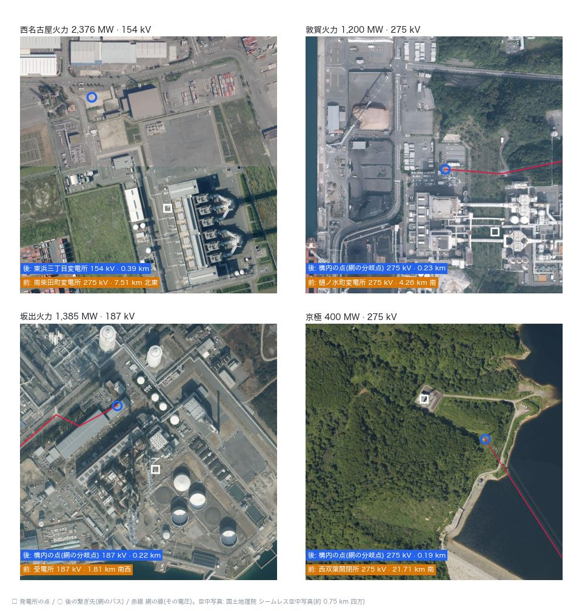

# 台帳の全機を地図と空中写真で見直す(介入#55 の追補・2026-10-30)

台帳 `config/plant_connections.yaml`(介入#55)は、10-28 に公表の一覧と網だけで作った。オーナーの指摘は「マップの画像とかをよくみにいってみては？」「当時目がない時に作っていたから」「できそうならやって」。台帳の 22 機すべてについて、繋ぎ先を網の線の端・地理院の標準地図・国土地理院の空中写真で見直した。

## 要点

- **4 機を直した。** 台帳は 23 機になった。
  - 西名古屋火力 2,376 MW を新しく載せた。154 kV で構内の変電所(網の東浜三丁目 154 kV)へ繋ぐ。前は南柴田町 275 kV(7.5 km 先)。
  - 敦賀火力 1,200 MW は、構内の 275 kV の点へ。前は樋ノ水町 275 kV(4.3 km 先)。
  - 坂出火力 1,385 MW は、構内の 187 kV の点へ。前は受電所 187 kV(1.8 km 先)。
  - 京極 400 MW は、構内の 275 kV の点へ。前は西双葉開閉所 275 kV(21.7 km 先)で、京極幹線を 1 本飛ばしていた。
- **南柴田町 275 kV への集中は 5,434 → 3,058 MW。** 残るのは新名古屋だけで、構内から出る 275 kV の線の筋としてもっともらしい(`nagoya_port_sites_2026-10-29.md` の残り 1)。
- 残りの 18 機は変えなかった。
  - 14 機は、すでに発電所の点から 0.31 km 以内のバスに繋がっている。
  - 川越・知多第二・橘湾・柳井の 4 機は、網の公表の電圧の線が構内まで来ていない(1.5 km 以内にその電圧の点が無い)。そのため、今の繋ぎ先が網の中では最ももっともらしい。川越は、公表の川越火力線(川越火力変電所 → 西名古屋変電所)の相手と一致する。
- ⚠ **訂正 1**: `nagoya_port_sites_2026-10-29.md` の「西名古屋火力は公表の一覧に線の名前が無い」は誤り。275 kV 以上の一覧(KRSIH010)だけを見ていた。尾張・知多の 154 kV 以下の一覧(KRSIH011)に、西名古屋名南-1・-2 がある。
- ⚠ **訂正 2**: `nagoya_port_sites_2026-10-29.md` の「配布ケースの網」の前後には、台帳の差し替えが効いていなかった。
  - その `measure.py` は `export_matpower_canonical.load_plant_connections` を差し替えていた。ところが `build_canonical_net` は、呼ばれるたびに `run_full_powerflow_from_db` から台帳を読む。
  - そのため、前後の差は #44 の回線数 2 本だけを測っていた。
  - 前の台帳と正典(`6ede44e6`)で測り直すと、西は次のとおり。報告では 1.97 → 1.96 %・42 → 44 本(最大 282.8 → 286.4 %)・67 → 68 台と書いていた。

    | 指標 | 前 | 後 |
    |---|---|---|
    | 損失 | 1.98 % | 1.96 % |
    | 154 kV 以上の線の過負荷 | 43 本(最大 287.2 %) | 44 本(最大 286.4 %) |
    | 変圧器の過負荷 | 66 台 | 68 台 |

  - 全規模の潮流と N-1 は、再生成した出力から読んでいたので正しい。

## 判断の材料

| 機 | 公表(線名・電圧・回線数・区間) | 網 | 地図・空中写真 | 採ったもの | 確からしさ |
|---|---|---|---|---|---|
| 西名古屋火力 2,376 MW | KRSIH011 No.10181・10182 西名古屋名南-1・-2 154 kV 各 2 回線 名南変電所 → 西名古屋変電所。275 kV 以上の一覧には西名古屋火力の線が無い | 発電所の脇の東浜三丁目 154 kV(飛島村)から、名南変電所(港区新茶屋)へ 6 回線、飛島七宝線 4 回線 | 7 号系列のすぐ北西に、ガス絶縁の母線と変圧器のある変電所。角に大きな鉄塔があり、架空線が北西(名南の方角)へ出る | 構内の点(`at`、154 kV)。網では東浜三丁目 154 kV(発電所の点から 0.39 km) | 高 |
| 敦賀火力 1,200 MW | H110 敦賀火力線 275 kV 2 回線 南条 → 敦賀火力。敦賀火力変電所 275/77 kV | 発電所の点から 0.23 km に 275 kV の分岐点。網の線(端の名から自動で付いた「奥野々変電所~敦賀変電所線」2 回線)がここから東へ出る | 点は発電所の北の変電設備の脇。線は東の山へ延びる | 構内の点(`at`) | 高 |
| 坂出火力 1,385 MW | No.28 坂出火力線 187 kV 2 回線。坂出火力変電所 187/66 kV | 発電所の点から 0.22 km に 187 kV の分岐点。網の線「受電所~讃岐変電所線」が通る | 点は構内の建物の脇。屋内の変電設備と見られるが、写真だけでは確かめきれない | 構内の点(`at`) | 中 |
| 京極 400 MW | No.8 京極幹線 275 kV 2 回線 発電所 → 後志幹線 | 発電所の点から 0.19 km に 275 kV の分岐点。網の線の名前も OSM で「京極幹線」2 回線 | 点はダムの脇の林の中で、線は南東へ出る | 構内の点(`at`) | 高 |

- 公表の「西名古屋変電所」には、三重の同名の変電所もある(網では 35.083, 136.616)。そこの 154 kV の線は北と南(大協町二丁目・関西幹線・下大榑新田)へ出ていて、東の名南へ向かうものは網に無い。そのため、西名古屋名南の「西名古屋」は発電所の側と読んだ。
- 敦賀と坂出の点には、同じ座標に地域ごとの双子の点がある。選ばれたのは隣の地域の側(中部・中国)だが、4 機とも島の本体の網(連結成分)の中にあることを確かめた。
- 知多第二の繋ぎ先(東海変電所 = 東海町六丁目と推定・確からしさ中)は変えていない。
  - 網の浅山一丁目は 275 kV と 154 kV を持ち、公表の東海変電所(275/154 kV)と形が合う。
  - 東海町六丁目と浅山一丁目は、同じ 275 kV の線の上で 300 m しか離れていない。標準地図では、どちらの点の脇にも「発電所等」の記号がある。
  - どちらに繋いでも、潮流はほとんど変わらない。
- 知多変電所は、網の原二丁目(知多市八幡)ではなさそう。公表では、知多変電所から 77 kV の分岐が阿久比・成岩・常滑・榎戸などへ出ている。網の原二丁目の 77 kV は、北の大府・大高・緑区へ繋がる。今のモデルはこの同定を使っていない。



図: □ は発電所の点、○ は後の繋ぎ先(網のバス)、赤線は網の線(その電圧)。下の帯が前と後の繋ぎ先で、前は発電所からの距離と方角。空中写真は国土地理院 シームレス空中写真(約 0.75 km 四方)。

## 直したこと

- 台帳に西名古屋火力を足した(`kv: 154`・`at`・`to: [名南変電所 154kV]`)。
- 敦賀・坂出・京極に `at` を足した。
- コードは変えていない。`at` の選び方は 10-29 の追補と同じで、0.5 km 以内で台帳の電圧のバスを、ほかより先に選ぶ。
- 試験 `tests/test_canonical_islands.py` の記録を更新した(西の損失 1.96 → 1.88 %・vm 0.7757 → 0.7758 / 1.0378 → 1.0379、北海道 2.48 → 2.50 %)。

## 前後

数字は `plant_sites_by_eye_2026-10-30/stats.json`(`measure.py` の出力)、`docs/data/powerflow_full/summary.json`、`docs/data/n1_canon/summary.json` から取った。前は main `5e1223fb` の台帳と出力。正典(`docs/data/built/all.json`)は前後で同じ。

**繋ぎ先**

| 機 | 前 | 後 |
|---|---|---|
| 西名古屋火力 2,376 MW | 南柴田町 275 kV・7.51 km | 東浜三丁目 154 kV・0.39 km |
| 敦賀火力 1,200 MW | 樋ノ水町 275 kV・4.26 km | 構内の点 275 kV・0.23 km |
| 坂出火力 1,385 MW | 受電所 187 kV・1.81 km | 構内の点 187 kV・0.22 km |
| 京極 400 MW | 西双葉開閉所 275 kV・21.71 km | 構内の点 275 kV・0.19 km |

**名古屋港の周りでバスに載る出力の上位**

- 前: 南柴田町 275 kV 5,434 MW・西名古屋 275 kV 4,802 MW・川口町五丁目 275 kV 4,236 MW
- 後: 西名古屋 275 kV 4,802 MW・川口町五丁目 275 kV 4,236 MW・南柴田町 275 kV 3,058 MW・東浜三丁目 154 kV 2,602 MW
- 西名古屋変電所(三重)には川越火力が載り、川口町五丁目(碧南変電所)には碧南が載る。どちらも公表の相手。

**全規模の潮流**(地点需要あり・4 島とも AC)

- 東・沖縄は出力が main とバイト一致する。
- 西: 損失 1,180.1 → 1,133.5 MW、最大負荷率 606.1 → 605.6 %、vm の最小 0.728(同じ)。
- 北海道: 損失 99.7 → 100.4 MW。
- 中部で負荷率が 15 ポイント以上動いた線は 91 本。
  - 100 % を超えなくなった線が 21 本ある。例: 南柴田町~昭和町 200 → 84 %(200 は書き出しの上限)、昭和町寛政-2 125 → 20 %、浅山一丁目~原二丁目 131 → 96 %。
  - 新しく超えた線は 3 本。昭和町寛政-1・寛政築港連絡-2 45 → 127 %、稲沢~吉津二丁目 15 → 118 %、中勢亀山線 98 → 100 %。
  - 西名古屋火力の出力の行き先は、東浜三丁目~名南 11 → 52 %、飛島七宝線 最大 62 %。154 kV のまま受けられている。
- 北陸で動いた線は 4 本(敦賀の周り。北陸電力送配電 154 kV 線 113 → 17 % など)。四国は 1 本(受電所~讃岐 0 → 19 %)。

**N-1**(≥154 kV の実在の枝を監視)

| 島 | 平常時の過負荷 | 平常時の最大負荷率 | 新しい過負荷を起こす開放 | うち 120 % 超 | 開放後の最大 |
|---|---|---|---|---|---|
| 西 | 35 → 21 | 284.1 → 248.5 % | 229 → 249 | 56 → 55 | 206.4 → 212.5 % |
| 北海道 | 0 → 0 | 不変 | 不変 | 不変 | (AC の確かめの最大 55.3 → 55.4 %) |
| 東・沖縄 | 不変 | 不変 | 不変 | 不変 | 不変 |

**配布ケースの網**(地点需要なし・正典の島の試験と同じ組み方)

- 西: 損失 1.96 → 1.88 %、154 kV 以上の線の過負荷 44 → 30 本(最大 286.4 → 255.0 %)、変圧器の過負荷 68 → 65 台、vm の範囲はほぼ同じ。
- 北海道: 損失 2.48 → 2.50 %。

潮流は採否の根拠にしていない。平常時の過負荷は減るが、新しい過負荷を起こす開放は増える。採ったのは、公表の線名・電圧と、網の線の端・地図・空中写真の一致による。

## 残り

1. 新名古屋 3,058 MW の繋ぎ先(南柴田町 275 kV・2.2 km)。公表の 275 kV 以上の一覧に新名古屋火力の線が無い。154 kV の一覧には東海潮見(潮見変電所 → 東海変電所)がある。網の 275 kV の線は構内から出ている。
2. 碧南 → 幸田の線の容量(`nagoya_port_sites_2026-10-29.md` の残り 2)。
3. 知多変電所の場所(上)。
4. 東の台帳・沖縄の照合。

## 再現

```
PYTHONPATH=. python scripts/regenerate_all.py                                    # 正典と出力(重い段も)
PYTHONPATH=. python docs/reports/plant_sites_by_eye_2026-10-30/measure.py        # stats.json(数分・前の台帳は git の履歴から読む)
python docs/reports/plant_sites_by_eye_2026-10-30/fig.py                          # sites.jpg(空中写真をその場で取る)
```

全規模の潮流の地点需要(介入#30)は `data/external/system_disclosure/normalized/point_demand.csv`(git の外)を使う。無いと、東・沖縄の数字も黙って変わる。
