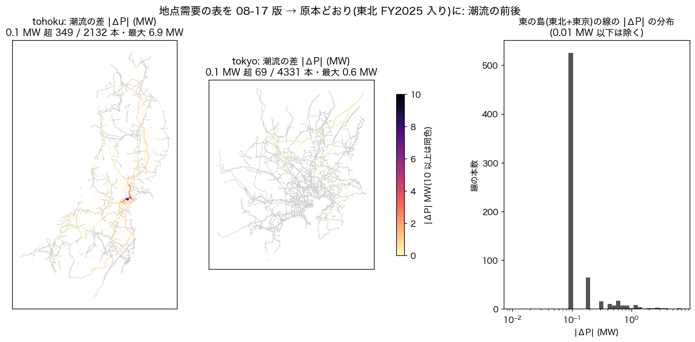

# 地点需要の表を原本に合わせて作り直す・潮流の再現を確かめる 2026-10-26

オーナー「この github 見た人が計算や生成を全て再現できるように」（10-24）の続き。正典（`docs/data/built/all.json`）は clone だけで作り直せるようになった（#106〜#108）。ただし潮流・N-1・MATPOWER・CIM は、git の外にある**地点需要の表**（介入 #30、`data/external/system_disclosure/normalized/point_demand.csv`）を読む。この表は各社の系統情報の公表から作るので、再配布できない。この報告では、各自がその表を作れるか、作った表から公開値が再現するかを確かめた。

分析と実装は Claude Opus 5.5。根拠の表は `point_demand_refresh_2026-10-26/`（`stats.json`・`before_after.png`）。

## わかったこと

1. **手順書のとおりには作れなかった。** `docs/REPRODUCIBILITY.md` は「各自で `scripts/parse_point_demand.py` を流して作る」と書いている。ところがこのスクリプトは、読む場所も書く場所も所有者の絶対パス（`/Users/shigenoburyuto/...`）だった。clone した人の手元では、原本を取っても表ができなかった。
2. **作り方そのものは決定的。** 手元の原本から作り直すと、08-17 の表にある 1,135 行は値まで全部同じだった。置き場を別の場所に移して作っても、sha256 は同じだった。
3. **公開している潮流は、原本より古い表から作られていた。** 08-17 の表には、10-24 に取り直した原本に入っていた東北 FY2025（表にして 184 行）が入っていない。毎週の処理（`scripts/realtime_cycle.sh`）は各社の潮流実績を取り直していたが、表を作り直す段が無かった。
4. **中部は、取得したままでは表に入らなかった。** 取得は URL の名前（`rule_88.xlsm` など）のまま保存する。ところが中部の Excel を CSV に直す `scripts/convert_chubu_flow.py` は、08-16 に手で付け替えた名前（`jisseki_kikan_line_2025.xlsm` など）しか読まなかった。この変換の段は手順書にも無かった。Linux のサーバーで clone から取り直すと、表の中部だけが 0 行だった（ほかの 6 社は事業者ごとの sha256 が一致）。
5. **同じ表を使えば、潮流と N-1 の出力はバイト一致で再現する。** 08-17 の表で全段を流し直すと、潮流の出力はコミットとバイト一致した（地図の層・単線結線図・各島の線とバス）。違ったのは `summary.json` の実行の記録（日付・git の版・生成時刻・解いた秒数）だけ。

## 直したこと

- `scripts/parse_point_demand.py` を clone した場所から読むようにした。毎時の処理と同じ環境変数 `AGJ_SYSTEM_DISCLOSURE` で置き場を変えられる。記録するファイル名は置き場からの相対にそろえた（どこで作っても同じ表になる）。
- 手順書（REPRODUCIBILITY・README・DATASET・dataset/）と STEPS が名指しするスクリプトに、所有者の絶対パスが無いことを検査にした（`tests/test_documented_scripts_portable.py`）。
- **表の指紋**（sha256・バイト数・行数と、事業者ごとの行数・sha256）を、重い段を回した `regenerate_all` が `MODEL_VERSION.json` の `external_inputs.point_demand` に記録する。配布ケースの `dist/matpower_national/meta.json` にも載せる。地点ごとの値は載せない（ライセンス）。事業者ごとの sha256 を見れば、食い違ったときにどの社の公表が差し替わったかが分かる。
- 中部の取得したままの名前（`rule_NN`）と、変換が読む名前の対応 8 本を `config/system_disclosure.yaml` の `chubu.flow_actual.names` に書いた。対応は、08-16 に付け替えた複製と sha256 が一致することで確かめた。`rule_NN` だけから変換した CSV 12 本は、8 月のものとバイト一致した。手順書と毎週の処理に変換の段を足した。
- 手元の表が正典の版と同じかは、`PYTHONPATH=. python3 -m scripts.check_point_demand_stamp` で確かめられる。違えば、違う事業者と行数を出す。
- 毎週の処理で、新しい公表があれば表も作り直し、正典の版と違えばそのことをログに出す。潮流は重いので、そこでは作り直さない。作り直すのは `regenerate_all`。

## 新しい表で潮流を作り直した

介入 #30 の決まり（局ごとに最新の 1 年だけ使う）は変えていない。入力の表を原本に合わせただけ。

| | 08-17 の表 | 10-26 の表（原本どおり） |
|---|---:|---:|
| sha256（先頭） | `663df59d1c91` | `f112870646af` |
| 行数 | 1,135 | 1,319（東北 FY2025 の 184 行が増えた） |
| ピン留めの合計 | 285.9 MW | 276.2 MW |
| 　うち東北（16 局） | 89.6 MW | 79.9 MW（14 局の値が FY2025 に替わる） |
| 　中部・四国・沖縄 | 90.3・48.6・57.3 MW | 同じ |

地域の合計需要は変わらない（ピン留めは配り方だけを変える）。

- 変わったのは東の島だけ。東北の線 2,132 本のうち 349 本で潮流が 0.1 MW を超えて動き、最大は 6.9 MW。東京は 4,331 本のうち 69 本で、最大 0.6 MW。出力の潮流は 0.1 MW 単位で丸めて保存しているので、分布は 0.1 MW に集まる。
- 東の島の AC: 最低電圧 0.8567 → 0.8564 pu、損失 1,398.6 → 1,398.8 MW、最大負荷率 997.85 → 997.80 %。4 島とも AC 収束のまま。
- 北海道・西・沖縄の潮流と、N-1（4 島）の結果は変わらない。

## 外の人が同じ表を作れるか — Linux の clone で確かめた

研究室の Linux サーバー（pws-160core、x86_64、Python 3.12・pandas 2.3.3）に GitHub から clone し、手順書（`docs/REPRODUCIBILITY.md`）のとおりに流した。

1. `python -m scripts.fetch_system_disclosure --kind flow_actual`: 120 ファイル、失敗 0、約 2 分。
2. `python scripts/convert_chubu_flow.py`: 中部の 8 本から CSV 12 本、約 2 分。macOS で作った CSV と sha256 が一致。
3. `python scripts/parse_point_demand.py` のあと `python -m scripts.check_point_demand_stamp`: **「正典の版と同じ」**（sha256 `f112870646af…`、1,319 行）。

つまり 10-26 の時点では、clone した人が各社の公表から、公開値と同じ地点需要の表を作れる。原本は各社が差し替えることがある（今回の東北 FY2025 の追加がその例）。差し替わったあとに取った人の表は違うものになり、`check_point_demand_stamp` がどの社の行が違うかを示す。

## OS をまたいで同じ出力になるか — Linux と macOS

同じ地点需要の表から、Linux のサーバーで全段（`regenerate_all`、潮流・N-1・MATPOWER・CIM まで）を流した。手元は macOS（Python 3.14・pandapower 3.4）、サーバーは Python 3.12・pandapower 3.5.6。

| 出力 | はじめ | 直したこと | 直したあと |
|---|---|---|---|
| 正典 `built/all.json` | 一致 | — | 一致 |
| 潮流の線・バス・地図の層（`powerflow_full/*.geojson`） | 値は全部同じなのにバイトが違う（中部・北海道・東北・東京の線で計 171 本） | ほぼ 0 の潮流（±1e-14）の符号が OS で変わり、0.1 MW に丸めると `-0.0` と `0.0` に分かれていた → 丸めるときに `-0.0` を `0.0` にそろえる | **バイト一致** |
| 潮流の要約（`summary.json`） | 1e-11 程度ずれる | 有効数字 10 桁で書く | 生成時刻と所要時間の欄だけ違う |
| N-1（`n1_screening_*.json`） | 件数・最大負荷率は同じ。上位 20 の顔ぶれ（沖縄）と順（西）が違う | 同点（沖縄の 89.9 % 前後、西の平行回線）が数値の揺れ（N-1 では 1e-6 % 程度）で入れ替わっていた → 負荷率が 1e-3 % 以内に並ぶまとまりは枝の番号順（`src/powerflow/contingency.py` の `TIE_PCT`） | 所要時間・日付・git の版の欄だけ違う |
| 全段の再生成 | N-1 の図の段が `ModuleNotFoundError: matplotlib` で落ちた | `matplotlib` を依存（`pyproject.toml`）に足した | 全段 rc=0 |

順位の付け方を変えたので、手元の N-1 の上位の一覧も変わった（沖縄の実在線の上位 20 のうち 10 件の顔ぶれ、西の 2 組の順）。どれも 89.9 % などで並んだ同点の中の入れ替わりで、件数や最大の負荷率は変わらない。

## 残り

- 沖縄の原本は `tyoryu_2025_2.csv` という 1 本の名前で決め打ちしている。新しい年度が公表されても入らない。
- `summary.json` の実行の記録（生成時刻・解いた秒数）があるので、潮流の出力を作り直すと毎回差分が出る。中身の一致を確かめるときは、これらの欄を除いて比べる。
