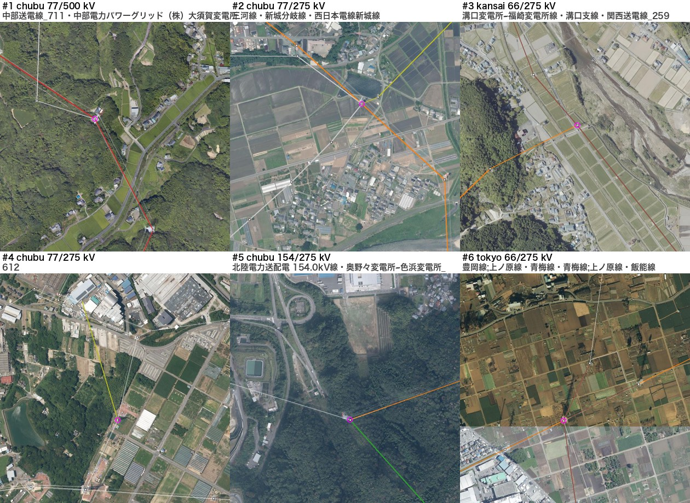
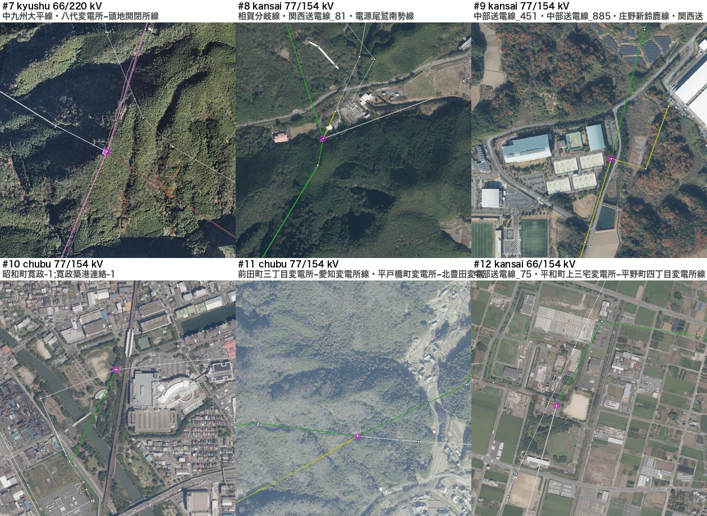
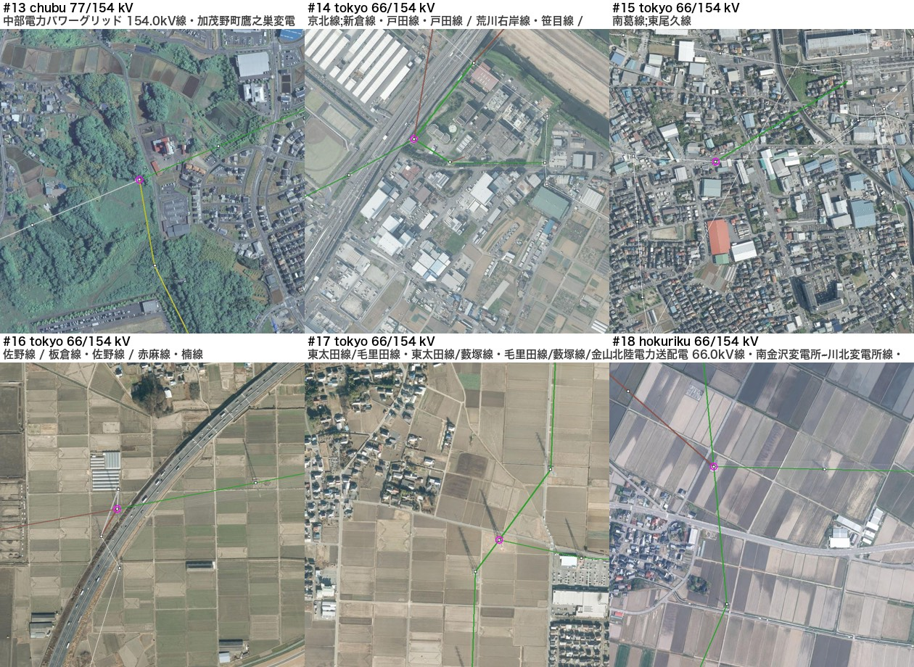
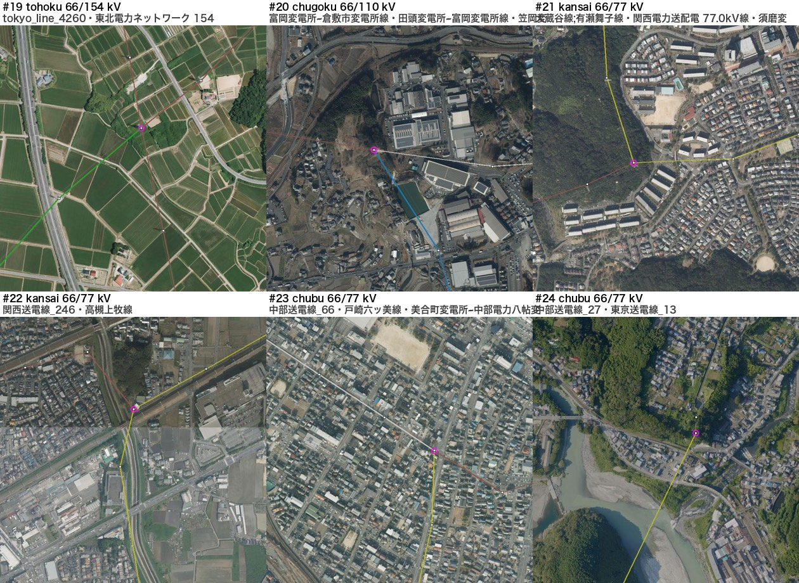
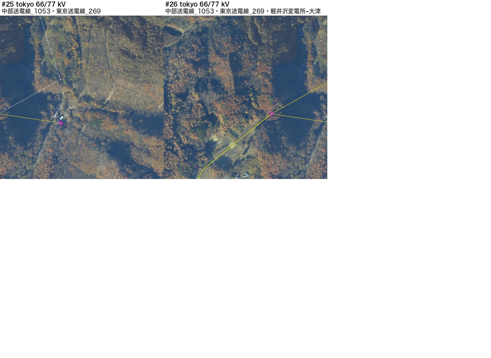

# 正典の「電圧の違う枝がつながる点」を航空写真で確かめた（2026-11-07）

`docs/reports/route_connectivity_audit_2026-11-05.md` の「正典: 変電所でない接続点で電圧の違う枝がつながる」59 か所のうち、
**作った枝（公表からの経路づけ・引込み・名前での結び付けなど）が関わらず、変電所から 300 m を超えて離れている 26 か所**を、
国土地理院の航空写真（全国最新写真・ズーム 17）に正典の枝（色は電圧）・OSM の線（白）・OSM の鉄塔（白い四角）・接続点（紫の丸）を重ねて確かめた。
判定の一覧は `docs/data/route_audit/mixed_kv_review.json`、一つずつの図は nas03 の `PWS_DB/osm_jp_power/20261107_audit_photos/`（写真のタイルと作り方 compose.py も同じ場所）。

## 結果

| 判定 | か所 | 番号 |
|---|---:|---|
| **誤接続**（変電所の無い所で電圧の違う線が交差するか同じ鉄塔に載り、正典がそこで枝をつないでいる） | **17** | #1・2・3・5・6・7・11・13・14・16・18・19・21・23・24・25・26 |
| 変電所が OSM に無いだけの可能性（すぐ近くに変電所か開閉所らしい施設） | 2 | #8・20 |
| 写真だけでは決められない（市街地・分岐） | 7 | #4・9・10・12・15・17・22 |

- #1 は第二浜岡幹線 500 kV に 77 kV の線をつないでいる（森の中の鉄塔、変電所は 5 km 先）。
- #24（富士川のそば）・#25・#26（軽井沢）は、東京（50 Hz）と中部（60 Hz）の 66/77 kV の線を鉄塔の所でつないでいる。周波数の違う系統が変換所なしにつながることは無い。
- 原因は、OSM で交差する線や併架の線が点を共有していて、正典を作るときにその点で電圧の違う枝が 1 つの接続点になったこと、と考えている（docs/OSM_ROUTES.md の「併架はつながない」と同じ問題）。

| 1〜6 | 7〜12 | 13〜18 |
|---|---|---|
|  |  |  |

| 19〜24 | 25〜26 |
|---|---|
|  |  |

## 次（正典を変えるので別の PR。採用は先生の確認のあと）

- 誤接続 17 か所は、接続点を電圧ごとに分ける（同じ電圧の枝だけを同じ点につなぐ）。正典を作り直し、潮流・島の数の前と後を比べ、介入台帳（docs/MODEL_INTERVENTIONS.md）に①根拠（この報告と写真）②帳簿（どの点を分けたか）③無効化の方法を書く。
- 変電所の可能性の 2 か所は、OSM と公表の系統図で変電所かどうかを確かめてから。決められない 7 か所はそのまま残す。
- 作った枝の関わる 28 か所と変電所の近くの 5 か所は、作った枝の根拠（介入台帳の各項目）と合わせて見直す。
