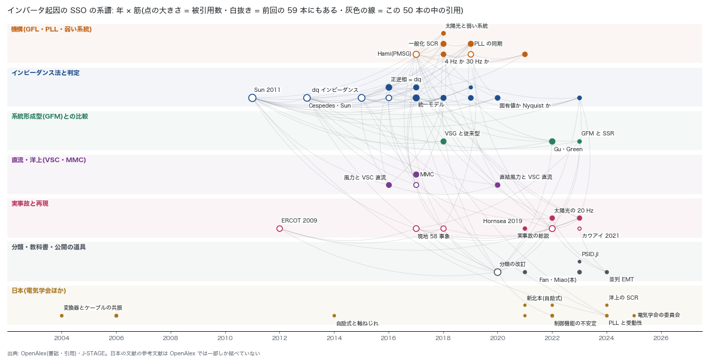

# インバータ起因の SSO: 文献調査と「起こせるか」(2026-10-31)

## 経緯

- オーナー: 「インバータ起因の sso も起こせるの？」「いろんな文献調査してから」
- 第 0 段の文献調査(`sso_literature_2026-10-31.md`、59 本)の続き。計画の第 2 段(インバータ)に入る前に、文献で足場を固める。
- 実装はまだしない。この文書は文献と、起こすときの道筋だけ。

## 要点

1. **起こせる見込みはある。** ただし、インバータ 1 台を網の等価インピーダンスにつないだ小さな模型で、制御の定数は文献の典型値を使う。全国の網で実機の振動を予言することはできない。実機の制御の定数が公開されていないためである。
2. **文献での起こし方は 3 通りある。**
   - 状態空間の固有値
   - インピーダンス(アドミタンス)による判定
   - 時間領域(平均値モデルか EMT)

   全体のアドミタンスから求めた固有値は安定を正しく予測し、Bode 線図・Nyquist 線図には限界がある(ADMIT2020)。AGJ では 2 つ以上の道を使い、振動の周波数と減衰がそろうかで確かめる。
3. **振動を起こす条件について、文献の手がかり。**
   - 弱い系統(低い SCR)。
   - PLL の定数。テキサスの 4 Hz と中国西部の 30 Hz の違いの一因とされる(WEAK4HZ2018)。
   - 電流制御のゲイン(PV2018)。
   - 無効電力制御・電圧フィードフォワードと PLL の組み合わせ(PLLLOOP2019)。
   - 直流の整流器の制御(DDWF2020)。
   - 系統形成型の側は安定に寄る。VSG は中域で誘導性になり、従来の系統連系インバータ(中域で容量性)より不安定になりにくい(VSG2018)。Type III 風車を GFM で運転すると、直列補償との SSR の危険が低い(GFMSSR2023)。
4. **公表の再現例がある。**
   - 実系統の太陽光の約 20 Hz の振動: 簡単な線形モデルと感度解析で機構に結び付けて原因を推定し、MATLAB/Simscape の EMT で確かめた(REAL20HZ2022)。
   - 2019 年の英国の大停電での Hornsea の風力の振動: MATLAB のモデルで再現した(HORNSEA2021)。
   - 太陽光と弱い系統: PSCAD で確かめた(PV2018)。

   AGJ では、まずこれらの本文の定数で、公表の結果を再現する。
5. **国内にも系統側の文献があった。** 第 0 段の「見つからなかった」は訂正する(下の「前回の報告の訂正」)。
   - 系統連系の制御機能が、短絡比の低い条件で不安定になる仕組み(JP2022)
   - PLL の周波数の結合で受動性が崩れる(JP2024)
   - 自励式変換器の次数間高調波と、タービン発電機の軸ねじれ(JP2014)
   - 変換器とケーブルの高次の共振(JP2004)
   - 洋上風力では SCR が誤った判断を招きうる(JP2025S)
   - 電気学会の「自励交直変換器と電力系統の相互作用調査専門委員会」(JP2025C)
   - 新北本の連系設備は自励式(JP2021K)。第 1 段の最初の確かめ(直流の方式)の材料になる。



## 起こせるか: AGJ でやるなら

### 段 A: 模型と 3 つの道

- **模型**: 系統追従型(GFL)インバータ 1 台。PLL・電流制御・L フィルタを持ち、網のテブナン等価(R + jX)につなぐ。dq の平均値モデルとする。直流電圧の制御は、後から足す。
- **道 1**: 状態空間の固有値。
- **道 2**: インバータのアドミタンス(dq か正逆相。周波数の結合を含める)と網のインピーダンスを組み、全体の固有値を求める(ADMIT2020)。Nyquist だけで判定はしない。
- **道 3**: 時間領域で小さな外乱を入れ、振動が育つかを見る。
- **合格の条件**
  - 3 つの道で、振動の周波数と減衰がそろう。
  - abc の量で見たとき、sub の f と super の 2f0 − f が組で出る。

### 段 B: 公表の例題を 1 つ再現する

- **候補**: PV2018・WEAK4HZ2018・REAL20HZ2022。本文に定数がそろっているものを採る。要旨だけで決めず、本文で確かめる。教科書(FANBOOK2023)にも模型がある。
- **照らすもの**
  - 公表の振動数。
  - ゲインを動かしたときの傾向。たとえば PV2018 の要旨では、電流制御の比例ゲインが小さいと危険が増し、PLL のゲインが大きいと和らぐ。
- **第 2 の道具**: 公開の道具 PowerSimulationsDynamics.jl(PSID2023)でも同じ例題を回す。インバータのモデルと、動的な網の dq の模型を持つ。自前の実装と違う系統の確かめになる。
- 再現できなければ、段 C には進まない。第 1 段の IEEE 第 1 ベンチマークと同じ扱いにする。

### 段 C: AGJ の点に当てる

- 網の等価インピーダンスは、いまある短絡容量の計算(`src/powerflow/short_circuit.py`。IBR の SCR の報告 `ibr_hosting_scr_2026-09-02.md`)から作る。
- **場所**: 北海道・東北の風力、九州の太陽光の集まり。インバータが近くに集まる所は、一般化 SCR(GSCR2018)で見る。
- **出すもの**: 典型の制御定数の幅の中で、振動が育ち始める SCR の境界(臨界 SCR)。それを下回る点の一覧まで出す。

### 言えないこと

- 実機の制御の定数(PLL・電流制御の帯域)は公開されていない。結果は「この定数なら、この SCR で起こる」という地図で、予言ではない。
- 洋上風力は、海底ケーブルの静電容量のため、SCR が誤った判断を招きうる(JP2025S)。テブナン等価だけで判断しない。
- super 側の高い周波数と、ケーブルとの共振(JP2004・WFHVDC2016)には、網の Z(f) が要る。これは第 1 段の周波数走査で作る。
- 時間領域は平均値モデルまでにする。スイッチングまで入れた EMT は回さない。

## 分類(機構)

| 型 | 何と何の相互作用か | 帯の目安 | 主な文献 |
|---|---|---|---|
| GFL と弱い系統 | PLL・電流制御 × 網のインピーダンス | 数 Hz〜数十 Hz(実例は 4 Hz・20 Hz・30 Hz) | HAMI2017・WEAK4HZ2018・PV2018・REAL20HZ2022・JP2024 |
| 風力と直列補償(SSCI) | DFIG の電流制御 × 直列コンデンサ | sub | ERCOT2012・GUYUAN2017・GFMSSR2023 |
| 風力と直流(VSC・MMC) | 風車の系統側変換器 × 直流の変換器 | sub〜高調波 | DDWF2020・WFHVDC2016・MMCSEQ2017 |
| 変換器と火力の軸ねじれ | 変換器の次数間高調波・制御 × 軸ねじれ | sub | JP2014(直流と軸ねじれの系譜は第 0 段の報告) |
| 変換器とケーブル | 変換器の高調波 × ケーブルの直列・並列共振 | super〜高調波 | JP2004・WFHVDC2016 |
| 系統連系の制御機能 | 付加した制御機能 × 低い短絡比 | RMS で見える帯 | JP2022 |

- 帯の境目は文献によって違う。帯は目安で、判定には使わない。
- インバータでは、平衡した系統でも PLL によって正相と逆相が結合する(BAKHSH2016・UNIFIED2017)。中国南方電網では、STATCOM と弱い交直系統の間で、sub と super の成分が結合した振動が観測された(STATCOM2017)。sub と super は分けずに見る。

## 前回の報告の訂正

- `sso_literature_2026-10-31.md` では、「インバータ・風力の SSO を系統側から扱った国内の論文」が「見つからなかったもの」に入っていた。今回、J-STAGE を言い方を変えて引き直すと見つかった(JP2014・JP2022・JP2024・JP2025S・JP2025C・JP2026)。
- 前回は「低調波」「SSO」のような言葉で引いた。国内の文献は「制御機能の不安定」「受動性」「次数間高調波」「短絡比」と言い表していて、そのため外れていた。
- 前回の報告と計画には、訂正の追記を足した。本文は書き換えていない。
- 電中研の報告と OCCTO の扱いは、まだ確かめていない(要調査のまま)。

## 文献の表(50 本)

- 新しく足したのは 37 本。残りの 13 本は第 0 段の表にもあり、引用の線を結ぶために入れた。
- 50 本すべてを DOI で確かめた(OpenAlex と doi.org)。BibTeX は `refs.bib` にある。
- 注記は要旨で確かめた。要旨の無い 4 本(PARAEMT2024・DYNAWO2021・JP2021K・JP2025C)は、題名で言えることだけを書いた。
- 50 本の中の引用は 130 本。日本の文献の参考文献は、OpenAlex では一部しか結べていない。

### 機構(GFL・PLL・弱い系統)(7 本)

| 鍵 | 年 | 筆頭著者 | 誌 | 注記 | DOI |
|---|---|---|---|---|---|
| HAMI2017 | 2017 | Huakun Liu | IEEE Transactions on Power Systems | 新疆の直結型 PMSG 風力と弱い交流系統の低調波の相互作用 (第 0 段の表にもある) | [10.1109/tpwrs.2017.2682197](https://doi.org/10.1109/tpwrs.2017.2682197) |
| GSCR2018 | 2018 | Wei Dong | IEEE Transactions on Power Systems | 小信号安定と SCR・臨界 SCR の関係を 1 台で解析し、多連系に広げて一般化 SCR(gSCR)と臨界 gSCR を定義 | [10.1109/tpwrs.2018.2875305](https://doi.org/10.1109/tpwrs.2018.2875305) |
| PV2018 | 2018 | Shuqiang Zhao | IET Renewable Power Generation | 太陽光の正相・逆相インピーダンスで解析。条件によっては sub の帯で容量性になり、弱い誘導性の網と共振する。要旨では、電流制御の比例ゲインが小さいと危険が増し、PLL のゲインが大きいと和らぐ。PSCAD で確認 | [10.1049/iet-rpg.2018.5659](https://doi.org/10.1049/iet-rpg.2018.5659) |
| WEAK4HZ2018 | 2018 | Lingling Fan | IEEE Transactions on Power Systems | テキサスの 4 Hz と中国西部の 30 Hz の違いを、動的モデルと固有値で説明。原因の 1 つは PLL の定数。直流電圧制御のある Type 4 では、低い周波数のモードと sub のモードが同時にある | [10.1109/tpwrs.2018.2852947](https://doi.org/10.1109/tpwrs.2018.2852947) |
| PLLLOOP2019 | 2019 | Linbin Huang | IEEE Transactions on Smart Grid | 弱い系統で PLL が同期を失う(周波数が発散し、出力が振動する)。無効電力制御・電圧のフィードフォワード・PLL の設計の組み合わせで安定余裕が変わる | [10.1109/tsg.2019.2924295](https://doi.org/10.1109/tsg.2019.2924295) |
| WEAK2019 | 2019 | Yin Li | IEEE Transactions on Power Systems | 弱い系統の風力: 低周波の振動・SSO・火力の軸ねじれ (第 0 段の表にもある) | [10.1109/tpwrs.2019.2924412](https://doi.org/10.1109/tpwrs.2019.2924412) |
| PMSGIMP2021 | 2021 | Tao Xue | IEEE Transactions on Energy Conversion | PMSG 風力のインピーダンスモデルに、ふつうは定電力源と置く機側の動特性まで入れる | [10.1109/tec.2021.3074798](https://doi.org/10.1109/tec.2021.3074798) |

### インピーダンス法と判定(12 本)

| 鍵 | 年 | 筆頭著者 | 誌 | 注記 | DOI |
|---|---|---|---|---|---|
| SUN2011 | 2011 | Jian Sun | IEEE Transactions on Power Electronics | インピーダンスに基づく系統連系インバータの安定判定 (第 0 段の表にもある) | [10.1109/tpel.2011.2136439](https://doi.org/10.1109/tpel.2011.2136439) |
| CESPEDES2014 | 2013 | Mauricio Cespedes | IEEE Transactions on Power Electronics | 電圧形変換器のインピーダンスのモデル化 (第 0 段の表にもある) | [10.1109/tpel.2013.2262473](https://doi.org/10.1109/tpel.2013.2262473) |
| DQIMP2015 | 2015 | Bo Wen | IEEE Transactions on Power Electronics | dq 小信号インピーダンス (第 0 段の表にもある) | [10.1109/tpel.2015.2398192](https://doi.org/10.1109/tpel.2015.2398192) |
| BAKHSH2016 | 2016 | Mohammad Kazem Bakhshizadeh | IEEE Transactions on Power Electronics | 相領域インピーダンスの周波数の結合 (第 0 段の表にもある) | [10.1109/tpel.2016.2542244](https://doi.org/10.1109/tpel.2016.2542244) |
| RYGG2016 | 2016 | Atle Rygg | IEEE Journal of Emerging and Selected Topics in Power Electronics | 正相・逆相のインピーダンスの定義を修正し、dq の定義と等価であることを示す。鏡像周波数で分離できる系(MFD)を定義 | [10.1109/jestpe.2016.2588733](https://doi.org/10.1109/jestpe.2016.2588733) |
| DQSEQ2017 | 2017 | Shahil Shah | IEEE Transactions on Energy Conversion | dq・正逆相・フェーザの 3 領域で、電圧形変換器のインピーダンスを 3×3 の伝達行列として部品ごとに組む | [10.1109/tec.2017.2698202](https://doi.org/10.1109/tec.2017.2698202) |
| UNIFIED2017 | 2017 | Xiongfei Wang | IEEE Transactions on Power Electronics | PLL と電流制御の影響を見るための、系統連系の電圧形変換器の統一したインピーダンスモデル。領域ごとのモデルの関係を複素伝達関数で明示。αβ のモデルで PLL の周波数の結合も示す | [10.1109/tpel.2017.2684906](https://doi.org/10.1109/tpel.2017.2684906) |
| UNIDQ2018 | 2018 | Huakun Liu | IEEE Transactions on Power Systems | 交直の網と変換器の相互作用を、統一した dq のインピーダンスの網で判定する | [10.1109/tpwrs.2018.2794067](https://doi.org/10.1109/tpwrs.2018.2794067) |
| FDMODAL2019 | 2019 | Ying Zhan | IEEE Transactions on Sustainable Energy | 周波数領域のモード解析。関係する振動モードを洗い出し、機器ごとの参加の度合いを評価 | [10.1109/tste.2019.2900348](https://doi.org/10.1109/tste.2019.2900348) |
| JP2019 | 2019 | Tuomas Messo | IEEJ Journal of Industry Applications | 系統連系インバータの小信号の正確なインピーダンスモデル。網のインピーダンスとの相互作用で高調波・次数間高調波が出る(電気学会の英文誌、筆者は海外) | [10.1541/ieejjia.8.488](https://doi.org/10.1541/ieejjia.8.488) |
| ADMIT2020 | 2020 | Lingling Fan | IEEE Transactions on Power Systems | 全体のアドミタンスから求めた固有値は安定を正しく予測し、Bode 線図・Nyquist 線図には限界がある。弱い系統の電圧形変換器で示す | [10.1109/tpwrs.2020.2996014](https://doi.org/10.1109/tpwrs.2020.2996014) |
| WIDEBAND2023 | 2023 | Qifan Chen | IEEE Transactions on Power Systems | s 領域と周波数領域を結び、インピーダンス法の結果の読み方の限界を説明 | [10.1109/tpwrs.2023.3341432](https://doi.org/10.1109/tpwrs.2023.3341432) |

### 系統形成型(GFM)との比較(3 本)

| 鍵 | 年 | 筆頭著者 | 誌 | 注記 | DOI |
|---|---|---|---|---|---|
| VSG2018 | 2018 | Wenhua Wu | IEEE Transactions on Power Electronics | VSG と従来の系統連系インバータの正逆相インピーダンスを比べる。従来型は中域で容量性になり不安定になりやすい。VSG は誘導性で、超弱系統や多数並列でも安定 | [10.1109/tpel.2018.2841371](https://doi.org/10.1109/tpel.2018.2841371) |
| GU2022 | 2022 | Yunjie Gu | Proceedings of the IEEE | IBR で角度・周波数・電圧の動きの帯が広がって互いに結合し、電磁的なモードとも結合する。GFM と GFL の同期を双対で統一 | [10.1109/jproc.2022.3179826](https://doi.org/10.1109/jproc.2022.3179826) |
| GFMSSR2023 | 2023 | Weihang Yan | IEEE Transactions on Sustainable Energy | Type III 風車を GFM で運転すると直列補償との SSR の危険が低い仕組みを、正逆相インピーダンスで説明。PSCAD と 2.5 MW 機の実測で確認 | [10.1109/tste.2023.3300219](https://doi.org/10.1109/tste.2023.3300219) |

### 直流・洋上(VSC・MMC)(4 本)

| 鍵 | 年 | 筆頭著者 | 誌 | 注記 | DOI |
|---|---|---|---|---|---|
| WFHVDC2016 | 2016 | Mohammad Amin | IEEE Journal of Emerging and Selected Topics in Power Electronics | 風力と VSC 直流の間で現地で観測された sub の振動と高調波共振の原因を、洋上の集電点から見た両側のインピーダンスで探る | [10.1109/jestpe.2016.2620378](https://doi.org/10.1109/jestpe.2016.2620378) |
| MMCSEQ2017 | 2017 | Jian Sun | IEEE Journal of Emerging and Selected Topics in Power Electronics | MMC の正相・逆相インピーダンス。直流送電や STATCOM の安定と共振の解析に使う | [10.1109/jestpe.2017.2762408](https://doi.org/10.1109/jestpe.2017.2762408) |
| STATCOM2017 | 2017 | Dewu Shu | IEEE Transactions on Power Electronics | STATCOM と弱い交直系統の sub・super の相互作用 (第 0 段の表にもある) | [10.1109/tpel.2017.2769702](https://doi.org/10.1109/tpel.2017.2769702) |
| DDWF2020 | 2020 | Bingbing Shao | IEEE Transactions on Sustainable Energy | 現地で起きた、直結型風力と VSC 直流の SSO を固有値で解析。主に効くのは、風車の系統側変換器の制御と直流の整流器の制御 | [10.1109/tste.2020.3035203](https://doi.org/10.1109/tste.2020.3035203) |

### 実事故と再現(8 本)

| 鍵 | 年 | 筆頭著者 | 誌 | 注記 | DOI |
|---|---|---|---|---|---|
| ERCOT2012 | 2012 | John Adams | — | ERCOT の SSCI の経験と対策(2009 年の事故) (第 0 段の表にもある) | [10.1109/tdc.2012.6281678](https://doi.org/10.1109/tdc.2012.6281678) |
| GUYUAN2017 | 2017 | Xiaorong Xie | IEEE Transactions on Energy Conversion | 実際の風力と直列補償の SSR(現地で記録した 58 事象の解析) (第 0 段の表にもある) | [10.1109/tec.2017.2676024](https://doi.org/10.1109/tec.2017.2676024) |
| SHAIR2018 | 2018 | Jan Shair | Renewable and Sustainable Energy Reviews | 実際の風力の SSO の総説 (第 0 段の表にもある) | [10.1016/j.rser.2018.09.047](https://doi.org/10.1016/j.rser.2018.09.047) |
| HORNSEA2021 | 2021 | Xiangwu Yan | Energies | 2019-08-09 の英国の大停電(負荷の約 3.2%、約 100 万需要家)での Hornsea の風力の sub の振動を、事故調査報告から分析し、MATLAB のモデルで再現 | [10.3390/en14227685](https://doi.org/10.3390/en14227685) |
| CHENG2022 | 2022 | Yunzhi Cheng | IEEE Transactions on Power Systems | IBR の多い系統の実際の SSO の事故(IEEE PES の作業会) (第 0 段の表にもある) | [10.1109/tpwrs.2022.3161418](https://doi.org/10.1109/tpwrs.2022.3161418) |
| REAL20HZ2022 | 2022 | Lingling Fan | IEEE Transactions on Energy Conversion | 実系統で観測された太陽光の約 20 Hz の SSO を、簡単な線形モデルと感度解析で機構に結び付ける。MATLAB/Simscape の EMT で確認 | [10.1109/tec.2022.3206795](https://doi.org/10.1109/tec.2022.3206795) |
| KAUAI2023 | 2023 | Shuan Dong | arXiv (Cornell University) | カウアイ島 2021-11-21 の 18〜20 Hz の振動の解析 (第 0 段の表にもある) | [10.48550/arxiv.2301.05781](https://doi.org/10.48550/arxiv.2301.05781) |
| SSIREV2023 | 2023 | Neevatika Verma | Protection and Control of Modern Power Systems | 風力の系統の低調波の相互作用(SSI)の分類・解析・対策の総説 | [10.1186/s41601-023-00291-0](https://doi.org/10.1186/s41601-023-00291-0) |

### 分類・教科書・公開の道具(5 本)

| 鍵 | 年 | 筆頭著者 | 誌 | 注記 | DOI |
|---|---|---|---|---|---|
| HATZI2021 | 2020 | Nikos D. Hatziargyriou | IEEE Transactions on Power Systems | 安定度の定義と分類の改訂(共振の安定度・インバータの安定度) (第 0 段の表にもある) | [10.1109/tpwrs.2020.3041774](https://doi.org/10.1109/tpwrs.2020.3041774) |
| DYNAWO2021 | 2021 | Alireza Masoom | Electric Power Systems Research | Dynaωo で電磁過渡を Modelica で解く試みの現状(題名で確かめた) | [10.1016/j.epsr.2021.107340](https://doi.org/10.1016/j.epsr.2021.107340) |
| FANBOOK2023 | 2023 | Lingling Fan | CRC Press eBooks | IBR のモデル化と安定解析の教科書(Fan・Miao) | [10.1201/9781003323655](https://doi.org/10.1201/9781003323655) |
| PSID2023 | 2023 | José Daniel Lara | arXiv (Cornell University) | Julia で書かれた公開の動的シミュレーションの道具。同期機・インバータ・負荷のモデル、準静的なフェーザと、動的な網の dq の電磁モデル。他の道具と結果が合う | [10.48550/arxiv.2308.02921](https://doi.org/10.48550/arxiv.2308.02921) |
| PARAEMT2024 | 2024 | Min Xiong | Electric Power Systems Research | 公開の並列 EMT シミュレーションの枠組み(題名で確かめた。要旨は OpenAlex に無い) | [10.1016/j.epsr.2024.110734](https://doi.org/10.1016/j.epsr.2024.110734) |

### 日本(電気学会ほか)(11 本)

| 鍵 | 年 | 筆頭著者 | 誌 | 注記 | DOI |
|---|---|---|---|---|---|
| JP2004 | 2004 | Tatsuhito Nakajima | IEEJ Transactions on Power and Energy | 自励式変換器をケーブルのある系統につなぐと、変換器のわずかな高次高調波が直列・並列の共振で拡大する。EMTP で原因を解析し、実際に起こりうることを確認 | [10.1541/ieejpes.124.69](https://doi.org/10.1541/ieejpes.124.69) |
| JP2006 | 2006 | Kenichi Tanomura | IEEJ Transactions on Power and Energy | 遠方の大型ウィンドファームを弱い交流系統へつなぐ、自励式の直流送電の新しい制御 | [10.1541/ieejpes.126.619](https://doi.org/10.1541/ieejpes.126.619) |
| JP2014 | 2014 | Masayuki Watanabe | IEEJ Transactions on Power and Energy | 産業系統で、自励式変換器の次数間高調波がタービン発電機の軸ねじれの固有振動数と共振して大きな振動になる。現地の測定と瞬時値の系統シミュレーションで評価 | [10.1541/ieejpes.134.900](https://doi.org/10.1541/ieejpes.134.900) |
| JP2021H | 2021 | Ohuchi Kazuki | Journal of the Japan Institute of Power Electronics | MMC 方式の直流送電の極に、従来の電力制御と VSG 制御を当て、いろいろな SCR で交直の事故への強さを比べる | [10.5416/jipe.47.91](https://doi.org/10.5416/jipe.47.91) |
| JP2021K | 2021 | 貴徳 内海 | IEEJ Transactions on Industry Applications | 新北海道本州間連系設備に適用した大容量自励式直流送電システムの開発・実用化(技術開発レポート。J-STAGE の題名で確かめた) | [10.1541/ieejias.141.nl6_6](https://doi.org/10.1541/ieejias.141.nl6_6) |
| JP2022 | 2022 | Keisuke Shirasaki | IEEJ Transactions on Power and Energy | 系統連系のための制御機能が、短絡比が低いなどの条件で不安定になり振動する原理を、簡単な RMS モデルで明らかにし、GFL 向けの制動制御を作る | [10.1541/ieejpes.142.243](https://doi.org/10.1541/ieejpes.142.243) |
| JP2023 | 2022 | Yasuhiro Noro | IEEJ Transactions on Power and Energy | 再エネが増えたときの系統の課題と、スマートインバータ・VSG・GFM の技術動向(解説) | [10.1541/ieejpes.143.1](https://doi.org/10.1541/ieejpes.143.1) |
| JP2024 | 2024 | Yoshio Tamari | IEEJ Transactions on Electronics Information and Systems | GFL インバータ(αβ の複素ベクトル制御と dq の PLL)の安定をインピーダンス法で解析。PLL の周波数の結合で受動性が崩れ、弱い系統で不安定になりうる。解析・シミュレーション・実験で確認 | [10.1541/ieejeiss.144.1044](https://doi.org/10.1541/ieejeiss.144.1044) |
| JP2025S | 2024 | Yasuaki Yamada | IEEJ Transactions on Power and Energy | 洋上風力の SCR を、海底ケーブルの静電容量も入れて四端子回路から導く。陸上側の SCR が低いと洋上側の SCR の方が大きく出るのに、電圧安定は悪くなる。SCR は誤った判断を招きうる | [10.1541/ieejpes.145.46](https://doi.org/10.1541/ieejpes.145.46) |
| JP2025C | 2025 | 達人 中島 | IEEJ Transactions on Power and Energy | 電気学会「自励交直変換器と電力系統の相互作用調査専門委員会」の報告(題名で確かめた。中身は委員会の技術報告で確かめる) | [10.1541/ieejpes.145.nl11_6](https://doi.org/10.1541/ieejpes.145.nl11_6) |
| JP2026 | 2026 | Keisuke Shirasaki | IEEJ Transactions on Power and Energy | 日本で IBR が増える中での、インバータによる系統安定化対策の効果と留意点(GFL と GFM の特性を中心に) | [10.1541/ieejpes.146.533](https://doi.org/10.1541/ieejpes.146.533) |

## 再現

```bash
cd docs/reports/sso_ibr_literature_2026-10-31
# 探す(結果は raw/ に出る。raw/ は git に入れない)
python3 -I discover/forward.py raw/fwd1.json HAMI2017=W2595551762 CHENG2022=W4224237392 WEAK2019=W2952577944 BAKHSH2016=W2319578877
python3 -I discover/search_ta.py raw/q1.json "subsynchronous oscillation photovoltaic plant" "offshore wind VSC-HVDC oscillation interaction" \
    "Hornsea wind farm oscillation" "generalized short circuit ratio" "open source modeling package inverter-based resources Julia"
python3 -I discover/jstage.py raw/js1.json "PLL 弱い系統" "系統連系インバータ インピーダンス 安定" "短絡容量比 インバータ" \
    "自励式変換器 系統 安定" "subsynchronous inverter" "電中研 インバータ 系統" "高調波共振 ケーブル"
# 候補の書誌と要旨を引く(要旨は注記を確かめるためだけに使い、git には入れない)
python3 -I discover/fetch.py cand.tsv raw/meta.json
python3 -I discover/fetch.py prev.tsv raw/prev_meta.json
# 厳選した表から書誌・引用の線・BibTeX を作る
python3 -I curate.py .          # curated.json → lit.json・refs.bib
python fig.py                    # → lineage_ibr.png
```

- 探索は引用の網を主にした。起点の論文を引用する側を、被引用数の順に引いた(`forward.py`)。題名・要旨の検索(`search_ta.py`)は、道具・事故・指標を名前で探すときだけ使った。
- OpenAlex と J-STAGE の API は鍵なしで使える。被引用数は日によって変わる。
