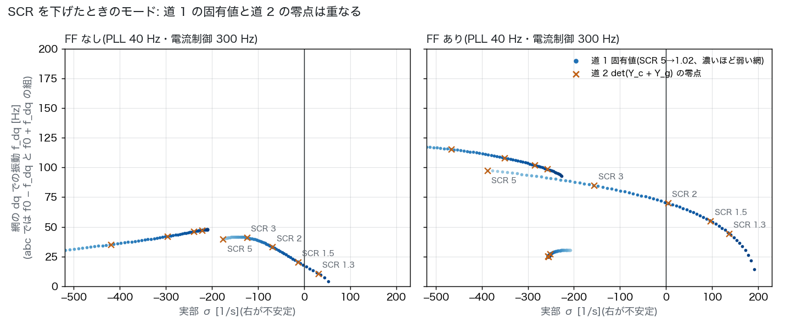
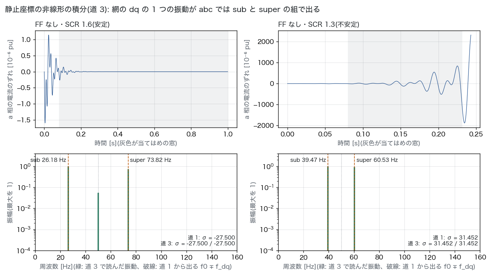
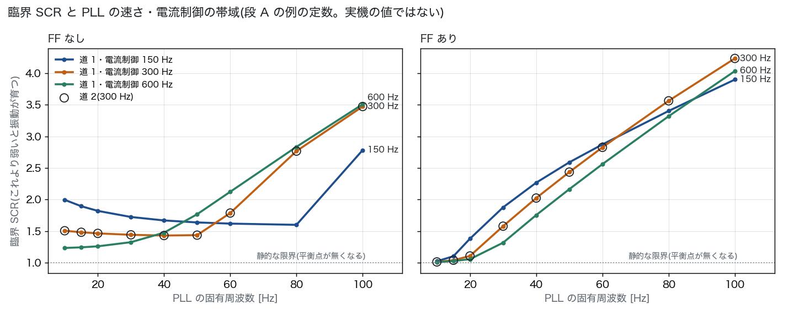

# インバータ起因の SSO 段 A: 1 台の模型と 3 つの道(2026-11-01)

## 経緯

- 10-31 の文献調査(`sso_ibr_literature_2026-10-31.md`)で、起こし方の道筋を段 A〜C に分けた。
- 「段 A から始めるか」という問いに、オーナーが「do」と答えた。この報告は段 A の結果である。
- 段 A の合格の条件(文献調査の報告に書いたもの):
  - 3 つの道で、振動の周波数と減衰がそろう。
  - abc の量で見たとき、sub の f と super の 2f0 − f が組で出る。
- 正典(`docs/data/built/`)には触れていない。網の模型はテブナン等価 1 つだけで、AGJ の網に当てるのは段 C。

## 要点

1. **3 つの道はそろった。** 安定 2 点・不安定 2 点の計 4 点で、合格の条件をすべて満たした(下の表)。
   - 道 1 と道 2 の差は相対で 1e-10 の桁。
   - 道 3 は周波数で 1e-3 Hz、減衰で 1e-2 [1/s] の桁で合う。
   - 右半面の極の数を偏角の原理で数えると、固有値で数えた数と同じになった。
2. **abc では組で出た。** 網の dq の 1 つの振動 f_dq が、abc では f0 − f_dq と f0 + f_dq に、同じ減衰で出る(`time.png`)。
   - 例: FF なし・SCR 1.3 では 39.47 Hz と 60.53 Hz で、和は 2f0 = 100 Hz。
   - f_dq が f0 を超えると、下の側は逆相の向きに回る。例: FF あり・SCR 1.8 では 15.15 Hz と 115.15 Hz。
3. **育つのは PLL のモード。** 臨界 SCR での危ないモードでは、どの定数でも PLL の角 δ の参加率が一番大きい(0.33〜0.41)。2 番目以降は場合で変わる(走査の表の「効く状態」)。
   - FF なしで PLL が遅いとき: PLL の積分 x_pll と、電流制御の積分 x_cc,d
   - PLL が速いとき: 電流の q 成分 i_Q
   - FF ありで PLL が 40〜50 Hz のとき: i_Q と、フィードフォワードの q 成分 v_ff,q
4. **臨界 SCR は、制御の定数で大きく変わる。** PLL の固有周波数を 10〜100 Hz で振ると、次の範囲になった(電流制御 300 Hz)。
   - FF なし: 1.43〜3.47。40 Hz 付近が一番低い U 字で、遅くしても速くしても上がる。
   - FF あり: 1.01〜4.24。PLL を速くするほど上がる。
5. **文献の要旨との突き合わせ**(結論ではなく、段 B で本文を読むときの手がかり):
   - **電流制御の帯域:** 効き方は PLL の速さで変わる(下の「臨界 SCR と電流制御の帯域」の表)。
     - PLL が遅い側(FF なしで 30 Hz 以下、FF ありで 60 Hz 以下)では、帯域を下げるほど臨界 SCR が上がる。PV2018 の要旨(電流制御の比例ゲインが小さいと危険が増す)と同じ向き。
     - PLL が速い側では順が崩れる。FF なしで 60 Hz 以上では逆向きで、帯域を下げると臨界 SCR が下がる。
   - **PLL の速さ:** 40 Hz より速い側で臨界 SCR が上がるのは、PV2018 の要旨の「PLL のゲインが大きいと和らぐ」とは逆向き。PV2018 には直流の側と外側の制御があり、定数も違う。どこから違いが出るかは、段 B で本文から確かめる。
   - **フィードフォワード:** 電圧のフィードフォワードの有無で臨界 SCR が変わるのは、PLLLOOP2019 の要旨(フィードフォワードと PLL の設計の組み合わせで安定余裕が変わる)と矛盾しない。
6. **言えないこと。**
   - 定数は道を確かめるための例で、実機の値ではない。
   - 次のものは模型に入っていない: 電流の制限、制御とPWMの遅れ、スイッチング、直流の側、外側の制御(P・Q・直流電圧)、LCL フィルタ。
   - 臨界 SCR の数字は、そのまま国内の設備に当てはめられない。

## 模型

系統追従型(GFL)インバータ 1 台を、網のテブナン等価(R + jX)につなぐ。dq の平均値模型で、状態は 8 個。

```
回路   (L_f + L_g) di/dt = v_c − v_g − (R_f + R_g) i − jω0 (L_f + L_g) i
       v_pcc = v_g + (R_g + jω0 L_g) i + L_g di/dt
PLL    v^c = v_pcc e^{−jδ}、 dδ/dt = K_p v^c_q + x_pll、 dx_pll/dt = K_i v^c_q
電流   v_c^c = K_p,cc (i_ref − i^c) + x_cc + jω0 L_f i^c + k_ff v_ff
       dx_cc/dt = K_i,cc (i_ref − i^c)、 T_ff dv_ff/dt = v^c − v_ff、 v_c = v_c^c e^{jδ}
```

- 単位はインバータの定格を基準にした pu で、時間は秒。網の dq は ω0 で回り、網の電圧を d 軸に置く。
- 電流の指令は一定にした(外側の制御は後で足す)。
- 定数(`src/dynamics/sso/gfl.py` の `GFLParams`):

| 量 | 値 | 決め方 |
|---|---|---|
| 定格周波数 f0 | 50 Hz | 東の系統。60 Hz でも同じ式で回る |
| フィルタ x_f / r_f | 0.15 / 0.005 pu | 例 |
| 網 | SCR を振る。X/R = 10 | \|Z_g\| = V_g² / SCR |
| 電流の指令 | i_d = 1 pu、i_q = 0 | 定格の電流で、無効電力は 0 |
| 電流制御 | 帯域 300 Hz(150・600 Hz も) | 内部モデル制御の規則 K_p = α L_f、K_i = α R_f(HARNEFORS1998) |
| PLL | 固有周波数 40 Hz(10〜100 Hz を振る)、ζ = 0.707 | s² + K_p s + K_i = s² + 2ζω_n s + ω_n² |
| フィードフォワード | FF なし(k_ff = 0)/ FF あり(k_ff = 1、T_ff = 1 ms) | 2 つの場合を並べる |

- 静的な限界(平衡点が無くなる SCR)は、電流 1 pu・X/R = 10 で約 0.995。それより上で振動が育ち始める点を、臨界 SCR と呼ぶ。

## 3 つの道

| 道 | 何をするか | 何と独立か |
|---|---|---|
| 道 1 状態空間 | 非線形の dq の式を平衡点で数値的に線形化し、A の固有値を出す | — |
| 道 2 アドミタンス | インバータの dq アドミタンス Y_c(s)(2×2)を周波数領域の式から手で組む。網の Y_g(s) と足した全体のアドミタンスの det の零点を出す(ADMIT2020)。右半面の零点の数は、偏角の原理で別に数える | 道 1 の A を使わない。零点の探索の種は、jω 軸の \|det\| の谷と粗い格子で、道 1 の固有値は使わない |
| 道 3 時間領域 | 静止座標(αβ)で、非線形のまま積分する(DOP853、許容誤差 1e-10)。PLL の角を 1e-6 rad ずらし、a 相の電流のずれを行列ペンシル法(HUA1990)で減衰する正弦に分ける | dq への変換をしない式で、線形化もしない。道 1・道 2 と共有するのは平衡点だけ。平衡点に置いたまま積分しても漂わない(テストで確かめる) |

- Y_c(s) の中では、PLL の座標への変換を線形化した項(Δx^c = e^{−jδ0}Δx − j x0^c Δδ)が、d と q をまたいで結び付ける。これが、文献でいう PLL による周波数の結合(BAKHSH2016・UNIFIED2017)の源になる。
- 道 2 では出ないモードが 1 つある。実軸のすぐそば(−10.46 [1/s])のモードで、電流制御の PI の零点(−R_f/L_f)とほぼ打ち消し合い、連系点からは見えない。比べるのは 0.5 Hz 以上の振動に限った。
- 偏角の原理は、零点が虚軸のすぐそばにあると数え違えうる。そのため臨界 SCR は零点の追跡で出し、偏角の原理は境の両側の確かめに使った。
- 道 3 は、振動が育つ場合も線形の範囲だけを読む。当てはめの窓は、a 相の電流のずれが 1e-3 pu を超える手前で切る(この模型には電流の制限が無いので、その先は物理的な意味を持たない)。

## 結果



- SCR を 5 から下げると、PLL のモードが右へ動き、虚軸を越える。動くにつれて周波数も変わる。
  - FF なし: SCR 1.43 で越える。そのときの f_dq は約 17 Hz で、abc では約 33 Hz と 67 Hz。
  - FF あり: SCR 2.02 で越える。f_dq は約 70.5 Hz で、abc では約 20.5 Hz(逆相の向き)と 120.5 Hz。
- 道 2 の零点(×)は、道 1 の固有値の上に乗る。



- 静止座標の積分(道 3)から読んだ振動は、道 1 から出る f0 ∓ f_dq に乗る。2 つの成分の減衰は同じ。
- 安定の側に出ている 50 Hz の小さな成分は、網の dq で振動しない(実の)モードが abc では f0 に出たもの。



<!-- 表:begin -->

### 4 つの点で 3 つの道を比べる

| 場合 | SCR | 道 1: σ [1/s] / f_dq [Hz] | 道 2: 相対誤差 | 道 3: sub [Hz] / σ | 道 3: super [Hz] / σ | 右半面の極(固有値 / 偏角) | 合否(1-2・1-3・組・極) |
|---|---|---|---|---|---|---|---|
| FF なし | 1.6 | -27.5000 / 23.8212 | 3e-10 | 26.1788 / -27.5001 | 73.8212 / -27.5000 | 0 / 0 | 合・合・合・合 |
| FF なし | 1.3 | 31.4525 / 10.5256 | 3e-10 | 39.4744 / 31.4524 | 60.5256 / 31.4522 | 2 / 2 | 合・合・合・合 |
| FF あり | 2.5 | -79.7179 / 78.7592 | 9e-11 | 28.7587 / -79.7141 | 128.7590 / -79.7155 | 0 / 0 | 合・合・合・合 |
| FF あり | 1.8 | 39.8818 / 65.1454 | 1e-11 | 15.1454 / 39.8818 | 115.1450 / 39.8818 | 2 / 2 | 合・合・合・合 |

### 臨界 SCR(電流制御 300 Hz)

| PLL [Hz] | FF なし: 道 1 | 道 2 | f_dq [Hz] | 効く状態 | FF あり: 道 1 | 道 2 | f_dq [Hz] | 効く状態 |
|---|---|---|---|---|---|---|---|---|
| 10 | 1.5053 | 1.5053 | 5.4 | δ 0.40・x_pll 0.32・x_cc,d 0.18 | 1.0111 | 1.0111 | 5.4 | δ 0.40・x_pll 0.32・i_D 0.19 |
| 15 | 1.4812 | 1.4812 | 7.3 | δ 0.41・x_pll 0.34・x_cc,d 0.16 | 1.0379 | 1.0379 | 11.9 | δ 0.40・x_pll 0.27・i_D 0.22 |
| 20 | 1.4636 | 1.4636 | 9.1 | δ 0.41・x_pll 0.35・x_cc,d 0.14 | 1.1058 | 1.1058 | 24.3 | δ 0.38・i_D 0.24・x_pll 0.19 |
| 30 | 1.4408 | 1.4408 | 12.9 | δ 0.41・x_pll 0.35・x_cc,d 0.11 | 1.5777 | 1.5777 | 53.9 | δ 0.33・i_Q 0.17・i_D 0.16 |
| 40 | 1.4295 | 1.4295 | 17.3 | δ 0.39・x_pll 0.34・i_D 0.12 | 2.0234 | 2.0234 | 70.5 | δ 0.33・i_Q 0.23・v_ff,q 0.13 |
| 50 | 1.4357 | 1.4357 | 24.1 | δ 0.37・x_pll 0.31・i_D 0.17 | 2.4349 | 2.4349 | 84.6 | δ 0.33・i_Q 0.27・v_ff,q 0.14 |
| 60 | 1.7861 | 1.7861 | 51.6 | δ 0.37・x_pll 0.24・i_Q 0.23 | 2.8265 | 2.8265 | 97.5 | δ 0.34・i_Q 0.29・x_pll 0.14 |
| 80 | 2.7673 | 2.7673 | 85.5 | δ 0.40・i_Q 0.31・x_pll 0.22 | 3.5642 | 3.5642 | 121.0 | δ 0.35・i_Q 0.32・x_pll 0.15 |
| 100 | 3.4740 | 3.4740 | 108.3 | δ 0.41・i_Q 0.32・x_pll 0.22 | 4.2359 | 4.2359 | 141.9 | δ 0.36・i_Q 0.32・x_pll 0.16 |

### 臨界 SCR と電流制御の帯域(道 1)

| PLL [Hz] | FF なし: 150 Hz | 300 Hz | 600 Hz | FF あり: 150 Hz | 300 Hz | 600 Hz |
|---|---|---|---|---|---|---|
| 10 | 1.9950 | 1.5053 | 1.2326 | 1.0213 | 1.0111 | 1.0077 |
| 15 | 1.8939 | 1.4812 | 1.2423 | 1.1015 | 1.0379 | 1.0256 |
| 20 | 1.8202 | 1.4636 | 1.2587 | 1.3791 | 1.1058 | 1.0549 |
| 30 | 1.7235 | 1.4408 | 1.3239 | 1.8760 | 1.5777 | 1.3157 |
| 40 | 1.6686 | 1.4295 | 1.4746 | 2.2669 | 2.0234 | 1.7532 |
| 50 | 1.6371 | 1.4357 | 1.7664 | 2.5897 | 2.4349 | 2.1640 |
| 60 | 1.6183 | 1.7861 | 2.1228 | 2.8728 | 2.8265 | 2.5605 |
| 80 | 1.5989 | 2.7673 | 2.8348 | 3.4035 | 3.5642 | 3.3198 |
| 100 | 2.7833 | 3.4740 | 3.5096 | 3.9009 | 4.2359 | 4.0358 |

- 効く状態は、臨界 SCR での危ないモードの参加率の上位 3 つ(δ と x_pll が PLL、i が電流、x_cc が電流制御の積分、v_ff がフィードフォワード)。

<!-- 表:end -->

## 次(段 B)

- 例題の候補(PV2018・WEAK4HZ2018・REAL20HZ2022)の本文を読み、定数がそろうものを選ぶ。要旨だけで決めない。
- 段 A の模型に、例題が持つものを足す: 制御の遅れ、外側の制御(P・Q・直流電圧)、直流の側、LCL フィルタ、電流の制限。足すたびに、3 つの道がそろうかを確かめ直す(テストに足す)。
- 公表の振動数と、ゲインを動かしたときの傾向を照らす。PLL の速さの向きが PV2018 の要旨と逆だった点は、ここで確かめる。
- 公開の道具 PowerSimulationsDynamics.jl(PSID2023)でも同じ例題を回す。
- 再現できなければ、段 C(AGJ の点に当てる)には進まない。

## 再現

```
python scripts/sso_stage_a.py               # 約 20 秒。図 3 枚・results.json・この報告の表
python -m pytest -q tests/test_sso_gfl.py   # 3 つの道がそろうことのテスト(約 3 秒)
```

- 模型と 3 つの道は `src/dynamics/sso/gfl.py`、行列ペンシル法は `src/dynamics/sso/pencil.py`。
- 数字はすべて `sso_ibr_stage_a_2026-11-01/results.json` にある。上の表はスクリプトが書き込む。

## 文献

- HARNEFORS1998: L. Harnefors, H.-P. Nee, "Model-based current control of AC machines using the internal model control method," IEEE Trans. Ind. Appl., 34(1), 133–141, 1998. doi:10.1109/28.658735
- HUA1990: Y. Hua, T. K. Sarkar, "Matrix pencil method for estimating parameters of exponentially damped/undamped sinusoids in noise," IEEE Trans. Acoust., Speech, Signal Process., 38(5), 814–824, 1990. doi:10.1109/29.56027
- 上の 2 本は、doi.org で書誌を確かめた(`sso_ibr_stage_a_2026-11-01/refs.bib`)。
- ほかの略号(ADMIT2020・BAKHSH2016・UNIFIED2017・PV2018・PLLLOOP2019・WEAK4HZ2018・REAL20HZ2022・PSID2023)は、`sso_ibr_literature_2026-10-31.md` の文献の表にある。
