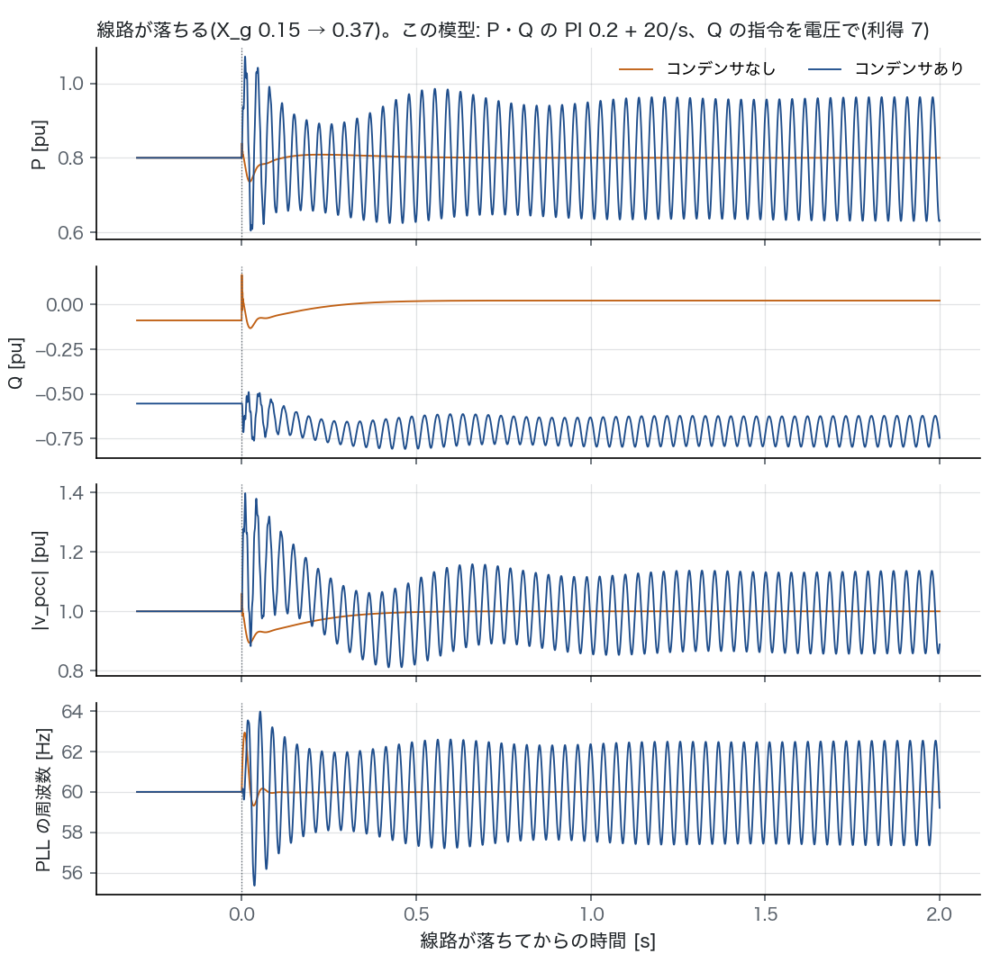
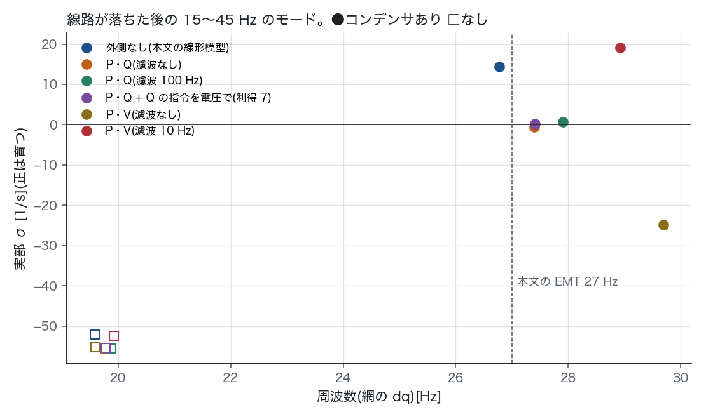
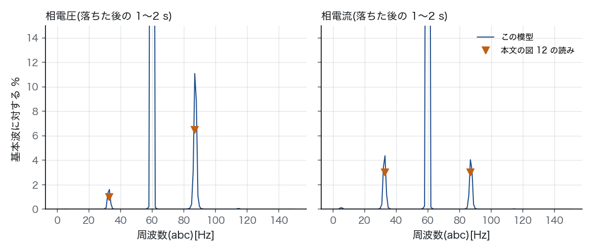

# インバータ起因の SSO 段 B の続き: Case 3 の EMT の 27 Hz を、運転点と外側の制御で解く(2026-11-01)

## 経緯

- 段 B(`sso_ibr_stage_b_2026-11-01.md`、PR #129)では、REAL20HZ2022 の Case 3 の臨界の i_d は本文と合った。一方、本文の EMT の 27 Hz は出なかった(i_q = 0 の臨界での振動は 17.6 Hz)。
- 段 B のマージのあと、オーナーが段 B の続きを「やって」と言った。候補は外側の制御と制限で、この報告はその結果である。
- 本文(OSTI 1897735 の著者版)の図 12・13 を画像で見て、運転点と波形を目で読んだ。読んだ値は `scripts/sso_stage_b2.py` の `PAPER` に 1 か所でまとめた。読みの幅は ±0.05 pu ほどある。
- 本文の PDF と図はコミットしない(IEEE の著作物)。使ったのは図から読んだ数字だけである。
- 正典(`docs/data/built/`)には触れていない。

## 要点

1. **27 Hz が出なかった原因は運転点だった。** 段 B では i_q = 0(Q ≈ 0)で解いた。本文の EMT では、インバータが無効電力を吸っている(図 13 の Q ≈ −0.55)。
   - 変電所のコンデンサ(0.99 pu)が出す無効電力を、インバータが打ち消している格好である。
   - 「電源 1 pu・PCC の電圧 1 pu・P 0.8」と置くと、Q は図 13 の 4 つの読み(コンデンサの有無 × 線路が落ちる前と後)と、どれも 0.03 以内で合った(表 1)。
   - この運転点では、本文の線形模型そのもの(外側の制御なし)で、線路が落ちた後のモードが 26.8 Hz になる。コンデンサがあれば育ち(σ +14.4)、なければ育たない。本文の図 13 と同じ向きである。
   - 道 1 と道 2 は、i_q ≠ 0 のこの点でも 7 つのモードの全部で一致した(相対差 1.2e-9、表 6)。本文の式の −i_q G1I の項まで正しく組めている。
2. **外側の制御(本文の PI 0.2 + 20/s)を足すと、モードは σ ≈ 0 に寄る。**
   - P と Q を指令に保つ形(測る量は濾波しない)では、σ −0.52・27.40 Hz で、ほとんど減衰しない(表 2)。本文の「27 Hz の振動が続く」と合う。
   - P を 0.7〜0.9 に振っても、σ は −0.7〜−0.2、周波数は 26.3〜28.5 Hz に収まる(表 3)。図の読みの幅に左右されない。
   - 外側の制御の形を変えると、結果は大きく変わる(表 2、`modes.png`)。
     - 電圧を PI で直接保つ形(P・V)にすると、濾波なしでは σ −24.8・29.7 Hz と強く減衰する。濾波 10 Hz では σ +19.1・28.9 Hz と強く育つ。
     - Q の指令を一定にすると、落ちた後の PCC の電圧が 1.245 pu になり、図 13(約 1.0)と合わない。
3. **線路が落ちる場面を非線形で解くと、本文の図 13 とよく似る(`trip.png`、表 4)。** 図の Q と電圧のゆっくりした動きを説明するため、「Q の指令を PCC の電圧の積分でゆっくり動かす」形を仮説として足した。
   - 図 13 の Q の動きは、コンデンサありで −0.55 → −0.7、なしで −0.1 → 0 である。
   - 利得 7 は、コンデンサなしで電圧が約 0.4 s で 1 pu に戻る図の動きに合わせた。
   - 結果: 27.0 Hz の振動が 2 s 続き、ほぼ一定の振幅で落ち着く(リミットサイクル)。
   - 平均は P 0.80・Q −0.70・|v_pcc| 1.00 で、図と同じ。コンデンサなしでは振動しない。
   - 相電流は 33 Hz と 87 Hz(60 ∓ 27)が同じくらいの大きさで、相電圧は 87 Hz が主だった(表 5、`spectrum.png`)。本文の図 12 と同じ形である。
4. **振幅は合わない。** P の振幅は ±0.10〜0.26(利得 5〜10)で、図 13 の読み ±0.07 の 1.4〜3.7 倍になる。
   - 線形の σ が 0 のすぐそば(−0.7〜+0.9、表 2・3)にあるので、リミットサイクルの大きさは細部で大きく変わる。細部とは、濾波・利得・測り方である。
   - 本文の図の P や V_PLL が、測る器械の濾波を通っているかは本文に書いていない。
5. **制限だけでは、図のような小さい持続振動にならなかった。**
   - 強く育つ形(P・V、濾波 10 Hz)は、制限が無いと線路が落ちて 0.28 s で発散した。
   - 電流 1.1 pu・電圧の指令 1.2 pu・PLL の周波数 ±5 Hz のどれを入れても発散は止まる。ただし振幅は図の 8〜29 倍だった(表 4)。
   - 本文の EMT は PLL の制限を入れていない(本文 IV-C の Remarks)。図の振動は「強く不安定なモードを制限で抑えたもの」ではなく、「σ がほぼ 0 のモード」と読むのが筋である。

## 模型に足したもの

`src/dynamics/sso/gfl_pr.py`(段 B の模型)に、選んで入れられる形で足した。既定はすべて「入れない」なので、段 B の結果は変わらない(段 B のテスト 12 本はそのまま通る)。

| 項目 | 引数 | 中身 | 出どころ |
|---|---|---|---|
| 外側の制御 | `outer="pq"` / `"pv"`、`kp_o` 0.2、`ki_o` 20 | P と Q(または \|v_pcc\|)を PI で指令に保ち、i_d*・i_q* を出す | 本文 II-A・図 4「0.2 + 20/s」。P・V の形はこちらの比べるための案 |
| 測る量の濾波 | `f_meas`(0 は濾波しない) | P・Q・\|v_pcc\| の 1 次の濾波器 | 本文に書いていない。0 のときは、v_pcc が指令によるので代数ループを解く(2 変数のニュートン法) |
| Q の指令をゆっくり | `kv_q` | dQ*/dt = kv_q (1 − \|v_pcc\|) | 仮説。図 13 の Q と電圧の動きを説明するため。利得は図に合わせた |
| 電流の制限 | `i_max` | \|i_d* + j i_q*\| を上限で縮める | 比べるため。本文の EMT の電流の制限は書いていない |
| 電圧の制限 | `v_max` | 遅れに入る前の電圧の指令の大きさ(変調の飽和)。u + β sat(u) = K を閉じた形で解く | 比べるため |
| PLL の周波数の制限 | `df_max` | PLL の周波数の偏差を上限で止め、外へ向かう積分を止める | 本文 IV-C の Remarks が挙げる制限(本文の EMT には無い) |
| 運転点 | `at_source(p, P, v_g)` | 電源の電圧 v_g・PCC の電圧・P から i_d・i_q を解く | 図 13 の読み |
| 場面 | `simulate_event(p_pre, p_post, …)` | 静止座標で非線形のまま積分し、途中で網を切り替える | — |

- 制限は平衡点では効かない値にする。線形化(道 1)は制限の無い模型のままである(テストで確かめた)。
- 道 2(本文の線形模型)は外側の制御を入れない。外側を入れたときは道 1 と道 3 で確かめた(表 6、周波数の差 2.5e-6 Hz 以下・σ の差 2.6e-5 以下)。

## 結果

線路が落ちる場面を、この模型で解いた。外側の制御は P・Q の PI 0.2 + 20/s で、Q の指令は電圧で動かす(利得 7)。量は本文の図 13 と同じものを並べた。



落ちた後のモードが、外側の制御の形でどこへ行くかを示す。



落ちた後の 1〜2 s の相電圧と相電流のスペクトル。▼は本文の図 12 から目で読んだ値。



<!-- 表:begin -->

**表 1 運転点**(電源 1 pu・|v_pcc| 1 pu・P 0.8 と置いたときの Q と、本文の図 13 の読み)

| コンデンサ | 線路 | i_d | i_q | Q(計算) | Q(図 13 の読み) | 一番右のモード σ [1/s] / f [Hz] |
|---|---|---|---|---|---|---|
| あり | 落ちる前 | 0.793 | 0.567 | -0.554 | -0.55 | -30.83 / 94.01 |
| あり | 落ちた後 | 0.791 | 0.721 | -0.707 | -0.70 | 14.41 / 26.77 |
| なし | 落ちる前 | 0.800 | 0.102 | -0.089 | -0.10 | -59.59 / 20.27 |
| なし | 落ちた後 | 0.801 | -0.009 | 0.022 | 0.00 | -52.08 / 19.58 |

**表 2 落ちた後の 15〜45 Hz のモード**(σ [1/s] / f [Hz]。外側の制御の形を変える)

| 外側の制御 | コンデンサあり | なし | 落ちる前の一番右の σ |
|---|---|---|---|
| 外側なし(本文の線形模型) | 14.41 / 26.77 | -52.08 / 19.58 | -14.44 |
| P・Q(濾波なし) | -0.52 / 27.40 | -55.55 / 19.77 | -12.18 |
| P・Q(濾波 100 Hz) | 0.74 / 27.91 | -55.57 / 19.88 | -12.33 |
| P・Q + Q の指令を電圧で(利得 7) | 0.28 / 27.41 | -55.47 / 19.77 | -5.69 |
| P・V(濾波なし) | -24.80 / 29.69 | -55.26 / 19.59 | -7.17 |
| P・V(濾波 10 Hz) | 19.09 / 28.92 | -52.40 / 19.92 | -8.12 |

**表 3 P の読みの幅**(コンデンサあり、落ちた後。σ / f)

| P | Q | 外側なし | P・Q(濾波なし) | P・Q(濾波 100 Hz) | P・Q + 電圧で Q |
|---|---|---|---|---|---|
| 0.70 | -0.730 | 13.60 / 27.71 | -0.70 / 28.49 | 0.91 / 28.98 | 0.10 / 28.50 |
| 0.75 | -0.719 | 13.99 / 27.24 | -0.64 / 27.95 | 0.80 / 28.45 | 0.16 / 27.96 |
| 0.80 | -0.707 | 14.41 / 26.77 | -0.52 / 27.40 | 0.74 / 27.91 | 0.28 / 27.41 |
| 0.85 | -0.694 | 14.84 / 26.31 | -0.36 / 26.85 | 0.72 / 27.37 | 0.44 / 26.87 |
| 0.90 | -0.679 | 15.29 / 25.84 | -0.18 / 26.30 | 0.72 / 26.82 | 0.62 / 26.32 |

**表 4 線路が落ちる場面(非線形)**。前半は落ちて 0.05〜0.55 s、後半は 1〜2 s。振幅は片側

| 場合 | コンデンサ | 後半の P | 振幅 | 周波数 [Hz] | 後半の Q | 後半の |v_pcc| | 振幅 | PLL の周波数の振幅 [Hz] | 前半の P の振幅 |
|---|---|---|---|---|---|---|---|---|---|
| P・Q + Q の指令を電圧で(利得 7) | あり | 0.799 | 0.167 | 27.0 | -0.702 | 0.998 | 0.142 | 2.59 | 0.184 |
| P・Q + Q の指令を電圧で(利得 7) | なし | 0.800 | 0.000 | — | 0.022 | 1.000 | 0.000 | 0.00 | 0.014 |
| 同(利得 5) | あり | 0.798 | 0.101 | 27.0 | -0.706 | 0.998 | 0.088 | 1.56 | 0.177 |
| 同(利得 10) | あり | 0.801 | 0.260 | 27.0 | -0.695 | 1.001 | 0.216 | 4.02 | 0.254 |
| P・Q(Q の指令は一定) | あり | 0.800 | 0.000 | — | -0.554 | 1.245 | 0.000 | 0.00 | 0.159 |
| P・V(濾波 10 Hz)・制限なし | あり | 発散(落ちて 0.28 s) |  |  |  |  |  |  |  |
| P・V(濾波 10 Hz)・電流 1.1 pu | あり | 0.539 | 1.691 | 24.0 | -0.379 | 1.196 | 0.909 | 20.03 | 1.795 |
| P・V(濾波 10 Hz)・電圧の指令 1.2 pu | あり | 0.675 | 2.020 | 3.0 | 0.456 | 1.074 | 0.253 | 3.80 | 2.397 |
| P・V(濾波 10 Hz)・PLL の周波数 ±5 Hz | あり | 0.801 | 0.589 | 29.0 | -0.673 | 1.001 | 0.400 | 5.00 | 0.599 |

本文の図 13(2.5〜4 s)の読み: P 0.8 ± 0.07、Q −0.7、V_PLL 1.0 ± 0.05、周波数 ± 1 Hz、27 Hz(本文)。

**表 5 相電流・相電圧の 33 Hz と 87 Hz**(基本波の %)

| | この模型 33 Hz | 87 Hz | 本文の図 12 の読み 33 Hz | 87 Hz |
|---|---|---|---|---|
| 相電圧 | 1.6 | 11.1 | 1 | 6.5 |
| 相電流 | 4.4 | 4.1 | 3 | 3 |

**表 6 道のそろい**(落ちた後・コンデンサあり。道 1-2 は全モード、道 1-3 は 15〜45 Hz のモード)

| 外側の制御 | 道 | 結果 | 合格 |
|---|---|---|---|
| 外側なし | 1-2 | 固有値 7 個・零点 7 個・相対差の最大 1.2e-09 | ○ |
| P・Q(濾波なし) | 1-3 | -0.52 / 27.40 Hz、周波数の差 2.5e-06 Hz・σ の差 2.6e-05 | ○ |
| P・Q(濾波 100 Hz) | 1-3 | 0.74 / 27.91 Hz、周波数の差 1.4e-06 Hz・σ の差 3.1e-06 | ○ |
| P・Q + Q の指令を電圧で(利得 7) | 1-3 | 0.28 / 27.41 Hz、周波数の差 2.3e-06 Hz・σ の差 2.3e-05 | ○ |

<!-- 表:end -->

## 読み方の注意

- **仮説が 3 つある。** どれも本文には書いていない。
  - 運転点: 電源 1 pu・PCC の電圧 1 pu。Q の 4 つの読みと合うことが根拠である。
  - 外側の無効電力の形: P・Q の PI に、電圧で Q の指令をゆっくり動かす仕組みが付いている。
  - 測る量の濾波: 無し。
- **合ったのは平均と周波数と山の形で、振幅は合っていない。** 「本文の EMT を再現した」とは言わず、「27 Hz の出どころ(運転点)と、振動が続く理由(σ ≈ 0)を説明できた」と言う。
- 図からの読みは目分量で、±0.05 pu ほどの幅がある。P の読み(0.8)の幅は表 3 で振った。

## 次

- 段 B の残り(Case 1 の K_p・PV2018・WEAK4HZ2018 の本文・直流の側・PSID.jl)は変わらない。
- 振幅まで合わせるには、本文の EMT の外側の制御と測る器械の中身が要る。著者の模型が公開されていれば照合する。
- 段 C(`short_circuit.py` の SCR で臨界の地図)では、運転点(特に Q)で答えが大きく変わることを前提にする。
  - 落ちた後・P 0.8 で、Q を 0 から −0.71 にするだけで、モードは σ −17.9・19.5 Hz から σ +14.4・26.8 Hz へ動く(外側の制御なし)。
  - 地図は「力率ごと」に分けて描く。

## 再現

```
python scripts/sso_stage_b2.py                    # 約 60 秒。図 3 枚・results.json・この報告の表
python -m pytest -q tests/test_sso_pr_outer.py     # 外側の制御・制限・運転点・27 Hz のテスト
```

- 数字はすべて `sso_ibr_stage_b2_2026-11-01/results.json` にある。上の表はスクリプトが書き込む。
- 図から読んだ値は `scripts/sso_stage_b2.py` の `PAPER` に、図の番号を添えて 1 か所に置いた。

## 文献

- REAL20HZ2022: L. Fan ほか、IEEE Trans. Energy Convers. 37(4), 2863–2873, 2022. doi:10.1109/tec.2022.3206795(書誌は `sso_ibr_stage_b_2026-11-01/refs.bib`)。
  - 図 4(外側の制御 0.2 + 20/s)、IV-C(Case 3 の本文・図 12・13、PLL の制限が無いこと)を使った。
