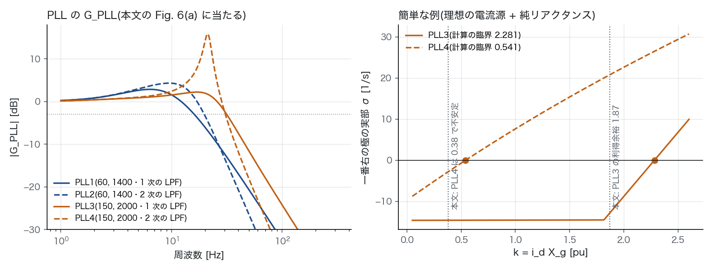
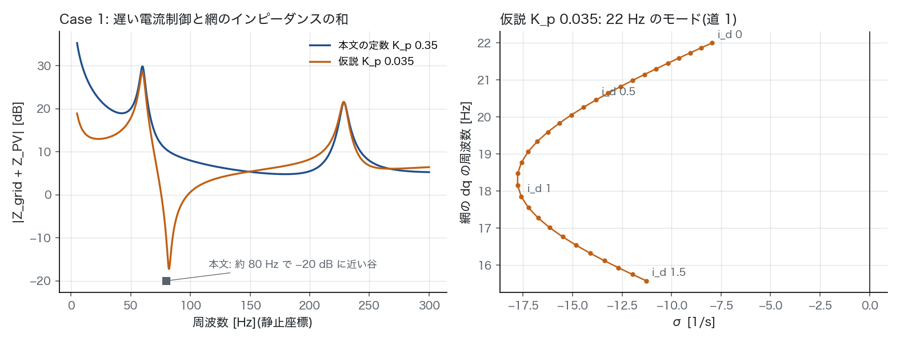
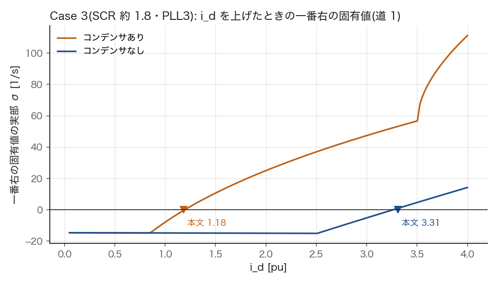
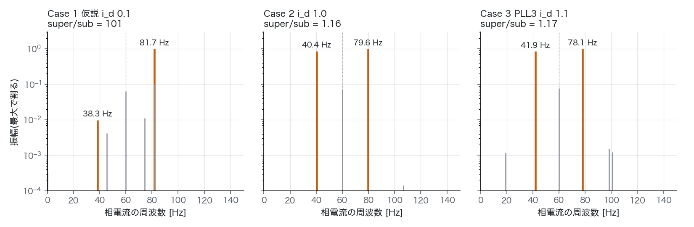

# インバータ起因の SSO 段 B: 公表例を本文の定数で解く(2026-11-01)

## 経緯

- 段 A(`sso_ibr_stage_a_2026-11-01.md`、PR #128)のマージのあと、オーナーが「やってみて検証してみて」と言った。この報告は段 B の結果である。
- 段 B は、公表例を本文の定数で解き、本文の数字と突き合わせる段。通らなければ先(段 C、AGJ の網)に進まない(`sso_ibr_literature_2026-10-31.md`)。
- 候補は 3 本あった。無料で本文を読めたのは REAL20HZ2022 だけだった。
  - REAL20HZ2022: OSTI 1897735 の著者版。OSTI に直接つながらず、Internet Archive の写し(2025-02-08)から取った。
  - PV2018(IET RPG)と WEAK4HZ2018(IEEE TPWRS): 出版社の版だけで、OpenAlex と Semantic Scholar でも無料の版は無かった。段 A で残した「PLL の速さの向きが PV2018 の要旨と逆」は、まだ確かめられていない。
- 本文の PDF はコミットしない(IEEE の著作物)。使ったのは定数と数字だけで、節の番号を添えた。
- 正典(`docs/data/built/`)には触れていない。

## 要点

1. **3 つの道はここでもそろった。** 5 つの点の全部で、次のとおり一致した(表 6)。
   - 道 1(状態空間の固有値)と道 2(論文の線形模型の零点)は、0.5〜200 Hz のモードの数が同じで、差は相対 1e-9 以下。
   - 道 3(静止座標の非線形の積分)は、周波数 1e-4 Hz・σ 1e-3 [1/s] の桁で道 1 と合う。
   - 相電流の super と sub の振幅の比も、道 1 の固有ベクトルから出した比と 1% 以内で合う。
   - 論文の線形模型(本文の式 (4)〜(15))は、外側の制御を除けば、状態空間の模型の厳密な線形化と同じだった。
2. **本文と合ったもの。**
   - **Case 2(PLL の減衰の不足):** 全部合った。
     - PLL の極は −7.06 ± j132.1 で、本文の −7 ± j132 と同じ。
     - 約 20 Hz(網の dq)のモードがある(i_d 0.1 で σ −6.8・20.9 Hz)。
     - 出力を上げると悪くなる。
     - 遅い PLL や 1 次の LPF にすると、ずっと安定になる(表 4)。
     - 相電流の 40 Hz と 80 Hz が同じくらいの大きさ(super/sub = 1.16、`signature.png`)。
   - **Case 3(PLL とコンデンサの相互作用):** 臨界の i_d が、PLL3 のとき 1.193(コンデンサあり)と 3.261(なし)。本文の 1.18 と 3.31 に、1% と 1.5% の差で合う(表 5、`case3.png`)。
     - 本文は Case 3 の PLL を「1 次の LPF の PLL」としか書いていない。ほかの 1 次の候補(Case 1 の式、PLL1)では 1.75 / 4.17、2.48 / 5.07 と大きくずれる。なので本文の III-B の PLL3 だと読んだ。
     - PCC の電圧を 0.95〜1.05 pu で動かしても、1.18〜1.21 と 3.24〜3.28 に収まる。
     - コンデンサがあると、G1 の山が 98 Hz に来る(本文「100 Hz」)。
   - **PLL の帯域:** PLL1 は 16.1 Hz、PLL2 は 19.8 Hz で、本文の 16 Hz・20 Hz と合う。
3. **本文と合わなかったもの。** 書いてある定数から、本文の数字が出ないところが 3 つある。
   - **(a) Case 1 の PLL の極:** 本文の式(100 + 2000/s・1 次の LPF)からは −65.8 ± j89.6 が出る。本文の −47 ± j80 は、PLL2(60, 1400・2 次の LPF)の極 −47.06 ± j80.03 とぴったり同じ。
   - **(b) 簡単な例の臨界:** 本文は PLL4 が 0.38・23 Hz、PLL3 の利得余裕が 1.87。計算では 0.541・20.3 Hz と 2.28・23.4 Hz になった(表 2、`pll.png`)。
     - 符号の取り方、50 Hz、LPF の定数の読み違いなど、もっともらしい読み違いの 6 通りを試したが、2 つを同時に説明できるものは無かった。
     - 計算は、非線形の積分と 1e-7 の桁で合う。だから式の解き違いではない。
     - 「2 次の LPF の PLL4 は PLL3 よりずっと不安定になりやすく、振動は G_PLL の山の 20 Hz 付近」という本文の主旨は成り立つ。
     - 同じ節の PLL3・PLL4 の帯域(本文 33 Hz、計算 31.5・30.6 Hz)も少しずれる。
   - **(c) Case 1(遅い電流制御):** 本文の定数(K_p 0.35・K_r 2・200 µs)では、本文の特徴が 1 つも出ない(表 3、`case1.png`)。
     - |Z_grid + Z_PV| の一番低いところは 179 Hz で +4.8 dB。本文の「80 Hz 付近で −20 dB に近い谷」は無い。
     - 15〜30 Hz(網の dq)のモードも無い。
4. **Case 1 の仮説: K_p は 0.035 の書き違いらしい。** 電流制御の比例ゲインだけを本文の 1/10 にすると、本文の Case 1 の特徴が 5 つともそろう。
   - 82.1 Hz で −17 dB の谷
   - 網の dq で 21.7 Hz のモード(i_d 0.1 で σ −9.1)
   - 相電流は 82 Hz が主で、38 Hz の約 100 倍(本文「82 Hz が主」)
   - i_d を上げると左へ動く(0.1 → 1.0 で σ −9.1 → −17.6。本文「出力が低いほど悪い」)
   - コンデンサの有無でほとんど変わらない。また、速い制御にするとこのモードは出ない
   
   K_r も 1/10 にすると崩れる。確定ではなく、一番もっともらしい読みとして置く。確かめるには著者の版の Simulink の模型か、出版社の版の定数の表を見る必要がある。
5. **言えないこと。**
   - Case 3 の 27 Hz(本文の EMT)は出ていない。臨界での振動は 17.6 Hz で、i_d を上げるほど下がる(0.6 で 20.3 Hz、2.0 で 13.6 Hz、3.0 で 7.6 Hz)。
     - 動きの向きは本文の root locus の説明と同じ。PLL の極が右へ動き、G1R の極(38〜48 Hz)は左へ動く(i_d 0.3 → 3.0 で σ −39 → −107)。
     - 本文の EMT は、外側の制御(0.2 + 20/s)と、10% を超える大きな振れ(非線形の範囲)を含む。どの出力の水準かも書かれていない。
   - 模型に外側の制御・電流の制限・PLL の周波数の制限は入っていない。本文の EMT にも制限は入っていない(本文の結びの節)。
   - 試験系統の定数は Hydro One の 44 kV フィーダの集約で、インバータの制御は著者の仮定(本文「none of the authors has information regarding any solar PV inverter's control information」)。

## 模型

本文の Fig. 4 の試験系統。太陽光 3 か所(計 30 MW)を 1 台に集約し、30 MVA を基準にする。

```
回路   v ─ チョーク (R 0.015, X 0.15) ─ PCC ─ 44 kV フィーダ (0.0651 + j0.1805)
         ─ 変電所の母線(コンデンサ 29.6 MVAr = 0.987 pu)─ 電源 (0.007 + j0.0698) ─ 無限大母線
電流   v = T_d(s) [v_pcc + PR(s)(i* − i)]   (静止座標。PCC 電圧のフィードフォワードつき)
       PR(s) = K_p + K_r 2ω_c s/(s² + 2ω_c s + ω1²)、ω_c = 2π·2、T_d は Padé 1 次
PLL    v_q = Im(v_pcc e^{−jθ}) → LPF(1 次か 2 次、ω_n = 2π·25、ζ 0.707)→ (K_p + K_i/s) → ω
指令   i* = (i_d + j i_q) e^{jθ}(PLL の座標で一定。外側の制御は本文の線形模型と同じく入れない)
```

| 場合 | 電流制御 K_p, K_r | 遅れ τ | PLL K_p, K_i・LPF | 網 |
|---|---|---|---|---|
| Case 1 | 0.35, 2(遅い) | 200 µs | 100, 2000・1 次 | SCR 4・コンデンサあり |
| Case 1 の比べる制御 | 1, 10(速い) | 100 µs | 同上 | 同上 |
| Case 2 | 1, 10 | 50 µs | 150, 3000・2 次(式 (19)) | 同上 |
| Case 3 | 1, 10 | 50 µs | 1 次(本文は定数を書かず、PLL3 = 150, 2000 と読んだ) | X_g 0.37、R_g = X_g/8(線路が 1 本落ちた後。SCR 約 1.8) |

- 平衡点は、PCC の電圧の大きさを 1 pu に合わせて、無限大母線の電圧をそこから決める。本文の線形模型が G_PLL を |v_pcc| = 1 で書いているため。
- i_d は PLL の座標の電流の指令。本文の root locus の利得(本文の式 (13)(15))に当たる。
- 状態はコンデンサありで 15〜16 個。電流、コンデンサの電圧、電源の電流、PR の 2 つ、遅れ(以上は各 dq)、LPF、PLL の積分、δ。コンデンサなしでは電圧と電源の電流が無くなり、11〜12 個。
- 模型は `src/dynamics/sso/gfl_pr.py`。段 A の `gfl.py`(dq の PI 電流制御)とは別の制御の形。

## 3 つの道

| 道 | やり方 | 段 A との違い |
|---|---|---|
| 1 状態空間 | 網の dq(ω1 で回る)の非線形の常微分方程式を平衡点で数値的に線形化し、固有値を出す。静止座標の線形の部分(PR・遅れ・回路)は −jω1 を足して dq に移す | 同じ |
| 2 論文の線形模型 | 本文の式 (4)(5)(8)(10)(14)(15)。静止座標の G1(s) = Z_grid Z*_PV/(Z_grid + Z_PV) から G1R(s) = [G1(s + jω1) + G1(s − jω1)]/2 を作り、1 − G_PLL (i_d G1R − i_q G1I) = 0 の零点を割線法で探す | 段 A は 2×2 のアドミタンスの det。ここは論文の SISO の式そのもの |
| 3 時間領域 | 静止座標で非線形のまま積分し、a 相の電流のずれを行列ペンシル法で読む。段 A の `simulate` と同じ読み方 | 同じ |

- 道 2 の零点探しでは、関数に PLL の分母と G1 の分母 D(s ± jω1) を掛けて、極の無い形にした。
  - そうしないと、PLL との結び付きが弱いモードを取り逃がす(PR の 118.8 Hz、コンデンサの 166.6 Hz、遅れの 60 Hz)。零点が G1R の極のすぐそばにあり、割線法が収束しないため。
  - 極の無い形にしてから、道 1 と道 2 のモードの数が全部の点で同じになった。
- 道 2 は道 1 の固有値を種に使わない。jω 軸の谷と、1 Hz おきの格子から始める。
- 道 3 の super/sub の振幅の比は、道 1 の固有ベクトルの電流の成分 (v_d, v_q) からも出せる: |v_d + j v_q| / |v_d − j v_q|。本文が「しるし」と呼ぶ違い(Case 1 は super が主、Case 2・3 は同じくらい)を、2 つの道で確かめられる。
- 本文 III-B の簡単な例(理想の電流源 + 純リアクタンス)も、同じ模型に関数で置いた。
  - PCC の電圧を 1 に保つと、本文の開ループ −i_d (s X_g/ω1) G_PLL は厳密な線形化になる。
  - 線形の答えを非線形の積分で確かめた(表 2 の右の列)。

## 結果









<!-- 表:begin -->

**表 1 PLL(本文 III-B と IV)**

| PLL | K_p, K_i | LPF | 帯域(計算)| 帯域(本文)| 閉ループの極(計算)|
|---|---|---|---|---|---|
| PLL1 | 60, 1400 | 1 次 | 16.1 Hz | 16 Hz | -47.19 ± j35.78 |
| PLL2 | 60, 1400 | 2 次 | 19.8 Hz | 20 Hz | -47.06 ± j80.03 |
| PLL3 | 150, 2000 | 1 次 | 31.5 Hz | 33 Hz | -71.23 ± j128.08 |
| PLL4 | 150, 2000 | 2 次 | 30.6 Hz | 33 Hz | -9.71 ± j133.80 |
| Case 1 の式 | 100, 2000 | 1 次 | 23.8 Hz |  | -65.83 ± j89.60 |
| Case 2 の式 (19) | 150, 3000 | 2 次 | 30.6 Hz |  | -7.06 ± j132.13 |

本文の極: Case 1 は −47 ± j80(約 13 Hz)、Case 2 は −7 ± j132。

**表 2 簡単な例の臨界(本文 III-B)**

| PLL | 臨界の k = i_d X_g(計算)| 振動 | 本文 | 非線形の積分との差(臨界の ±5% で σ [1/s] と f [Hz] の大きい方)|
|---|---|---|---|---|
| PLL3 | 2.2812 | 23.42 Hz | 利得余裕 1.87 | 7.9e-08 |
| PLL4 | 0.5409 | 20.35 Hz | k 0.38・23 Hz | 7.7e-09 |

**表 3 Case 1(遅い電流制御、i_d は PLL の座標の電流の指令)**

| 定数 | Z_grid+Z_PV の谷 | 15〜30 Hz のモード σ / f(i_d 0・0.1・0.5・1.0)| コンデンサなし(i_d 0.1)| PLL2 にしたとき |
|---|---|---|---|---|
| 本文の定数 K_p 0.35 | 4.8 dB @ 179.3 Hz | —・—・—・— | — | — |
| 仮説 K_p 0.035 | -17.3 dB @ 82.1 Hz | -7.96 / 22.00 Hz・-9.06 / 21.73 Hz・-13.82 / 20.46 Hz・-17.60 / 17.85 Hz | -9.83 / 21.77 Hz | -9.19 / 22.07 Hz |

速い制御(本文の K_p 1・K_r 10・100 µs)の 15〜30 Hz のモード: —。

**表 4 Case 2(速い電流制御・50 µs)**

| PLL | 5〜60 Hz のモード σ / f(i_d 0.1・0.5・1.0)| 臨界の i_d |
|---|---|---|
| 本文の式 (19)(速い PLL・2 次の LPF) | -6.82 / 20.89 Hz・-5.83 / 20.32 Hz・-4.48 / 19.60 Hz | 2.466 |
| 遅い PLL(60, 1400・2 次の LPF) | -46.85 / 12.56 Hz・-45.68 / 11.83 Hz・-43.34 / 10.91 Hz | — |
| 式 (19) の LPF を 1 次に | -65.85 / 20.05 Hz・-61.16 / 19.76 Hz・-55.38 / 19.38 Hz | — |

**表 5 Case 3 の臨界の i_d(本文: コンデンサあり 1.18・なし 3.31)**

| PLL(1 次の LPF)| コンデンサあり | コンデンサなし |
|---|---|---|
| Case 1 の式 (100, 2000) | 1.747(12.4 Hz) | 4.170(10.5 Hz) |
| PLL1 (60, 1400) | 2.476(7.2 Hz) | 5.065(5.7 Hz) |
| PLL3 (150, 2000) | 1.193(17.6 Hz) | 3.261(16.0 Hz) |

PLL3 で PCC の電圧を 0.95 / 1.05 pu にすると: コンデンサあり 1.206 / 1.180、なし 3.237 / 3.284。道 2 で出した臨界: あり 1.1932(道 1 1.1932)、なし 3.2610(道 1 3.2610)。

**表 6 3 つの道**

| 点 | モードの数(道 1 / 道 2、0.5〜200 Hz)| 道 1–2 の差(相対の最大)| 道 1: σ / f_dq / super÷sub | 道 3: sub・super の周波数と σ / super÷sub | 合否 |
|---|---|---|---|---|---|
| Case 1 本文の定数 i_d 0.1 | 5 / 5 | 2.5e-10 | — | — | 合 |
| Case 1 仮説 i_d 0.1 | 6 / 6 | 1.2e-10 | -9.0562 / 21.7317 Hz / 101.3 | 38.2683 Hz -9.0562・81.7316 Hz -9.0567 / 101.2 | 合 |
| Case 2 i_d 1.0 | 6 / 6 | 6.8e-10 | -4.4836 / 19.6009 Hz / 1.157 | 40.3992 Hz -4.4836・79.6009 Hz -4.4836 / 1.157 | 合 |
| Case 3 PLL3 i_d 1.1 | 7 / 7 | 1.8e-10 | -3.6685 / 18.0734 Hz / 1.171 | 41.9266 Hz -3.6685・78.0734 Hz -3.6685 / 1.171 | 合 |
| Case 3 PLL3 i_d 1.3 | 7 / 7 | 8.7e-10 | 3.9375 / 17.1050 Hz / 1.156 | 42.8950 Hz 3.9375・77.1050 Hz 3.9375 / 1.156 | 合 |

<!-- 表:end -->

## 次(段 C の前に)

- **Case 1 の仮説:** 出版社の版の本文、または著者の公開の模型で、遅い制御の K_p を確かめる。確かめられるまでは、Case 1 を「再現した」とは言わない。
- **PV2018・WEAK4HZ2018:** 本文が読めれば、段 A の「PLL の速さの向き」の食い違いを確かめる。読めない間は、REAL20HZ2022 の Case 2・3 だけを段 B の合格の根拠にする。
- **段 C:** `short_circuit.py` の SCR で、臨界の地図を作る。ただし制御の定数が非公開なので、予言はできない。
- **模型に足す候補:**
  - 外側の制御(本文の 0.2 + 20/s)
  - 電流と PLL の周波数の制限
  - 直流の側(WEAK4HZ2018 の Type 4)
- PSID.jl での照合は、まだしていない。

### 追記(2026-11-01): Case 3 の 27 Hz の出どころ

- 上の「Case 3 の 27 Hz(本文の EMT)は出ていない」は、この報告の運転点(i_q = 0)での話である。
- 本文の図 13 では、インバータが無効電力を吸っている(Q ≈ −0.55)。「電源 1 pu・PCC の電圧 1 pu・P 0.8」と置くと、Q は図の 4 つの読みと 0.03 以内で合った。本文の線形模型のままでも、線路が落ちた後のモードは 26.8 Hz になる。
- 外側の制御(本文の 0.2 + 20/s)を足すと σ ≈ 0 に寄る。非線形で解くと、27 Hz の振動が続き、平均の P・Q・電圧は図と合った。振幅は図の 1.4〜3.7 倍で合っていない。
- 詳しくは `sso_ibr_stage_b2_2026-11-01.md`。

## 再現

```
python scripts/sso_stage_b.py               # 約 15 秒。図 4 枚・results.json・この報告の表
python -m pytest -q tests/test_sso_pr.py    # 3 つの道がそろうことと、本文との突き合わせのテスト
```

- 模型と 3 つの道は `src/dynamics/sso/gfl_pr.py`、行列ペンシル法は `src/dynamics/sso/pencil.py`(段 A と共通)。
- 数字はすべて `sso_ibr_stage_b_2026-11-01/results.json` にある。上の表はスクリプトが書き込む。
- 本文の値は `scripts/sso_stage_b.py` の `PAPER` に、節の番号を添えて 1 か所に置いた。

## 文献

- REAL20HZ2022: L. Fan, Z. Miao, S. Shah, Y. Cheng, J. Rose, S.-H. Huang, B. Pal, X. Xie, N. Modi, S. Wang, S. Zhu, "Real-World 20-Hz IBR Subsynchronous Oscillations: Signatures and Mechanism Analysis," IEEE Trans. Energy Convers., 37(4), 2863–2873, 2022. doi:10.1109/tec.2022.3206795
  - 書誌は doi.org で確かめた(`sso_ibr_stage_b_2026-11-01/refs.bib`)。
  - 本文は OSTI 1897735 の著者版(https://www.osti.gov/biblio/1897735)で読んだ。
- PV2018・WEAK4HZ2018 は、`sso_ibr_literature_2026-10-31.md` の文献の表にある(本文は未読)。
