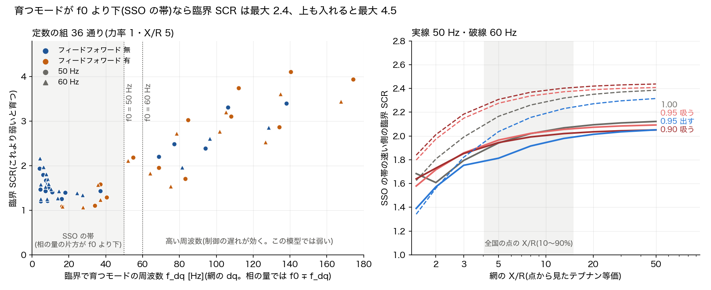
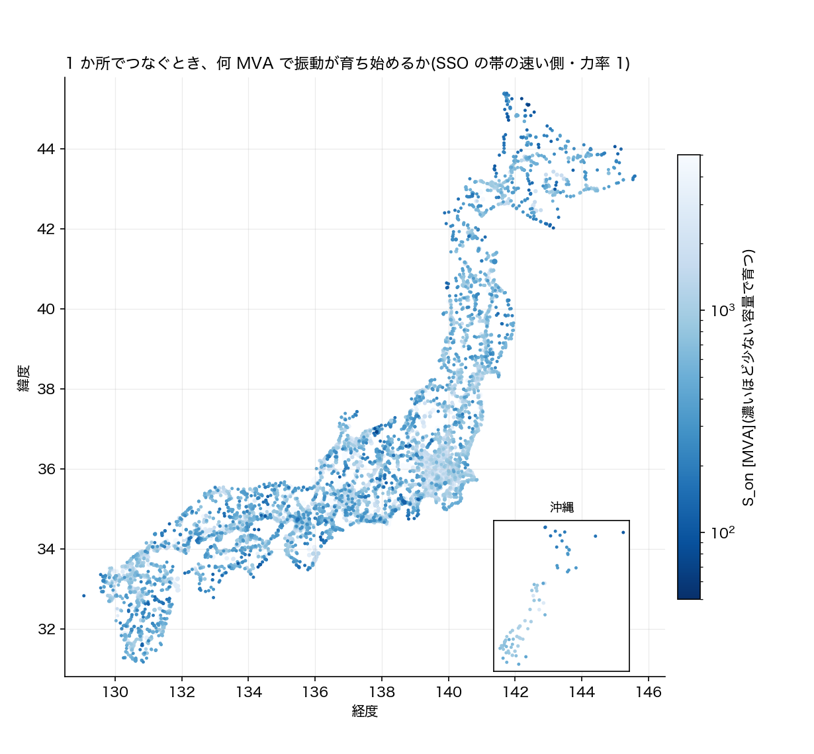

# SSO 第 2 段 段 C: 臨界 SCR を全国の点に当てる(2026-11-02)

計画は `docs/reports/sso_ibr_literature_2026-10-31.md` の「段 C」。オーナー「段 C に進めて」(11-02)。
段 A の GFL 1 台の模型(`src/dynamics/sso/gfl.py`。3 つの道で確かめた)で臨界 SCR の表を作り、正典の 4 島の各点の短絡容量と X/R に当てた。

## わかったこと

1. **臨界 SCR は、育つモードの周波数が f0 より下か上かで大きく違う**(図 `critical.png` の左、表 1)。臨界で育つモードの網の dq の周波数 f_dq は 3.5 Hz から 178 Hz まで切れ目なく出た。f0 を境に分けて見る。
   - **SSO の帯**(f_dq < f0)
     - 相の量では f0 の上下に組で出て、片方が f0 より下。
     - 遅い PLL・遅い電流制御・フィードフォワード無しの組で、臨界が高い。
     - 36 組の最大で、臨界 SCR は 50 Hz で 2.12、60 Hz で 2.44 まで(力率・X/R のすべてで)。
     - いちばん臨界が高い組では、f_dq が約 4 Hz。dq(RMS で見える量)で 4 Hz の振動は、WEAK4HZ2018 が扱ったテキサスの 4 Hz と同じ帯にある。
   - **高い周波数**(f_dq > f0)
     - 速い PLL(固有周波数 40〜100 Hz)と電圧のフィードフォワードの組で起きる。
     - 臨界 SCR は 50 Hz で 4.46、60 Hz で 4.00 まで上がる。
     - この模型は制御の遅れを入れていない。この帯は遅れで大きく動くので、確からしさは SSO の帯より下がる。
   - 36 組 × 力率 4 × X/R 9 の 1,296 通りのうち、50 Hz で 230 通り、60 Hz で 241 通りは、SCR 1.05 まで下げても振動では不安定にならなかった(静的な限界が先)。
2. **SCR 3 の目安との関係。** 09-02 の報告は SCR < 3 を弱い系統の目安にした(IEEE 1204-1997)。SSO の帯の臨界(最大 2.4)は、この目安の内側に入る。f0 より上の側は 3 を超えるので、制御の定数しだいでは目安だけでは足りない。
3. **力率と X/R の効き。** 力率の効きは小さい。50 Hz・SSO の帯・X/R 5 で、力率 1 が 1.94、0.95 で吸うと 1.97、0.95 で出すと 1.81。段 B の続き(REAL20HZ2022)では、吸う無効電力で σ が −18 から +14 まで動いた。違いの理由は、あの系統に変電所のコンデンサと外側の制御があったからと見ている(仮説。この模型には両方とも無い)。X/R は大きいほど臨界が上がる(50 Hz・力率 1・SSO の帯で、X/R 2 が 1.61、20 が 2.09)。
4. **全国の地図**(図 `map.png`、表 2)。1 か所でつなぐとき、振動が育ち始めるインバータの定格を S_on = S_sc / 臨界 SCR とした。SSO の帯の速い側の定数・力率 1 で、66〜77 kV の点の中央は次のとおり。
   - 北海道 489 MVA(下位 10% は 179 MVA)
   - 東 1,330 MVA(450 MVA)
   - 西 933 MVA(304 MVA)
   - 沖縄 749 MVA(197 MVA)

   いちばん弱いのは北海道の北(宗谷)の 66 kV で、ユーラス浜頓別ウインドファーム特高変電所は S_sc 125 MVA、66 MVA で育ち始める。f0 より上の側まで入れると 31 MVA。弱い点の上位 12 のうち 9 が北海道で、残りは小豆島(草壁)・高知の東の端(甲浦)・兵庫の揖保川町。
5. **既設の IBR で臨界を割る点は無い**(表 4)。模型の既設の IBR は OSM の容量で、4 島で計 9,319 MW。臨界との比が最小の点は次のとおり。
   - 北海道: 八雲変電所(102 MW・SCR 7.1)、比 1.71
   - 東: 菰槌変電所(122 MW・SCR 8.1)、比 1.93
   - 西: 新田辺変電所(112 MW・SCR 8.5)、比 2.25

   比の分母は、力率も定数も一番悪い側(高い周波数を含む)にした。
6. **集まると弱くなる**(表 5)。既設の IBR の並びのままの一般化 SCR(GSCR2018)は、北海道 6.39・東 7.24・西 8.38・沖縄 27.42。どの島でも、1 点ずつの SCR の最小より小さい。同じ並びのまま容量を増やすと、高い周波数を含む一番悪い側で 1.6〜2.2 倍、SSO の帯で 3.4〜3.7 倍(沖縄は 7.4 倍と 12.2 倍)で臨界に届く。
7. **正典のデータの疑いを 1 つ見つけた**(「見つけたこと」)。初めの計算では、西の島で臨界にいちばん近い既設の点が軽井沢東変電所(77 kV・187 MW・比 1.30)だった。これは人工物で、印を付けて表から外した。

## 見つけたこと: 地域をまたぐ双子に、別の周波数の発電所が付いていた

- 軽井沢東変電所は、同じ座標に東京の 66 kV の点(東の島・50 Hz)と中部の 77 kV の点(西の島・60 Hz)の 2 つがある。
- 中部の側の点に、群馬県高崎市(上室田ほか)の太陽光が計 187 MW 付いていた。高崎市は東京電力パワーグリッドの区域で 50 Hz。60 Hz の島の IBR として数えるのは誤り。
- 名前を書き込まずに外すため、「同じ座標(小数 5 桁)の点が別の島にもある」点に印を付け、既設の IBR の表と一般化 SCR から外した。印は東 27 点・西 27 点。外した既設の IBR は東 1 点(1 MW)、西 2 点(188 MW)。点ごとの表(`points.csv`)には印の列を残した。
- 双子そのものは既知の種類(正典の作り直しで数えた地域をまたぐ双子)。発電所の付け先が周波数をまたいでいた例は、この段で初めて見つけた。正典の直しは介入として別に扱う(この段では正典を変えていない)。

## 何をしたか

- **臨界 SCR の表**(`src/dynamics/sso/scr_map.py`)
  - 振ったもの: 制御の定数 36 組 × 力率 4 × X/R 9 × 定格周波数 50/60 Hz。
  - 臨界 SCR の定義: SCR を下げていき、0.5 Hz より上のモードの実部が 0 を越える SCR(段 A の道 1)。そこで育つモードの f_dq も残した。
  - かかる時間: 約 15 秒。
- **点の網**
  - 計算: `src/powerflow/short_circuit.py` で正典の 4 島を計算した。網と電源は 09-02 の IBR の SCR の報告と同じ(本番と同じ網、主成分、同期機の xd'' の典型値、V = 1 pu、線路の充電と負荷は入れない、IBR は電流源にしない)。
  - 使った量: 点の S_sc と、Z_th の X/R。X/R は表の格子の上で対数で補間した。
  - 範囲: 66 kV 以上で、計 14,169 点。
  - 時期: 10-21 の正典の作り直しの後の網なので、09-02 の報告の数字とは少し違う。
- **一般化 SCR**
  - Z の行列: 既設の IBR がある点の間のテブナンの行列 Z。`short_circuit.thevenin_matrix` を足し、同じ LU で列を解く。対角は Z_th と一致する。
  - 定義: diag(S)⁻¹ · base · Z⁻¹ の固有値の大きさの最小。1 点なら S_sc/S と同じ値になる。
  - GSCR2018 との違い: GSCR2018 は無損失の網で定義している。ここでは Z の偏角をそのまま入れている。

### 典型値の表(この段で振った幅。`scr_map.py` の 1 か所に置いた)

| 量 | 値 | 根拠 |
|---|---|---|
| PLL の固有周波数 ω_n/2π | 8・15・25・40・70・100 Hz(ζ 0.707) | 上の端は段 A の走査の端。下の端は REAL20HZ2022 の PLL の帯域(本文 16・20・33 Hz、段 B で計算と一致)。ζ 0.707 の 2 次の PLL の −3 dB 帯域は 2.06 ω_n なので、16 Hz は ω_n 約 8 Hz にあたる |
| 電流制御の帯域 | 150・300・600 Hz | 段 A と同じ。内部モデル制御の規則(HARNEFORS1998) |
| 電圧のフィードフォワード | 無・有(一次遅れ 1 ms) | 段 A と同じ |
| 力率 | 1.00・0.95 吸う・0.90 吸う・0.95 出す(電流は定格 1 pu) | 振った幅。国内の運用の値は確かめていない |
| 網の X/R | 1.5〜50 の 9 点 | 全国の点の X/R の 10〜90% は図 `critical.png` の右の灰色の帯 |
| 臨界を探す SCR | 1.05〜10 | 1.05 未満は静的な限界(平衡点が無くなる SCR、約 1)に近い |

## 言えないこと

- **予言ではない。** 実機の制御の定数は公開されていない。答えは「この定数の幅なら、この容量で育ち始める」という地図。
- **模型に入っていないもの。**
  - 外側の制御(P・Q)と電流の制限。段 B の続きでは、入れると臨界が動いた。
  - 制御の遅れ(PWM・計算)。高い周波数の族は、遅れで大きく動く。
  - フィルタのコンデンサと LCL。
- **網はテブナン等価(R + L が 1 つ)。** ケーブルの容量と、網の共振(super の側)は見ていない。洋上風力では、SCR が誤った判断を招きうる(JP2025S)。
- **S_sc の確からしさ。**
  - 線路の定数は電圧の階級ごとの合成値で、観測した値ではない。
  - 同期機は、本番の網に入っている全機で、定数は典型値。UC の運転・停止の断面ではないので、停まっている機の分だけ強めに出る。
  - いちばん弱い点の S_sc(125 MVA)は、この前提の上の値。
- **既設の IBR は OSM の容量で、実際より少ない。**
  - 浜頓別のウインドファームの変電所には、模型の発電所が 1 基も付いていない(OSM に容量が無い)。既設が臨界に近いかどうかは、実際の容量で確かめないと言えない。
  - 表 4 の「割る点は無い」は、模型の中での話。
- **S_on は 1 か所でつなぐときの値。** 近くに複数がつながるときは、一般化 SCR の方を見る。

## 確かめ

- **臨界の 3 つの道**(表 6): X/R 5、50/60 Hz、力率 1 と 0.95 吸う、速い側の組(100・300・有)と中ほどの組(40・300・無)の 8 か所。
  - 道 1(固有値)と道 2(アドミタンスの零点): 臨界 SCR が相対 1e-7 以内で一致した。
  - 道 3(静止座標の非線形の積分と行列ペンシル): 臨界の 0.97 倍で sub と super の成分がそろって育ち、1.03 倍で減った。σ は固有値と小数 2 桁まで一致した。
- **テスト**(`tests/test_sso_scr_map.py` 12 本)
  - 複数点のテブナンの行列の対角が Z_th と一致し、放射状の網で共通の道が非対角に出る。
  - 一般化 SCR は、1 点で S_sc/S、容量 k 倍で 1/k。近くに集まると 1 点ずつの最小より下がる。
  - 力率の電流の大きさと無効電力の向き。
  - 道 1 と道 2 の一致。
  - SSO の帯の要約が f_dq < f0 の組だけから取られる。
- **既存の短絡容量のテスト**(`tests/test_short_circuit.py` 7 本): 足した関数のために中を分けたが、そのまま通る。

## 次

- 外側の制御と制御の遅れを入れた模型(段 B の `gfl_pr.py`)で、同じ表を作る。特に f0 より上の側が、遅れでどこまで下がるか。
- 既設の IBR を、FIT の台帳の容量で置き換える。まず北海道の北と、浜頓別のウインドファームから。
- 地域をまたぐ双子に付いた発電所の付け先を、介入として直す(根拠・帳簿・無効化の 3 点)。
- super の側とケーブルの共振は、第 1 段の周波数走査(網の Z(f))で見る。

## 再現

```
python scripts/sso_stage_c.py          # 約 2 分半。表・図・results.json・points.csv を作り、この報告の表を書き換える
python -m pytest tests/test_sso_scr_map.py tests/test_short_circuit.py
```

出力は `docs/reports/sso_ibr_stage_c_2026-11-02/`。正典(`docs/data/built/all.json`)と git の中のファイルだけを読む。





## 表

<!-- 表:begin -->
**表 1 臨界 SCR(X/R 5 の点)。36 組の最大(高い周波数を含む)・SSO の帯の最大・中央値・最小。括弧は最大になった組(PLL・電流制御・フィードフォワード)と、そこで育つモードの f_dq**

| 定格周波数 | 力率 | 最大 | SSO の帯の最大 | 中央 | 最小 |
|---|---|---|---|---:|---:|
| 50 Hz | 1.00 | 4.11(100・300・有、140 Hz) | 1.94(8・150・無、4 Hz) | 1.58 | 1.05 |
| 50 Hz | 0.95 吸う | 4.25(100・300・有、141 Hz) | 1.97(8・150・無、4 Hz) | 1.65 | 1.05 |
| 50 Hz | 0.90 吸う | 4.23(100・300・有、141 Hz) | 1.95(8・150・無、4 Hz) | 1.65 | 1.05 |
| 50 Hz | 0.95 出す | 3.66(100・300・有、139 Hz) | 1.81(8・150・無、4 Hz) | 1.42 | 1.05 |
| 60 Hz | 1.00 | 3.61(100・300・有、135 Hz) | 2.17(8・150・無、4 Hz) | 1.58 | 1.05 |
| 60 Hz | 0.95 吸う | 3.80(100・300・有、136 Hz) | 2.27(40・150・有、55 Hz) | 1.62 | 1.05 |
| 60 Hz | 0.90 吸う | 3.81(100・300・有、136 Hz) | 2.31(40・150・有、56 Hz) | 1.60 | 1.05 |
| 60 Hz | 0.95 出す | 3.14(100・300・有、132 Hz) | 2.04(8・150・無、4 Hz) | 1.44 | 1.05 |

**表 2 島と電圧の帯ごとの S_on(力率 1)。SSO の帯の速い側の中央と下位 10%・高い周波数を含む最大の側の中央・中央の定数の中央**

| 島 | 帯 | 点 | S_sc 中央 [MVA] | X/R 中央 | S_on SSO の帯 中央 [MVA] | 同 下位 10% | S_on 最大の側 中央 | S_on 中央の定数 中央 |
|---|---|---:|---:|---:|---:|---:|---:|---:|
| hokkaido | 66-77kV | 655 | 946 | 5.0 | 489 | 179 | 233 | 602 |
| hokkaido | 110-154kV | 26 | 1,022 | 10.3 | 500 | 352 | 241 | 617 |
| hokkaido | 187-275kV | 118 | 4,899 | 14.2 | 2,363 | 1,396 | 1,146 | 2,920 |
| east | 66-77kV | 4,491 | 2,562 | 4.6 | 1,330 | 450 | 627 | 1,630 |
| east | 110-154kV | 853 | 9,582 | 9.6 | 4,680 | 1,441 | 2,266 | 5,779 |
| east | 187-275kV | 323 | 20,085 | 14.5 | 9,675 | 3,001 | 4,701 | 11,958 |
| east | 500kV | 142 | 38,235 | 24.0 | 18,175 | 7,128 | 8,900 | 22,515 |
| west | 66-77kV | 4,689 | 2,059 | 5.8 | 933 | 304 | 564 | 1,286 |
| west | 110-154kV | 1,680 | 5,552 | 9.7 | 2,427 | 785 | 1,489 | 3,386 |
| west | 187-275kV | 881 | 13,426 | 14.6 | 5,774 | 2,544 | 3,570 | 8,102 |
| west | 500kV | 217 | 34,533 | 29.4 | 14,559 | 7,180 | 9,088 | 20,578 |
| okinawa | 66-77kV | 71 | 1,704 | 6.0 | 749 | 197 | 458 | 1,043 |
| okinawa | 110-154kV | 23 | 6,306 | 25.0 | 2,670 | 2,220 | 1,663 | 3,768 |

**表 3 S_on(SSO の帯の速い側・力率 1)が小さい点。名前のある設備で、別の島に双子が無い点**

| 島 | 名前 | kV | S_sc [MVA] | X/R | S_on SSO の帯 [MVA] | S_on 最大の側 | S_on 中央の定数 | 模型の既設 IBR [MW] |
|---|---|---:|---:|---:|---:|---:|---:|---:|
| hokkaido | ユーラス浜頓別ウインドファーム特高変電所 | 66 | 125 | 4.4 | 66 | 31 | 81 | 0.0 |
| hokkaido | 浜頓別開閉所 | 66 | 128 | 4.4 | 67 | 32 | 82 | 0.0 |
| hokkaido | 猿払変電所 | 66 | 146 | 4.6 | 76 | 36 | 93 | 0.0 |
| hokkaido | 宇登呂変電所 | 66 | 171 | 3.6 | 92 | 43 | 113 | 0.0 |
| hokkaido | 遠別変電所 | 66 | 178 | 4.5 | 93 | 44 | 114 | 0.0 |
| west | 草壁変電所 | 66 | 194 | 3.6 | 95 | 56 | 129 | 0.0 |
| west | 四国電力 甲浦変電所 | 66 | 197 | 3.7 | 96 | 57 | 130 | 0.0 |
| hokkaido | 北栄町変電所 | 66 | 192 | 5.2 | 98 | 47 | 121 | 0.0 |
| west | 揖保川町変電所 | 66 | 212 | 4.0 | 101 | 60 | 138 | 0.0 |
| hokkaido | えりも変電所 | 66 | 197 | 4.4 | 104 | 49 | 127 | 0.0 |
| hokkaido | 浜頓別変電所 | 66 | 206 | 5.4 | 105 | 50 | 129 | 0.0 |
| hokkaido | 浜益変電所 | 66 | 193 | 3.5 | 105 | 49 | 128 | 0.0 |

**表 4 既設の IBR(OSM の容量)の SCR と、臨界(力率も定数も一番悪い側。高い周波数を含む)の比**

| 島 | 点 | 既設 [MW] | 比 < 1 の点 | SSO の帯の臨界を割る点 | 比の最小 | 比が最小の点 | 外した双子の点(MW) |
|---|---:|---:|---:|---:|---:|---|---:|
| hokkaido | 100 | 854 | 0 | 0 | 1.71 | 八雲変電所(66 kV・102 MW・SCR 7.1) | 0(0) |
| east | 887 | 3,860 | 0 | 0 | 1.93 | 菰槌変電所(66 kV・122 MW・SCR 8.1) | 1(1) |
| west | 987 | 4,382 | 0 | 0 | 2.25 | 新田辺変電所(77 kV・112 MW・SCR 8.5) | 2(188) |
| okinawa | 10 | 34 | 0 | 0 | 9.23 | 田港変電所 66kV(66 kV・10 MW・SCR 34.3) | 0(0) |

**表 5 既設の IBR が集まる所の一般化 SCR(双子の点は外す)**

| 島 | IBR の点 | 既設 [MW] | 一般化 SCR | 1 点ずつの SCR の最小 | 重みが一番大きい点 | 臨界(一番悪い側) | 同じ並びで何倍まで | 同(SSO の帯) |
|---|---:|---:|---:|---:|---|---:|---:|---:|
| hokkaido | 100 | 854 | 6.39 | 7.10 | 北桧山変電所(66 kV・重み 0.38) | 4.11 | 1.6 | 3.4 |
| east | 887 | 3,860 | 7.24 | 8.13 | 菰槌変電所(66 kV・重み 0.17) | 4.22 | 1.7 | 3.7 |
| west | 987 | 4,382 | 8.38 | 8.54 | 湯崎変電所(77 kV・重み 0.42) | 3.77 | 2.2 | 3.7 |
| okinawa | 10 | 34 | 27.42 | 34.30 | 田港変電所 66kV(66 kV・重み 0.45) | 3.72 | 7.4 | 12.2 |

**表 6 臨界の確かめ(X/R 5)。道 1 = 固有値、道 2 = アドミタンスの零点、道 3 = 非線形の積分。σ は臨界の 0.97 倍 / 1.03 倍での a 相電流の sub と super の成分の減衰 [1/s]**

| 定格 | 力率 | 組(PLL・電流制御・FF) | 道 1 | 道 2 | 相対差 | f_dq [Hz] | 0.97 倍 σ(sub / super) | 1.03 倍 σ(sub / super) | 相の量 [Hz] |
|---|---|---|---:|---:|---:|---:|---|---|---|
| 50 Hz | 1.00 | 100・300・有 | 4.1055 | 4.1055 | 1e-08 | 140.4 | +14.68 / +14.68 | -14.33 / -14.33 | 89.3 と 189.3 |
| 50 Hz | 1.00 | 40・300・無 | 1.3989 | 1.3989 | 8e-08 | 17.9 | +7.99 / +7.99 | -7.06 / -7.06 | 34.1 と 65.9 |
| 50 Hz | 0.95 吸う | 100・300・有 | 4.2546 | 4.2546 | 5e-08 | 141.1 | +15.04 / +15.04 | -14.68 / -14.68 | 90.0 と 190.0 |
| 50 Hz | 0.95 吸う | 40・300・無 | 1.4997 | 1.4997 | 1e-07 | 22.3 | +6.64 / +6.64 | -6.11 / -6.11 | 29.5 と 70.5 |
| 60 Hz | 1.00 | 100・300・有 | 3.6084 | 3.6084 | 4e-08 | 134.7 | +13.48 / +13.48 | -13.19 / -13.19 | 73.5 と 193.5 |
| 60 Hz | 1.00 | 40・300・無 | 1.4360 | 1.4360 | 4e-08 | 14.6 | +7.88 / +7.88 | -7.03 / -7.03 | 46.9 と 73.1 |
| 60 Hz | 0.95 吸う | 100・300・有 | 3.8028 | 3.8028 | 4e-08 | 136.2 | +13.99 / +13.99 | -13.68 / -13.68 | 75.0 と 195.0 |
| 60 Hz | 0.95 吸う | 40・300・無 | 1.4999 | 1.4999 | 4e-09 | 17.2 | +7.12 / +7.12 | -6.45 / -6.45 | 44.3 と 75.7 |
<!-- 表:end -->

## 文献

`sso_ibr_stage_c_2026-11-02/refs.bib`(DOI は第 0 段と段 A・B の bib から写した)

| 鍵 | 内容 | DOI |
|---|---|---|
| GSCR2018 | 多連系の小信号安定を、一般化 SCR と臨界の一般化 SCR で見る | [10.1109/tpwrs.2018.2875305](https://doi.org/10.1109/tpwrs.2018.2875305) |
| WEAK4HZ2018 | 弱い系統の風力の 4 Hz と 30 Hz の振動を、動的モデルと固有値で説明する | [10.1109/tpwrs.2018.2852947](https://doi.org/10.1109/tpwrs.2018.2852947) |
| REAL20HZ2022 | 実際の 20 Hz の IBR の SSO。段 B で再現した例題 | [10.1109/tec.2022.3206795](https://doi.org/10.1109/tec.2022.3206795) |
| HARNEFORS1998 | 内部モデル制御による電流制御の定数の決め方 | [10.1109/28.658735](https://doi.org/10.1109/28.658735) |
| JP2025S | 洋上風力の SCR は、ケーブルの容量のため誤った判断を招きうる | [10.1541/ieejpes.145.46](https://doi.org/10.1541/ieejpes.145.46) |
