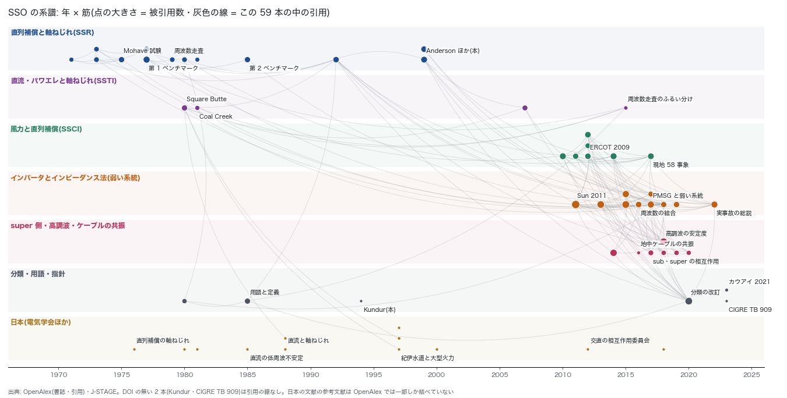

# SSO(sub・super)の文献調査と系譜(2026-10-31)

SSO 解析の計画(`sso_plan_2026-10-31.md`)の第 0 段。
オーナーの指示は「sso は super も sub もある。文献調査や系譜も必要」「進めて」「やっていい」。
分類を一次文献で確かめ、研究の系譜と日本の文脈を整理した。そのうえで、AGJ の網と台帳で何が言えるかを決める。

## 要点

- **厳選した 59 本**(7 つの筋)で系譜を組んだ。DOI のある 57 本は、DOI で実在を確かめ、BibTeX を取った。DOI の無い 2 本は Kundur の教科書と CIGRE TB 909 で、出版元の頁で確かめた。59 本の中で結べた引用は 145 本。
- **分類**: CIGRE TB 909(2023)は、SSO を次の 2 系統に分ける。範囲は sub と super(高調波側)の両方で、検討は「ふるい分け → 詳しい検討 → 対策 → 監視」の段で進める。AGJ でやるのはふるい分けの段に当たる。
  - SSR: 網の共振が原因
  - PEDI: パワエレ機器の制御が原因
- IEEE の安定度の分類の改訂(2021)は、インバータの増加を受けて 2004 年の分類を見直したもの(要旨)。足された分類(共振の安定度・インバータが主の安定度とされる)は、本文で確かめる。
- **系譜の幹は 4 本**(下の図)。
  1. 1970 年代の直列補償と軸ねじれ(Mohave の試験 → 第 1 ベンチマーク → 周波数走査 → 対策 → 第 2 ベンチマーク・用語)
  2. 1980 年前後の直流と軸ねじれ(Square Butte・Coal Creek)
  3. 2009 年からの風力と直列補償(ERCOT)
  4. 2011 年からのインピーダンス法と弱い系統
  - 4 本目から、sub と super を組で扱う研究(2016〜2020)と実事故の総説(2022)が出る。
- **日本**: 直列補償と軸ねじれ(1976〜)、直流と軸ねじれ(1980〜1997)の筋が厚い。
  - 1997 年の論文(山路・田中・関田・真鳥)は、紀伊水道の直流(1,400 MW・2000 年運転開始・大型火力に直結する単独送電もあり得る)の交直の相互作用と軸ねじれ(SSTI)の対策を扱う。AGJ で UIF を出したら、最初に照らす相手になる。
  - 国内の直流と軸ねじれの 3 本(1988・1997・1997)は、Square Butte(1980)を引いている。
- **見つからなかったもの**(検索の範囲で): 次の 3 つ。どれも「要調査」とする。
  - インバータ・風力の SSO を系統側から扱った国内の論文
  - 電力中央研究所の報告
  - OCCTO・系統連系技術要件での SSO の扱い



図: 横は年、段は筋。点の大きさは被引用数(OpenAlex)、灰色の線はこの 59 本の中の引用。日本の文献の参考文献は、OpenAlex では一部しか結べていない(1997 年の論文は J-STAGE では 17 本、ここで結べたのは 1 本)。

## 分類(何を sub/super と呼ぶか)

| 分け方 | 中身 | 出典 |
|---|---|---|
| 帯 | sub は系統周波数 f0 より下、super は f0 より上(高調波側)。インバータでは PLL によって正相と逆相が結合する(`BAKHSH2016` の要旨)。そのため sub の f と super の 2f0 − f が組で現れる(通説。本文で確かめる) | TB909・`BAKHSH2016`・`STATCOM2017`・`IMPNET2018` |
| 原因(TB 909) | SSR(網の共振)と PEDI(パワエレ機器の制御の相互作用) | TB909 |
| 安定度の分類 | インバータの増加を受けた 2004 年の分類の見直し。共振の安定度とインバータが主の安定度が足されたとされる(本文で確かめる) | `HATZI2021` |
| 古典の SSR | 直列補償の網の電気共振と軸ねじれの相互作用。用語と記号は IEEE の作業会が定めた | `TERMS1980`・`TERMS1985`・`ANDERSON1999` |
| SSTI | 直流・FACTS の制御と軸ねじれ | `SQBUTTE1980`・`COALCREEK1981`・`PEINT2007` |
| SSCI | インバータ(風車)の制御と直列補償の網 | `IRWIN2011`・`ERCOT2012` |
| 弱い系統の制御の相互作用 | 直列補償が無くても、短絡容量が小さい網でインバータの制御が振動する | `HAMI2017`・`WEAK2019`・`CHENG2022` |

古典の SSR の内訳(誘導発電機効果・ねじれの相互作用・トルクの増幅)は通説として広く使われる。原典の該当箇所は、第 1 段に入る前に `TERMS1985` と `ANDERSON1999` で確かめる。

## 系譜

1. **直列補償と軸ねじれ(1970〜1999)**
   - 直列コンデンサによる自己励磁の予測(1971)と、直列補償の線の SSR(1973)から始まる。
   - Mohave の試験(1975)で、ねじれの固有振動数と減衰を実測した。Mohave の軸の損傷(1970・1971 年とされる)は、この調査の範囲では原典を確かめていない。
   - 第 1 ベンチマーク(1977・被引用 602)が共通の試験系になった。周波数走査(1979)は、ふるい分けの手法として今も引かれている。
   - その後、対策(1980・NGH 1981)、第 2 ベンチマークと用語(1985)、読書案内(1992)、教科書 2 冊(1999)と続く。
2. **直流と軸ねじれ(1980〜)**
   - Square Butte(1980)と Coal Creek の現地試験(1981)が起点。
   - パワエレ変換器一般との相互作用の解析(2007)を経て、機器起因の SSO を周波数走査でふるい分ける手法(2015)に繋がる。
   - 日本では、この筋が紀伊水道の検討(1997)まで続く。
3. **風力と直列補償(2009〜)**
   - ERCOT の 2009 年の事故(Type 3 風車と直列補償の SSCI)が起点。
   - DFIG のモデル(2010)、インピーダンスとナイキストの判定による説明(2012)、現地で記録した 58 事象の解析(2017)と続く。
4. **インバータとインピーダンス法(2011〜)**
   - Sun(2011・被引用 2,590)のインピーダンスによる判定が幹。電圧形変換器のモデル(2014)、dq インピーダンス(2015)、受動性(2015)と続く。
   - PLL による正相と逆相の結合(2016)が示され、sub と super を組で扱う研究に繋がった。
   - 新疆の PMSG 風力と弱い系統の振動(2017)で、直列補償が無くても起きることが示された。
   - 実事故の総説(2022・IEEE PES の作業会)と TB 909(2023)で、まとめられた。
5. **super 側・高調波・ケーブル**
   - パワエレが主の系統の高調波の安定度(2014・2018)。
   - sub と super の相互作用(2017〜2020)。
   - 長い超高圧の地中ケーブルは、大きな静電容量で低次の共振を作る(オランダ・2016 の要旨)。日本の都市の 275・500 kV の地中網を見る手がかりになる。

## 日本の文脈

| 項目 | 分かったこと | 状態 |
|---|---|---|
| 直流と大型火力 | 紀伊水道(1,400 MW)の SSTI の検討と対策が 1997 年に出ている(`J1997A`)。変換所の技術は `J2000` | 要旨で確認。対策の中身は本文で確かめる |
| 直流と軸ねじれの研究 | 1980・1985・1988(2 本)・1997(自励式) | DOI で確認 |
| 直列補償 | 軸ねじれ共振と抑制(1976)、軸ねじれを考えた直列コンデンサの制御(1997) | DOI で確認。実設備の有無は要調査 |
| 委員会 | 電気学会「電力系統と交直変換器の相互作用調査専門委員会」(2012 の報告) | DOI で確認 |
| インバータ・風力の SSO | J-STAGE の検索では、系統側の論文が見当たらない(パワエレ側の系統インピーダンス推定 2018 はある) | 要調査(電中研・OCCTO・各社) |
| 地中ケーブルの共振 | 国内の文献はこの検索では未発見。海外はオランダの例 | 要調査 |

J-STAGE で使った語: 軸ねじれ 共振・サブシンクロナス・次同期共振・直流送電 軸ねじれ・軸ねじれ相互作用・北海道本州間 直流 軸ねじれ・周波数変換所 軸ねじれ・風力発電 弱い系統 振動・インバータ 系統 共振 インピーダンス 安定・地中ケーブル 共振 高調波 系統・洋上風力 共振。

## AGJ で使えるもの・使えないもの

| 手法 | 出典 | AGJ の材料 | 判断 |
|---|---|---|---|
| 周波数走査(網の駆動点インピーダンス) | `FSCAN1979`・`DDSO2015` | 正典の網の R・X・B、変圧器、同期機の典型の xd″ | 使える。sub と super の両方を 1 回で見る |
| 直流の SSTI の一次判定(UIF) | `DDSO2015` の要旨は「UIF は直列補償の無い誘導性の網にしか使えない」とする。原典は DOI の無い報告と見られる(要確認) | 短絡容量(`short_circuit.py`)、連系線と発電所の台帳 | 直列補償が無ければ使える(日本の基幹系統の直列補償の有無を先に確かめる)。最初の照合相手は `J1997A`(紀伊水道) |
| ベンチマークの再現 | `FBM1977`・`SBM1985` | 系の定数は論文に載っている | 試験として先に作る |
| ねじれの帯との突き合わせ | `FBM1977`・`ANDERSON1999` | 軸の定数は無いので、典型の帯で置く | 仮定つきで使える |
| インバータのインピーダンスの判定 | `SUN2011`・`CESPEDES2014`・`BAKHSH2016` | 制御の定数は無いので、典型値で置く | 第 2 段 |
| 時間領域の EMT | — | 道具も定数も無い | 使わない |

## 限界

- 59 本は厳選で、網羅ではない。選び方は、総説 6 本の参考文献と、古典 5 本の被引用の上位から幹を取り、そこに国内の文献を足した(下の「再現」)。
- 中身の確認は要旨まで。本文は読んでいない。表の「内容」は題名と要旨による。
- 被引用数は 2026-10-31 時点の OpenAlex の値。日本の文献の参考文献は、OpenAlex では一部しか結べていない。
- CIGRE TB 909 は購入品で、中身は CIGRE と ELECTRA の紹介頁による。

## 文献の表

全 59 本。BibTeX は `sso_literature_2026-10-31/refs.bib`、書誌と引用の辺は `lit.json`。

**直列補償と軸ねじれ(SSR)**

| 年 | 鍵 | 内容 | 役割 | 被引用(全体/この中) | DOI |
|---|---|---|---|---|---|
| 1971 | `KILGORE1971` | 直列コンデンサによる自己励磁の予測と抑制 | 起点 | 51 / 3 | [10.1109/tpas.1971.292933](https://doi.org/10.1109/tpas.1971.292933) |
| 1973 | `BALLANCE1973` | 直列補償線路の SSR | 起点 | 118 / 5 | [10.1109/tpas.1973.293713](https://doi.org/10.1109/tpas.1973.293713) |
| 1973 | `SELFEXC1973` | 直列コンデンサによる軸ねじれ周波数の自己励磁 | 起点 | 101 / 4 | [10.1109/tpas.1973.293717](https://doi.org/10.1109/tpas.1973.293717) |
| 1975 | `MOHAVE1975` | Mohave 2 号機の SSR 試験(ねじれの固有振動数・減衰の実測) | 試験 | 238 / 1 | [10.1109/t-pas.1975.32034](https://doi.org/10.1109/t-pas.1975.32034) |
| 1977 | `FBM1977` | IEEE 第 1 ベンチマーク | ベンチマーク | 602 / 4 | [10.1109/t-pas.1977.32485](https://doi.org/10.1109/t-pas.1977.32485) |
| 1977 | `NAVAJO1977` | Navajo の SSR 解析と対策 | 事例 | 145 / 2 | [10.1109/t-pas.1977.32445](https://doi.org/10.1109/t-pas.1977.32445) |
| 1979 | `FSCAN1979` | 周波数走査による SSR 解析 | 手法 | 100 / 1 | [10.1109/tpas.1979.319312](https://doi.org/10.1109/tpas.1979.319312) |
| 1980 | `COUNTER1980` | SSR の対策 | 対策 | 113 / 2 | [10.1109/tpas.1980.319771](https://doi.org/10.1109/tpas.1980.319771) |
| 1981 | `NGH1981` | NGH の SSR 抑制方式 | 対策 | 45 / 0 | [10.1109/mper.1981.5511408](https://doi.org/10.1109/mper.1981.5511408) |
| 1985 | `SBM1985` | IEEE 第 2 ベンチマーク | ベンチマーク | 218 / 1 | [10.1109/tpas.1985.323456](https://doi.org/10.1109/tpas.1985.323456) |
| 1992 | `READERS1992` | SSR の読書案内 | 総説 | 283 / 6 | [10.1109/59.141698](https://doi.org/10.1109/59.141698) |
| 1999 | `ANDERSON1999` | Anderson・Agrawal・Van Ness『Subsynchronous Resonance in Power Systems』 | 教科書 | 426 / 6 | [10.1109/9780470546505](https://doi.org/10.1109/9780470546505) |
| 1999 | `PADIYAR1999` | Padiyar『Analysis of Subsynchronous Resonance in Power Systems』 | 教科書 | 355 / 2 | [10.1007/978-1-4615-5633-6](https://doi.org/10.1007/978-1-4615-5633-6) |

**直流・パワエレと軸ねじれ(SSTI)**

| 年 | 鍵 | 内容 | 役割 | 被引用(全体/この中) | DOI |
|---|---|---|---|---|---|
| 1980 | `SQBUTTE1980` | Square Butte の直流と軸ねじれの相互作用 | 事故 | 215 / 7 | [10.1109/tpas.1980.319726](https://doi.org/10.1109/tpas.1980.319726) |
| 1981 | `COALCREEK1981` | Coal Creek の直流と軸ねじれの現地試験 | 試験 | 56 / 2 | [10.1109/tpas.1981.316861](https://doi.org/10.1109/tpas.1981.316861) |
| 2007 | `PEINT2007` | パワエレ変換器との軸ねじれ相互作用の解析 | 手法 | 140 / 2 | [10.1109/tpwrs.2006.889038](https://doi.org/10.1109/tpwrs.2006.889038) |
| 2015 | `DDSO2015` | 機器起因の SSO の周波数走査によるふるい分け | 手法 | 18 / 0 | [10.1109/tpwrs.2015.2442653](https://doi.org/10.1109/tpwrs.2015.2442653) |

**風力と直列補償(SSCI)**

| 年 | 鍵 | 内容 | 役割 | 被引用(全体/この中) | DOI |
|---|---|---|---|---|---|
| 2010 | `DFIGSSR2010` | DFIG 風力の SSR 解析のモデル | 手法 | 473 / 7 | [10.1109/tpwrd.2010.2050912](https://doi.org/10.1109/tpwrd.2010.2050912) |
| 2011 | `IRWIN2011` | Type 3 風車と直列補償の SSCI | 事故 | 230 / 8 | [10.1109/pes.2011.6039426](https://doi.org/10.1109/pes.2011.6039426) |
| 2012 | `ERCOT2012` | ERCOT の SSCI の経験と対策(2009 年の事故) | 事故 | 289 / 6 | [10.1109/tdc.2012.6281678](https://doi.org/10.1109/tdc.2012.6281678) |
| 2012 | `FANMIAO2012` | ナイキストの判定による Type 3 の SSR の説明 | 手法 | 137 / 4 | [10.1109/tec.2012.2193491](https://doi.org/10.1109/tec.2012.2193491) |
| 2012 | `IMPSSR2012` | インピーダンスによる Type 3 の SSR 解析 | 手法 | 331 / 6 | [10.1109/tec.2012.2211019](https://doi.org/10.1109/tec.2012.2211019) |
| 2014 | `PRACT2014` | 実際の DFIG 風力と直列補償の SSR の調査 | 事故 | 504 / 7 | [10.1109/tpwrs.2014.2365197](https://doi.org/10.1109/tpwrs.2014.2365197) |
| 2017 | `GUYUAN2017` | 実際の風力と直列補償の SSR(現地で記録した 58 事象の解析) | 事故 | 382 / 3 | [10.1109/tec.2017.2676024](https://doi.org/10.1109/tec.2017.2676024) |

**インバータとインピーダンス法(弱い系統)**

| 年 | 鍵 | 内容 | 役割 | 被引用(全体/この中) | DOI |
|---|---|---|---|---|---|
| 2011 | `SUN2011` | インピーダンスに基づく系統連系インバータの安定判定 | 手法 | 2,590 / 10 | [10.1109/tpel.2011.2136439](https://doi.org/10.1109/tpel.2011.2136439) |
| 2013 | `CESPEDES2014` | 電圧形変換器のインピーダンスのモデル化 | 手法 | 1,172 / 8 | [10.1109/tpel.2013.2262473](https://doi.org/10.1109/tpel.2013.2262473) |
| 2015 | `DQIMP2015` | dq 小信号インピーダンス | 手法 | 1,339 / 4 | [10.1109/tpel.2015.2398192](https://doi.org/10.1109/tpel.2015.2398192) |
| 2015 | `PASSIV2015` | 受動性に基づく安定判定の総説 | 手法 | 679 / 4 | [10.1109/jestpe.2015.2490549](https://doi.org/10.1109/jestpe.2015.2490549) |
| 2016 | `BAKHSH2016` | 相領域インピーダンスの周波数の結合 | 手法 | 303 / 4 | [10.1109/tpel.2016.2542244](https://doi.org/10.1109/tpel.2016.2542244) |
| 2017 | `HAMI2017` | 新疆の PMSG 風力と弱い交流系統の持続的な低調波の振動 | 事故 | 628 / 8 | [10.1109/tpwrs.2017.2682197](https://doi.org/10.1109/tpwrs.2017.2682197) |
| 2017 | `SEQ3WT2017` | Type III 風車の正相・逆相インピーダンス | 手法 | 151 / 0 | [10.1109/tec.2017.2763585](https://doi.org/10.1109/tec.2017.2763585) |
| 2018 | `SHAIR2018` | 実際の風力の SSO の総説 | 総説 | 200 / 2 | [10.1016/j.rser.2018.09.047](https://doi.org/10.1016/j.rser.2018.09.047) |
| 2019 | `WEAK2019` | 弱い系統の風力: 4 Hz か 30 Hz か | 手法 | 236 / 1 | [10.1109/tpwrs.2019.2924412](https://doi.org/10.1109/tpwrs.2019.2924412) |
| 2022 | `CHENG2022` | IBR の多い系統の実際の SSO の事故(IEEE PES の作業会) | 総説 | 502 / 0 | [10.1109/tpwrs.2022.3161418](https://doi.org/10.1109/tpwrs.2022.3161418) |

**super 側・高調波・ケーブルの共振**

| 年 | 鍵 | 内容 | 役割 | 被引用(全体/この中) | DOI |
|---|---|---|---|---|---|
| 2014 | `HARMSTAB2014` | パワエレが主の交流系統の高調波の安定度 | 手法 | 785 / 4 | [10.1109/tpel.2014.2306432](https://doi.org/10.1109/tpel.2014.2306432) |
| 2016 | `DUTCH2016` | 超高圧の地中ケーブルとオランダの系統の共振 | 事例 | 8 / 0 | [10.1109/pesgm.2016.7741332](https://doi.org/10.1109/pesgm.2016.7741332) |
| 2017 | `STATCOM2017` | STATCOM と弱い交直系統の sub・super の相互作用 | 手法 | 121 / 2 | [10.1109/tpel.2017.2769702](https://doi.org/10.1109/tpel.2017.2769702) |
| 2018 | `IMPNET2018` | インピーダンスの網による sub/super の定量解析 | 手法 | 72 / 1 | [10.1109/access.2018.2849830](https://doi.org/10.1109/access.2018.2849830) |
| 2018 | `WANGBLAA2018` | パワエレ系統の高調波の安定度 | 総説 | 1,291 / 1 | [10.1109/tsg.2018.2812712](https://doi.org/10.1109/tsg.2018.2812712) |
| 2019 | `WAMS2019` | sub/super の電力の流れで SSCI の源を広域監視で特定 | 手法 | 80 / 0 | [10.1109/tpwrd.2019.2963336](https://doi.org/10.1109/tpwrd.2019.2963336) |
| 2020 | `SC2020` | 同期調相機が sub/super の振動に与える影響 | 手法 | 59 / 0 | [10.1109/tpwrd.2020.3019481](https://doi.org/10.1109/tpwrd.2020.3019481) |

**分類・用語・指針**

| 年 | 鍵 | 内容 | 役割 | 被引用(全体/この中) | DOI |
|---|---|---|---|---|---|
| 1980 | `TERMS1980` | SSO の用語と定義の案 | 分類 | 70 / 3 | [10.1109/tpas.1980.319686](https://doi.org/10.1109/tpas.1980.319686) |
| 1985 | `TERMS1985` | SSO の用語・定義・記号 | 分類 | 204 / 3 | [10.1109/tpas.1985.319152](https://doi.org/10.1109/tpas.1985.319152) |
| 1994 | `KUNDUR1994` | Kundur『Power System Stability and Control』(McGraw-Hill・DOI なし) | 教科書 | — / 0 | なし |
| 2020 | `HATZI2021` | 安定度の定義と分類の改訂(共振の安定度・インバータの安定度) | 分類 | 1,244 / 1 | [10.1109/tpwrs.2020.3041774](https://doi.org/10.1109/tpwrs.2020.3041774) |
| 2023 | `TB909` | CIGRE TB 909 パワエレが主の系統の SSO の検討の指針(JWG C4/B4.52, 2023) | 指針 | — / 0 | なし |
| 2023 | `KAUAI2023` | カウアイ島 2021-11-21 の 18〜20 Hz の振動の解析 | 事故 | 7 / 0 | [10.48550/arxiv.2301.05781](https://doi.org/10.48550/arxiv.2301.05781) |

**日本**

| 年 | 鍵 | 内容 | 役割 | 被引用(全体/この中) | DOI |
|---|---|---|---|---|---|
| 1976 | `J1976` | 直列コンデンサ補償系統における同期機の軸ねじれ共振現象とその抑制 | 国内 | 0 / 0 | [10.1541/ieejpes1972.96.607](https://doi.org/10.1541/ieejpes1972.96.607) |
| 1980 | `J1980` | 直流系統の並列キャパシタンスによる同期機の自己励磁現象 | 国内 | 0 / 0 | [10.1541/ieejpes1972.100.17](https://doi.org/10.1541/ieejpes1972.100.17) |
| 1981 | `J1981` | タービン発電機の軸ねじれ振動抑制装置による SSR の抑制 | 国内 | 0 / 0 | [10.1541/ieejpes1972.101.213](https://doi.org/10.1541/ieejpes1972.101.213) |
| 1985 | `J1985` | 直流送電系統における低周波不安定現象の解析 | 国内 | 0 / 0 | [10.1541/ieejpes1972.105.323](https://doi.org/10.1541/ieejpes1972.105.323) |
| 1988 | `J1988A` | 発電機と直流送電系統の干渉による低周波軸ねじれ振動現象の解明と抑制方式の開発 | 国内 | 0 / 0 | [10.1541/ieejpes1972.108.97](https://doi.org/10.1541/ieejpes1972.108.97) |
| 1988 | `J1988B` | 発電機と直流送電系統の相互作用による軸ねじれ振動発生メカニズムの検証 | 国内 | 0 / 0 | [10.1541/ieejpes1972.108.347](https://doi.org/10.1541/ieejpes1972.108.347) |
| 1997 | `J1997A` | 大容量火力発電所に連接する交直連系系統の相互作用と対策(紀伊水道 1,400 MW・火力直結の単独送電) | 国内 | 0 / 0 | [10.1541/ieejpes1990.117.7_975](https://doi.org/10.1541/ieejpes1990.117.7_975) |
| 1997 | `J1997B` | 自励式変換器を用いた交直連系系統における軸ねじれ振動の定態安定度解析 | 国内 | 2 / 0 | [10.1541/ieejpes1990.117.7_905](https://doi.org/10.1541/ieejpes1990.117.7_905) |
| 1997 | `J1997C` | 軸ねじれ振動対策を考慮した直列コンデンサのオンオフ離散制御 | 国内 | 0 / 0 | [10.1541/ieejpes1990.117.7_921](https://doi.org/10.1541/ieejpes1990.117.7_921) |
| 2000 | `J2000` | 紀伊水道直流 500 kV 連系プロジェクトの変換所の技術 | 国内 | 1 / 0 | [10.1541/ieejfms1990.120.11_959](https://doi.org/10.1541/ieejfms1990.120.11_959) |
| 2012 | `J2012` | 電力系統と交直変換器の相互作用調査専門委員会(電気学会の委員会報告) | 国内 | 0 / 0 | [10.1541/ieejpes.132.NL4_5](https://doi.org/10.1541/ieejpes.132.NL4_5) |
| 2018 | `J2018` | 周波数スイープによる系統インピーダンス推定法を用いた補償器の最適設計 | 国内 | 0 / 0 | [10.5416/jipe.44.66](https://doi.org/10.5416/jipe.44.66) |

## 再現

```
# 発見(起点 → 引用の網 → 国内)。結果は手元の raw/ に出る(git には入れていない)
python3 -I docs/reports/sso_literature_2026-10-31/discover/seed.py   raw/seeds.json
python3 -I docs/reports/sso_literature_2026-10-31/discover/expand.py raw
python3 -I docs/reports/sso_literature_2026-10-31/discover/jstage.py raw/jstage.json 軸ねじれ\ 共振 直流送電\ 軸ねじれ ...
# 厳選(curated.json)から書誌・引用の辺・BibTeX を取り直す
python3 -I docs/reports/sso_literature_2026-10-31/curate.py docs/reports/sso_literature_2026-10-31
# 図
python docs/reports/sso_literature_2026-10-31/fig.py
```

OpenAlex と J-STAGE の API は鍵なしで使える。被引用数は日によって変わる。
