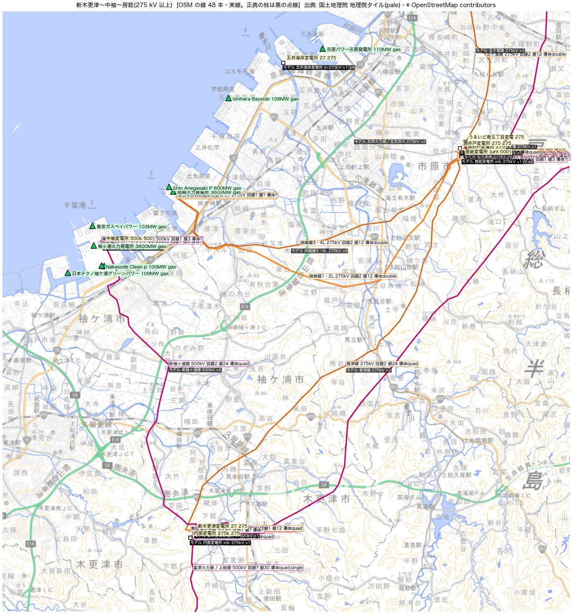
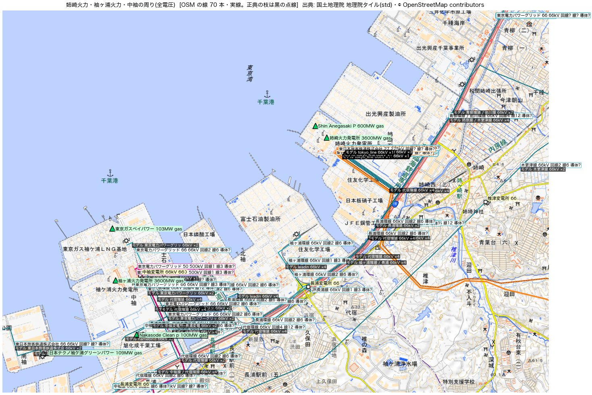
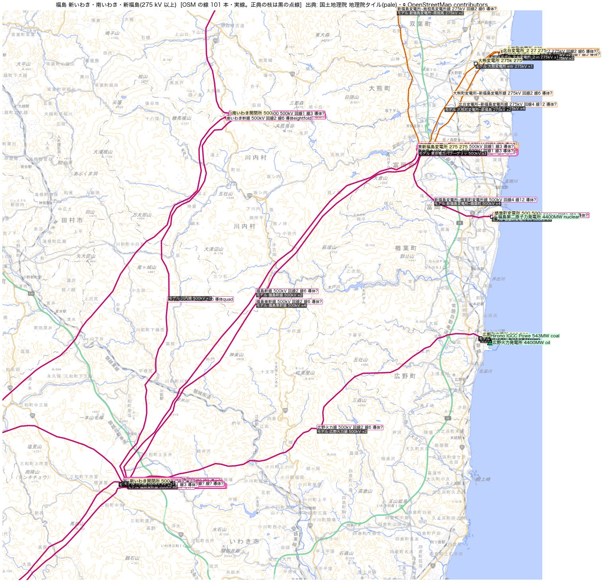

# 潮流を観測と同じ時刻で比べる — 初めての採点と、そこから見つかった 2 つの直し(2026-11-10)

オーナーの指示「データ収集をもう少し高度に。精度も上げるし、限界を超えたい」を受けて、まず今の精度を測った。
これまで観測との比べは年統計どうしの規模の比較で、「同じ時刻どうしの比較ではない」ことが限界として残っていた
(`flow_map_observed_compare_2026-10-03.md`)。11-07 から OCCTO の地内基幹送電線の潮流実績(30 分値)が毎時入るので、
日別断面と同じ時刻で比べられる。

**モデル**: Claude Fable 5.2。**出典**: 電力広域的運営推進機関 系統情報サービス(地内基幹送電線潮流実績・運用容量実績・
連系線潮流実績)、広域予備率Web公表システム 04、各社のエリア需給実績。線路ごとの値はこの報告に載せない(集計と、説明に要る数本だけ)。

## 先に結論

1. **同じ時刻で比べると、公開中の日別断面は規模は合うが、時間の動きを追えていない。**
   2026-11-09 の 24 時刻・317 線路で、|モデル|÷|観測| の中央値は ×0.95、時間の相関の中央値は +0.21、
   誤差(RMSE)は観測の大きさの 86%(中央値)。
2. **原因の 1 つは計算の手順だった(直した)。** 当日の断面は 1 時間ごとに継ぎ足す。燃料別の実績は需要より遅れて出るのに、
   先に計算した時刻をそのまま再利用していた。11-09 の公開中の断面で、燃料別の実績が当たっていたのは 24 時刻のうち 13〜20 時刻。
   全時刻を作り直すと、時間の相関は +0.21 → +0.47、誤差は 86% → 79% になる。
3. **もう 1 つは区域の収支(直しの案・既定 OFF)。** 区域ごとの(発電 − 需要)が公表の受け渡しから GW の単位でずれ、
   ずれた分を基準の母線 1 点が肩代わりしていた(11-08 の 12 時で 東 3.7 GW・西 2.0 GW・北海道 0.6 GW)。
   連系線の公表値に合わせると、時間の相関は +0.47 → +0.59 になる。線路の潮流には合わせていない。誤差の大きさはほとんど変わらない(79% → 77%)。
4. **残る誤差は少数の線路に集まっている。** 誤差の大きい 50 本(317 本の 16%)が、誤差の合計の 48% を占める。
   先頭は東京湾の東岸の 500 kV(新袖ヶ浦線・印旛線・房総線・君津線)と福島の 500 kV(福島幹線・福島東幹線)。
   その多くは時間の動きは合っていて(相関 0.98 前後)、並行する経路への分かれ方が違う。
   注入を動かすだけでは説明できない(線を伏せた同化の実験)ので、発電所の繋ぎ先と網の側を一次資料で確かめる所。
5. **観測が終日 0 の線路が 24 本ある**(開放か停止とみられる)。モデルは全部つながった状態で流している(東京東線に 1.2 GW)。
6. **発電所 1 台ごとの出力は、翌日には公表されている**(OCCTO のユニット別発電実績。468 ユニット・265 発電所、前日分まで)。
   これまで 1 週間分しか取っていなかった。名前でモデルの発電機に結ぶと発電量の 92% が結べ、発電機の出力を観測の値にできる
   (直しの案 #63・既定 OFF)。収支の直しと合わせると ΣRMSE/Σ|観測| は 0.78 → 0.74。ただし良くなる線路 112 本に対して悪くなる線路が 97 本ある。
7. **結べなかった 8% の先頭は、モデルに入っていない発電所**(五井火力 平均 2.1 GW・新小野田 0.9 GW・姫路天然ガス・田子倉・奥只見など、計 平均 6.4 GW)。
   五井の出力が千葉から抜けるので、新京葉線〜新古河線はかえって不足が広がる。次の一手は、この名簿でモデルの発電所を点検して足すこと。
8. **地図を目で見て分かったこと(§10)。** ここまでは数字だけで追っていた。地理院の地図に OSM の線とモデルを重ねて見ると、
   姉崎火力は 275 kV の姉崎線で房総へ出ているのに、モデルは中袖の 500 kV につないでいた。試しに直し、五井火力を足すと、
   新袖ヶ浦線の RMSE は 982 → 113、房総線は 1,537 → 525。導体数は正典に入っておらず、回線数は 187 kV 以上で 92 本が OSM のタグと合わない。

## 1. 採点の道具

`scripts/score_sync_flows.py`。OCCTO の当日分(`docs/data/flow_map/occto_today.json`、前日 0 時〜)と日別断面
(`docs/data/flow_map/days/<日付>.json`)を、線路ごと・時刻ごとに突き合わせる。

- OCCTO の線路 → モデルの線は `scripts/build_occto_line_crosswalk.py` の対応表(464 線路中 331 本。A 名前と両端・B 両端のみ・C 片端と線名)
- 30 分ごとの値は瞬時値とみなし、台形で 1 時間の平均にする(連系線で各社の 1 時間値と比べ、8 社中 7 社で、台形がコマの始まり・終わりの平均より近かった)
- 物差し(線路ごと): 比(|モデル|の平均 ÷ |観測|の平均)、時間の相関、向き(平均の符号。照合 C は大きさだけ)、誤差(RMSE を観測の|平均|と運用容量で割る)
- 集計: 中央値と割合。全体・電圧・照合の確からしさ・島・エリアで分ける

## 2. 見つかったこと(1): 当日に継ぎ足した時刻の使い回し

毎時の処理は、当日の断面を「新しい時刻だけ計算し、前に計算した時刻は再利用」で継ぎ足す。前日分は「ファイルが無ければ作る」。
燃料別の実績(エリア需給実績)は需要(でんき予報)より遅れて出る。11-09 の最後の更新(23:53)の時点で当たっていたのは、
区域により 13〜20 時刻ぶん。先に計算した時刻は容量比例の配分のまま残り、翌日になっても作り直されなかった。

| 2026-11-09 の断面 | 燃料別の実績が当たった時刻(区域ごと) | 時間の相関 | 誤差/観測 | ΣRMSE/Σ\|観測\| |
|---|---|---|---|---|
| 公開中(当日に継ぎ足したもの) | 13〜20 / 24(帳簿の関西は 37 と数え過ぎ) | +0.21 | 0.86 | 0.88 |
| 翌日に全時刻を作り直したもの | 23〜24 / 24 | +0.47 | 0.79 | 0.80 |

直し(`scripts/export_day_flows.py`):

- 時刻ごとに入力の署名(需要のある区域・燃料別実績のある区域・収支の直しの出どころ)を出力の `hour_inputs` に残し、
  署名が前回と同じ時刻だけ再利用する。署名の無い古い断面は再利用しない
- 入力も線構成も前回と同じなら、網を組む前に終わる。毎時の処理(`scripts/realtime_cycle.sh`)は前日分も毎回呼ぶ
- 帳簿(`fuel_actuals_ledger`)は時刻ごとの記録 `fuel_actuals_hourly` から作る。前は要約に足し込んでいて、作り直すたびに時刻を数え直していた
- 交流で解けた時刻を `ac_hours` に残す

## 3. 見つかったこと(2): 区域の収支のずれを基準の母線 1 点が肩代わりしていた

日別断面と同じ手順で作った注入を、区域ごとに足した(2026-11-08 の 12 時。主系統の中、発電機は計上エリアで数える)。

| 島 | 基準の母線が肩代わりした量 | 基準の母線 |
|---|---|---|
| 北海道 | 611 MW を出す | 泊変電所 275 kV(泊発電所は停止中) |
| 東 | 3,736 MW を出す | 中袖変電所 500 kV(千葉) |
| 西 | 2,029 MW を吸う | 東浜三丁目変電所 154 kV(中部) |

| 区域 | モデルの(発電 − 需要) | 公表の連系線から出した「域外へ」 |
|---|---|---|
| 東北 | +700 MW | +5,040 MW |
| 東京 | −4,681 MW | −5,268 MW |
| 関西 | +139 MW | −2,414 MW |
| 中部 | −464 MW | −4 MW |
| 北海道 | −666 MW | −55 MW |

ずれる理由は 3 つある。

1. 燃料別の実績が無い区域・時刻は、容量比例の配分で区域の中だけで釣り合わせる。東北(実績は約 2 か月遅れ)から東京への約 5 GW が入らない
2. 実績の出力がモデルの容量を超えると載らない(帳簿の clipped。11-09 は北海道で平均 478 MW、中部 353 MW、九州 369 MW、北陸 330 MW)
3. 主系統につながらない孤立片の需要は、孤立片ごとの基準の母線が賄う

(訂正の記録: はじめ「千葉の 500 kV でモデルが観測の数倍になるのは、中袖の肩代わりが流れているため」と読んだが、違った。
収支を合わせたあとも 印旛線は 観測 89 MW に対してモデル 2,393 MW で、ほとんど変わらない。§5 の「誤差の集まっている所」。)

### 連系線の公表値から区域の「域外へ」を出す

`src/powerflow/zone_closure.py` の `zone_net_export`。順方向(正)は OCCTO の定義(北本 = 北海道→東北、相馬双葉 = 東北→東京、
FC = 東京→中部、関西中国 = 関西→中国、阿南紀北 = 関西→四国、本四 = 中国→四国、関門 = 中国→九州)。
中部・北陸・関西の輪は 3 つのフェンスで出ていて、符号の決まりは値から決めた:
中部フェンス = 中部から出る向きが正、北陸フェンス = 北陸へ入る向きが正、関西フェンス = 関西へ入る向きが正
(2026-11-09〜10 の 92 コマで、中部 − 北陸 − 関西 の中央値は 6 MW、絶対値の中央値は 26 MW)。

別の公表(各社のエリア需給実績の連系線の欄)と 2026-11-09 の 24 時刻で比べた。

| 区域 | 各社の欄の符号 | 平均の差 | \|域外へ\|の平均 |
|---|---|---|---|
| 東京 | 受電が正 | 78 MW | 4,213 MW |
| 四国 | 受電が正 | 16 MW | 1,948 MW |
| 中部 | 受電が正 | 65 MW | 1,825 MW |
| 関西 | 受電が正 | 62 MW | 1,747 MW |
| 九州 | 送電が正 | 89 MW | 1,694 MW |
| 北海道 | 受電が正 | 19 MW | 308 MW |
| 中国 | 受電が正 | 38 MW | 210 MW |
| 北陸 | 受電が正 | 22 MW | 142 MW |

### 直しの案(介入 #62・既定 OFF)

区域の動いている発電機(出力 > 0。太陽光・風力はほかに動いている発電機があれば使わない)へ、出力の比で配り直して
「発電 − 需要 = 域外へ」にする。止まっている発電機は動かさない。増やす分は容量まで(超えた分は帳簿に書く)。
島の境(FC・北本)の注入も同じ出どころの値にする。連系線の実績が手元に無い日は、公表 04 の計画潮流を使う(帳簿に「計画」と残る)。

10-26 の「案 3」(`west_slack_surplus_2026-10-26.md`、同じ需要水準の OCCTO の受け渡しの中央値を足す)との違いは、
同じ時刻の公表値を使うことと、確かめに使う物差しが別のデータ(地内の線路の潮流実績)であること。
エリア間の潮流そのものは入力になるので、その検証には使えなくなる(案 3 と同じ)。

## 4. 前と後(2026-11-09 の 24 時刻、本番と同じ交流の計算)

4 島とも、どの組み合わせでも 24 時刻すべて交流で解けた。OCCTO の地内基幹 317 線路との同時刻の比べ。
下の 2 つ目の表は、公開中 → 作り直し → 収支の直し の 3 つ(ユニット別の実績は §6)。

| 2026-11-09(317 線路) | 比の中央値 | ×2 以内 | 時間の相関(中央値) | 相関 > 0.5 | 向き | 誤差/観測(中央値) | ΣRMSE/Σ\|観測\| |
|---|---|---|---|---|---|---|---|
| 公開中(当日に継ぎ足したもの) | ×0.95 | 59% | +0.21 | 19% | 74% | 0.86 | 0.88 |
| 全時刻を作り直し(§2 の直し) | ×0.90 | 57% | +0.47 | 49% | 74% | 0.79 | 0.80 |
| ＋区域の収支の直し(#62 の案) | ×0.92 | 56% | +0.59 | 55% | 74% | 0.77 | 0.78 |
| ＋ユニット別の発電実績(#63 の案。収支の直しなし) | ×0.83 | 54% | +0.61 | 58% | 74% | 0.76 | 0.77 |
| ＋ユニット別の発電実績と収支の直し(#62・#63) | ×0.83 | 60% | +0.62 | 61% | 76% | 0.75 | 0.74 |

| 電圧・島 | 時間の相関(公開中 → 作り直し → 収支) | ΣRMSE/Σ\|観測\|(同) |
|---|---|---|
| 500 kV(92) | +0.32 → +0.58 → +0.69 | 0.72 → 0.66 → 0.62 |
| 275 kV(125) | +0.15 → +0.40 → +0.52 | 1.18 → 1.08 → 1.08 |
| 220 kV(51) | +0.18 → +0.67 → +0.67 | 0.90 → 0.79 → 0.81 |
| 187 kV(47) | +0.17 → +0.33 → +0.33 | 0.90 → 0.84 → 0.82 |
| 北海道(34) | +0.22 → +0.38 → +0.51 | 0.90 → 0.85 → 0.79 |
| 東(91) | +0.35 → +0.54 → +0.66 | 0.85 → 0.82 → 0.81 |
| 西(190) | +0.18 → +0.48 → +0.57 | 0.89 → 0.78 → 0.75 |

集計の全体は `sync_scoreboard_2026-11-10.json`。

帳簿(11-09): 動かした量の最大は 東北 3,829 MW・関西 5,013 MW(燃料別の実績の無い 1 時刻)・東京 1,683 MW・九州 862 MW。
容量を超えて載せた量は 0。

読み方:

- 収支の直しで良くなるのは時間の相関(全体 +0.12)と、500 kV の誤差(0.66 → 0.62)。区域の間を流れる電力が効く層
- 275 kV 以下は誤差がほぼ変わらない。東では誤差/観測の中央値(0.84 → 0.89)と ×2 以内の割合(56% → 52%)がわずかに悪くなる。
  線路ごとに見ると、RMSE が 1 割以上良くなったのは 72 本、悪くなったのは 57 本。
  収支を合わせた分を動いている発電機に出力比で配るので、どの発電所が受け持つかは当たっていない
- 採否の根拠は公表値どうしの収支で、線路の潮流の改善は矛盾が無いことの確かめ

## 5. 誤差の集まっている所

収支の直しのあとの断面で、線路ごとの RMSE を大きい順に並べた。

- 上位 20 本で誤差の合計の 28%、上位 50 本で 48%。上位 50 本のエリアは 東京 23・中部 10・関西 7・九州 4・中国 2・東北 2・北陸 1・四国 1
- 上位 50 本のうち 16 本は、時間の相関が 0.7 を超える。動きは追えていて、大きさ(並行する経路への分かれ方)が違う

| 線路(OCCTO の名前) | 観測の\|平均\| | モデル | 時間の相関 | 読み |
|---|---|---|---|---|
| 新袖ヶ浦線(新木更津 → 新佐原)500 kV | 2,232 MW | 5,164 MW | 0.98 | 東京湾の東岸の火力の出力が、モデルではこの線に寄る |
| 房総線(房総 → 新京葉)500 kV | 2,403 MW | 1,316 MW | 0.99 | 実際はこちらの経路が太い |
| 印旛線(新佐原 → 新京葉)500 kV | 89 MW | 2,393 MW | −0.37 | 実際はほとんど流れていない |
| 君津線(新木更津 → 房総)275 kV | 360 MW | 1,841 MW | 0.78 | |
| 福島幹線(山)・福島東幹線(山)(新いわき → 新福島)500 kV | 2,227・1,798 MW | 222 MW | | 東北からの約 5 GW が通る経路。モデルではほとんど流れない |
| 東京東線(新京葉 → 新野田)275 kV | 0 MW(終日) | 1,220 MW | | 開放か停止とみられる線を、モデルはつないで流している |

- 東京湾の東岸: 発電所がどの母線・どの電圧に繋がるか(富津・袖ヶ浦・姉崎・五井・千葉・君津の大型機)を、公表の接続電圧と各社の系統図で確かめる所。
  介入 #55(公表の接続電圧の台帳)の「東の台帳」が残っている
- 福島: 相馬双葉幹線が 2026-06 に新いわき開閉所へつなぎ替わっている。モデルの新いわき〜新福島の間のつなぎを確かめる所
- **観測が終日 0 の線路**(11-09、|値| ≤ 3 MW が 40 コマ以上): 464 線路中 24 本。モデルに対応する線がある 12 本のうち、
  モデルが 100 MW 以上流しているのは 東京東線 1,220・西濃西部線 745・北大阪線 471・水道橋線 368・東新宿水道橋線 329・瀬戸北豊田線 196・佐久間東幹線(中)158 MW。
  対応が無い 12 本には 西上武幹線(500 kV、西群馬 → 新所沢)も入る。開放なのか停止なのかは、OCCTO の作業停止の実績と各社の系統図で確かめる
- ここに挙げたのは候補で、直しではない。採否は一次資料で決める

## 6. ユニット別の発電実績を当てる(介入 #63 の案・既定 OFF)

OCCTO の「ユニット別発電実績公開システム」は、認可出力 10 万 kW 以上のユニットの 30 分ごとの発電量を公表している。
2026-11-10 の夜に 11-01〜11-09 を取って確かめた(`scripts/fetch_hks.py`、10 日分で 10 秒): 前日分まで全コマが出ている。
468 ユニット・265 発電所。11-09 の 12 時台で、火力・原子力・水力などの発電量に対する覆いは
東京 90%・関西 92%・四国 90%・中国 89%・九州 87%・中部 75%・北陸 75%・北海道 74%。東北(燃料別の実績は約 2 か月遅れ)は 12.6 GW。

やり方(`src/powerflow/unit_actuals.py`、`scripts/export_day_flows.py --unit-actuals`):

- 発電所ごとに合算し、名前でモデルの発電機に結ぶ。名前は会社名・「発電所」などの語尾・号機の印を落としてそろえる。
  そろえても結べないものは台帳 `config/hks_plant_aliases.yaml`(15 件。確か・もっともらしいの別つき)。
  「片方がもう片方を含む」で結ぶのは、3 字以上・燃料が食い違わない・観測の最大が相手の容量の 3 倍以内・相手が 1 つだけのとき
- 結んだ発電機の出力を観測の値にする。燃料別の実績からその合計を引いた残りを、ほかの発電機へ容量の比で配る(これまでの配り方)。
  燃料別の実績が無い区域(東北)では、残りの発電機を「区域の需要 − 観測の合計」に合わせる。東北は観測の合計が需要を超えるので、残りは 0 になり、区域は送電する
- 収支の直し(#62)と一緒に使うと、収支を合わせる分は観測の無い発電機が受け持つ

11-09 の結び: 265 発電所のうち 215(同じ名前 195・台帳 15・含む 5)。1 日の発電量 1,890 GWh のうち 91.9% を結べた。

前と後(§4 の表の下 2 行)。収支の直しだけの断面と比べて:

- ΣRMSE/Σ|観測| 0.78 → 0.74、時間の相関 +0.59 → +0.62、×2 以内 56% → 60%、向き 74% → 76%
- 線路ごとの RMSE が 1 割以上良くなったのは 112 本、悪くなったのは 97 本。良くなる所と悪くなる所がはっきり分かれる

| 線路 | 観測の\|平均\| | 収支の直しだけ | ＋ユニット別の実績 | |
|---|---|---|---|---|
| 新袖ヶ浦線(新木更津 → 新佐原)500 kV | 2,232 MW | 5,164 MW | 3,195 MW | 容量比例が千葉の火力に載せ過ぎていた分が減る |
| 君津線(新木更津 → 房総)275 kV | 360 MW | 1,841 MW | 1,099 MW | |
| 印旛線(新佐原 → 新京葉)500 kV | 89 MW | 2,393 MW | 1,686 MW | |
| 松島線(松島 → 東佐世保)220 kV | 17 MW | 715 MW | 27 MW | 松島火力は当日 0 MW。容量比例は止まっている発電所にも出力を載せていた |
| 丹後幹線(新綾部 → 猪名川)500 kV | 1,608 MW | 949 MW | 1,353 MW | 若狭の原子力の出力が発電所ごとに入る |
| 新京葉線(新京葉 → 新古河)500 kV | 3,744 MW | 2,397 MW | 1,401 MW | **悪くなる**。五井火力(モデルに無い)の出力が千葉から抜ける |
| 新古河線(新古河 → 新所沢)500 kV | 3,368 MW | 2,189 MW | 1,453 MW | 同上 |
| 房総線(房総 → 新京葉)500 kV | 2,403 MW | 1,316 MW | 906 MW | 同上 |

帳簿(11-09): 観測の値が容量を超えて容量を引き上げた分は 中国 4,621 MWh・四国 5,752 MWh(モデルの容量が実物より小さい発電機がある)。
収支の直しで容量を超えて載せた分は 関西 1,668 MWh。

### モデルに無い・結べない大型の発電所

名前で結べなかった 50 発電所の発電量は 1 日 154 GWh(平均 6.4 GW)。発電量の大きい順(号機ごとの行はまとめた):

| 区域 | 公表の発電所 | 平均の出力(11-09) | 発電所の層(`docs/data/plants_all.geojson`)を日本語と英語の名前で探した結果 |
|---|---|---|---|
| 東京 | 五井火力発電所(1〜3 号機) | 2,072 MW | 見つからない |
| 中国 | 新小野田発電所(1・2 号機) | 934 MW | 見つからない |
| 東北 | 福島天然ガス発電所 | 514 MW | 見つからない |
| 九州 | ひびき発電所 | 456 MW | 見つからない |
| 関西 | 姫路天然ガス発電所 | 400 MW | 見つからない |
| 中国 | 宇部興産発電所 | 231 MW | 見つからない |
| 東北 | 田子倉発電所 | 206 MW | 見つからない |
| 東北 | 奥只見発電所 | 146 MW | 見つからない |
| 関西 | 大河内発電所 | 113 MW | 見つからない(同じ名前の別の県の水力だけ) |
| 中部 | 奥美濃発電所 | 111 MW | 所内の水力だけがある |

- ユニット別の実績の名簿は、10 万 kW 以上の発電所の点検表になる。無い発電所は、場所と繋ぎ先を一次資料で確かめてから足す(ここでは足していない)
- 発電所の層には、種別が食い違っているものもある(北海道の伊達火力が太陽光 350 MW として入っている、など)
- 原子力は、号機ごとの稼働が観測で入る。11-09 の平均: 泊 0・女川 796・柏崎刈羽 1,304・東海第二 0・浜岡 0・志賀 0・美浜 822・大飯 1,158・高浜 2,526・
  島根 808・伊方 872・玄海 2,304・川内 1,829 MW。日別断面に限れば、「止まっている炉を外すか」(判断待ち)は観測で決まる

## 7. 線を伏せた同化の実験(記録。良い結果ではない)

「誤差は注入(どこで発電・消費しているか)の見積もりから来るのか、網から来るのか」を見る実験
(`sync_scoreboard_2026-11-10/assim_holdout.py`、2026-11-08、直流の式)。

- 直流の式を自前で組み、pandapower の直流潮流と比べた: 観測の線で最大の差 0.00 MW(3 島とも)
- 観測の線(照合 A・B)を 5 つに分け、4/5 の線の観測から母線ごとの注入の直しを推定し(事前の幅 = 需要と発電容量の α 倍、
  区域の収支は変えない)、伏せた 1/5 の線を当てる

| 島(線の数) | 事前の誤差 | 伏せた線の誤差(α=0.1) | 当てはめた線の誤差 | 動かした注入 |
|---|---|---|---|---|
| 北海道(30) | 1.07 → 収支を合わせて 0.97 | 0.96 → 0.79 | 0.87 → 0.52 | 585 MW(需要 3,241 MW) |
| 東(88) | 0.99 → 0.84 | 0.77 → 0.71 | 0.57 → 0.51 | 16.7 → 14.4 GW(需要 28.8 GW) |
| 西(180) | 0.79 → 0.74 | 0.85 → 0.82 | 0.60 → 0.60 | 13.1 → 12.7 GW(需要 36.4 GW) |

(誤差は ΣRMSE/Σ|観測|。矢印の左は今の注入、右は収支を合わせた注入を出発点にした値。当てはめた線だけは誤差/観測の中央値)

- 西では、観測の 8 割を使っても伏せた線は事前より悪くなる。当てはめた線でも 5〜6 割の誤差が残り、そのために需要の 2〜6 割に当たる注入を動かす
- この試作で収支を合わせる配り方は「余力の比(止まっている発電機も含む)」で、本番の案(動いている発電機へ出力の比)とは違う
- つまり、今の網と今の注入の置き方では、注入を動かすだけでは観測を説明できない。考えられるもの:
  発電所 1 台ごとの出力(燃料の中は容量比例)、変電所ごとの需要(地点需要の公表は 4 社だけ)、網(並行の経路の欠け・インピーダンスは全網で合成)、
  線路の対応(モデルが別の線とまとめている所)
- この実験は推定のやり方が粗い(母線ごとに独立な幅)。「網が悪い」とまでは言えない。発電所の出力を観測で固定してからやり直す

## 8. 読み方の限界

- 比べた日は 2026-11-08〜10 だけ。OCCTO の当日分は前日 0 時からしか持たないので、長い期間は研究室の保管庫の統合 DB で回す
  (地内基幹の潮流実績は 2025-04-01 以降。まだ回していない)
- OCCTO の地内基幹は 187 kV 以上が中心。154 kV 以下は各社の潮流実績(年統計の比べだけ)
- 照合 B・C には、モデルが別の線とまとめているものが混ざる
- 30 分値を瞬時値とみなした。1 時間の平均との差は、変化の速い朝夕で残る
- ユニット別の実績と収支の直しは 11-09 の 1 日でしか測っていない。発電所の名前の結びは目で全部は確かめていない(台帳の 15 件と「含む」の 5 件は確かめた)
- モデルの時刻は 1 時間値。需要は でんき予報、発電は燃料別の実績を容量比例で配ったもの

## 9. 次に効くもの

| 何を | なぜ | いまの状態 |
|---|---|---|
| ユニット別の発電実績を毎日取り溜める | 前日分まで出ている(§6)。保存期間は未確認なので、早く取り溜めを始めるほどよい。取り溜めがあれば、過去の日も #63 で作り直せる | モデルに当てる側はできた(#63 の案)。取得は手で回した 10 日分だけ。研究室の保管庫の毎日の処理には入っていない |
| モデルに無い大型の発電所を足す | 結べなかった平均 6.4 GW の先頭は、発電所の層に無いもの(五井火力 2.1 GW など)。無いままユニット別の実績を当てると、周りの線路がかえって悪くなる(§6) | 名簿はできた。場所と繋ぎ先の確かめはこれから |
| 連系線の潮流実績を過去分も日別断面に渡す | 収支の直しを過去の日にも「実績」で当てる | 当日分(前日 0 時〜)と、公表 04 の計画潮流(2025-04〜)。実績の過去分は保管庫にある |
| 同時刻の採点を保管庫の全期間で回す | 3 日では季節・曜日が見えない。線路ごとの残差が毎日同じ向きなら、網の誤りの候補になる | 道具はできた。保管庫の統合 DB から読む入口が要る |
| 東の大型機の繋ぎ先を一次資料で確かめる(#55 の東の台帳) | 誤差の先頭が東京湾の東岸の 500 kV に集まっている(§5)。姉崎火力は地図で見て 275 kV、モデルは 500 kV(§10)。試しに直すと新袖ヶ浦線の RMSE が 982 → 113 | 西は 23 機の台帳がある。東は残っている。姉崎・君津共同が最初の候補 |
| 導体数を正典に運ぶ | 275 kV は単導体〜4 導体が混ざり、定数が 2〜4 倍違う。正典は導体数を持たない(§10) | OSM のタグは 500 kV で 47%・275 kV で 41%。公表のインピーダンス(10 社、1,009 線)と照らせる |
| 回線数の食い違いを目で確かめる | 187 kV 以上で 92 本が OSM のタグと合わない。廃線も入っている(§10) | 一覧はできた。1 本ずつはまだ見ていない |
| 線路の入り切りを観測から入れる | 観測が終日 0 の線路が 24 本あり、モデルはつないで流している(§5) | OCCTO の作業停止の計画・実績は保管庫に取り溜めてある。日別断面には使っていない |
| 止まっている原子力の炉を外す | 収支を合わせる前は、泊(停止中)が北海道の基準の母線として 0.6 GW を出していた | 潮流は稼働の状態を見ない(判断待ち) |

## 10. 目で確かめたこと(2026-11-10 夜)

先生「系統は目も使わないと改善しないけど。それもやった？」「線も正確に。回線も」「導体数も」。
ここまでは数字だけで追い、地図・空中写真・系統図を一度も見ていなかった。誤差の先頭の東京湾の東岸を、地理院の地図の上に
OSM の線(電圧・回線数・ケーブル数・導体数のタグ)とモデルの枝・発電所を重ねて見た(`sync_scoreboard_2026-11-10/inspect_map.py`)。





見えたこと:

1. 新木更津変電所から 500 kV が 2 方向に出る。北西は袖ヶ浦火力(中袖)へ、北東は新佐原へ。OSM はどちらも「新袖ヶ浦線」(2 回線・24 本・4 導体)
2. **姉崎火力からは 275 kV の姉崎線(1・2L と 3・4L)が構内から出て、房総変電所へ行く。500 kV の線は無い。**
   モデルは姉崎火力(容量 3,150 MW)と、同じ発電所の英語名の写し(1,950 MW)を、中袖変電所の 500 kV につないでいた。
   モデルには姉崎の構内に 275 kV の点が無く、容量の大きい発電機はいちばん上の電圧の近い母線に付く決まりのため
3. 君津共同発電所(1,152 MW)は、富津火力と同じ 500 kV の母線に付いている(製鉄所の構内の発電所)
4. 君津線(新木更津〜房総、275 kV)の OSM のタグは 24 本・4 導体。500 kV 並みの造りの線を 275 kV で使っている。モデルは電圧の級だけで定数を決める
5. モデルの五井火力線は、OSM の線の形が無い直線。発電所(五井火力)は無い
6. 発電所の層の誤り: 蘇我に「太陽光 1,440 MW」、KSC Chiba IPP が石炭 1,440 MW、姉崎が 2 つ(日本語名と英語名)

試し(正典は変えない。`sync_scoreboard_2026-11-10/whatif_chiba.py`): 姉崎(2 つ)を房総変電所の 275 kV へ移し、
五井火力(2,340 MW)を五井海岸変電所の 275 kV に足して、#62・#63 つきで東の島の 11-09 を計算した。

| 線路 | 観測の\|平均\| | 前(#62・#63) | 試し | RMSE 前 → 試し |
|---|---|---|---|---|
| 新袖ヶ浦線(新木更津 → 新佐原)500 kV | 2,232 MW | 3,195 MW | 2,131 MW | 982 → 113 |
| 房総線(房総 → 新京葉)500 kV | 2,403 MW | 906 MW | 1,910 MW | 1,537 → 525 |
| 印旛線(新佐原 → 新京葉)500 kV | 89 MW | 1,686 MW | 836 MW | 1,721 → 879 |
| 君津線(新木更津 → 房総)275 kV | 360 MW | 1,099 MW | 135 MW | 756 → 491 |
| 北千葉線(房総 → 新京葉)275 kV | 595 MW | 134 MW | 897 MW | 611 → 317 |
| 新京葉線(新京葉 → 新古河)500 kV | 3,744 MW | 1,401 MW | 1,867 MW | 2,432 → 1,936 |
| 東京東線(新京葉 → 新野田)275 kV | 0 MW(終日) | 875 MW | 1,158 MW | 895 → 1,185 |

- 東の島の ΣRMSE/Σ|観測| は 0.764 → 0.715、東京エリアは 0.73 → 0.67。千葉の幹線は観測に近づく
- 新京葉線はまだ半分。観測が終日 0 の東京東線をモデルがつないで流している分(約 1.2 GW)が、新京葉線に乗っていない
- これは読みを確かめる試しで、直しではない。繋ぎ先を正典で直すには、介入 #55 の台帳(公表の接続電圧)に東の発電所を足す

### 回線数と導体数(全国、OSM のタグ)

OSM の線の延長のうち、タグが付いている割合:

| 電圧 | 延長 | 回線数 | 導体数 | 導体数の内訳(km) |
|---|---|---|---|---|
| 500 kV | 8,807 km | 90% | 47% | 4 導体 3,239・8 導体 338・6 導体 262・2 導体 92 |
| 275 kV | 8,466 km | 86% | 41% | 2 導体 1,837・4 導体 797・単導体 505 |
| 220 kV | 2,963 km | 80% | 35% | 2 導体 516・単導体 494 |
| 187 kV | 3,271 km | 98% | 36% | 単導体 1,161 |
| 154 kV | 9,993 km | 77% | 18% | 単導体 1,382・2 導体 208 |
| 66 kV | 21,716 km | 86% | 20% | 単導体 4,072 |

- **導体数は正典に入っていない。** 正典の枝が持つのは電圧・回線数(par)・名前・形だけ。旧い系譜(`snapped_topology.py` の `_parse_wires`)は読んでいたが、今の系譜には運ばれていない。
  275 kV は単導体・2 導体・4 導体が混ざっていて、インピーダンスと容量は 2〜4 倍違う。モデルは電圧の級で 1 つの値
- **回線数の食い違い**(粗い見積もり: 187 kV 以上の正典の枝を、同じ名前・同じ電圧の級の OSM の線と比べた): 比べられた 897 本のうち、
  正典の回線数が OSM の範囲の外にあるのは 92 本(多い 78・少ない 14)。例: 鹿島線 ×17(線の形の無い枝)、河北線 1・2L ×6(OSM は 2)、
  姉崎線 3・4L ×6(OSM は 2。1・2L と合わせても 4)、佐久間東幹線(山線)×6(OSM は 2)
- 名前に「(廃線)」と付いた線(青梅線)が、275 kV の枝 5 本として正典に入っている
- この 92 本と廃線は、1 本ずつ地図と空中写真で確かめる候補。まだ見ていない

## 11. 潮流マップの組み方を正典にそろえる・東の台帳・福島(2026-11-12)

先生「良いよ」(姉崎などの繋ぎ先を、公表の接続電圧の台帳 #55 に東の発電所を足す形で直す)。

### 見つかったこと: 潮流マップは正典と違う組み方で網を組んでいた

台帳(`config/plant_connections.yaml`)には、姉崎(275 kV・房総)・横浜・勿来が 10-29 から入っていた。それでも §10 の
日別断面で姉崎が中袖 500 kV に付いていたのは、潮流マップの 2 本(`scripts/export_flow_map_data.py` の基準と NOW 断面、
`scripts/export_day_flows.py` の日別断面)が、正典の潮流(`src/powerflow/full_from_built.py`)・配布ケース・CIM と違う組み方を
していたため。

| | 正典・配布ケース・CIM | 潮流マップ(直す前) |
|---|---|---|
| 発電機の付け方の規則(#24・#41) | 島ごと(北海道・西 `capkv`、東・沖縄 `cap`) | 全島 `cap` |
| 公表の接続の台帳(#55) | 渡す | 渡さない |
| 出力の目標(#54①) | 同じ成分・同じエリアの負荷、予備率なし | 旧挙動 |
| 残った損失を発電機へ(#54②) | する | しない |

台帳の 26 機のうち 19 機(東 3・西 14・北海道 2)が、正典と違う所に付いていた。io の潮流マップが中身と違うものを見せていた。

直し(正典は変えない):
- `src/powerflow/full_from_built.py` に `model_attach_kwargs(island)`(付け方の規則と台帳)と `model_recipe_tag()`(組み方の印)
- 潮流マップの 2 本は、付け方・需給の合わせ方を正典と同じ既定にする
- 日別断面の時刻の署名に組み方の印を入れ、台帳などを変えたら古い時刻を使い回さない
- 試験 `tests/test_flow_map_recipe.py`(2 本のスクリプトが `"cap"` を書き込まない・#54 を渡す・印が台帳で変わる)

| 2026-11-09(317 線路) | 時間の相関(中央値) | 誤差/観測(中央値) | ΣRMSE/Σ\|観測\| |
|---|---|---|---|
| 旧い組み方で全時刻を作り直し | +0.47 | 0.79 | 0.80 |
| 正典の組み方 | +0.56 | 0.76 | 0.76 |
| 旧い組み方＋#62＋#63 | +0.62 | 0.75 | 0.74 |
| 正典の組み方＋#62＋#63 | +0.65 | 0.72 | 0.70 |

- 東の島の ΣRMSE/Σ|観測| 0.82 → 0.74(直しなし)。姉崎の周り(＋#62＋#63): 新袖ヶ浦線の RMSE 982 → 306、君津線 756 → 207、北千葉線 611 → 343
- 悪くなった所もある(＋#62＋#63、RMSE が 1 割以上 良く 62 本・悪く 45 本): 三重連絡線 301 → 591・能勢線 1,988 → 2,228・山城北線(西の台帳の 14 機が動いた所)。
  正典ではもともとこの付け方なので、潮流マップが正典の弱点を見せるようになったということ。目で見るのは次の回

### 東の台帳: 新姉崎を足した

姉崎の構内には、OSM の地物が 2 つある。「姉崎火力発電所」(容量 3,150 MW)と、英語名の「Shin Anegasaki Power Plant」(1,950 MW・姉崎の新 1〜3 号機)。
2 つの点は 300 m ほどの距離で、地理院の地図で同じ構内。台帳は日本語名だけだったので、新姉崎は中袖 500 kV のままだった。
同じ姉崎線(275 kV・房総)を根拠に、台帳に 1 行足した。

- 正典の島の試験(東・西・北海道、全規模の AC)は通る
- 東の日別断面(11-09・＋#62＋#63): 東の ΣRMSE/Σ|観測| 0.722 → 0.712、新袖ヶ浦線の RMSE 306 → 92、北千葉線 343 → 179、房総線 1,208 → 1,003
- ⚠ 姉崎の旧号機(1〜6 号機・3,600 MW)は廃止されている。発電所の層の 3,150 MW はその旧号機とみられ、新 1〜3 号機と二重になっている。
  ユニット別の実績(#63)は名前が同じ「姉崎火力発電所」に結ぶので、出力は合うが容量は二重のまま。発電所の層を直すのは別の件

東電の基幹の一覧で、端が「発電所」の 275 kV の線は 15 本ある。

| 線 | 発電所 | 扱い |
|---|---|---|
| 姉崎線 1・2L/3・4L | 姉崎 | 台帳(10-29)＋新姉崎(今回) |
| 横浜港北線 | 横浜 | 台帳(10-29) |
| 沼原線(新栃木 → 発電所) | 沼原 | モデルはもう 275 kV の沼原電力所に付いている。足さない |
| 田子倉線・奥只見線 | 田子倉・奥只見 | 発電所の層に無い(§6) |
| 梓川線 | 梓川の水力(安曇・水殿など) | 1 つに決められない |
| 佐久間東幹線 | 佐久間 | 50 Hz と 60 Hz の両方の機があり、この線の分を分けられない |
| 阿武隈線・鹿島の「送電線」・中東京幹線・東京南線 1・2L/3・4L・川崎高輪線・川崎豊洲線 | — | 線名だけでは決めきれない |

### 福島: 相馬双葉幹線の 2026-06 の接続変更が網に入っていない(候補。正典には入れていない)



- OCCTO 運用容量検討会 2026 年度 第 2 回 資料 3 の 12 枚目(変更前)と 13 枚目(変更後〜第二連系線の運開前)の系統図:
  変更前は 相馬双葉幹線が南相馬 → 南いわき開閉所。変更後は南いわきに入らず、福島山幹線につながって新いわき開閉所へ。
  南いわきに残るのは 川内線(→ 新いわき)と南いわき幹線だけ
- OSM(と正典)は変更前の形: 「南相馬変電所~南いわき開閉所線」500 kV 2 回線が南いわきに入る(OSM の way 199522664)
- 観測(11-09 の平均、OCCTO の正方向): 川内線(南いわき → 新いわき)−1,076 MW、福島幹線(山)(新いわき → 新福島)+2,227 MW、
  福島東幹線(山)(同)−1,798 MW。川内線は新いわき → 南いわきへ流れている(相馬双葉の電気は南いわきを通っていない)
- 試し(`sync_scoreboard_2026-11-10/whatif_fukushima.py`: 相馬双葉の南いわきの端を新いわきへ移す。東・11-09・＋#62＋#63):
  川内線の RMSE 2,121 → 608(向きも合う)、福島東幹線(山)1,369 → 476、勿来幹線 263 → 78。
  ただし福島幹線(山)は 2,683 → 3,577 に悪くなる。東の ΣRMSE/Σ|観測| 0.722 → 0.714
- 正典に入れない理由: (1) 相馬双葉幹線が福島山幹線のどこにつながったかが、系統図(模式)からも地図からも決まらない。
  (2) モデルは福島幹線と福島東幹線を 1 本の枝(4 回線)にまとめている。観測では 2 本が逆向きに流れている(+2,227 と −1,798)ので、
  1 本のままでは表せない。先に 2 本を OSM の way ごとに分ける必要がある
- 福島第二原子力(4,400 MW、廃炉)が発電所の層に入っている。ユニット別の実績(#63)を当てると出力は 0 になるが、正典の潮流では容量比例で出力が乗る
  (稼働していない炉を外すかは判断待ち)

### 公開中の基準ファイルの古さ(記録)

`docs/data/flow_map/meta.json` の北海道の線構成の署名(c358ecbcb531)は、今の正典で組んだ網の署名(379a5057624f、NOW 断面と同じ)と違う。
日別断面は基準ファイルの線に合わせて書くので、北海道は線の 98.4% だけに値が入る。基準ファイルは毎時の処理では作り直していない。

## 12. 2 日目で確かめ、#62・#63 を日別断面の既定にした(2026-11-14)

先生「全てあなたが検証してよければ取り込んでマージすればいい」。#62・#63 を既定にする前に、効き目を分けて測り、別の日でも確かめた。
どれも正典の組み方(§11)の上で、OCCTO の地内基幹 317 線路と同時刻で比べた。

| 日 | 断面 | 時間の相関 | 誤差/観測 | ΣRMSE/Σ\|観測\| | 線路ごとの RMSE(正典の組み方から 1 割以上) |
|---|---|---|---|---|---|
| 11-09 | 正典の組み方 | +0.56 | 0.76 | 0.76 | — |
| 11-09 | ＋#62 | +0.58 | 0.74 | 0.74 | 良く 45・悪く 49 |
| 11-09 | ＋#63 | +0.64 | 0.71 | 0.72 | 良く 104・悪く 101 |
| 11-09 | ＋#62＋#63 | +0.65 | 0.72 | 0.70 | 良く 127・悪く 90 |
| 11-13 | 正典の組み方 | +0.42 | 0.81 | 0.78 | — |
| 11-13 | ＋#62＋#63 | +0.54 | 0.74 | 0.71 | 良く 130・悪く 88 |

- 2 日とも、北海道・東・西のどの島でも ΣRMSE/Σ|観測| が下がる(11-13: 北海道 0.86 → 0.80・東 0.76 → 0.75・西 0.79 → 0.67)
- #62 だけでは線路ごとの良し悪しが半々。区域の収支のずれ(GW の単位で基準の母線が肩代わり)は事実なので直すが、
  収支を合わせた分をどの発電所が受け持つかは #63 が無いと決まらない。2 つは一緒に使う
- 悪くなる線路は、モデルに無い発電所(五井など)・1 本にまとめた並行の線(福島)の周りに多い。直しの側ではなくモデルの欠けの側の問題
- 採否の根拠は、どちらも推定を公表値(連系線の潮流・発電所ごとの出力)に置き換えること。線路の潮流が観測に近づくのは、矛盾が無いことの確かめ

既定にしたこと:
- `scripts/export_day_flows.py` の `--zone-closure`・`--unit-actuals` を既定 ON(環境変数 `AJG_ZONE_CLOSURE=0`・`AJG_UNIT_ACTUALS=0` で切れる)
- 毎時の処理(`scripts/realtime_cycle.sh`)が、ユニット別の発電実績を日に 1 回(6 時以降)、直近 3 日ぶん取る。置き場は本体の
  `data/external/occto/hks`(環境変数 `AJG_HKS_DIR`)。前日の断面は、原本が届いた回に署名が変わって作り直される
- 日別断面の説明文に、ユニット別発電実績の出典と加工の旨を書く(公開システムの利用条件)。原本の CSV は git に入れない

まだしていないこと:
- NOW 断面(`export_flow_map_data.py --realtime`)には #62・#63 を入れていない(当日のユニット別の実績はまだ出ていない)
- 日別断面のうち、毎時の処理が作り直すのは当日と前日だけ。それより前の日は前の組み方のまま(説明文で見分けられる)
- 台帳(#55)に新姉崎を足したので、正典の潮流・N-1・配布ケース・CIM の段を作り直した(このコミット)

## 再現

```bash
# 対応表(git の外)を当日分の線路の一覧から作る
PYTHONPATH=. python3 scripts/score_sync_flows.py --build-crosswalk
# 公開中の断面を採点
PYTHONPATH=. python3 scripts/score_sync_flows.py
# 直しなし・ありを別の場所に作って比べる
PYTHONPATH=. python3 scripts/export_day_flows.py --date 20261109 --out-dir /tmp/days_base
PYTHONPATH=. python3 scripts/export_day_flows.py --date 20261109 --zone-closure --out-dir /tmp/days_closed
PYTHONPATH=. python3 scripts/score_sync_flows.py --days-dir 前=/tmp/days_base 後=/tmp/days_closed \
    --out docs/reports/sync_scoreboard_2026-11-10.json
# 線を伏せた同化の実験(当日分に入っている日だけ)
PYTHONPATH=. python3 docs/reports/sync_scoreboard_2026-11-10/assim_holdout.py --root . \
    --crosswalk data/external/occto/occto_line_crosswalk.json --date 20261109 --balance
```

試験: `tests/test_zone_closure.py`・`tests/test_score_sync_flows.py`・`tests/test_day_flows_reuse.py`。
