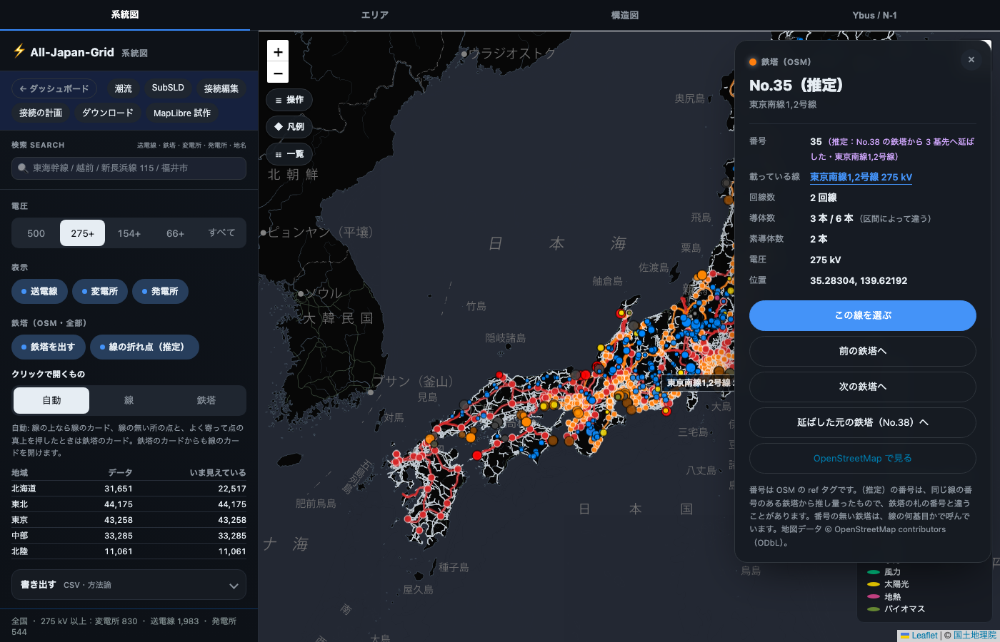

# 鉄塔の番号を線の端まで延ばす推定（2026-11-07）

先生の「番号の推定も進めて」に応えるもの。番号の付く鉄塔を増やすため、同じ線の番号のある鉄塔から番号を延ばす。
延ばした番号は**推定**で、鉄塔の札の番号とは違うことがある。カードでは必ず「推定」と書き、どの鉄塔の番号から何基先へ延ばしたかを出す。

あわせて、鉄塔の層を Mac で作っても Linux で作っても同じになるよう、鉄塔の地域の決め方を直した（下の「OS に依らない地域の決め方」）。

## 延ばす決まり（`src/topology/osm_routes.py` の `extend_numbers`）

- 対象: 同じ線の上の鉄塔の並び（`chains`）のうち、番号のある鉄塔（OSM の `ref`）が 2 基以上あり、**どの隣り合う 2 基のあいだも 1 基ごとに番号が 1 つずつ増える（どこも減る）**もの。向きと間隔がそろうことを、数え方がこの並びに沿っている根拠にする。
- 延ばし方: 一番端の番号のある鉄塔から、並びの端まで 1 基ごとに 1 つずつ。番号が 1 より小さくなる所で止める。
- 延ばさない所:
  - 番号の向きか間隔がそろわない並び（建て替えで番号が戻る、間が飛ぶ）
  - 並びによって違う番号になる鉄塔（併架など）
  - 前後の番号から埋めた推定（今までの `infer_numbers`）とぶつかる鉄塔。あいだを埋める方が根拠が強いので、そちらを残す
- 書き出し（`towers_<地域>.json` の `est`）: 前後から埋めた推定は `[番号, 路線]`。延ばした推定は `[番号, 路線, 元の鉄塔の地域, 元の鉄塔の node id, 元の番号, 何基先]`。
- カード: 「35（推定：No.38 の鉄塔から 3 基先へ延ばした・東京南線1,2号線）」。見出しは「No.35（推定）」。「延ばした元の鉄塔（No.38）へ」のボタンで、元の鉄塔に飛ぶ。



## 前と後（全国。OSM 2026-11-05、nas03 の 20261105 の抽出）

| 鉄塔 | 前 | 後 |
|---|---:|---:|
| 鉄塔の数 | 246,609 | 246,609 |
| 番号か名前（OSM） | 32,460 | 32,460 |
| 番号（推定：前後の番号から） | 1,855 | 1,855 |
| **番号（推定：端まで延ばした）** | 0 | **7,895** |
| 番号か名前のある鉄塔の合計 | 34,315（13.9%） | **42,210（17.1%）** |
| 線の何基目かだけ（北の端から数えた順） | 182,888 | 177,797 |
| どれも無い | 29,406 | 26,602 |

延ばした推定は 7,953 基で、うち名前も番号も無かった鉄塔が 7,895 基。事前の見積もり（+8,618）より少ないのは、前後から埋めた推定とぶつかる所と、並びによって番号が違う所（併架など）を外したため。

### 地域ごと（後）

地域の決め方を直したので、鉄塔が地域のあいだを移っている（下の節）。地域ごとの「前」と「後」はそのまま比べられないので、鉄塔の数の動きと、後の値を出す。

| 地域 | 鉄塔の数（前 → 後） | 番号か名前（後） | うち延ばした推定 |
|---|---:|---:|---:|
| 北海道 | 31,624 → 31,651 | 3,680（11.6%） | 1,381 |
| 東北 | 44,015 → 44,175 | 943（2.1%） | 342 |
| 東京 | 43,616 → 43,258 | 23,587（54.5%） | 2,384 |
| 中部 | 35,041 → 33,285 | 3,015（9.1%） | 1,065 |
| 北陸 | 7,564 → 11,061 | 1,411（12.8%） | 880 |
| 関西 | 27,154 → 25,469 | 2,955（11.6%） | 595 |
| 中国 | 21,470 → 21,293 | 369（1.7%） | 235 |
| 四国 | 8,144 → 9,242 | 14（0.2%） | 0 |
| 九州 | 26,837 → 26,031 | 6,154（23.6%） | 998 |
| 沖縄 | 1,144 → 1,144 | 82（7.2%） | 15 |

## OS に依らない地域の決め方（`scripts/export_osm_routes.py` の `region_lookup`）

160core（Linux）で鉄塔の層を作り直すと、入力（正典 `all.json` と OSM の JSON）もコードも同じなのに、git に入っている層（Mac で作った）と 20 ファイルで食い違った。

- 原因: 鉄塔の地域を「いちばん近い正典の点の地域」で決めていて、地域をまたぐ写し（同じ線が 2 つの地域の取り出しに入る）では、同じ座標に地域の違う点が並ぶ。STRtree の `nearest` がそのどちらを返すかは、木の作り方の順で OS によって変わる。
- 直し: 同じ距離の候補を全部取り（`query_nearest(all_matches=True)`）、鉄塔の座標の領土（都道府県→エリア。正典の #5 と同じ `area_of_coord`）の地域があればそれ、無ければ地域の並びの最初を選ぶ。
- 確かめ: git に入っている鉄塔の座標 246,609 基に当てて、答えのハッシュを比べた。

| 決め方 | Mac | Linux（160core） |
|---|---|---|
| 古い決め方 | `8e5927d9…` | `9e234cf7…`（Mac と違う） |
| 新しい決め方 | `1008f1ef…` | `1008f1ef…`（一致） |

古い決め方と新しい決め方で地域が変わるのは 19,969 基（Mac）で、どれも地域の境の写しのある所。たとえば北陸の領土にあるのに中部の写しの点に引かれて中部に入っていた鉄塔が、北陸に戻った（北陸 7,564 → 11,061 基）。路線の地域（`routes_<地域>.json`）も同じ決め方で決まる。

## 作り直し方

鉄塔の生データは NAS にしか置かない（取得データは Mac に置かない決まり）ので、nas03 をつないだ所（pws-160core など）で作り、出力（git に入れる派生物）を持ち帰る。地域の決め方が OS に依らないので、どこで作っても同じになる。

```bash
PYTHONPATH=. python3 scripts/export_osm_routes.py      # 既定で nas03 の 20261105 の抽出を読む
```
