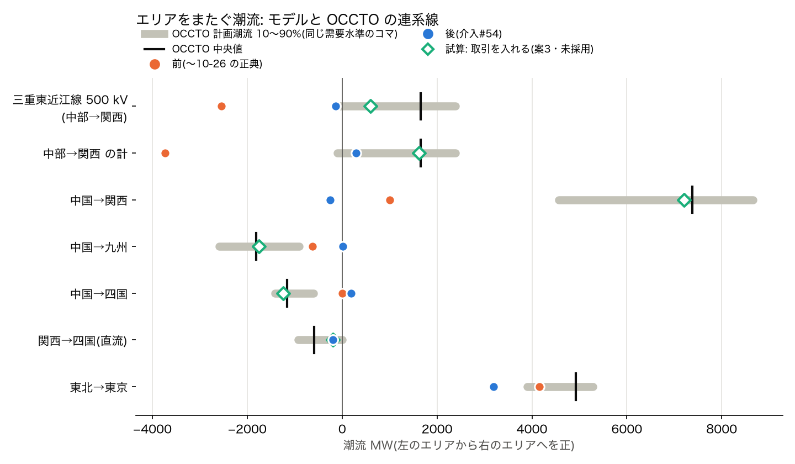
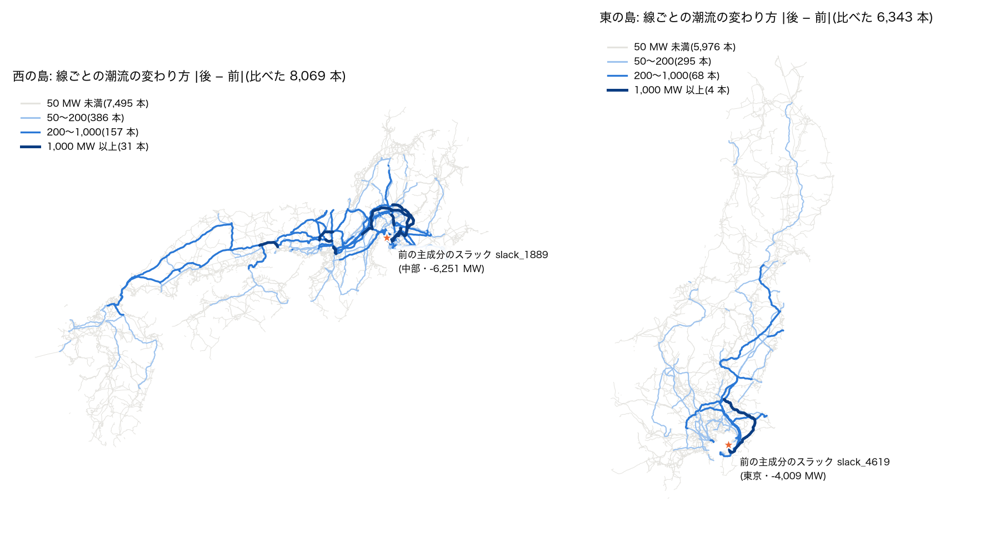

# 主成分のスラックが島の余りを吸っていた件(issue #99)・介入#54 2026-10-26

外部の方の issue #99 は、次の 3 点を指摘した。
- 正典の西の島では、主成分のスラック(中部の 1 バス)が島全体の余り 6.2 GW を吸っている。
- これが架空の負荷として働き、エリア間の潮流をゆがめている。
- その結果、三重東近江線の向きが OCCTO と逆になっている。

この報告では、次のことをまとめる。
- 指摘を再現したこと
- 直し方(issue の案 1・案 2)を介入#54 として入れたこと
- 前後の比較
- OCCTO と、各社の線路の潮流実績との照合

分析と実装は Claude Opus 5.5。根拠の表と図は `west_slack_surplus_2026-10-26/` にある。
- `stats.json`: `measure.py` の出力
- `occto_reference.json`: `occto_reference.py` の出力
- 図 2 枚: `fig.py` が描く

## わかったこと

1. **指摘どおりだった。しかも西だけではない。** 主成分のスラックは、どの島でも余りを吸う架空の負荷になっていた。

   | 島 | 主成分のスラック | 前 | 後 |
   |---|---|---:|---:|
   | 西 | `slack_1889`(中部・東浜三丁目変電所 154 kV) | −6,251 MW | +1 MW |
   | 東 | `slack_4619`(東京・中袖変電所 500 kV) | −4,009 MW | +1 MW |
   | 北海道 | `slack_480` | −267 MW | −1 MW |
   | 沖縄 | `slack_62` | −151 MW | −0 MW |

   出どころは `balance_by_zone` の出力の目標「エリアの負荷全体 × (1 + 予備率 0.05)」の 2 か所。
   - **予備率の分**を出力に乗せていた。予備率は OCCTO の公表(エリア需要・供給力・予備力を別々の列に持つ)のとおり、供給力の余裕であって出力ではない。
   - **主成分から届かない孤立片の負荷**も目標に数えていた。孤立片の負荷は、孤立片ごとの合成スラックが別に賄う。そのため二重に数えていた(西で 4.2 GW)。

2. **吸い込みの場所に大きな火力が集まっていたので、過負荷が隠れていた。**
   - 西のスラックのバス(東浜三丁目 154 kV)には、知多・東海の臨海部の 6 発電所 計 6,985 MW が載っている(西名古屋・知多第二・知多・名古屋東海・名南共同・愛知製油所)。発電所の点(`data/chubu_plants.geojson`)からバスまでは 0.4〜6.9 km。どのバスに繋ぐかは介入#24 の規則で推定したもので、実際の接続は確かめていない。
   - ⚠(2026-10-28 追記)この 6,985 MW の集中は**配布ケースの網だけ**のもの。配布ケース(`build_canonical_net`)は発電機の繋ぎ先の規則を `cap` に固定していて、介入#41 の島別の既定(西は `capkv`)に追随していなかった。全規模の潮流と N-1 は `capkv` で組んでいて、そちらでこのバスに載るのは愛知製油所 226 MW だけ。食い違いは別の PR で直す(`docs/reports/nagoya_port_attach_2026-10-28.md`)。
   - 前は、このバスで 6,251 MW を吸っていた。発電の出力を差し引くと、正味では約 1.8 GW の負荷になっていた。
   - 後は、正味約 4 GW の出しになる。そのため、周りの 154 kV の線と 275/154 kV の変圧器に過負荷が出る(下の N-1)。

3. **直しても、エリア間の潮流は実績に合わない。** 案 1・案 2 は「間違いを消す」直しで、各エリアが自分の負荷を自分で賄う断面になる。

   OCCTO の計画潮流と比べた(西の需要の合計がモデルと同じ 73.9 GW ±3% のコマ 708 個の中央値、図 1)。実際には、関西は約 8.9 GW を受け入れている(中国から 7.4 GW、中部から 1.7 GW)。この取引は、モデルからは抜けたままになる。

   | 区間(前のエリア → 後のエリアを正) | OCCTO 中央値 | 前 | 後 |
   |---|---:|---:|---:|
   | 三重東近江線 500 kV(中部→関西) | +1,659 | **−2,547** | −138 |
   | 中部→関西 の計 | +1,659 | −3,730 | +295 |
   | 中国→関西 | +7,376 | +1,005 | −254 |
   | 中国→九州 | −1,812 | −623 | +18 |
   | 中国→四国 | −1,156 | −3 | +191 |
   | 東北→東京 | +4,929 | +4,154 | +3,196 |

   前の向きのいくつか(中国→関西など)が合って見えたのは、中部に余りが吸い込まれていたための偶然だった。

   

4. **独立の物差しでは、ほぼ変わらない。** 各社が公表する線路の潮流実績(2024 年度の年平均)と、向きを比べた。照合は潮流マップと同じ `export_obs_compare.match_all` で、両端が解決し、平均がはっきり片向きの線だけを数えた。
   - 西: 140/210 → 145/210
   - 東: 128/165 → 128/164
   - 北海道: 18/25 → 18/25

   エリア間の取引が抜けても、エリアの中の向きは悪くならない。

5. **取引を入れる試算(案 3)は、エリア間を OCCTO に近づける。ただし、その一致は根拠にならない。**
   - 試算では、各エリアの出力の目標に、同じ需要水準の OCCTO の受け渡しの中央値を足した。
   - 西は AC で解ける。中国→関西は +7,202、中部→関西の計は +1,614 になる。ただし、三重東近江線そのものは +601 で、残りはエリアの境をまたぐ別の線に流れる。
   - 東は AC で解けない(DC のみ)。
   - 入力が照合と同じ OCCTO の数字なので、エリア間が合うのは作りによる。独立の物差しは 145/210 → 142/209 で、良くならない。
   - 採否はオーナーの判断に回す(下の「残り」)。

## 直したこと(介入#54・正典・既定 ON)

- **① 出力の目標**(`balance_by_zone(connected=True)`)
  - 目標を「その発電機と同じ連結成分にある、同じエリアの通電している負荷」にした。
  - 予備率は乗せない(予備率は Pmax の余裕としてだけ残る)。
- **② 損失の配り直し**(`spread_slack`)
  - 解いたあと、最大の成分のスラックに残った分(ほぼ損失)を、同じ成分の発電機へ出力比で配って解き直す。上限は Pmax。
  - 参加係数を出力比にした分散スラックと同じ形で、スラックのバスは位相の基準として 1 個のまま。スラックを複数置くと、スラックどうしの間に架空の潮流が生じる。
  - 解き直しで解けなければ、配る前の解を返す。
  - 配った量は帳簿に残る(`powerflow_full/summary.json` と配布ケースの `meta.json` の `slack_spread`)。
- **通る場所**: 正典の手順(`scripts/regenerate_all.py`)の全規模の潮流・N-1・配布ケース・CIM Level 2、それと `ajgrid zone`。配布ケース・CIM・ゾーン・正典の島の試験は、解き方を `export_matpower_canonical.solve_canonical` 1 つにまとめた。
- **関数の引数既定は旧挙動のまま**(#24・#26 と同じ)。what-if 群が比べる基準を、黙って変えないため。
  - モデルを組む側だけが、定数 `CONNECTED_DISPATCH` を渡す。
  - 潮流マップ(UC・日別断面)と、感度の派生ツール(hosting・IBR)は、まだ旧既定のまま。追随は別にする。
- **無効化**: `--no-connected-dispatch`(`run_full_powerflow_from_db.py`・`export_matpower_canonical.py`)、または定数を False。

## 前後の比較(正典)

**配布ケースの解き方**(素朴 NR・畳む・地点需要あり。`stats.json`)

| 島 | 損失 前→後 | vm の最小 前→後 | 線の潮流が 50 MW 超変わった本数 | 最大の変化 |
|---|---|---|---:|---:|
| 西 | 2.17 → 1.95 % | 0.7755 → 0.7761 | 636 / 8,109 | 3,758 MW |
| 東 | 3.00 → 3.06 % | 0.8564 → 0.8569 | 369 / 6,443 | 3,535 MW |
| 北海道 | 2.63 → 2.67 % | 0.8604 → 0.8604 | 8 / 858 | 105 MW |
| 沖縄 | 1.93 → 1.99 % | 0.9719 → 0.9719 | 3 / 96 | 77 MW |

4 島とも AC で解ける。網の規模(バス・線・変圧器・畳んだバス)は変わらない。



図 2 で、大きく変わった線の場所を示す。線は全規模の潮流(`powerflow_full`)、星は配布ケースの網での前の主成分のスラック。西は、前のスラックのある名古屋南部から、関西・中国へ延びる 500/275 kV の幹線。東は、前のスラック(中袖)の周りの房総・京葉と、東北から東京への幹線。

**全規模の潮流**(`docs/data/powerflow_full`・畳まない系譜)

| 島 | AC の最大負荷率 前→後 | DC の最大負荷率 前→後 |
|---|---|---|
| 東 | 998 → 897 % | 875 → 788 % |
| 西 | 639 → 607 % | 748 → 687 % |

⚠ **西の vm の最小が 0.728 → 0.569 に下がった。**
- 場所は呉の南の 66 kV のアンテナ(江田島・能美・大柿・倉橋)。発電機の無い木で、負荷 172 MW を宮原変電所から 1 本で受ける。
- 下がった理由は、木の根の呉 66 kV が 0.913 → 0.866 に下がったこと。中国エリアの出力の目標は、予備率と孤立片を数えなくなって 9,371 → 8,738 MW に下がった。そのため、広島・呉の近くの電源が減った。
- 配布ケースは、この木そのものを介入#52 で畳んでいる(前も後も同じ 6 バス)。前の 0.728 も、物理的にはあり得ない値だった。

**N-1**(`docs/data/n1_canon/summary.json`・DC で全枝を開放し、上位 5 件を AC で解き直す)

| 島 | 平常時の過負荷(物理の枝) | 新しい過負荷を起こす開放 | 平常時の最大負荷率 |
|---|---|---|---|
| 西 | 22 → 37 | 147 → 263 | 256 → 278 % |
| 東 | 69 → 70 | 122 → 119 | 771 → 689 % |
| 北海道 | 0 → 0 | 0 → 0 | 41 → 44 % |
| 沖縄 | 0 → 2 | 2 → 0 | 90 → 123 % |

- 西で増えた平常時の過負荷は、ほぼ中部の名古屋南部・知多・碧南に集まる(DC の試算で、新しく 100% を超えた 154 kV 以上の枝 30 本のうち 29 本)。2. の吸い込みが消えて、隠れていたものが見えた。
- ~~その元は、6,985 MW を 1 個の 154 kV バスに繋いだ推定(介入#24)にある。~~ **誤り(2026-10-28 訂正)**。N-1 は `capkv`(#41)で組むので、この 154 kV バスへの集中は N-1 には無い。N-1 の網では、名古屋港の周りの大型機が 275 kV の 2 か所に寄っている。
  - 南柴田町 275 kV に 7,142 MW(新名古屋・西名古屋・知多第二)
  - 大字石浜 275 kV に 6,870 MW(碧南・知多・武豊)
  - `capkv` は 953 MW を超える機に 500 kV を求め、25 km 以内に 500 kV が無いと、距離を見ずに受けられる容量の最も大きい 275 kV バスを選ぶ。そのため 2 か所に寄る。詳しくは `docs/reports/nagoya_port_attach_2026-10-28.md`。

## 残り(オーナーの判断)

1. **エリア間の取引(案 3)を入れるか。**
   - 入れるなら、同じ需要水準の OCCTO の受け渡しを、各エリアの目標に足す。
   - ただし、モデルの需要の断面(各エリアのピーク × 0.85)と OCCTO の期間(2025-04〜)が違う。また、東は AC で解けない。
   - エリア間の潮流を OCCTO で検証することもできなくなる。入力と同じ数字なので、検証が循環する。
2. **名古屋港の周りの大型機の繋ぎ先。** ~~知多・東海の 6,985 MW を 1 個の 154 kV バスに繋いでいる件。これが、西の N-1 の増えた分の元。~~(2026-10-28 訂正: 154 kV バスへの集中は配布ケースだけ。N-1 の網では 275 kV の 2 か所に寄っている。上の N-1 の節と `docs/reports/nagoya_port_attach_2026-10-28.md`)
3. **エリアの境をまたぐ線。** モデルで中部・関西の境をまたぐ線は 9 本ある。OCCTO の連系線は三重東近江線 1 本だけ。試算でも、中部→関西の半分以上が別の線を通った。北陸→関西(+6.7 GW)も、嶺南の発電所の計上エリア(#26)とバスの座標のエリアが食い違うことから来ている。

## 再現

```
PYTHONPATH=. python scripts/regenerate_all.py                                  # 正典(重い段も)
python docs/reports/west_slack_surplus_2026-10-26/occto_reference.py           # OCCTO(data/external/occto)
PYTHONPATH=. python docs/reports/west_slack_surplus_2026-10-26/measure.py      # 前後の数字
python docs/reports/west_slack_surplus_2026-10-26/fig.py <前の powerflow_full>  # 図
```

- OCCTO の公表は git の外(`data/external/occto`)にある。書き出すのは集計値だけ。
- 線路の潮流実績(`data/external/system_disclosure`)は再配布できない。書き出すのは、事業者ごとの「向きが合った本数 / 比べた本数」だけ。
