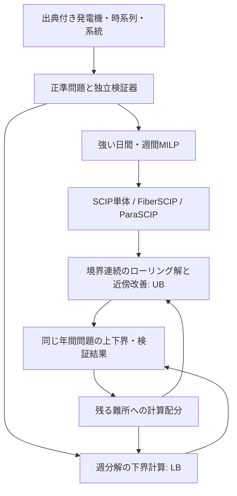

# 800台UCを日間から年間まで解くための公開ソルバー研究計画

作成: 2026-10-23。状態（10-25 更新）: **研究・開発中。全体設計は §0。10-24 時点では SCIP/HiGHS の上下界の取得、独立検証器、限界ベンチ、ローリング解を初期解にする比較までを実装。800台は合成ケースでの実測のみ**（[実装・実測メモ](IMPLEMENTATION_STATUS.md)）。
公開ブランチ: `research/uc800-uc-solver`（10-25、作業ブランチの差分を main に載せ直したもの）。

**提案する中心課題は、800台の個別起動停止を保った年間計画について、実行可能な解と、その解が最適値からどれだけ離れうるかを同時に返す公開ソルバーを作ること。** 日間・週間の強いUCモデルをSCIPで確立し、UG / FiberSCIP / ParaSCIPによる並列化と、年間の上界・下界を作る分解法を段階的に組み合わせる。

## 0. 全体設計（10-25 改訂、オーナー指示「見通し悪いか全体設計し直して」）

研究を 3 つの問いにまとめ直す。下の「1.」以降は 10-23 の当初計画で、残しておく。

| 部 | 問い | いまの答え | 次 |
|---|---|---|---|
| **解く** | 800 台の起動停止を、最適値からどれだけ離れているか言える形で解けるか | **UC 専用ソルバー**（台ごとの DP を価格でつなぐ列生成＋浮いた台だけの MILP）で、800 台×48h を幅 0.021%・93 秒。汎用の HiGHS は 900 秒で 0.57%（[§7](IMPLEMENTATION_STATUS.md)） | 難しさの地図（15 通り）、1 週間、年間（日ごとの価格の受け渡し）、DP の並列化（GPU） |
| **広げる** | 日本の実データの 1 年と実在の送電網で回せるか | 2025 年度 365 日を OCCTO の需要で解き、154kV 以上の実在線 4,023 本に流した（3 台で分散、§6.15〜6.16）。混雑の候補と 1 MW の価値、網のデータを疑う線 708 本 | 疑う線の一次資料での確認（[判断レポート](../../reports/scuc_data_suspects_2026-10-25.md)）、UC 専用ソルバーを実データへ |
| **守る** | 線の上限を守る運転計画を、全国の UC のまま解けるか | 遅延制約で 1 日を試行（§6.17）。27 本 → 2 本、1 日 +4,618 万〜5,872 万円。網のデータを直すことが前提 | 1 年分、N-1（LODF）、UC 専用ソルバーの価格に線を足す |

ページ（窓）は同じ 3 部の順に並べる：冒頭に 3 つの成果、第 1 部 解く、第 2 部 広げる、第 3 部 守る、次にやること、研究の記録（これまでの経緯と失敗）。

## 1. 成果を三段階に定義する

| 成果 | 「解けた」の意味 | 最初の到達目標案 |
|---|---|---|
| 日間・週間UC | 指定した単一MILPの実行可能解、同じ目的関数の上下界、停止理由を返す | 800台・24/48hはgap 0.1%以下、168hは0.5%以下 |
| 年間運用計算 | 全期間の状態が連続し、年間制約を満たすスケジュールを返す | 全時刻・全境界の独立検証に合格。gap未取得なら「不明」と表示 |
| 年間最適化 | 同じ年間問題に対する上界UBと有効な下界LBを返す | まず有限のLB、次に年間gap 1%以下を研究目標とする |

これらの閾値は研究上の仮目標であり、達成見込みの測定値ではない。最適性の範囲はまず決定論的・時間刻み1h・ゾーン連系線モデルとする。DC制約、N-1、不確実性は個別の拡張として評価する。AC潮流検証の合格から、AC-UCの大域最適性までは主張しない。

年間の将来情報を全て知る**完全予見の計画問題**と、毎日の予報しか使わない**運用シミュレーション**は別実験にする。後者には予報発行時刻・実績・非予見性の契約が必要である。

## 2. 800台×8760hの何が難しいか

800台を全て起動停止対象とした、presolve前の単純な変数数を示す。

| 時間長 | 稼働状態u: NT | u・起動v・停止w: 3NT | 加えて3起動種別を全台に置く場合: 6NT |
|---|---:|---:|---:|
| 24h | 19,200 | 57,600 | 115,200 |
| 48h | 38,400 | 115,200 | 230,400 |
| 168h | 134,400 | 403,200 | 806,400 |
| 720h | 576,000 | 1,728,000 | 3,456,000 |
| 8760h | 7,008,000 | 21,024,000 | 42,048,000 |

これは定式化依存の概算で、整数変数数の下限ではない。年間にはさらに出力pだけで約701万連続変数、予備力・蓄電・系統変数が加わる。年間一括モデルは比較対象・規模測定として残すが、初手の唯一の実装にはしない。

800台という数だけで難問性は決まらない。容量余裕、最低出力、ランプ、停止履歴、似た発電機の対称性、貯水、混雑、定式化の強さ、root LPのメモリが難しさを左右する。大きな木を分担する前にrootで時間・メモリを使い切る場合、探索並列化だけでは解決しない。台数を増やす実験と、同じ800台で難しさを変える実験を分ける。

## 3. 既存資産を出発点にする

本リポジトリにはPuLPのUC、HiGHS/CBC、48h窓・24h前進のローリング計算、揚水・蓄電、地域間連系線、年間集計がある。一方、[コード監査](BASELINE_AUDIT.md)で、SCIPバックエンド、実際のdual bound取得、窓境界の出力ランプ、起動種別の前史、年間の厳密な目的関数再計算に着手点を確認した。

また、保存済みの24hケースは531個のGeneratorレコードであり、個別火力800ユニットの実証ではない。発電所集約と発電機ユニットの対応表を作ること自体が最初の成果になる。既存年次レポートの `Optimal` を年間最適性の証拠として流用しない。

## 4. 推奨アーキテクチャ

**層A: 問題と証拠。** 入力JSON等の正準形式、MPS/CIP、変数対応、独立検証器、目的関数ID、解・上下界の時系列を揃える。Pythonはデータ処理と実験管理を担い、SCIP固有の拡張はPySCIPOptで試作し、必要な部分をC/C++プラグインにする。

**層B: 日間・週間の計算エンジン。** HiGHSと素のSCIPを同じMPSで比較してから、UC定式化、初期解、近傍探索を一要因ずつ追加する。SCIPはプラグインを追加できる最適化基盤である。[公式の拡張手順](https://www.scipopt.org/scip/doc/html/HEUR.php)

**層C: 並列化。** 共有メモリではFiberSCIP、分散メモリではParaSCIPを比較候補とする。UGが探索の並列化基盤であり、時間分解や年間状態連続性を自動的に実装するものではない。[UG公式](https://ug.zib.de/)

**層D: 年間の調整。** 48〜168h先読みで実行可能解を作り、週分解で下界を上げ、必要な週・境界を再最適化する。最初は外側のジョブ管理とUGを分離し、効果が測れた後にUGのタスク管理へ統合するかを検討する。

PythonのコールバックがそのままMPIワーカーへ移るとは仮定しない。独自プラグインの登録・複製・通信、変数写像、部分問題ごとの制約の有効範囲を単体試験し、各ワーカーで同じ問題を再現できてから大規模化する。

## 5. 研究として育てる発想

以下は**検証すべき仮説**であり、既存研究との差分・新規性を確定した主張ではない。基盤整備と並行して最初に試すのはA、次にBとする。

| 案 | 着眼点と実装 | 比較・採否 |
|---|---|---|
| A. 苦しい時間帯をまたぐ近傍探索 | 夕方ランプ、低再エネの連続日、連系線混雑、停止復帰を検出し、その前後の発電機群・蓄電をまとめて再最適化する。夜0時で切らない | 同じcore-hourのランダム近傍・固定日窓と比較。UB改善と実行可能解到達時間を測る |
| B. 境界の価値を学ぶ年間調整 | 週境界SOC・貯水・稼働履歴の影響を下界計算の乗数から読み、先読み長と境界近傍を選ぶ | 固定48/72/168h、固定終端SOCと比較。乗数を価格の真値とみなさず、年間gapで評価 |
| C. 上界と下界に計算資源を配る | UB改善が停滞したら下界の弱い週へ、LB改善が停滞したら境界修復へ資源を回す。探索木並列と独立部分問題並列を選ぶ | 固定配分・純ParaSCIP・独立ポートフォリオと同一予算で比較。公平な探索を維持し、厳密な証明の枝を捨てない |
| D. 発電機の運転パターンを列として共有 | 単機の実行可能な週間運転軌道を列とし、需給・連系線・年間資源をmasterで結ぶ | Lagrangian下界が弱いときの第2候補。列生成・pricingのコストと下界改善を測る。全列LPの下界保証にはpricingの証明が必要 |
| E. 必要な箇所だけ詳細化 | 類似機群・粗い時間解像度を初期解や指針に使い、混雑・ランプ・停止境界で個別化する | 800台・1hの元モデルで復元・検証する。集約モデルの値を下界と呼ぶには緩和関係の証明が必要 |

定式化の強化は既存のUC研究を再利用する。Morales-Españaらのtight/compactモデル、Knuevenらの部品ごとの比較を基準にし、「小さいモデルほど速い」とも「LPが強ければ必ず速い」とも決めつけずに測る。[定式化の比較研究](https://pubsonline.informs.org/doi/10.1287/ijoc.2019.0944)

## 6. 年間の上下界をどう作るか

最初に採用する候補は、**全制約で検証するローリング＋境界修復のUB**と、**時間境界・年間資源制約を緩和した週部分問題のLB**。詳細な数式と成立条件は[モデル契約](MODEL_AND_CERTIFICATES.md)に置く。

貯水・燃料・CO2の年間制約を入れる場合は、先に連続緩和や粗い年間計画から週ごとの資源配分・終端状態の目安を作る。ローリングが年末に資源を使い切って行き詰まることを検出し、配分と窓を更新する。この目安は解生成の補助であり、粗いモデルの目的値を下界として採用するには元モデルとの緩和関係を別途確認する。

下界は最初から鋭くなくてもよい。最初の成功は「年間の有効なLBが一つ計算でき、検証済みUBと比較できる」こと。弱い境界を含むブロックを長くする、結合制約を追加する、乗数を更新する順に強める。

Lagrangian双対には整数問題由来のgapが残りうる。1%が閉じない場合は、長いブロック、定式化強化、GCG等でのDantzig–Wolfe分解、必要なら大域探索との結合を比較する。整数recourseに通常のLP Benders cutをそのまま適用しない。ADMMや学習による候補生成は有望でも、それだけで下界・最適性の証明にはしない。

## 7. 到達順序と開発成果

| 期間の目安 | 作業 | 次へ進む条件 |
|---|---|---|
| 第1〜2週 | 個別ユニット台帳、正準問題、境界状態、目的関数・status監査、独立検証器 | 小問題で上下界と最適値が一致。境界違反を意図的に入れた解を検出 |
| 第3〜4週 | SCIP導入、同一MPS比較、強い定式化、800台24/48/168h計測 | 実際のバックエンド・UB/LBを記録。root/探索/構築の難所を分類 |
| 第5〜6週 | FiberSCIP / ParaSCIP、イベント近傍、再起動・チェックポイント | 同じ品質に対する時間とcore-hourで改善、または効かない理由を特定 |
| 第7〜9週 | 境界を連続させた年間UB、週分解LB、長期資源制約 | 年間の全境界・全制約を検証。有限LBとgapを記録 |
| 第10〜12週 | 弱い境界の強化、未見季節・公開外部ケース、公開パッケージ | 目標gapの達否と計算資源を報告。未達でも上下界を保持 |

12週はデータ・計算資源が揃う場合の作業順序案。個別ユニット情報やHPC準備が不足する場合は工程を更新する。初期の研究モデルは決定論的ゾーンUC、定検は外生。内生的な定検計画・確率SCUC・全国詳細AC-UCまで一度に含めない。

成果物は (1) 出典と生成条件のある800台問題群、(2) モデルと独立検証器、(3) SCIP/UGで再現できる実験、(4) 再利用可能なプラグインまたは並列化改良、(5) 年間の解と品質報告。単なる計算速度表に終わらず、電力側にもソルバー側にも使える形にする。

## 文書の入口

- [現行実装・保存済み結果の監査](BASELINE_AUDIT.md)
- [モデル・境界・上下界の契約](MODEL_AND_CERTIFICATES.md)
- [実験手順と採否判断](EXPERIMENT_PLAN.md) / [機械可読な実験案](experiment_matrix.yaml)
- [一次資料と採用理由](REFERENCES.md)
- [監査対象・規模計算のスナップショット](planning_snapshot.json)
